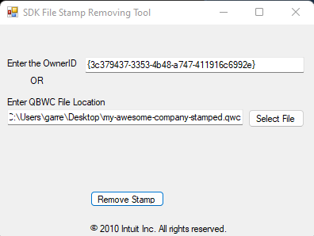
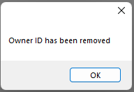

Each problem below says what the message means, why it happens, and what to do. If you're a customer of an
app that uses QuBe Sync, follow the steps and tell the app's support team what you saw if they don't work.
If you build on QuBe Sync, send your customers here.

## "Unique OwnerID/FileID pair value required" when adding the setup file

The Web Connector refuses the `.qwc` file with **QBWC1039**, and its log ends with
`Unique OwnerID/FileID pair value required`. Nothing was added or changed: if the app was already listed
in the Web Connector, that entry is still there and still works.

**What it means.** The first time a setup file is added with the company file open, QuickBooks writes the
file's `FileID` into the company file and keeps it. From then on the Web Connector refuses to add any setup
file for that connection to that company file, whatever the new file carries, until the stored `FileID` is
cleared. A connection's setup file goes in once.

**Why it happens.** The file is being added a second time: to fix an entry, after the entry disappeared,
or on a new computer with the same company file. Downloading the file again doesn't help by itself: every
download for the connection is refused until the stored `FileID` is cleared.

**What to do.**

<Steps>
  <Step title="If the app is still listed, use that entry">
    You don't need to add the file again. In the Web Connector, tick the app's row and click **Update
    Selected**. If its **Password** column is empty, paste the connection's password first (the app gives you
    it, or generates a new one) and choose **Yes** to save it.
  </Step>
  <Step title="Otherwise, clear the stored FileID with Intuit's CP3 tool">
    Intuit's own fix, from [Fix Web Connector error QBWC1039](https://quickbooks.intuit.com/learn-support/en-us/help-article/multi-user-mode/fix-error-qbwc1039/L2WqXx5LW_US_en_US),
    checked on QuickBooks Enterprise 24.0 with Web Connector 34.0:

    1. Open QuickBooks with the company file, signed in as the admin.
    2. Download the [CP3 tool](https://http-download.intuit.com/http.intuit/CP3Tool/QBWC_CP3Tool.exe) from
       Intuit and open it. It's a small program signed by Intuit, Inc., no installer; its window is called
       **SDK File Stamp Removing Tool**.
    3. Click **Select file** and pick the app's `.qwc` file (the one that was refused is fine), then click
       **Remove Stamp**. The tool fills in the Owner ID from the file.

       <Frame>
         
       </Frame>
    4. The tool asks you to back up the company file first. Do that in QuickBooks (**File → Back Up
       Company → Create Local Backup**), then click **OK**.
    5. If QuickBooks shows an **Application Certificate** window, choose **Yes**, then **Continue**, and
       **Done** on **Access Confirmation**. (On our test it asked nothing.)
    6. The tool says **Owner ID has been removed**. Click **OK**.

       <Frame>
         
       </Frame>
    7. Exit the Web Connector (answer **Yes** to its Auto-Run warning) and QuickBooks, then open both again on
       the same company file. The app's old row is still listed; that's expected.
  </Step>
  <Step title="Add the setup file again">
    In the Web Connector, **File → Add an Application** with the app's `.qwc` file, QuickBooks open on the
    company file, and **OK** on **Authorize New Web Service**. The new file replaces the app's old row
    under the same name, keeps the password saved in it and turns **Auto-Run** on. If the **Password** column
    is empty, paste the connection's password and choose **Yes** to save it. Tick the row and click **Update
    Selected**: the status should read "No data exchange required" or "Update postponed by application".
  </Step>
</Steps>

<Note>
  Removing an entry with a different company file open fails with QBWC1088 ("Company File do not match").
  Open the company file the app was set up with first. Removing the entry that way, with its company file
  open, also clears the stored `FileID`, so a fresh setup file can be added afterwards without the CP3 tool.
</Note>

[Web Connector logs](/qwc-logs) says where the log is and how to turn on the detail that names the error.
