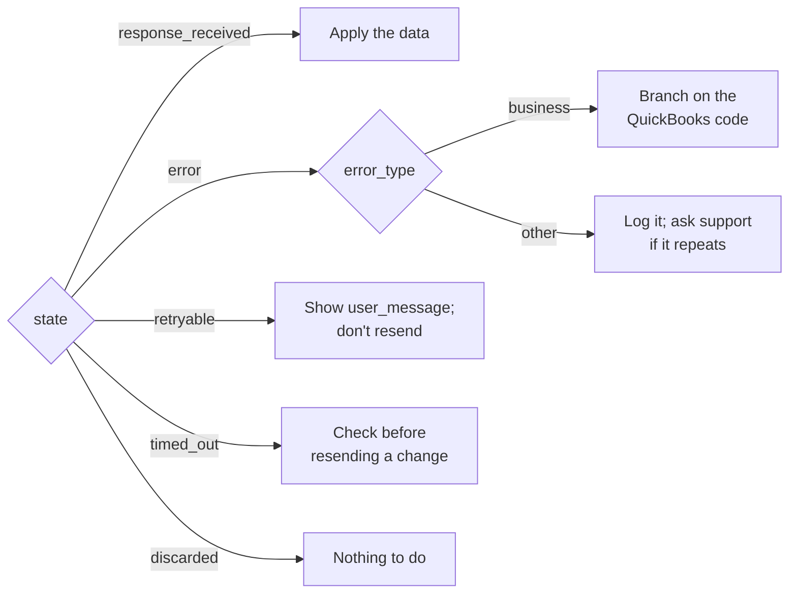
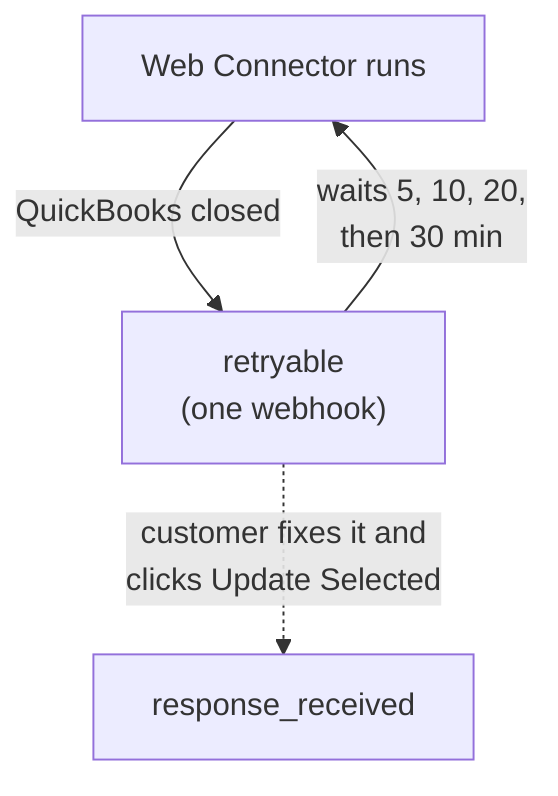

A QuickBooks Desktop integration fails in more places than most APIs: QuickBooks' own rules, a PC that's
switched off, a dialog left open, a Web Connector that stopped running. QuBe Sync sorts every failure into
a small set of states, each with a clear next step, and gives you a message you can show your customer.



## The error object

When `state` is `error` or `retryable`, the webhook's `error` says what happened. Here QuickBooks refused a
new customer because the name is taken:

```json
{
  "state": "error",
  "error": {
    "error_type": "quickbooks_business_error",
    "error_code": 3100,
    "message": "The name \"Riverbend Electric\" of the list element is already in use.",
    "user_message": "QuickBooks already has a record with this name. Choose a different name, or update the existing record instead of creating a new one.",
    "debug_message": "value \"Riverbend Electric\" was supplied via CustomerAddRq > CustomerAdd > Name",
    "hresult": null
  },
  "response_json": {
    "status": "error",
    "error": { "code": 3100, "type": "name_in_use", "message": "The name \"Riverbend Electric\" of the list element is already in use." }
  }
}
```

| Field | What it's for |
| --- | --- |
| `error_type` | Where it failed: `quickbooks_business_error`, `quickbooks_connection_error`, `xml_error` or `unexpected_error`. |
| `error_code` | QuickBooks' status code, for a business error. The stable thing to branch on. |
| `user_message` | Plain language for your end user: what went wrong and what to do. |
| `message` | The raw message from QuickBooks or the Web Connector. |
| `debug_message` | For you. It names the field that caused it, when QuickBooks says. |
| `hresult` | The Web Connector's error code, for a connection or XML error. |

## QuickBooks said no

A **business error** means the connection worked and the request was well-formed, but QuickBooks refused
it on its own terms. `state` is `error`, `error.error_type` is `quickbooks_business_error`, and
`response_json.error` carries QuickBooks' code with a stable name:

| Code | `type` | Meaning | Usual fix |
| --- | --- | --- | --- |
| 3100 | `name_in_use` | The name is already used by a customer, vendor, employee or other name. | Use the existing record, or pick another name. [`create_customer_safely`](/workflows#templates) asks your app which. |
| 3120 | `object_not_found` | No record has that `list_id` or `txn_id`. | Re-sync the record; it may have been deleted in QuickBooks. |
| 3140 | `invalid_reference` | A reference (a `customer_ref`, `item_ref`...) names a record the company file doesn't have. | Create the referenced record first, or look it up by name. |
| 3170 | `cannot_modify` | QuickBooks refused to save a change to an existing record. | Read `message` for why, such as a closed accounting period. |
| 3175 | `in_use` | The record is in use, so it can't be changed right now. | Try again later; someone may be editing it in QuickBooks. |
| 3180 | `cannot_save` | QuickBooks refused to save a new record. | The text after "QuickBooks error message:" says why. |
| 3200 | `stale_edit_sequence` | The record changed in QuickBooks after you read it. | Query it again and retry with the fresh `edit_sequence`. |
| 3210 | `invalid_value` | A field's value isn't one QuickBooks accepts. | `message` names the field and value. |
| 3250 | `feature_not_enabled` | The feature is off in this company file, or this edition lacks it. | Ask the customer to turn it on, or skip the feature. |
| 3260 | `insufficient_permission` | QuickBooks didn't grant permission for this action. | The customer changes your app's access in QuickBooks' Integrated Applications preferences. |

Branch on the **code**, not the message text. Intuit's
[status code reference](https://developer.intuit.com/app/developer/qbdesktop/docs/develop/exploring-the-quickbooks-desktop-sdk/status-codes-in-response-messages)
lists every one. Each operation in the [API reference](/api-reference/introduction) and each
[MCP tool](/mcp-server) names the codes that operation can raise.

<Tip>
  Test these before your customers do. The [simulator](/simulator) can answer the next request with any of
  them: `{"faults": {"next_status": {"code": 3200}}}`.
</Tip>

A query that matches nothing is **not** an error. It's `response_received` with an empty `data` list, and
QuickBooks' message alongside.

## When QuickBooks is out of reach

A `retryable` webhook means the Web Connector ran on your customer's computer but couldn't get the request
into QuickBooks. QuickBooks wasn't running, no company file (or the wrong one) was open, or a dialog was
open. Nothing was applied, and only your customer can fix it:

```json
{
  "state": "retryable",
  "error": {
    "error_type": "quickbooks_connection_error",
    "hresult": "0x80040408",
    "message": "QBWC1039: The Web Connector could not start QuickBooks. Make sure QuickBooks is installed and running on this computer.",
    "user_message": "QuickBooks is either not running or not installed on the same computer as the Web Connector. Please ensure QuickBooks is installed and running.",
    "error_code": null,
    "debug_message": null
  },
  "response_json": null
}
```

**Show your customer `error.user_message`, and don't resend the request.** QuBe Sync keeps it and tries
again on the Web Connector's next runs, for as long as it takes. You get a `retryable` webhook when the error
first appears and another only if it changes. After that, the next webhook is the answer.



While QuickBooks stays out of reach, QuBe Sync spaces out the Web Connector's automatic runs: each wait is
double the last, up to 30 minutes apart, and the Web Connector shows "Update postponed by application". Your
customer doesn't have to wait once they've fixed the problem. Clicking **Update Selected** tries right
away. If that first click also says "Update postponed by application", they click it again.

Requests on a connection go to QuickBooks in the order they were queued, so everything queued after a
`retryable` request waits behind it.

### Discarding a request

If you no longer want a request, for example because your customer cancelled the order, discard it:

```bash
curl -u "$QUBE_API_KEY:" -X POST \
  "https://qubesync.com/api/v2/connections/$CONN_ID/queued_requests/$REQUEST_ID/discard"
```

It becomes `discarded`, is never sent, and a `discarded` webhook follows. Only a request the Web Connector
hasn't picked up yet (`waiting`, or `retryable` between tries) can be discarded. One it already has goes
ahead (`409`, `in_flight`), and one that has finished stays as it is (`409`, `already_finished`).

If a connection's requests wait a week without reaching QuickBooks, QuBe Sync emails your organization's
owners.

## Other endings

- **`timed_out`**: QuickBooks received the request, but the Web Connector session ended before it answered.
  QuickBooks may or may not have applied it. A query is safe to queue again. For a create or update,
  query first to see whether it happened.
- **`discarded`**: your app [discarded it](#discarding-a-request). QuickBooks never saw it.
- **`error` with `xml_error`**: QuickBooks couldn't parse the request. Requests built through the API are
  validated against QuickBooks' schema first, so this is rare, but it can happen with characters QuickBooks
  can't handle. Sent again as-is, it fails again.
- **`error` with `unexpected_error`**: QuickBooks failed without saying why. The Web Connector's log
  (**View Log** in the Web Connector) usually has more; turn on [verbose logging](/qwc-logs) if it doesn't.
  [support@qubesync.com](mailto:support@qubesync.com) can help.

## Problems on your customer's PC

Some problems stop the Web Connector before it ever reaches QuBe Sync: a wrong password, a log file it
can't write, a damaged `.qwc` file. Those never arrive as an error. The Web Connector just stops checking
in, and requests wait in `waiting`.

If a connection's requests stop being answered, compare its `last_connected_at` with the current time, then
ask your customer to open the Web Connector and read the status next to your app. It shows these problems as
`QBWC` codes (QBWC1039, QBWC1085...). Intuit keeps the fixes in
[Fix common Web Connector errors in QuickBooks Desktop](https://quickbooks.intuit.com/learn-support/en-us/help-article/open-programs/fix-common-web-connector-errors-quickbooks-desktop/L9slolvg0_US_en_US).
For anything that page doesn't cover, [verbose logs](/qwc-logs) show what the Web Connector was doing.
