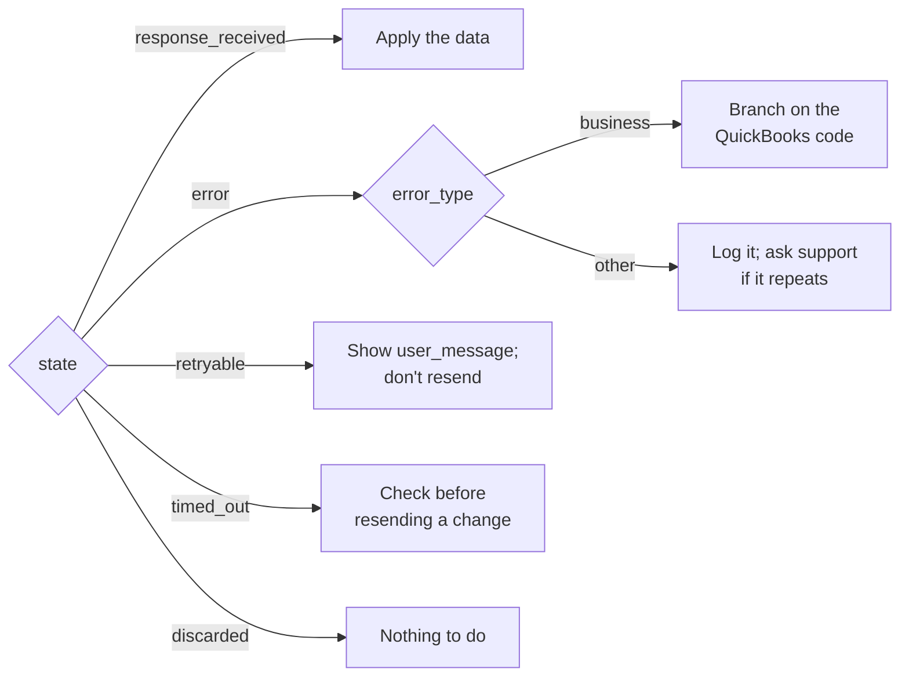
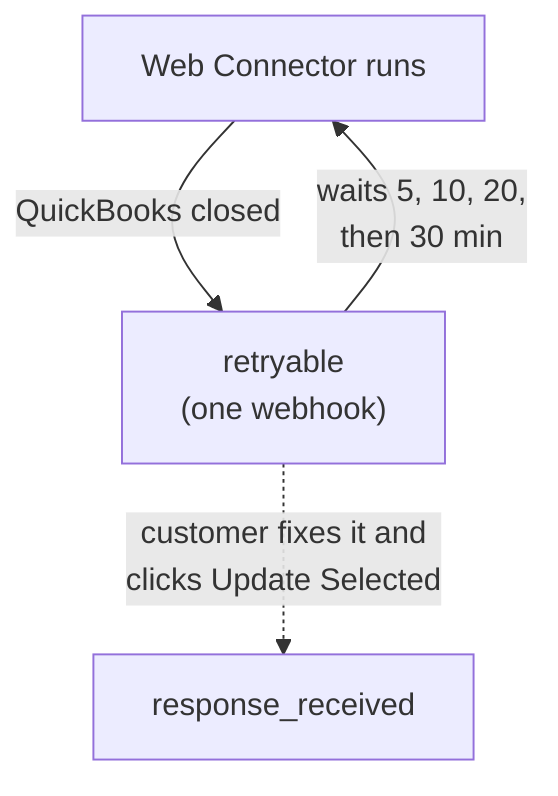

A QuickBooks Desktop integration fails in more places than most APIs: QuickBooks' own rules, a PC that's
switched off, a dialog left open, a Web Connector that stopped running. QuBe Sync sorts every failure into
a small set of states, each with a clear next step, and gives you a message you can show your customer.



## When QuBe Sync refuses a request

Before anything reaches QuickBooks, QuBe Sync can refuse the request itself: a wrong API key, a
connection that isn't yours, a parameter the operation doesn't take, a record that fails validation.
Those answers are `4xx` with one key, `errors`, whose shape says what went wrong:

| `errors` is | When | Example |
| --- | --- | --- |
| A sentence | The endpoint explains a refusal in words: `400` for a parameter the operation doesn't take, `409` when a key is taken or a run has already ended, `422` when a production connection is asked for a working copy or a workflow that sends your app data is started without a `webhook_url` (`webhook_url_required`). | `{"errors": "unknown parameter: \"emial\""}` |
| `{"detail": "..."}`, with a `code` when there is one | `403` for something the key may not do, `404` for a thing that doesn't exist or isn't yours, and a CLI session's `401`. | `{"errors": {"detail": "Not Found"}}` |
| An object of fields, each a list of messages | `422` for a record that fails validation, such as a connection with a `redirect_url` that carries a query string, or a request or workflow run whose `webhook_url` QuBe Sync [can't send to](/webhooks#where-webhooks-can-go). Nothing was saved. | `{"errors": {"redirect_url": ["must not have a query string"]}}` |
| A list of `{"path", "message"}` | A workflow run's input, or a chart, with the path of each problem. | `{"errors": [{"path": "input.customer", "message": "is required"}]}` |

Starting a [workflow](/workflows) that sends your app data (a `notify` state, its own or in a workflow it
calls) without a `webhook_url` is refused before the run exists: `422`, with a sentence that starts
`webhook_url_required:` and names what it would send, such as
`{"errors": "webhook_url_required: this workflow sends data to your app (customers_page at send_customers), so a run of it needs a webhook_url to send it to"}`.
Start it again with a `webhook_url` ([Sending your app data](/workflows#sending-your-app-data)).

A `webhook_url` QuBe Sync can't send to is refused the same way on every endpoint that takes one:
`422`, field by field, one message per problem, and nothing is queued or started. It has to be an
absolute `http` or `https` URL with no username or password, and it can't point at `localhost` or a
private address ([Where webhooks can go](/webhooks#where-webhooks-can-go)):

```json
{"errors": {"webhook_url": ["may not point at a private or local address"]}}
```

The other messages are `must be an http or https URL`, `must include a host name`,
`may not contain a username or password`, `must have a port between 1 and 65535` and
`must be at most 2048 characters`.

One exception: a request without a usable API key gets a `401` Basic challenge with the plain-text body
`Unauthorized`, not JSON. Branch on the status code first, then read `errors` for the message to log or
show. The [API reference](/api-reference/introduction) documents the shape as `Error` on every refused
response.

## The error object

When `state` is `error` or `retryable`, the webhook's `error` says what happened. Here QuickBooks refused a
new customer because the name is taken:

```json
{
  "state": "error",
  "error": {
    "error_type": "quickbooks_business_error",
    "error_code": 3100,
    "message": "The name \"Riverbend Electric\" of the list element is already in use.",
    "user_message": "QuickBooks already has a record with this name. Choose a different name, or update the existing record instead of creating a new one.",
    "debug_message": "value \"Riverbend Electric\" was supplied via CustomerAddRq > CustomerAdd > Name",
    "hresult": null
  },
  "response_json": {
    "status": "error",
    "error": { "code": 3100, "type": "name_in_use", "message": "The name \"Riverbend Electric\" of the list element is already in use." }
  }
}
```

| Field | What it's for |
| --- | --- |
| `error_type` | Where it failed: `quickbooks_business_error`, `quickbooks_connection_error`, `xml_error` or `unexpected_error`. |
| `error_code` | QuickBooks' status code, for a business error. The stable thing to branch on. |
| `user_message` | Plain language for your end user: what went wrong and what to do. |
| `message` | The raw message from QuickBooks or the Web Connector. |
| `debug_message` | For you. It names the field that caused it, when QuickBooks says. |
| `hresult` | The Web Connector's error code, for a connection or XML error. |

## QuickBooks said no

A **business error** means the connection worked and the request was well-formed, but QuickBooks refused
it on its own terms. `state` is `error`, `error.error_type` is `quickbooks_business_error`, and
`response_json.error` carries QuickBooks' code with a stable name:

| Code | `type` | Meaning | Usual fix |
| --- | --- | --- | --- |
| 3100 | `name_in_use` | The name is already used by a customer, vendor, employee or other name. | Use the existing record, or pick another name. [`create_customer_safely`](/workflows#templates) asks your app which. |
| 3120 | `object_not_found` | No record has that `list_id` or `txn_id`. | Re-sync the record; it may have been deleted in QuickBooks. |
| 3140 | `invalid_reference` | A reference (a `customer_ref`, `item_ref`...) names a record the company file doesn't have. | Create the referenced record first, or look it up by name. |
| 3170 | `cannot_modify` | QuickBooks refused to save a change to an existing record. | Read `message` for why, such as a closed accounting period. |
| 3175 | `in_use` | The record is in use, so it can't be changed right now. | Try again later; someone may be editing it in QuickBooks. |
| 3180 | `cannot_save` | QuickBooks refused to save a new record. | The text after "QuickBooks error message:" says why. |
| 3200 | `stale_edit_sequence` | The record changed in QuickBooks after you read it. | Query it again and retry with the fresh `edit_sequence`. In a [workflow](/workflows#conflicts), the run re-reads it and, if the changes overlap, asks your app with the diff, unless the state's `on_conflict` says otherwise. |
| 3210 | `invalid_value` | A field's value isn't one QuickBooks accepts. | `message` names the field and value. |
| 3250 | `feature_not_enabled` | The feature is off in this company file, or this edition lacks it. | Ask the customer to turn it on, or skip the feature. |
| 3260 | `insufficient_permission` | QuickBooks didn't grant permission for this action. | The customer changes your app's access in QuickBooks' Integrated Applications preferences. |

Branch on the **code**, not the message text. Intuit's
[status code reference](https://developer.intuit.com/app/developer/qbdesktop/docs/develop/exploring-the-quickbooks-desktop-sdk/status-codes-in-response-messages)
lists every one. Each operation in the [API reference](/api-reference/introduction) and each
[MCP tool](/mcp-server) names the codes that operation can raise.

Inside a [workflow](/workflows#lost-answers), a request state can also raise an `error` whose `type` is
`unsettled` or `no_response`, with `code` `null`. Those aren't QuickBooks codes: they're how a run reports
an answer that never came back and couldn't be settled. A `no_response` also carries `reason`, why the
answer never came (`timed_out`, `connector_error`, `rejected`, `withdrawn` or `page_expired`), and for a
creation request `external_guid`, the GUID it was sent with ([Lost answers](/workflows#lost-answers)). Only `timed_out`
and `connector_error` leave the record possibly applied.

<Tip>
  Test these before your customers do. The [simulator](/simulator) can answer the next request with any of
  them: `{"faults": {"next_status": {"code": 3200}}}`.
</Tip>

## QuickBooks said yes, with a warning

Sometimes QuickBooks does what you asked but has something to say about it, and answers with a `Warn`
severity instead of `Info`. That's still a success: `state` is `response_received`, `response_json.status` is
`success`, and `data` is what QuickBooks saved. `response_json.warning` has QuickBooks' code and message.

This is a real answer to `POST /journal-entries` with an entry-level `memo`. QuickBooks saved the entry
without the memo:

```json response_json (abridged)
{
  "status": "success",
  "data": {
    "txn_id": "1F-1790470623",
    "txn_date": "2026-10-02",
    "journal_debit_line": [
      { "txn_line_id": "20-1790470623", "account_ref": { "full_name": "Office Supplies" }, "amount": 30.0 }
    ],
    "journal_credit_line": [
      { "txn_line_id": "21-1790470623", "account_ref": { "full_name": "Checking" }, "amount": 30.0 }
    ]
  },
  "warning": {
    "code": 530,
    "message": "The field \"Memo\" is not supported by this implementation."
  }
}
```

| Code | Meaning | What to do |
| --- | --- | --- |
| 530 | A field you sent isn't supported by this QuickBooks, so the record was saved without it. `message` names the field. | Store the record's id as usual, and don't resend: the record already exists. Leave the field out next time, or keep its value somewhere QuickBooks does save it, such as a line's `memo`. |
| 500 | A lookup by an exact `full_name` or `list_id` found nothing, so `data` is empty. | Nothing went wrong: the record doesn't exist. |

`warning` is never set on a plain success or on an error. When every field you send matters, check for it
after a create or update, and branch on `code`, not the message text. In a [workflow](/workflows), a request
state's `response.warning` is the same, so a transition can test `response.warning.code`. The
[simulator](/simulator) answers a journal entry with an entry-level `memo` the same way, so you can try it in
a sandbox.

## When QuickBooks is out of reach

A `retryable` webhook means the Web Connector ran on your customer's computer but couldn't get the request
into QuickBooks. QuickBooks wasn't running, no company file (or the wrong one) was open, or a dialog was
open. Nothing was applied, and only your customer can fix it:

```json
{
  "state": "retryable",
  "error": {
    "error_type": "quickbooks_connection_error",
    "hresult": "0x80040408",
    "message": "QBWC1039: The Web Connector could not start QuickBooks. Make sure QuickBooks is installed and running on this computer.",
    "user_message": "QuickBooks is either not running or not installed on the same computer as the Web Connector. Please ensure QuickBooks is installed and running.",
    "error_code": null,
    "debug_message": null
  },
  "response_json": null
}
```

**Show your customer `error.user_message`, and don't resend the request.** QuBe Sync keeps it and tries
again on the Web Connector's next runs, for as long as it takes. You get a `retryable` webhook when the error
first appears and another only if it changes. After that, the next webhook is the answer. It has the same
`id` and `page_request_id` as the `retryable` one, and only `state` differs. If you drop duplicate
deliveries, key on `page_request_id` plus `state`, or the answer looks like a repeat and is lost.

The exception is a later page of an [iterated query](/pagination#if-the-session-ends-partway). QuickBooks
keeps an iteration only for the session that started it, so that page ends as `error` and the query has to
be queued again.



While QuickBooks stays out of reach, QuBe Sync spaces out the Web Connector's automatic runs: each wait is
double the last, up to 30 minutes apart, and the Web Connector shows "Update postponed by application". Your
customer doesn't have to wait once they've fixed the problem. Clicking **Update Selected** tries right
away. If that first click also says "Update postponed by application", they click it again.

Requests on a connection go to QuickBooks in the order they were queued, so everything queued after a
`retryable` request waits behind it.

### Discarding a request

If you no longer want a request, for example because your customer cancelled the order, discard it:

```bash
curl -u "$QUBE_API_KEY:" -X POST \
  "https://qubesync.com/api/v2/connections/$CONN_ID/queued-requests/$REQUEST_ID/discard"
```

It becomes `discarded`, is never sent, and a `discarded` webhook follows. Only a request the Web Connector
hasn't picked up yet (`waiting`, or `retryable` between tries) can be discarded. A request the Web Connector already has goes
ahead (`409`, `in_flight`), and a request that has finished stays as it is (`409`, `already_finished`).

Discarding a request a [workflow run](/workflows) sent moves the run on: the state that sent it raises
`error` with type `no_response` and `reason` `withdrawn`, "the request was withdrawn before it was sent".
Such a request can't be
deleted on its own: it goes when the run does.

If a connection's requests wait a week without reaching QuickBooks, QuBe Sync emails your organization's
owners.

## Other endings

- **`timed_out`**: QuickBooks received the request, but never responded. This might happen if the customer's QB computer crashes or loses connection while processing, and
  QuickBooks may or may not have applied it. A query is safe to queue again. For a create or update,
  query first to see whether it happened. A request a [workflow](/workflows#lost-answers) sent is the
  exception: the run automatically finds out whether it was applied and carries on, so there's usually nothing for your
  app to do. When it can't tell, the state raises `unsettled` or `no_response`, which fails the run unless
  the chart handles it.
- **`discarded`**: your app [discarded it](#discarding-a-request). QuickBooks never saw it.
- **`error` with `xml_error`**: QuickBooks couldn't parse the request. Requests built through the API are
  validated against QuickBooks' schema first, so this is rare, but it could happen if you're sending raw custom QBXML. Sent again as-is, it fails again. A workflow doesn't settle it: the state raises
  `no_response` with `reason` `rejected`.
- **`error` with `unexpected_error`**: QuickBooks failed without saying why. The Web Connector's log
  (**View Log** in the Web Connector) usually has more; turn on [verbose logging](/qwc-logs) if it doesn't.
  [support@qubesync.com](mailto:support@qubesync.com) can help.

## Problems on your customer's PC

Some problems stop the Web Connector before it ever reaches QuBe Sync: a wrong password, a log file it
can't write, a damaged `.qwc` file. Those never arrive as an error. The Web Connector just stops checking
in, and requests wait in `waiting`.

If a connection's requests stop being answered, compare its `last_connected_at` with the current time, then
ask your customer to open the Web Connector and read the status next to your app. It shows these problems as
`QBWC` codes (QBWC1039, QBWC1085...). Intuit keeps the fixes in
[Fix common Web Connector errors in QuickBooks Desktop](https://quickbooks.intuit.com/learn-support/en-us/help-article/open-programs/fix-common-web-connector-errors-quickbooks-desktop/L9slolvg0_US_en_US).
For anything that page doesn't cover, [verbose logs](/qwc-logs) show what the Web Connector was doing.
