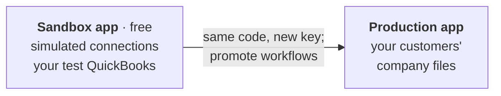

You've built against your sandbox app. Launching means pointing your production environment at your
**production app**, where your customers' connections live, and making sure your integration handles the
things real company files do.

Your code doesn't change between the two. The API key, the webhook secret and the connection ids do.

## Launch checklist

<Steps>
  <Step title="Configure production credentials">
    Copy the production app's API key and webhook secret into your production environment. Your sandbox
    key can't reach production connections, and the other way round, so a mix-up fails loudly rather than
    quietly.
  </Step>
  <Step title="Set up billing">
    In the dashboard, a production app without a subscription shows **Set up billing to enable**. Add a
    payment method before your first customer connects.
  </Step>
  <Step title="Promote your workflows">
    Production connections only run **published** workflow versions. Publish in your sandbox app, then
    [promote](/workflow-authoring#from-sandbox-to-production) to production, and fix any company-file
    values the promotion warns about. Promotion publishes the version in production too: **Publish there as
    well** is ticked in the **Promote to another app** window. Untick it to land the chart as that app's
    working copy for a final look, then publish it there when you're happy.
  </Step>
  <Step title="Harden your webhook endpoint">
    [Verify every signature](/webhooks#securing-your-endpoints), answer `2xx` within 5 seconds and do the work in
    a job, and process each `page_request_id` and `state` once. A <Badge color="orange">`retryable`</Badge> webhook is followed by the answer
    with the same `page_request_id`. Deliveries can repeat or arrive out of order.
  </Step>
  <Step title="Handle every state">
    Show your customer `error.user_message` for <Badge color="red">`error`</Badge> and <Badge color="orange">`retryable`</Badge>. Don't resend a <Badge color="orange">`retryable`</Badge>
    request. Decide what a <Badge color="purple">`timed_out`</Badge> create means for you. [Error handling](/error_handling) has the full
    list.
  </Step>
  <Step title="Finish your onboarding flow">
    Set a `redirect_url`, handle `connected`, `cancelled` and `expired`, and optionally show each customer their
    connection's `last_connected_at` so they can tell when their Web Connector has stopped.
    [Connect your customers](/onboarding).
  </Step>
  <Step title="Test against real QuickBooks">
    Run your whole flow against a [not-for-resale copy of QuickBooks](/nfr-quickbooks) on a real Web
    Connector, with a sample company file.
  </Step>
</Steps>

## How billing works

- **Sandbox apps and simulated connections are free**, however much you use them.
- **You pay per active production connection per month.** A connection is active when its Web Connector has
  checked in during the past week. A customer who disconnects stops counting.
- **Realtime connections** (Web Connector every 10 seconds) are billed at a higher rate than standard ones
  (every 5 minutes).
- There's no charge per request or per webhook.

See [pricing](https://qubesync.com/#pricing) for current rates. High volume or special requirements?
[Talk to us](https://qubesync.com/contact_us).

## Operating it

- **Watch connections, not just requests.** A connection whose `last_connected_at` is days old has a Web
  Connector that stopped, usually because the PC is off or QuickBooks moved. Its requests wait until it's
  back, and your organization's owners are emailed after a week.
- **Rotate secrets without downtime.** Webhook deliveries are signed with every active secret on the app,
  so you can [rotate](/webhooks#rotate-your-webhook-secret) by adding a new one before expiring the old.
  API keys work the same way: create the new key, deploy it, then expire the old one. Expiring a key takes
  effect immediately.
- **Use the dashboard to investigate.** Every request shows what was sent, what QuickBooks answered, and
  each webhook attempt, with a **Resend webhook** button. Every workflow run shows its path on the canvas.
- **Invite your team** from your organization's members page. Alerts go to owners, so make sure more than
  one person is an owner.
