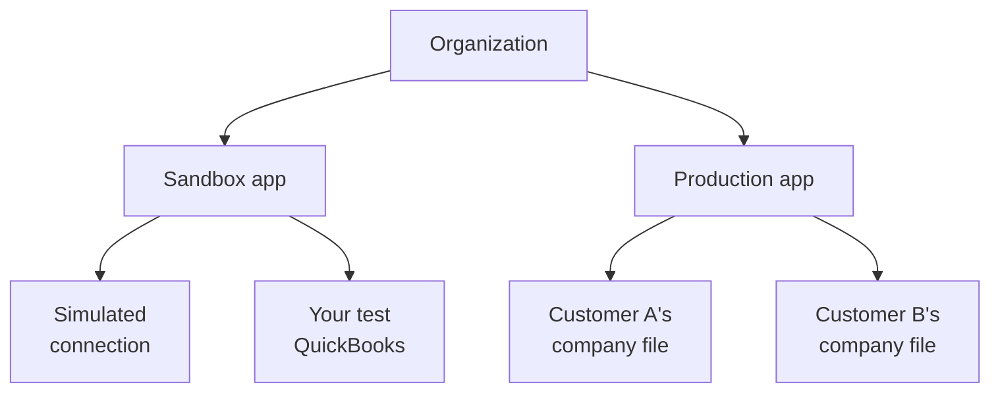
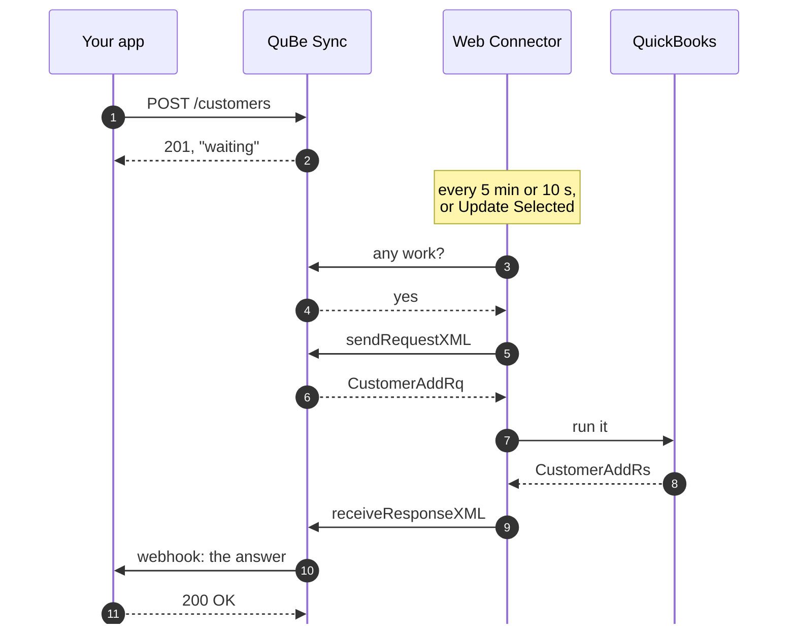
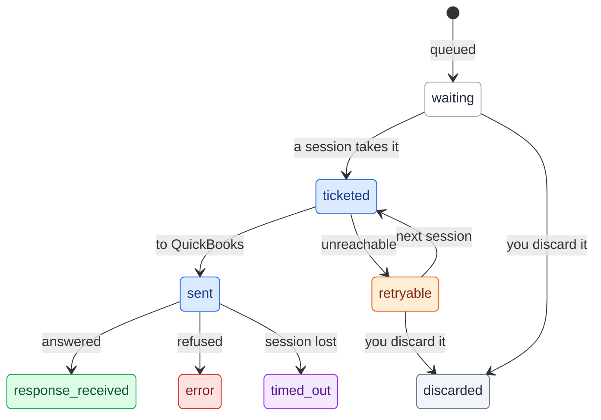

## The pieces

**Organization.** Your company's account, shared with your teammates. Its owners get the alerts: a webhook
that couldn't be delivered, a connection whose requests have waited a week.

**App.** Your product's identity in QuBe Sync, with its own API key, webhook secrets, connections and
workflows. A **sandbox** app is for building and testing. A **production** app holds your customers'
connections. You start with one of each, and nothing crosses between them: a sandbox key can't reach a
production connection.

**Connection.** One QuickBooks company file, usually one per customer. It carries the Web Connector's
credentials and knows when it last checked in (`last_connected_at`). It is `standard` (the Web Connector
checks in every 5 minutes), `realtime` (every 10 seconds) or `simulated` (a fake QuickBooks hosted by QuBe
Sync, for development).

**Queued request.** One QuickBooks operation, such as listing customers or adding an invoice, queued
against a connection. You queue it with JSON, and its answer is delivered to your `webhook_url`.

**Workflow run.** A multi-step job QuBe Sync runs for you: several requests, the logic between them, and
questions for your app when the chart calls for one. See [Workflows](/workflows).

## Why every request is asynchronous

QuickBooks Desktop runs on your customer's Windows machine, behind their firewall. Nothing on the internet
can call it. Intuit's **Web Connector**, installed alongside QuickBooks, calls out instead: on a schedule it
asks QuBe Sync whether there is work, runs it in QuickBooks, and hands back the answers.

So an API call to QuBe Sync can't return QuickBooks data. It returns a queued request, and the data follows
by webhook once the Web Connector has asked for work:

Design for that from the start:

- **Queue from anywhere, act on the webhook.** Do the follow-up work, such as storing the new customer's
  `list_id`, in your webhook handler.
- **One request at a time, in order.** A connection's requests go to QuickBooks in the order you queued
  them. If a request depends on the answer to another, for example an invoice for a customer you're
  creating, queue it from the first one's webhook, or better yet let a [workflow](/workflows) do the sequencing.
- **Built-in fault-tolerance.** We can't control whether QuickBooks is open on your customer's computer, or ready to process requests, but we *can* gracefully handle every situation. When QuickBooks throws a [connection error](/error_handling#when-quickbooks-is-out-of-reach), show users the `user_message` so they can solve problems themselves without contacting support. The request is automatically retried once the Web Connector resumes functioning.
- **Do you need realtime integration?** A standard connection polls every five minutes. When a person is waiting on results, use `realtime` connections.

## The life of a request

| State | Meaning | Webhook? |
| --- | --- | --- |
| `waiting` | Queued; the Web Connector hasn't picked it up yet. | |
| <Badge color="blue">`ticketed`</Badge> | A Web Connector session has taken it. | |
| <Badge color="blue">`sent`</Badge> | Handed to QuickBooks; waiting for its answer. | |
| <Badge color="orange">`retryable`</Badge> | The Web Connector couldn't reach QuickBooks (not running, a dialog open, the wrong company file). QuBe Sync tries again on the next runs. | Yes, when the error first appears or changes |
| <Badge color="green">`response_received`</Badge> | QuickBooks answered. Read `response_json.data`. | Yes |
| <Badge color="red">`error`</Badge> | Failed for good, for example QuickBooks refused it (a duplicate name, a stale `edit_sequence`). | Yes |
| <Badge color="purple">`timed_out`</Badge> | QuickBooks received it, but never responded. It may or may not have been applied. | Yes |
| <Badge color="gray">`discarded`</Badge> | Your app withdrew it before the Web Connector took it. It never reached QuickBooks. | Yes |

The last four are final. [Error handling](/error_handling) covers what to do with each.

## Speed and scheduling

- **Standard** connections are checked every 5 minutes, and **realtime** connections every 10 seconds.
  Choose with `type` when you create the connection.
- **Update Selected** in the Web Connector runs a sync immediately, whatever the schedule.
- **While QuickBooks is out of reach**, QuBe Sync spaces out the Web Connector's automatic runs (each wait
  double the last, up to 30 minutes) so it isn't retrying against a closed QuickBooks. A manual
  **Update Selected** is never held back.
- **Realtime connections in a sandbox app slow down while idle.** After 10 minutes without a request, they
  check in once a minute; after an hour, every 5 minutes. The session that picks up the next request brings
  them back to every 10 seconds. To run a request at once, click **Update Selected**.
- **The Web Connector shows "Update postponed by application"** whenever QuBe Sync has told it to wait.
  Nothing is wrong: it checks in again on its own.
- **A deleted connection's Web Connector** is told to check in only once a day until someone removes your
  app from it. See [When a customer leaves](/onboarding#when-a-customer-leaves).
- **Simulated** connections answer within a few seconds, with no Web Connector involved.

## Security

- **API keys belong to one app.** They reach that app's connections, requests and workflows, and nothing
  else. Keys start with `sk_`, and you can create and expire them in the dashboard.
- **Webhooks are signed** with your app's webhook secret (HMAC-SHA256 over a timestamp and the body), so
  you can reject anything that didn't come from QuBe Sync. [Verify signatures](/webhooks#securing-your-endpoints).
- **Sandbox and production are separate apps**, with separate keys, secrets and connections.
- **QuBe Sync never needs your customer's QuickBooks login.** The Web Connector authenticates to QuBe Sync
  with a per-connection username and password, and QuickBooks itself is only ever reached from their PC.
- **Retention:** a finished request and its answer are kept for 60 days, then deleted. Workflow runs age
  out on the same schedule. These can also be deleted immediately upon receipt by your app via the API.
