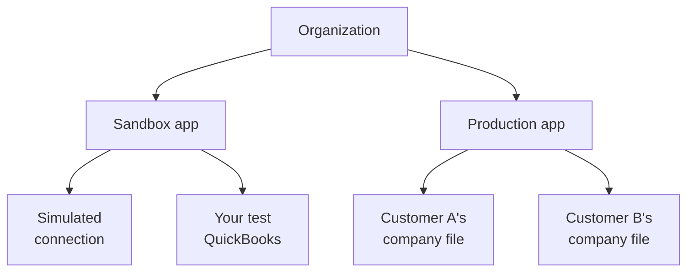
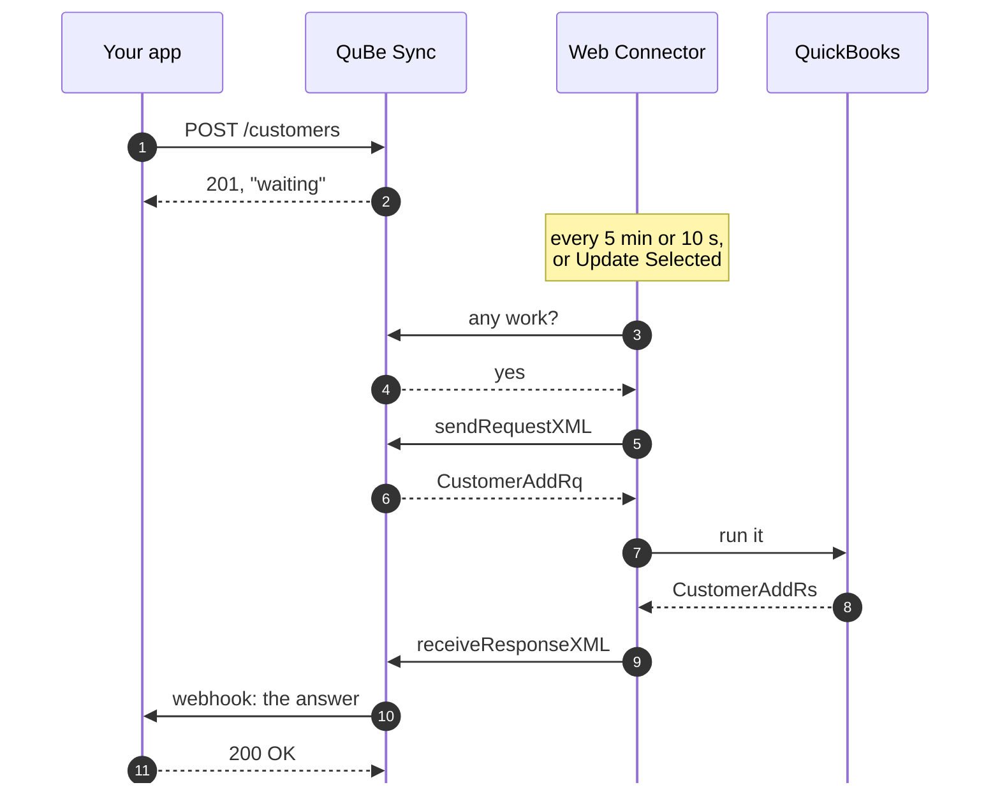
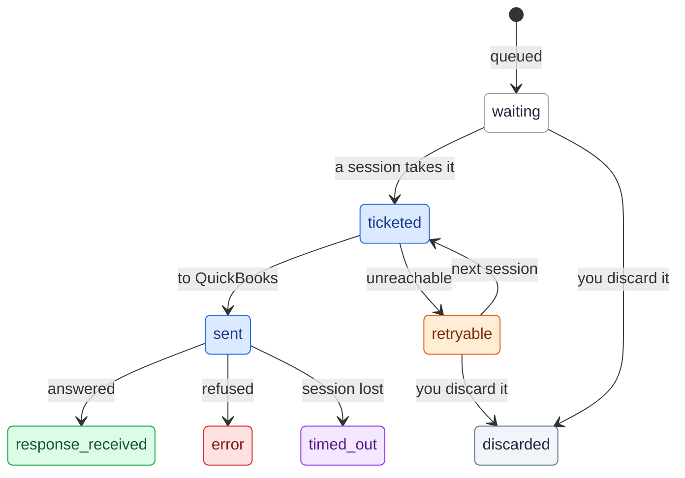

## The pieces

**Organization.** Your company's account, shared with your teammates. Its owners get the alerts: a webhook
that couldn't be delivered, a connection whose requests have waited a week.

**App.** Your product's identity in QuBe Sync, with its own API key, webhook secrets, connections and
workflows. A **sandbox** app is for building and testing. A **production** app holds your customers'
connections. You start with one of each, and nothing crosses between them: a sandbox key can't reach a
production connection.

**Connection.** One QuickBooks company file, usually one per customer. It carries the Web Connector's
credentials and knows when it last checked in (`last_connected_at`). It is `standard` (the Web Connector
checks in every 5 minutes), `realtime` (every 10 seconds) or `simulated` (a fake QuickBooks hosted by QuBe
Sync, for development). A realtime or simulated connection can also run [workflows](/workflows) and
[match names](/matching) against an index of its company file's lists, and its `name_index` says where that
index stands.

**Queued request.** One QuickBooks operation, such as listing customers or adding an invoice, queued
against a connection. You queue it with JSON, and its answer is delivered to your `webhook_url`.

**Workflow run.** A multi-step job QuBe Sync runs for you: several requests, the logic between them, and
questions for your app when the chart calls for one. See [Workflows](/workflows).

## Why every request is asynchronous

QuickBooks Desktop runs on your customer's Windows machine, behind their firewall. Nothing on the internet
can call it. Intuit's **Web Connector**, installed alongside QuickBooks, calls out instead: on a schedule it
asks QuBe Sync whether there is work, runs it in QuickBooks, and hands back the answers.

So an API call to QuBe Sync can't return QuickBooks data. It returns a queued request, and the data follows
by webhook once the Web Connector has asked for work:

  

    <Icon icon="bell" size={20} />
    

      **Queue from anywhere, act on the webhook**

      Do the follow-up work, like storing the new customer's `list_id`, in your webhook handler.
    

  

  

    <Icon icon="list-ol" size={20} />
    

      **One request at a time, in order**

      A connection's requests go to QuickBooks in the order you queued them, even when a Web Connector session
      ends part way: what was queued later waits. If one request depends on the
      answer to another, queue it from the first
      request's webhook. Better yet, let a [workflow](/workflows) do the sequencing.
    

  

  

    <Icon icon="shield-halved" size={20} />
    

      **Built-in fault-tolerance**

      We can't control whether QuickBooks is open on your customer's computer, or ready to process requests,
      but we *can* gracefully handle every situation. When QuickBooks throws a
      [connection error](/error_handling#when-quickbooks-is-out-of-reach), show users the `user_message` so
      they can solve problems themselves without contacting support. The request is automatically retried
      once the Web Connector resumes functioning.
    

  

  

    <Icon icon="bolt" size={20} />
    

      **Do you need realtime integration?**

      A standard connection polls every five minutes. When a person is waiting on results, use `realtime`
      connections that start processing requests within 10 seconds. Workflows run only on realtime
      connections.
    

  

## The life of a request

| State | Meaning | Webhook? |
| --- | --- | --- |
| `waiting` | Queued; the Web Connector hasn't picked it up yet. | |
| <Badge color="blue">`ticketed`</Badge> | A Web Connector session has taken it. | |
| <Badge color="blue">`sent`</Badge> | Handed to QuickBooks; waiting for its answer. | |
| <Badge color="orange">`retryable`</Badge> | The Web Connector couldn't reach QuickBooks (closed, and the app not allowed to start it; a dialog open; the wrong or a missing company file). QuBe Sync tries again on the next runs, with no limit, until QuickBooks can be reached or your app discards it. | Yes, when the error first appears or changes |
| <Badge color="green">`response_received`</Badge> | QuickBooks answered. Read `response_json.data`. | Yes |
| <Badge color="red">`error`</Badge> | Over, and not tried again, for example QuickBooks refused it (a duplicate name, a stale `edit_sequence`). With `error.error_type` `outcome_unknown`, a create or update may still have been saved. | Yes |
| <Badge color="purple">`timed_out`</Badge> | QuickBooks received it, but never responded. It may or may not have been applied. Its `error.error_type` is `timed_out`. | Yes |
| <Badge color="gray">`discarded`</Badge> | Your app withdrew it before the Web Connector took it. It never reached QuickBooks. Its `error.error_type` is `discarded`, or the connection error it was waiting on if it was `retryable`. | Yes |

The last four are final. [Error handling](/error_handling) covers what to do with each.

## Speed and scheduling

| Connection | Picks up requests |
| --- | --- |
| `standard` | Every 5 minutes |
| `realtime` | Every 10 seconds |
| `simulated` | Answers within a few seconds, with no Web Connector involved |
| Any, while QuickBooks is out of reach | Automatic runs spaced out, each wait double the last, up to 30 minutes, so it isn't retrying against a closed QuickBooks. A manual **Update Selected** is never held back. |

Choose `standard` or `realtime` with `type` when you create the connection. **Update Selected** in the Web
Connector runs a sync immediately, whatever the schedule.

<Note>
  **"Update postponed by application" is normal.** Every connection's Web Connector is set to run every 10
  seconds, and QuBe Sync tells it to wait when it isn't due. That's how a standard connection picks up
  requests every 5 minutes, and why its **Last Result** often reads "Update postponed by application". It
  checks in again on its own. The schedule column (**Every Min**) is blank for a QuBe Sync entry, which is
  expected. Leave **Auto-Run** ticked and don't edit the schedule in the Web Connector: QuBe Sync controls it.
</Note>

You can switch a connection between standard and realtime from its page in the dashboard:

| Change | What happens |
| --- | --- |
| Upgrade to realtime | Billed as realtime from then on. [Workflows](/workflows) and [name matching](/matching) are available at once. |
| Downgrade to standard | Scheduled for the end of the billing period, and billed as realtime until then. Then new workflow runs are refused (runs already going finish, at the standard pace), matching stops, and the connection's name index is deleted. |
| **Slow polling to every 5 minutes** | Slows a realtime connection right away, without changing its bill. Workflows and matching keep working, though their steps wait for the slower check-ins. |

To see when a connection will next pick up requests, read it on the connection
(`GET /connections/{connection_id}` in v2), or the **Speed** card on its dashboard page:

<ResponseField name="next_check_in_expected_at" type="string | null">
  When the connection will next pick up requests. A time more than a minute in the past means the check-in
  is late: a long session is still running, or the Web Connector isn't running on the QuickBooks computer.
</ResponseField>

<ResponseField name="backing_off" type="boolean">
  `true` while QuBe Sync is spacing the tries out because QuickBooks can't be reached.
</ResponseField>

<Note>
  **Realtime connections in a sandbox app slow down while idle.** After 10 minutes without a request, they
  check in once a minute; after an hour, every 5 minutes. The session that picks up the next request brings
  them back to every 10 seconds. To run a request immediately, click **Update Selected** (a click within about 20 seconds of a scheduled run is treated as the schedule and postponed; click again). The connection's page
  says when this is why its next check-in is minutes away, and so does `next_check_in_reason`
  (`sandbox_idle`) on the connection.
</Note>

## Security

  

    <Icon icon="key" size={20} />
    

      **Each App has its own API keys and webhook secrets**

      They reach that app's connections, requests and workflows, and nothing else. Keys start with `sk_`, and
      you can create or expire them in the dashboard.
    

  

  

    <Icon icon="signature" size={20} />
    

      **Webhooks are signed**

      Each is signed with your app's webhook secret (HMAC-SHA256 over a timestamp and the body), so you can
      reject anything that didn't come from QuBe Sync. [Verify signatures](/webhooks#securing-your-endpoints).
    

  

  

    <Icon icon="clone" size={20} />
    

      **Sandbox and production are separate apps**

      They have separate keys, secrets and connections.
    

  

  

    <Icon icon="user-lock" size={20} />
    

      **QuBe Sync never needs your customer's QuickBooks login**

      The Web Connector authenticates to QuBe Sync with a per-connection username and password, and
      QuickBooks itself is only ever reached from their PC.
    

  

  

    <Icon icon="clock" size={20} />
    

      **Retention**

      An answered request is kept for 60 days, then deleted, and one that failed (`error`, `timed_out` or
      `discarded`) for 90. Workflow runs, and the requests they sent, age out after 60 days. These can also be deleted immediately upon receipt by your app via the API.
    

  

