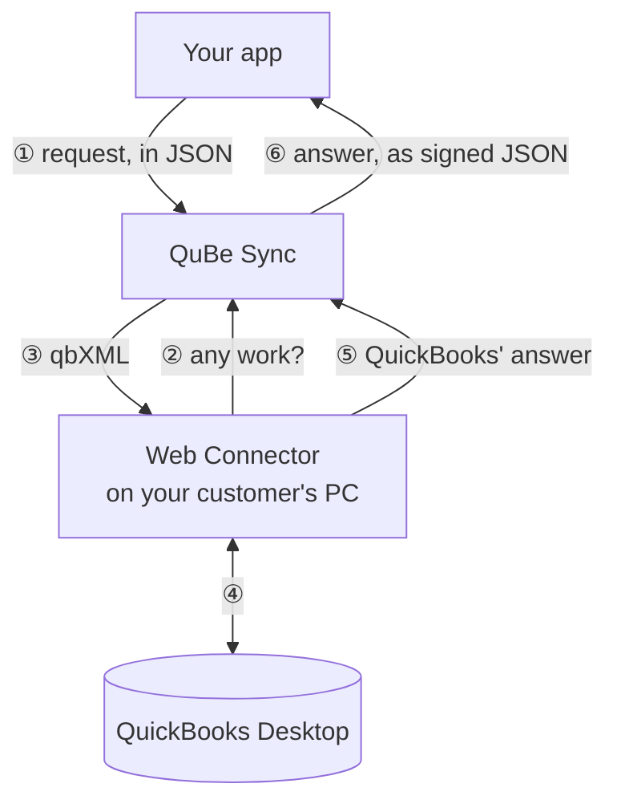

Plenty of businesses still keep their books in QuickBooks Desktop or QuickBooks Enterprise, and they
expect the software they buy to work with it. Integrating the traditional way means running a SOAP
server for Intuit's Web Connector, writing qbXML by hand, and handling failures that happen on your
customer's Windows machine, where you can't see them.

QuBe Sync does that part. Your app calls a REST API with JSON. We run the Web Connector sessions,
translate to and from qbXML, and deliver each answer to your webhook as clean, signed JSON.

## What you get

<CardGroup cols={2}>
  <Card title="JSON in, JSON out" icon="code" href="/making-requests">
    261 QuickBooks operations, covering customers, invoices, bills, payments, items, payroll and reports.
    Each one is a REST endpoint with a typed JSON body. You never write qbXML or talk SOAP.
  </Card>
  <Card title="Answers pushed to you" icon="bell" href="/webhooks">
    Each request carries a webhook URL. When QuickBooks answers, QuBe Sync POSTs the result to it,
    signed, and retries if your endpoint is down.
  </Card>
  <Card title="Workflows for multi-step jobs" icon="diagram-project" href="/workflows">
    Find or create a customer, ask your app what to do about a duplicate name, then invoice it.
    QuBe Sync runs the whole sequence server-side.
  </Card>
  <Card title="Build without QuickBooks" icon="flask" href="/simulator">
    A simulated connection answers like QuickBooks Desktop within seconds and fails on demand, so you
    can test the unhappy paths before your customers find them.
  </Card>
  <Card title="Hosted customer onboarding" icon="plug" href="/onboarding">
    Send your customer to one link. It walks them through the Web Connector setup and sends them back
    to your app, connected.
  </Card>
  <Card title="Made for AI-assisted development" icon="robot" href="/mcp-server">
    An MCP server and a CLI let Claude Code, Cursor and other agents explore the API and build your
    integration without ever holding a secret.
  </Card>
</CardGroup>

## The hard parts, handled

QuickBooks Desktop can't be called. It calls out, through the Web Connector, on its own schedule.
Most of the work in a Desktop integration is dealing with what follows from that.

<AccordionGroup>
  <Accordion title="The Web Connector protocol" icon="plug-circle-bolt">
    The Web Connector speaks SOAP, authenticates with a per-company username and password, and
    runs sessions made of tickets, request and response rounds, and a close. QuBe Sync implements
    all of it. If a session dies before a request was handed to QuickBooks, that request goes back
    in the queue for the next one.
  </Accordion>
  <Accordion title="qbXML in both directions" icon="file-code">
    Requests are built from QuickBooks' own schema, so an invalid field is rejected when you queue
    the request, not minutes later on your customer's PC. Answers are parsed into snake_case JSON with
    real numbers, booleans and lists. The raw qbXML is still there if you want it.
  </Accordion>
  <Accordion title="QuickBooks isn't running, a dialog is open, or it's the wrong company file" icon="triangle-exclamation">
    Your request stays queued and is retried on the Web Connector's next runs for as long as it
    takes. QuBe Sync tells you once, with a message your customer can act on ("Please close all
    dialogs..."), and backs the Web Connector off so it doesn't hammer a closed QuickBooks.
    [How retries work](/error_handling#when-quickbooks-is-out-of-reach).
  </Accordion>
  <Accordion title="QuickBooks' own rules" icon="scale-balanced">
    Names have to be unique across customers, vendors, employees and other names. Updates need the
    record's current `edit_sequence`. Every refusal comes back with QuickBooks' status code, a stable
    name such as `name_in_use`, and a message written for your end user.
  </Accordion>
  <Accordion title="Large result sets" icon="layer-group">
    Pass `iterator=true` and QuBe Sync pages through the results for you, delivering each page as
    its own webhook. [Pagination](/pagination).
  </Accordion>
  <Accordion title="Knowing when something is wrong" icon="stethoscope">
    Every request, answer and webhook delivery is visible in the dashboard, and a failed delivery can
    be resent with one click. Your organization's owners get an email when a webhook can't be
    delivered after every retry, and when a connection's requests have been waiting a week.
  </Accordion>
</AccordionGroup>

## How quickly answers arrive

| Connection type | The Web Connector checks in | Good for |
| --- | --- | --- |
| `standard` | every 5 minutes | Syncing in the background |
| `realtime` | every 10 seconds | Workflows where a person is waiting |
| `simulated` | within seconds, no Web Connector needed | Building and testing |

Your customer can also click **Update Selected** in the Web Connector to run a sync immediately.

## Pricing in one paragraph

Building is free. Create an account, use your sandbox app and simulated connections, and test
against your own copy of QuickBooks at no cost. Once you launch, you pay per connection your
customers are actively using, meaning its Web Connector has checked in during the past week. Sandbox and
simulated connections are never billed. See [pricing](https://qubesync.com/#pricing) for current
rates, or [talk to us](https://qubesync.com/contact_us) about volume.

## Start here

<CardGroup cols={2}>
  <Card title="Quickstart" icon="rocket" href="/quickstart">
    Queue a request and receive the answer in about five minutes. No QuickBooks needed.
  </Card>
  <Card title="How it works" icon="gears" href="/how-it-works">
    Apps, connections, requests and the Web Connector's cycle, in one page.
  </Card>
  <Card title="Workflows" icon="diagram-project" href="/workflows">
    Let QuBe Sync run multi-step QuickBooks jobs for you.
  </Card>
  <Card title="API reference" icon="book" href="/api-reference/introduction">
    Every endpoint, generated from the API itself.
  </Card>
</CardGroup>
