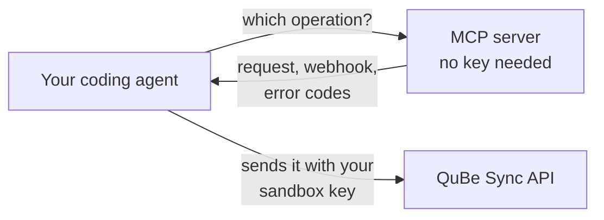

import { Request } from "/snippets/request.jsx";

QuBe Sync runs a public [Model Context Protocol](https://modelcontextprotocol.io) server at:

```
https://qubesync.com/mcp
```

Connect an AI coding agent to it and the agent knows QuickBooks Desktop the way QuBe Sync does: every
operation and field, the errors each one can raise, the webhook your app will receive, and how to write a
workflow. It works for anything from "how do I find inactive vendors?" to building your whole integration.



## Connect your agent

The server speaks Streamable HTTP and needs no authentication.

<Tabs>
  <Tab title="Claude Code">
    ```bash
    claude mcp add --transport http qubesync https://qubesync.com/mcp
    ```
  </Tab>
  <Tab title="Cursor">
    Add it to `.cursor/mcp.json` in your project, or to `~/.cursor/mcp.json` for every project:

    ```json
    {
      "mcpServers": {
        "qubesync": { "url": "https://qubesync.com/mcp" }
      }
    }
    ```
  </Tab>
  <Tab title="Other clients">
    Add a remote (HTTP) MCP server with the URL `https://qubesync.com/mcp`. Most clients take a config like:

    ```json
    {
      "mcpServers": {
        "qubesync": { "type": "http", "url": "https://qubesync.com/mcp" }
      }
    }
    ```
  </Tab>
</Tabs>

## What it can do

The server **never touches a QuickBooks connection** and never needs an API key. Its tools check parameters,
build requests and validate charts, and your agent sends what they build with your key. So there is nothing
for the server to leak.

<CardGroup cols={2}>
  <Card title="261 operation tools" icon="code">
    One per QuickBooks operation: `find_customers`, `create_invoice`, `update_vendor`, `record_payment`,
    `execute_txn_void`... Each checks the arguments against QuickBooks' schema and returns the API request
    that runs it.
  </Card>
  <Card title="4 workflow tools" icon="diagram-project">
    `get_workflow_authoring_guide`, `validate_workflow_chart`, `list_workflow_templates` and
    `get_workflow_template`: everything an agent needs to write a [workflow](/workflow-authoring) and check
    it.
  </Card>
</CardGroup>

Two more are hand-written. `match_records` builds a [match](/matching): the request that finds the record a
name means in a customer's company file, `POST /api/v2/connections/{connection_id}/matches`, checked the way
the API checks it, with the answer's schema and what each tier means. Like the operation tools it never
touches a connection, so the agent sends the request with your key. And `report_confusion` lets an agent tell
us when a tool, guide or API response confused it, without sending any keys or customer data. We read those
reports to improve the tools.

## What an operation tool returns

Calling `create_customer` with a name and email returns the request to send, ready to use:

```json structuredContent
{
  "method": "POST",
  "url": "https://qubesync.com/api/v2/connections/{connection_id}/customers",
  "body": { "name": "Northwind Builders", "email": "ap@northwind.example" },
  "headers": { "Idempotency-Key": "0b7e4f2c-9a1d-4c63-8e5b-2f7d1a9c3e40" },
  "webhook": { "type": "object", "properties": { "state": { ... }, "response_json": { ... } } }
}
```

<ResponseField name="method, url, query or body" type="string, string, object">
  The API call, with `query` for a `GET` or `body`. Swap in a real `connection_id`, add your
  `webhook_url`, and send it with your API key.
</ResponseField>
<ResponseField name="headers" type="object">
  Send them too. Each call of a tool gives a fresh `Idempotency-Key`, so if the `201` never arrives, the
  same request sent again, key and all, answers with the request already queued instead of queueing a
  second one. See [Retrying a call safely](/making-requests#retrying-a-call-safely).
</ResponseField>
<ResponseField name="webhook" type="object">
  The JSON Schema of the [webhook](/webhooks) the answer will arrive in, including this operation's own
  `data` and every QuickBooks status code it can fail with, each with what it means and what to do.
</ResponseField>

The text content repeats the same as a ready-to-run `curl` command, plus a short guide to handling each
webhook `state` and the rest of the operation's notes from Intuit's qbXML reference. The tool's
description carries only their opening paragraph, since a client loads every tool's description at once.

So an agent writing your webhook handler gets the data shape and the error cases from the same call that
built the request. Pass `"include_qbxml": true` to also see the qbXML QuBe Sync will send QuickBooks. That's
for curiosity and debugging only: your app always sends JSON.

`validate_workflow_chart` runs the same checks as `POST /api/v2/workflows/validate`, except the ones that need
your app: the server never has your API key, so it can't see your workflows. Pass the chart as `chart`, a JSON
object or a string holding one, and the keys of the workflows your app already has as `known_workflows`. A
`workflow` state that calls a key not in that list is a warning rather than an error, and the key is listed in
`workflows_to_create`: create those in your app before you push this chart, because saving it there checks
that each one exists and takes the `input` you pass. The result is
`{valid, errors, warnings, workflows_to_create}`, and each error or warning has a `path` into the chart and a
`message`. Errors block saving; warnings are likely mistakes worth a look.

## Pair it with the CLI

The MCP server tells your agent what to send. The [qube CLI](/cli) lets it send it safely: log in yourself
with the default **sandbox** scope, and your agent can create a simulated connection, run the requests it
built, inject faults, and push the workflows it wrote, without ever seeing a secret or a production app.

## Calling it directly

It's plain JSON-RPC over `POST`, so `curl` works for scripting or debugging. (A `GET` answers `405`.)

<Request
  label="List tools"
  method="POST"
  path="/mcp"
  auth={false}
  body={{ jsonrpc: "2.0", id: 1, method: "tools/list" }}
/>

{/* agent-block:start */}
<Visibility for="agents">

List tools:

```http
POST /mcp

{
  "jsonrpc": "2.0",
  "id": 1,
  "method": "tools/list"
}
```

```bash
curl -X POST \
  "https://qubesync.com/mcp" \
  -H "Content-Type: application/json" \
  -d '{
    "jsonrpc": "2.0",
    "id": 1,
    "method": "tools/list"
  }'
```

</Visibility>
{/* agent-block:end */}

<Request
  label="Build a request"
  method="POST"
  path="/mcp"
  auth={false}
  body={{
    jsonrpc: "2.0",
    id: 2,
    method: "tools/call",
    params: {
      name: "find_customers",
      arguments: { active_status: "ActiveOnly", max_returned: 25 },
    },
  }}
/>

{/* agent-block:start */}
<Visibility for="agents">

Build a request:

```http
POST /mcp

{
  "jsonrpc": "2.0",
  "id": 2,
  "method": "tools/call",
  "params": {
    "name": "find_customers",
    "arguments": {"active_status": "ActiveOnly", "max_returned": 25}
  }
}
```

```bash
curl -X POST \
  "https://qubesync.com/mcp" \
  -H "Content-Type: application/json" \
  -d '{
    "jsonrpc": "2.0",
    "id": 2,
    "method": "tools/call",
    "params": {
      "name": "find_customers",
      "arguments": {"active_status": "ActiveOnly", "max_returned": 25}
    }
  }'
```

</Visibility>
{/* agent-block:end */}

`tools/list` returns 100 tools per page. The first page starts with the workflow tools,
`report_confusion` and `match_records`, then the operations in alphabetical order. Pass `nextCursor` back as
`params.cursor` for the rest.

<Note>
  The server is public, so don't send it real customer data. Use it to explore and build requests, then send
  them yourself with your API key.
</Note>
