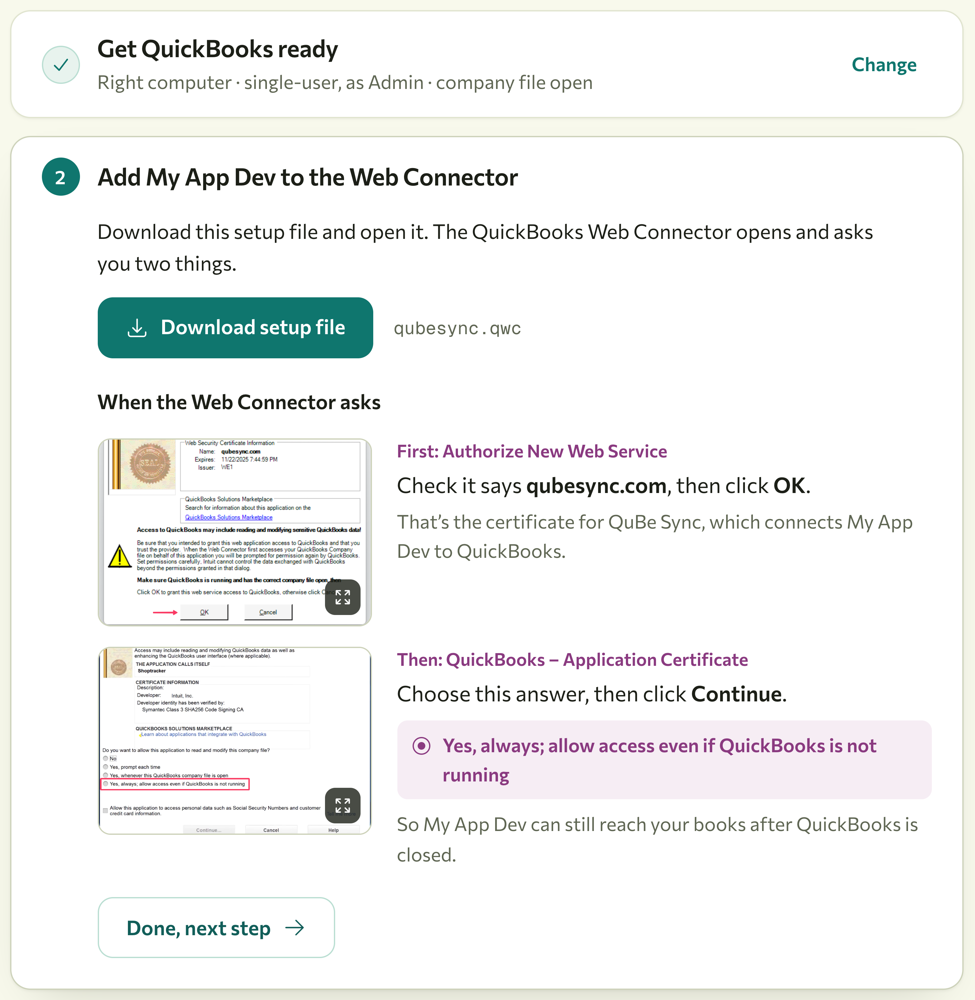
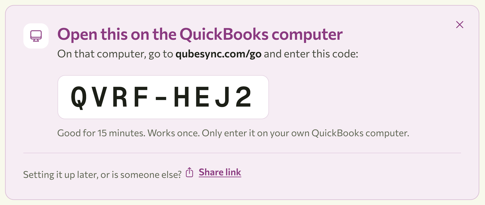

import { Request } from "/snippets/request.jsx";

<Frame caption="The onboarding page your customer sees, with your app's name.">
  
</Frame>


## Add the "Connect to QuickBooks" button
<Steps>
  <Step title="Create the connection">
    When your customer clicks the button, create a connection for them. Name it after their company, and
    pass the URL they should come back to.

    <Request
      method="POST"
      path="/api/v2/connections"
      body={{
        name: "Riverbend Electric",
        redirect_url: "https://your-app.example/quickbooks/callback",
      }}
    />

    {/* agent-block:start */}
    <Visibility for="agents">

    ```http
    POST /api/v2/connections

    {
      "name": "Riverbend Electric",
      "redirect_url": "https://your-app.example/quickbooks/callback"
    }
    ```

    ```bash
    curl -u "$QUBE_API_KEY:" \
      -X POST \
      "https://qubesync.com/api/v2/connections" \
      -H "Content-Type: application/json" \
      -d '{
        "name": "Riverbend Electric",
        "redirect_url": "https://your-app.example/quickbooks/callback"
      }'
    ```

    </Visibility>
    {/* agent-block:end */}

    Store the connection's `id` against the customer's account. You'll use it for every request.

    <Accordion title="Standard or realtime?">
      Pass `type` when you create the connection:

      | `type` | Picks up requests | Best for |
      | --- | --- | --- |
      | `standard` (default) | Every 5 minutes | Background syncing |
      | `realtime` | Every 10 seconds | Interactive UIs, where time matters, and [name matching](/matching) |

      Realtime connections are billed at a higher rate; see [pricing](https://qubesync.com/#pricing).

      Every connection's Web Connector is set to run every 10 seconds, and QuBe Sync tells a standard connection's
      to wait, so its **Last Result** often reads "Update postponed by application". That's normal. Your customer
      shouldn't change the "Every Min" field (leave it blank) in the Web Connector, no matter which type is chosen. This also let's you switch a
      connection's type later without installing a new QWC file.
    </Accordion>
  </Step>
  <Step title="Send them to onboarding">
    Redirect the browser to the connection's `links.onboarding`. Ask your customer to do this on the
    Windows computer where QuickBooks is installed. If they use a QuickBooks server, that machine is best.

    If they open it somewhere else, like a phone, a Mac or another PC, the page shows them a short code. They
    enter it at qubesync.com/go on the QuickBooks computer and carry on there, so your app doesn't need to handle
    that case.

    <Frame caption="Opened on the wrong computer, the page shows a code to enter on the QuickBooks computer.">
      
    </Frame>
  </Step>
  <Step title="Handle their return to your app">
    QuBe Sync redirects to your `redirect_url` with two query parameters, `connection_id` and `state`:

    | `state` | What happened | What to do |
    | --- | --- | --- |
    | `connected` | The Web Connector checked in for the first time. | Start syncing. |
    | `cancelled` | Your customer chose "Cancel and go back" on the onboarding page. | Offer to try again, or delete the connection. |
    | `expired` | The onboarding link was more than 48 hours old. | [Regenerate the link](/api-reference/v2/connections/regenerate-the-onboarding-url) and send them again. |

    <Visibility for="agents">
      Don't include query parameters in your `redirect_url`, because QuBe Sync appends <span style="text-wrap: nowrap;">`?connection_id=…&state=…`</span>. To bring your own context back, look the account up by `connection_id` or put it in the path (`/quickbooks/callback/42`).
    </Visibility>
  </Step>
</Steps>

In code, using the small API helper from [Making requests](/making-requests#a-small-api-client):

<CodeGroup>
```ruby Rails
class QuickbooksConnectionsController < ApplicationController
  def create
    connection = Qube.api(:post, "/connections", {
      name: current_account.name,
      redirect_url: callback_quickbooks_connections_url
    })
    current_account.update!(qube_connection_id: connection["id"])

    redirect_to connection.dig("links", "onboarding"), allow_other_host: true
  end

  def callback
    if params[:state] == "connected"
      redirect_to root_path, notice: "QuickBooks is connected."
    else
      redirect_to root_path, alert: "QuickBooks wasn't connected. Please try again."
    end
  end
end
```

```javascript Express
app.post("/quickbooks/connect", async (req, res) => {
  const { data: connection } = await qube("POST", "/connections", {
    name: req.account.name,
    redirect_url: "https://your-app.example/quickbooks/callback",
  });
  await req.account.update({ qubeConnectionId: connection.id });

  res.redirect(connection.links.onboarding);
});

app.get("/quickbooks/callback", (req, res) => {
  const connected = req.query.state === "connected";
  res.redirect(connected ? "/?quickbooks=connected" : "/?quickbooks=failed");
});
```
</CodeGroup>

## Keep an eye on the connection

A connection's `last_connected_at` is the last time its Web Connector checked in. Displaying it to your user can help them self-diagnose why they're still waiting on a request. If it's hours or days old, the computer running QuickBooks is probably off, the Web Connector
isn't running, or the company file has moved. Requests keep waiting in the queue in the meantime. If they
wait a week, QuBe Sync emails your organization's owners.

## Setting a connection up again

If QuickBooks moves to another computer, or your customer's Web Connector entry was removed, send them to the
connection's onboarding link again ([regenerate it](/api-reference/v2/connections/regenerate-the-onboarding-url)
if it's more than 48 hours old). The page tells them the connection is already set up, and offers
**Set up again**.

Choosing it changes the connection's password straight away, so the Web Connector entry already installed is
turned away ("Invalid password for username") and can't be mistaken for the new one. Until your customer
finishes the new setup, requests wait in the queue and `last_connected_at` stays at the old entry's last
check-in. When the new entry checks in, they're sent back to your `redirect_url` with `state=connected`, as the
first time.

## When a customer leaves

[Delete the connection](/api-reference/v2/connections/remove-a-connection) and ask your customer to remove
your app from their Web Connector (select it, then **Remove**).

Until your app is removed, the Web Connector keeps checking in on its own. 

## Build your own onboarding

If you'd rather keep your customer inside your app, skip `links.onboarding` and give them the two things
the Web Connector needs yourself:

<Steps>
  <Step title="The QWC file">
    [`POST /connections/{id}/qwc`](/api-reference/v2/connections/get-the-qwc-file) returns it. Offer it as
    a download. QuickBooks has to be open with the company file when they add it.
  </Step>
  <Step title="A password">
    [`POST /connections/{id}/password`](/api-reference/v2/connections/generate-or-set-a-password)
    generates one, or sets one you choose. They paste it into the Web Connector after adding the QWC file.
  </Step>
</Steps>

Tell them to leave **Auto-Run** ticked and not to change the schedule (the **Every Min** column). QuBe Sync
decides how often a connection checks in, so editing it only breaks that.

The connection is live when `last_connected_at` is set.
