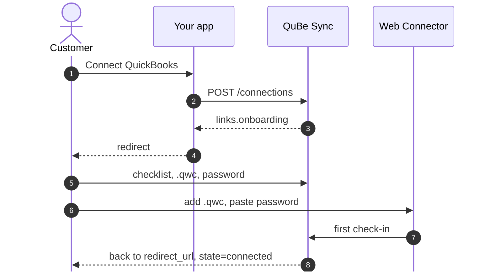

Connecting QuickBooks Desktop means installing a `.qwc` file in the Web Connector and typing a password on
the computer that runs QuickBooks. That's easy to get wrong without help, so QuBe Sync hosts a step-by-step
onboarding page for it. Your app creates the connection and sends your customer to that page, and they
come back to your `redirect_url` when they're done.



## Add the button

<Steps>
  <Step title="Create the connection">
    When your customer clicks the button, create a connection for them. Name it after their company, and
    pass the URL they should come back to.

    ```bash
    curl -u "$QUBE_API_KEY:" -X POST https://qubesync.com/api/v2/connections \
      -H "Content-Type: application/json" \
      -d '{"name": "Riverbend Electric", "redirect_url": "https://your-app.example/quickbooks/callback"}'
    ```

    Store the connection's `id` against the customer's account. You'll use it for every request.
  </Step>
  <Step title="Send them to onboarding">
    Redirect the browser to the connection's `links.onboarding`. Ask your customer to do this on the
    Windows computer where QuickBooks is installed. If they use a QuickBooks server, that machine is best.
  </Step>
  <Step title="Handle their return">
    QuBe Sync redirects to your `redirect_url` with two query parameters, `connection_id` and `state`:

    | `state` | What happened | What to do |
    | --- | --- | --- |
    | `connected` | The Web Connector checked in for the first time. | Start syncing. |
    | `cancelled` | Your customer chose "Cancel and return" on the onboarding page. | Offer to try again, or delete the connection. |
    | `expired` | The onboarding link was more than 48 hours old. | [Regenerate the link](/api-reference/v2/connections/regenerate-the-onboarding-url) and send them again. |

    <Note>
      QuBe Sync appends `?connection_id=…&state=…` to your `redirect_url`, so it can't have a query string of
      its own: the API refuses one with `422`. To bring your own context back, put it in the path
      (`/quickbooks/callback/42`) or look the account up by `connection_id`.
    </Note>
  </Step>
</Steps>

In code, using the small API helper from [Making requests](/making-requests#a-small-api-client):

<CodeGroup>
```ruby Rails
class QuickbooksConnectionsController < ApplicationController
  def create
    connection = Qube.api(:post, "/connections", {
      name: current_account.name,
      redirect_url: callback_quickbooks_connections_url
    })
    current_account.update!(qube_connection_id: connection["id"])

    redirect_to connection.dig("links", "onboarding"), allow_other_host: true
  end

  def callback
    if params[:state] == "connected"
      redirect_to root_path, notice: "QuickBooks is connected."
    else
      redirect_to root_path, alert: "QuickBooks wasn't connected. Please try again."
    end
  end
end
```

```javascript Express
app.post("/quickbooks/connect", async (req, res) => {
  const { data: connection } = await qube("POST", "/connections", {
    name: req.account.name,
    redirect_url: "https://your-app.example/quickbooks/callback",
  });
  await req.account.update({ qubeConnectionId: connection.id });

  res.redirect(connection.links.onboarding);
});

app.get("/quickbooks/callback", (req, res) => {
  const connected = req.query.state === "connected";
  res.redirect(connected ? "/?quickbooks=connected" : "/?quickbooks=failed");
});
```
</CodeGroup>

## What your customer sees

The onboarding page names your app ("Connect My App to QuickBooks Enterprise / Desktop") and walks them through:

1. **A checklist**: they're on the computer that runs QuickBooks, QuickBooks is open in single-user mode as
   the admin, and the right company file is open.
2. **Download the QWC file** and open it, which adds your app to their Web Connector.
3. **Generate a password** and paste it into the Web Connector.
4. **Connected.** As soon as the Web Connector checks in, the page confirms it and returns them to your app.

While you're building, you can skip all of this with a [simulated connection](/simulator).

## Standard or realtime?

Pass `type` when you create the connection:

- `standard` (the default): the Web Connector checks in every 5 minutes. Right for background syncing.
- `realtime`: every 10 seconds. Right when a person is waiting on the result, such as an invoice created
  from a checkout page. Realtime connections are billed at a higher rate; see [pricing](https://qubesync.com/#pricing).

## Keep an eye on the connection

A connection's `last_connected_at` is the last time its Web Connector checked in. Show it in your app's
settings page: if it's hours or days old, the computer running QuickBooks is probably off, the Web Connector
isn't running, or the company file has moved. Requests keep waiting in the queue in the meantime. If they
wait a week, QuBe Sync emails your organization's owners.

## Build your own onboarding

If you'd rather keep your customer inside your app, skip `links.onboarding` and give them the two things
the Web Connector needs yourself:

1. **The QWC file**: [`POST /connections/{id}/qwc`](/api-reference/v2/connections/get-the-qwc-file).
   Offer it as a download.
2. **A password**: [`POST /connections/{id}/password`](/api-reference/v2/connections/generate-or-set-a-password)
   generates one, or sets one you choose. They paste it into the Web Connector after adding the QWC file.

The connection is live when `last_connected_at` is set.
