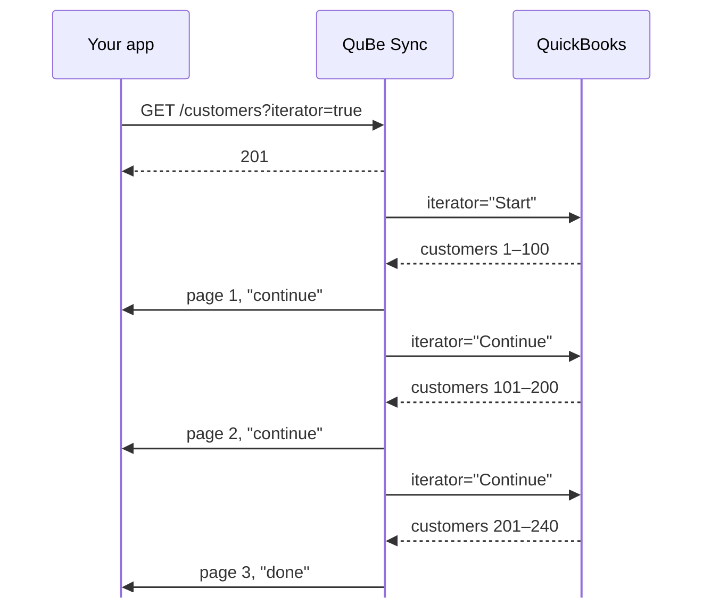

QuickBooks Desktop returns large result sets in pages, through an iterator you'd normally have to track
yourself: remember its id, ask for the next page, and know when you're done. QuBe Sync does that for you.
Add `iterator=true` to any query that supports it, and `max_returned` becomes the page size:

```bash
curl -u "$QUBE_API_KEY:" \
  "https://qubesync.com/api/v2/connections/$CONN_ID/customers?iterator=true&max_returned=100&webhook_url=$WEBHOOK_URL"
```

QuBe Sync keeps asking QuickBooks for the next page until there are none left, and sends each page to your
`webhook_url` as it arrives:



## Telling pages apart

Every page's webhook has the same `id` (the request you queued) and its own `page_request_id`:

| Field | Page 1 | Page 2 | Last page |
| --- | --- | --- | --- |
| `id` | `01a0e05d-9068…` | `01a0e05d-9068…` | `01a0e05d-9068…` |
| `page_request_id` | `01a0e05d-9068…` | `01a0e05d-90bb…` | `01a0e05d-9a12…` |
| `page` | `1` | `2` | `3` |
| `iteration_state` | `continue` | `continue` | `done` |

- Process each page as it arrives. You don't need to wait for the last one.
- Pages can arrive out of order, and a retried delivery can arrive twice. Key on `page_request_id`.
- The import is complete once you've handled the page whose `iteration_state` is `done`.

<Note>
  In a **sandbox** app, an iteration stops after 4 pages. The last page's `iteration_state` is then
  `max_sandbox_iterations_reached` instead of `done`. Production apps page through everything.
</Note>

## Pages on demand

Each queued request also has a `links.pages` URL, which returns every page answered so far, oldest first,
each with its own `iteration_state`. That's handy for a script or a support tool. Your integration should
still take each page from its webhook.

```bash
curl -u "$QUBE_API_KEY:" \
  "https://qubesync.com/api/v2/connections/$CONN_ID/queued_requests/$REQUEST_ID/pages"
```

## Tips

- **Pick a page size QuickBooks can handle comfortably.** A few hundred records per page keeps each round
  trip quick on a slow machine. Transactions with many lines are heavier than list records.
- **Import once, then sync changes.** After the first full import, query with `from_modified_date` so
  each sync only fetches what changed.
