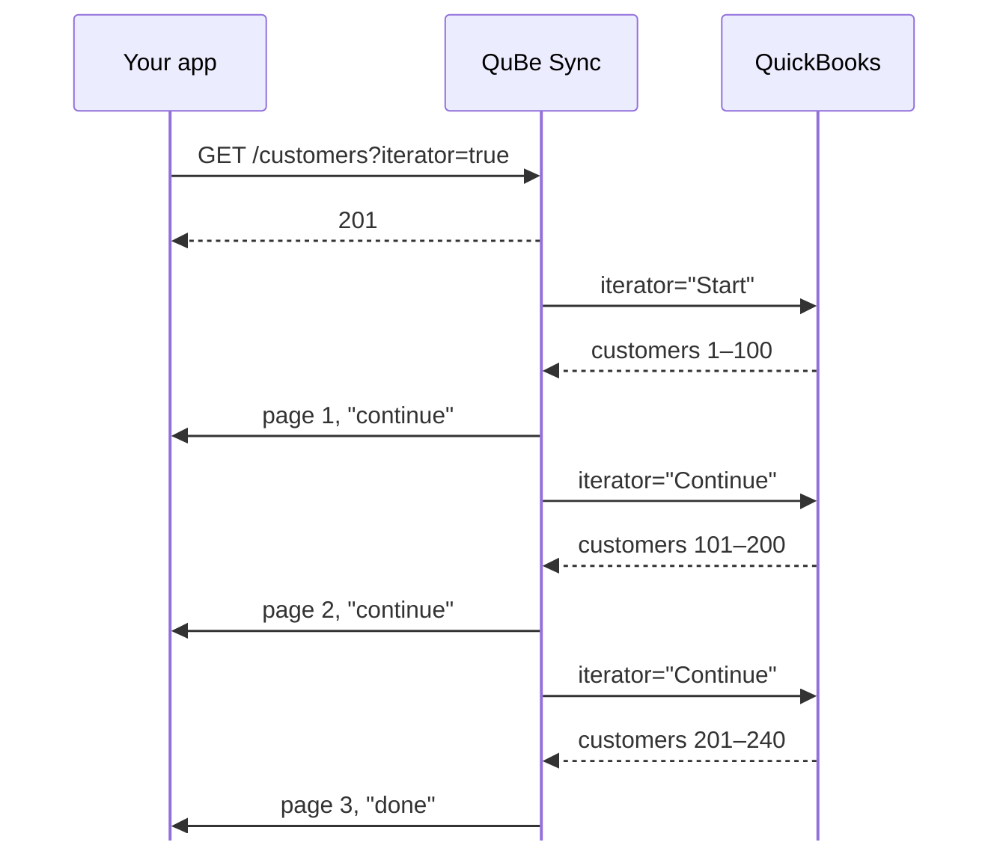

QuickBooks Desktop returns large result sets in pages, through an iterator you'd normally have to track
yourself: remember its id, ask for the next page, and know when you're done. QuBe Sync does that for you.
Add `iterator=true` to any query that supports it, and `max_returned` becomes the page size:

```bash
curl -u "$QUBE_API_KEY:" \
  "https://qubesync.com/api/v2/connections/$CONN_ID/customers?iterator=true&max_returned=100&webhook_url=$WEBHOOK_URL"
```

QuBe Sync keeps asking QuickBooks for the next page until there are none left, and sends each page to your
`webhook_url` as it arrives.

<Tip>
    Using the `stream_query` [workflow](/workflows) guarantees pages get delivered in the correct order, even when there are
    weird network latencies, your endpoint goes down, or any other situation that might disrupt the delivery order.
</Tip>



The diagram shows the order QuBe Sync sends the pages in. They can reach your endpoint in any order, although using a [Workflow](/workflows) like `stream_query` can ensure delivery order.

## Telling pages apart

Every page's webhook has the same `id` (the request you queued) and its own `page_request_id`:

| Field | Page 1 | Page 2 | Last page |
| --- | --- | --- | --- |
| `id` | `01a0e05d-9068…` | `01a0e05d-9068…` | `01a0e05d-9068…` |
| `page_request_id` | `01a0e05d-9068…` | `01a0e05d-90bb…` | `01a0e05d-9a12…` |
| `page` | `1` | `2` | `3` |
| `iteration_state` | `continue` | `continue` | `done` |

- Process each page as it arrives. You don't need to wait for the last one.
- Pages can arrive out of order (page 4 can land before page 3), and a retried delivery can arrive twice.
  Key on `page_request_id` plus `state`. A page whose `state` is `retryable` isn't final: the same
  `page_request_id` arrives again later as `response_received`, `error`, `timed_out` or `discarded`. See
  [Respond quickly, work later](/webhooks#respond-quickly-work-later).
- The `done` page (or `max_sandbox_iterations_reached` in a sandbox) is the last one, and its `page`
  number tells you how many pages there are. The import is complete once you've handled **every page from
  1 to that number**, not when the `done` page arrives: it can arrive before earlier pages. Keep the set
  of page numbers you've handled. A handler that stores only the last `iteration_state` it saw can end on
  `continue`.

<Note>
  In a **sandbox** app, an iteration stops after 4 pages. The last page's `iteration_state` is then
  `max_sandbox_iterations_reached` instead of `done`. Production apps page through everything.
</Note>

## If the session ends partway

QuickBooks keeps an iteration only for the Web Connector session that started it. If that session ends
before the last page (QuickBooks closes, the Web Connector is stopped, or the connection drops), QuickBooks
can't pick up where it left off. The next page's webhook then has `state` `error`, with `error_type`:
`quickbooks_connection_error` and a `user_message` saying so. Queue the query again to get the rest. It
starts from the first page, so save records by their `list_id` or `txn_id` and the ones you already have
are updated rather than duplicated.

## Pages on demand

Each queued request also has a `links.pages` URL, which returns every page answered so far, oldest first,
each with its own `iteration_state`.

```bash
curl -u "$QUBE_API_KEY:" \
  "https://qubesync.com/api/v2/connections/$CONN_ID/queued-requests/$REQUEST_ID/pages"
```

## In a workflow

A [workflow](/workflows) pages through a query for you, with no webhook per page. Set `"paginate": true`
on its request state: the chart handles each page as a `page` event, then gets `success` once every page
is in. See the `request` state in [Anatomy of a chart](/workflow-authoring#anatomy-of-a-chart).

## Initial import

Bringing a company file's lists into your app the first time can go either way:

- **The plain paginated API** (above): one query per list, one webhook per page. Pages can arrive out of
  order and twice, so you key on `page_request_id` plus `state`, and you know a list is done when you've
  handled every page up to the `done` page's `page` number. Nothing to install. Best for one list, or when you'd rather drive each query yourself.
- **A workflow that sends each page to your app**: Clone the `send_lists_to_app` template and start
  it once. It pages through every customer, vendor and item, 200 at a time, and sends each page to your
  `webhook_url` as a `workflow_run.notification` (`customers_page`, `vendors_page`, `items_page`) -- one at a
  time, in order, waiting for your `2xx` before the next. `workflow_run.completed` arrives last, with how
  many of each were sent, so it means the import is complete. Best when you want the lists in a fixed order,
  one run to watch, and a single "done". You can edit the workflow to include whichever entities you'd like to import. For one query of your own -- a filter, a date range, a single customer's transactions -- clone `stream_query` instead and pass the query as its input.

```bash
curl -u "$QUBE_API_KEY:" -X POST \
  https://qubesync.com/api/v2/workflow-templates/send_lists_to_app/install \
  -H "Content-Type: application/json" -d '{"publish": true}'

curl -u "$QUBE_API_KEY:" -X POST \
  "https://qubesync.com/api/v2/connections/$CONN_ID/workflow-runs" \
  -H "Content-Type: application/json" \
  -d '{"workflow": "send_lists_to_app", "webhook_url": "https://your-app.example/webhooks/qube"}'
```

A run needs its `webhook_url` -- without one it is refused, `422 webhook_url_required` -- and your endpoint
should answer within 5 seconds: a page your app can't take is retried for about an hour with the same
`delivery_id`, and the run waits meanwhile. Copy the template into your own workflow to send other lists,
different fields, or each page on to a workflow of your own. See
[Sending your app data](/workflows#sending-your-app-data) and the
[payload](/webhooks#data-a-workflow-sends-you).

## Tips

- **Pick a page size QuickBooks can handle comfortably.** A few hundred records per page keeps each round
  trip quick on a slow machine. Transactions with many lines are heavier than list records.
- **Import once, then sync changes.** After the first full import, filter on the modified date so each
  sync only fetches what changed. A list query (`customers`) takes `from_modified_date` directly; a
  transaction query (`invoices`) takes `modified_date_range_filter[from_modified_date]`. See
  [Making requests](/making-requests#query). The `pull_changes` template does this for every kind you name,
  sending each page to your app as `stream_query` does, and then the records deleted since the same date,
  which a modified-date filter can't find.
