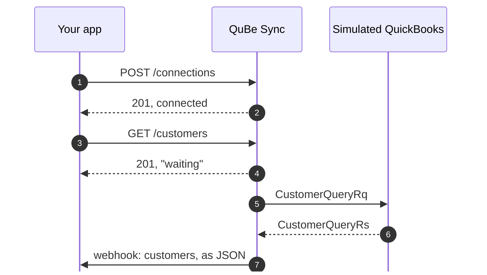

You'll create a **simulated connection**: a fake QuickBooks Desktop company file, hosted by QuBe Sync, that
answers like the real thing within seconds. Your code doesn't change when you move to your customers' real
QuickBooks. The simulator is in [beta](/simulator): it doesn't match real QuickBooks in every case yet, so test
against the real thing before you launch.



<Steps>
  <Step title="Create your free account">
    [Register at qubesync.com](https://qubesync.com/users/register). Your organization starts with two apps:
    **My App Dev**, a sandbox app to build with, and **My App Prod** for when you launch. Each has its own API
    key and webhook secret.
  </Step>
  <Step title="Get your sandbox app's keys">
    <Tabs>
      <Tab title="Dashboard">
        Open **My Applications**, then **My App Dev**, and copy the API key and webhook secret into your
        environment:

        ```bash
        export QUBE_API_KEY="sk_..."
        export QUBE_WEBHOOK_SECRET="..."
        ```
      </Tab>
      <Tab title="CLI">
        The [qube CLI](/cli) writes them into your `.env` without printing them:

        ```bash
        qube login
        qube use "My App Dev"
        qube env --write .env   # QUBE_URL, QUBE_API_KEY, QUBE_WEBHOOK_SECRET
        ```
      </Tab>
    </Tabs>

    Every call authenticates with HTTP Basic auth: the API key is the username and the password is blank.
  </Step>
  <Step title="Create a simulated connection">
    A connection is one QuickBooks company file. A simulated one is connected the moment it exists.

    <CodeGroup>
    ```bash cURL
    curl -u "$QUBE_API_KEY:" -X POST https://qubesync.com/api/v2/connections \
      -H "Content-Type: application/json" \
      -d '{"name": "Test company", "type": "simulated"}'
    ```

    ```javascript Node.js
    const auth = "Basic " + Buffer.from(`${process.env.QUBE_API_KEY}:`).toString("base64");

    const res = await fetch("https://qubesync.com/api/v2/connections", {
      method: "POST",
      headers: { Authorization: auth, "Content-Type": "application/json" },
      body: JSON.stringify({ name: "Test company", type: "simulated" }),
    });
    const { data: connection } = await res.json();
    ```

    ```python Python
    import os, requests

    auth = (os.environ["QUBE_API_KEY"], "")
    res = requests.post("https://qubesync.com/api/v2/connections", auth=auth,
                        json={"name": "Test company", "type": "simulated"})
    connection = res.json()["data"]
    ```

    ```ruby Ruby
    require "net/http"
    require "json"

    uri = URI("https://qubesync.com/api/v2/connections")
    req = Net::HTTP::Post.new(uri, "Content-Type" => "application/json")
    req.basic_auth(ENV.fetch("QUBE_API_KEY"), "")
    req.body = { name: "Test company", type: "simulated" }.to_json
    res = Net::HTTP.start(uri.host, uri.port, use_ssl: true) { |http| http.request(req) }
    connection = JSON.parse(res.body).fetch("data")
    ```
    </CodeGroup>

    ```json Response (abridged)
    {
      "data": {
        "id": "4fdde583-68b1-4c6b-94d1-82abf97afdf5",
        "name": "Test company",
        "type": "simulated",
        "last_connected_at": "2026-09-27T00:57:01Z",
        "company_file": "C:\\QuBeSync\\Simulator\\test-company.qbw",
        "links": {
          "self": "https://qubesync.com/api/v2/connections/4fdde583-68b1-4c6b-94d1-82abf97afdf5",
          "ui": "https://qubesync.com/app/connections/4fdde583-68b1-4c6b-94d1-82abf97afdf5"
        }
      }
    }
    ```

    Keep the `id`: every QuickBooks request is made against a connection.
  </Step>
  <Step title="Give QuBe Sync somewhere to deliver answers">
    Answers arrive as a `POST` to a `webhook_url` you choose. While you develop, expose your local server
    with a tunnel ([how](/ngrok)), for example:

    ```bash
    cloudflared tunnel --url http://localhost:3000
    ```
  </Step>
  <Step title="Queue a request">
    Ask for two customers. The request is **queued**, not answered: QuickBooks Desktop is only reachable
    when its Web Connector checks in.

    ```bash
    export CONN_ID="4fdde583-..."   # from the previous step

    curl -u "$QUBE_API_KEY:" \
      "https://qubesync.com/api/v2/connections/$CONN_ID/customers?max_returned=2&webhook_url=https://your-tunnel.example/webhooks/qube"
    ```

    ```json 201 Created (abridged)
    {
      "data": {
        "id": "01a0e05d-8fae-733a-875b-a258ff2c8fe2",
        "state": "waiting",
        "request_types": ["CustomerQueryRq"],
        "webhook_url": "https://your-tunnel.example/webhooks/qube",
        "webhook_state": "pending",
        "response_json": null,
        "links": {
          "self": "https://qubesync.com/api/v2/connections/4fdde583-.../queued_requests/01a0e05d-...",
          "ui": "https://qubesync.com/app/queued_requests/01a0e05d-8fae-733a-875b-a258ff2c8fe2"
        }
      }
    }
    ```
  </Step>
  <Step title="Receive the answer">
    A few seconds later QuBe Sync POSTs the answered request to your `webhook_url`. QuickBooks' reply is in
    `response_json`, already converted from qbXML:

    ```json Webhook body (abridged)
    {
      "id": "01a0e05d-8fae-733a-875b-a258ff2c8fe2",
      "state": "response_received",
      "sandbox": true,
      "response_json": {
        "status": "success",
        "data": [
          {
            "list_id": "80000020-1790470623",
            "edit_sequence": "1790470623",
            "name": "Hillcrest Dental",
            "full_name": "Hillcrest Dental",
            "company_name": "Hillcrest Dental Group",
            "email": "billing@hillcrest.example",
            "phone": "512-555-0177",
            "is_active": true,
            "balance": 0.0,
            "bill_address": { "addr1": "400 Oak St", "city": "Round Rock", "state": "TX", "postal_code": "78664", "country": "US" }
          },
          {
            "list_id": "80000021-1790470623",
            "edit_sequence": "1790470623",
            "name": "Marisol Vega",
            "full_name": "Marisol Vega",
            "first_name": "Marisol",
            "last_name": "Vega",
            "is_active": true,
            "balance": 0.0
          }
        ]
      },
      "error": null
    }
    ```

    No tunnel yet? Open the request's `links.ui` in your browser to watch it get answered in the dashboard.
  </Step>
</Steps>

That's the whole loop: queue a request, receive the answer. Everything else in QuBe Sync builds on it.

## Now break something

Real integrations fail in ways that are hard to reproduce: a name that's already taken, QuickBooks closed
on your customer's PC. The simulator can do both on demand. Make the next request fail the way QuickBooks
does when a name is taken:

```bash
curl -u "$QUBE_API_KEY:" -X PUT "https://qubesync.com/api/v2/connections/$CONN_ID/simulator" \
  -H "Content-Type: application/json" \
  -d '{"faults": {"next_status": {"code": 3100}}}'
```

Queue any request and its webhook arrives with `state: "error"` and `response_json.error.type: "name_in_use"`.
The [simulator guide](/simulator) lists every fault it can inject.

## Where to next

<CardGroup cols={2}>
  <Card title="How it works" icon="gears" href="/how-it-works">
    The model behind what you just did: apps, connections, requests and the Web Connector.
  </Card>
  <Card title="Connect a real customer" icon="plug" href="/onboarding">
    Send a customer through the hosted onboarding page and start syncing their company file.
  </Card>
  <Card title="Make requests" icon="code" href="/making-requests">
    Create invoices, update customers and query anything in QuickBooks.
  </Card>
  <Card title="Get QuickBooks for testing" icon="desktop" href="/nfr-quickbooks">
    A free not-for-resale copy of QuickBooks, for testing against the real thing.
  </Card>
</CardGroup>
