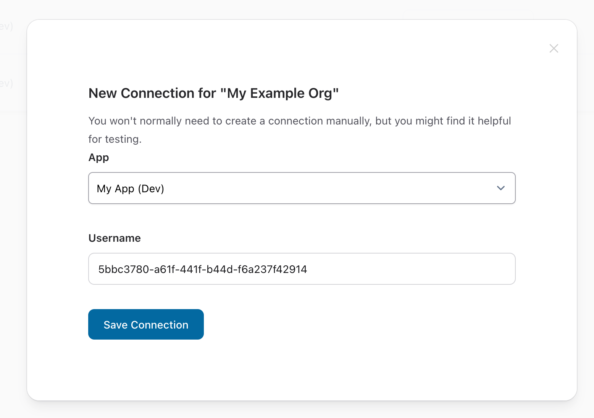
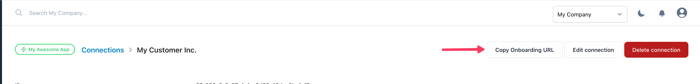
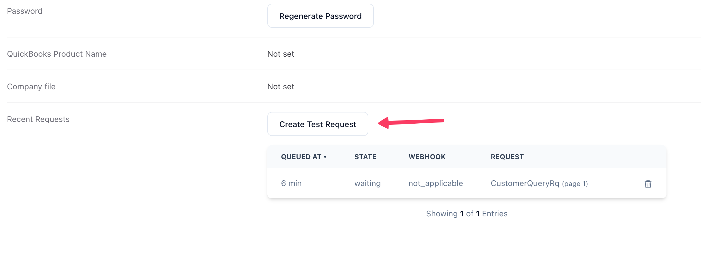

### Preparing your QuBe Sync account

<AccordionGroup>
  <Accordion title="Create your free QuBe Sync account" icon="user">
    From the https://qubesync.com homepage, click "Register" and create your free account
  </Accordion>
  <Accordion title="Create your first connection" icon="arrows-left-right">
    In the Connections tab, create a new connection.  Select your development app and click save.

    

    Usually, this will be done programmatically by posting to the connections endpoint:

    `post https://qubesync.com/api/v2/connections`

    <Note>
      Connections (create, list, get, update, delete, plus the QWC file, password, and onboarding URL) work the same under `/api/v1` and `/api/v2` — pick whichever version you're using for QuickBooks requests below. See [v2 vs v1](/api-reference/introduction#v2-vs-v1).
    </Note>

  </Accordion>
</AccordionGroup>

### No QuickBooks machine handy? Use a simulated connection

Choose type `simulated` and QuBe Sync will generate a fake company file and web connector
(customers, items, invoices, the usual QuickBooks errors). It is connected the moment it exists and answers
within seconds, so you can start building immediately. Definitely get yourself a [not-for-resale version of Quickbooks](/nfr-quickbooks), though,
for real-world testing.

The dashboard's connection page shows a **Simulator** panel to run the fake Web Connector on demand, reset the
company file, or make it fail on purpose (QuickBooks closed, a modal dialog, an XML error, a 3100 name clash...).
The `/connections/:id/simulator` endpoints (under `/api/v1` or `/api/v2`) do the same from code; see the
[CLI guide](/cli) for driving one without them at all.

### Set up the QuickBooks Web Connector

The Web Connector should come pre-installed with [QuickBooks](/nfr-quickbooks), and allows QuickBooks to communicate with web applications.

From a new (unsimulated) connection, you can get an onboarding url by clicking "Copy Onboarding URL". You'll need to open this URL from the Windows computer or VM where you have QuickBooks installed and follow the simple instructions\!



### Make a Test Request

From that same connection screen, you can click "Create Test Request" to fire off a Customer Query - click "Update selected" in your Web Connector to expedite the response and check out the results\!



### ...or make a custom request

<AccordionGroup>
  <Accordion title="Get your app's API key" icon="user-secret">
    In the "My Applications" tab, click into the sandbox app. We've generated an API key for you - click to copy it, and have it ready to use in your environment (e.g. `export QUBE_API_KEY="foo..."` )
  </Accordion>
  <Accordion title="Make a request!" icon="code">
    QuBe Sync gives you the full power of any QBXML request, but also has some prebuilt endpoints for common use cases. Here we'll ask for a list of customers

    <CodeGroup>

    ```bash cURL
    export QUBE_API_KEY="..." # get this from My Applications tab
    export CONN_ID="..." # get this from the Connections tab
    
    curl "https://qubesync.com/api/v2/connections/$CONN_ID/customers?max_returned=10&webhook_url=https://my-app.example/webhooks/qube" \
         --user $QUBE_API_KEY:
    ```

    
    ```ruby ruby
    ENV["QUBE_API_KEY"]="..."
    
    require 'net/http'
    require 'uri'
    require 'json'
    
    connection_id = "..."
    connection_url = "https://qubesync.com/api/v2/connections/#{connection_id}"
    uri = URI.parse("#{connection_url}/customers?max_returned=10&webhook_url=https://my-app.example/webhooks/qube")
    
    request = Net::HTTP::Get.new(uri)
    request.basic_auth(ENV["QUBE_API_KEY"], "")
    request.content_type = "application/json"
    
    response = Net::HTTP.start(uri.hostname, uri.port, use_ssl: true) do |http|
      http.request(request)
    end
    
    # Check the response
    if response.is_a?(Net::HTTPSuccess)
      puts "Request was successful!"
      puts "Response body: #{response.body}"
      # opening the request's page in the browser.
      `open #{JSON.parse(response.body)["data"]["links"]["ui"]}`
    else
      puts "Request failed with status code: #{response.code}"
      puts "Response body: #{response.body}"
    end
    
    ```

    </CodeGroup>

    The request is **queued** (`201`) and answered when the Web Connector next syncs. Pass a `webhook_url` and the
    answered request is POSTed to you -- that is the integration path (see [Webhooks](/webhooks)). The response
    also has a link to the request in the UI (`data.links.ui`) to watch it being processed. Hit "Update Selected" on
    the Web Connector and see your customers\!
  </Accordion>
</AccordionGroup>
