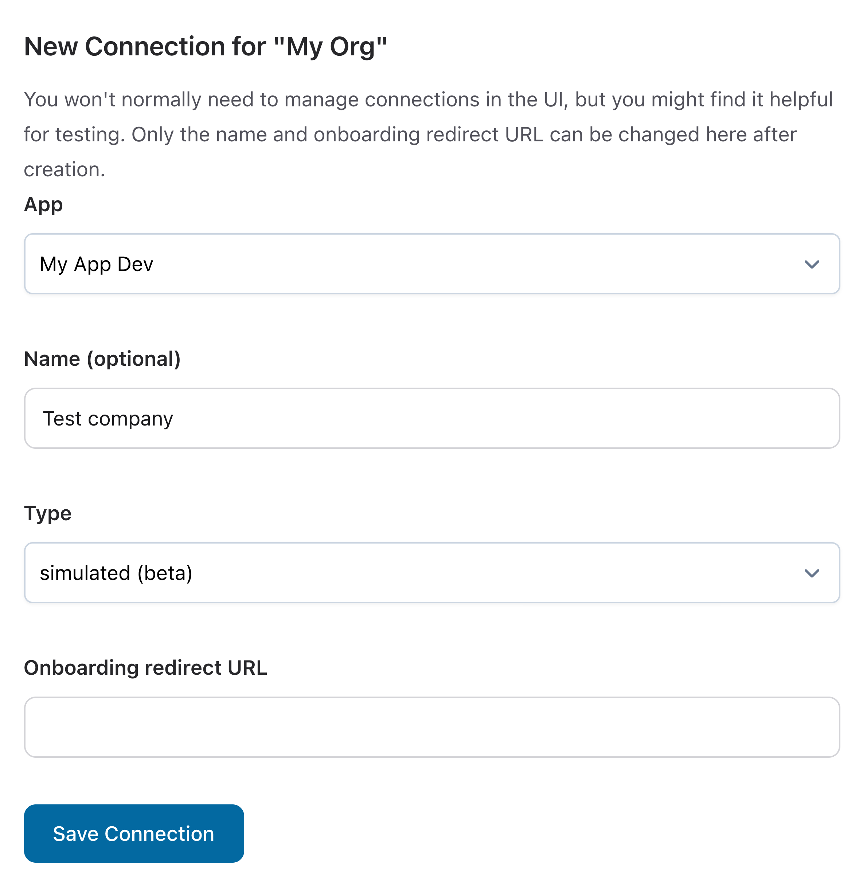
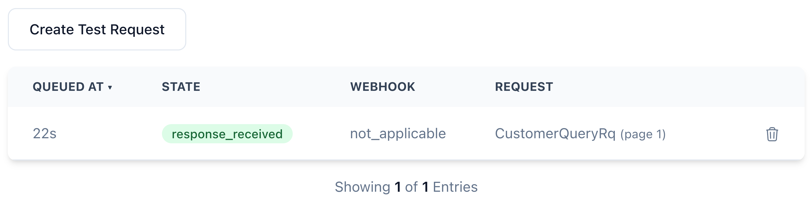
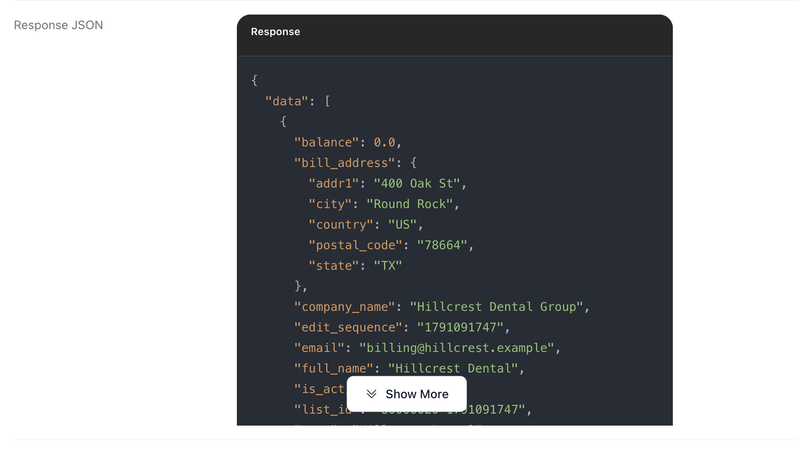
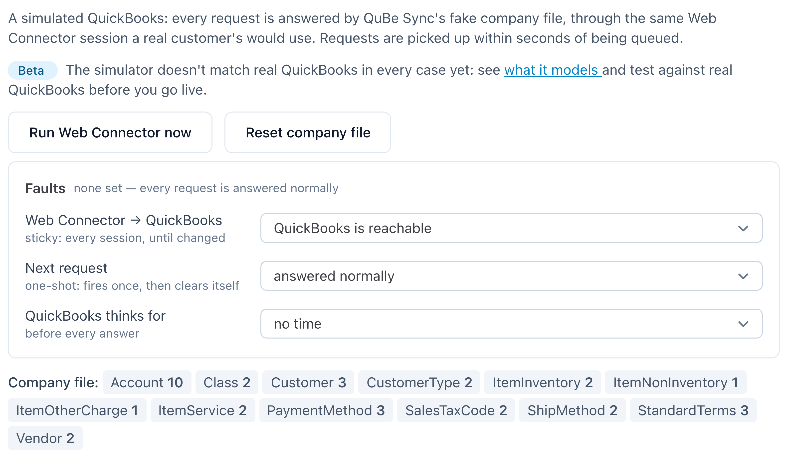
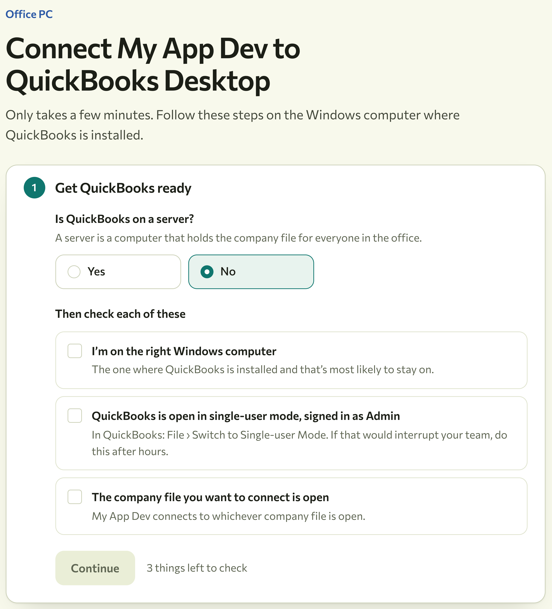
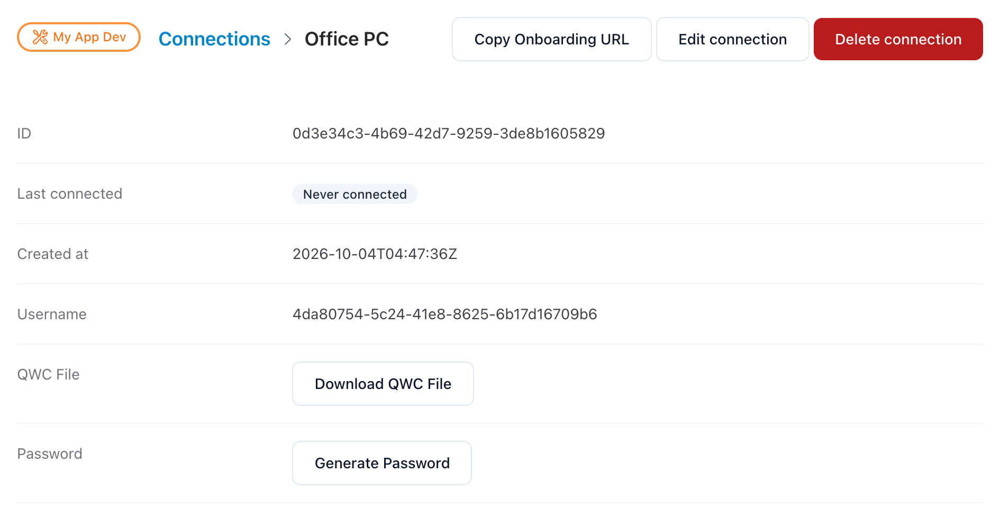
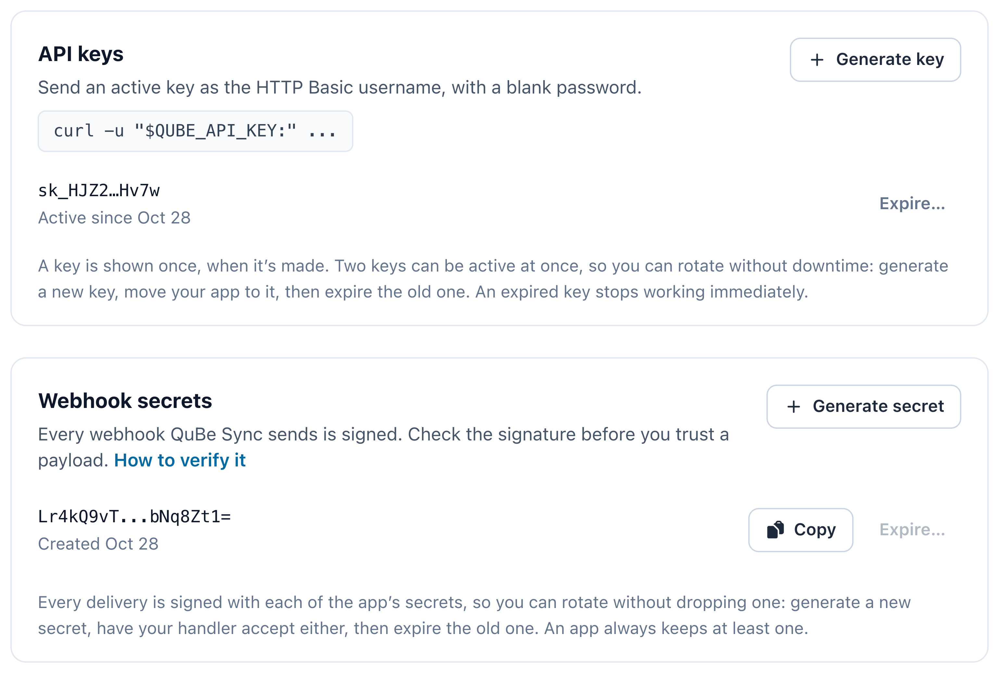

import { Request } from "/snippets/request.jsx";

import CreateAccount from "/snippets/quickstart-create-account.mdx";

## Connect to QuickBooks or a simulator

Use a **simulated** connection if you don't have QuickBooks handy. It's ready in seconds, and your code won't
change when you connect real QuickBooks later.

<Tabs>
  <Tab title="Simulated QuickBooks" icon="flask">
    <Tip>
      **About 3 minutes, nothing to install.** QuBe Sync hosts a sample company file that answers like
      QuickBooks Desktop.
    </Tip>

    <Steps>
      <Step title="Create your account">
        <CreateAccount />
      </Step>
      <Step title="Add a simulated connection">
        Open QB Connections -> New Connection

        <Frame caption="The name is optional.">
          
        </Frame>

        It's immediately "connected" to a sample company with customers, items and transactions. The simulator is in [beta](/simulator), so test against real QuickBooks before you launch.

        <Accordion title="Create it with the CLI or the API instead">
          Both need your API key: see [Do it from your code](#do-it-from-your-code).

          ```bash CLI
          qube login
          qube use "My App Dev"
          qube env --write
          qube connections create --simulated --name "Test company"
          ```

          <Request
            method="POST"
            path="/api/v2/connections"
            body={{ name: "Test company", type: "simulated" }}
          />

          {/* agent-block:start */}
          <Visibility for="agents">

          ```http
          POST /api/v2/connections

          {
            "name": "Test company",
            "type": "simulated"
          }
          ```

          ```bash
          curl -u "$QUBE_API_KEY:" \
            -X POST \
            "https://qubesync.com/api/v2/connections" \
            -H "Content-Type: application/json" \
            -d '{
              "name": "Test company",
              "type": "simulated"
            }'
          ```

          </Visibility>
          {/* agent-block:end */}
        </Accordion>
      </Step>
      <Step title="Send a test request">
        On the connection's page, click **Queue test request**. It asks QuickBooks for the first 10
        customers, and the simulator answers within seconds.

        <Frame caption="The request goes from Waiting to Answered on its own.">
          
        </Frame>
      </Step>
      <Step title="Read the answer">
        Click the request. **Response JSON** shows QuickBooks' answer, the sample company's customers, in
        the same shape your app will receive it.

        <Frame caption="Each request keeps its qbXML, its JSON and its webhook attempts.">
          
        </Frame>

        <Accordion title="Make the next request fail on purpose">
          Real integrations fail in ways that are hard to reproduce, like a name that's already taken. On
          the connection's page, click **Set faults** beside **Faults**, set **Next request** to *answered with
          3100: name already in use*, then click **Queue test request** again. Its state is <Badge color="red">`error`</Badge>, with the same
          refusal QuickBooks would send.

          <Frame>
            
          </Frame>

          The same fault from the command line:

          ```bash
          qube simulator faults "$CONN_ID" --next 3100
          ```

          The [simulator guide](/simulator#make-it-fail) lists every fault it can inject.
        </Accordion>
      </Step>
    </Steps>
  </Tab>

  <Tab title="Your own QuickBooks Desktop" icon="desktop">
    <Info>
      **About 6 minutes.** You need a Windows computer or VM with QuickBooks Desktop (Pro, Premier or
      Enterprise) and a company file to test with. No copy? [Get a free not-for-resale
      license](/nfr-quickbooks) and open one of QuickBooks' sample companies.
    </Info>

    <Steps>
      <Step title="Create your account">
        <CreateAccount />
      </Step>
      <Step title="Add a connection">
        Open QB Connections -> New Connection

        <Frame caption="Name it after the company file, so you can tell your connections apart.">
          
        </Frame>
      </Step>
      <Step title="Connect QuickBooks">
        On the connection's page, click **Copy onboarding link** and open it on the computer that runs
        QuickBooks. It's the page your customers will use: a short checklist, then a `.qwc` file to open in
        the Web Connector and a password to paste into it.

        <Frame caption="Your customers see the same page, with your app's name.">
          
        </Frame>

        When the Web Connector finishes its first update, the connection's page stops waiting for it: its
        status changes from *Never connected*, and its header says **Last session** with the time it checked
        in.

        <AccordionGroup>
          <Accordion title="Set it up without the onboarding page">
            On the connection's page, click **Set it up yourself** under **Copy onboarding link** if its steps
            are folded. (Once it has connected, they're under **Web Connector setup** → **Show**.)

            1. Click **Download QWC file** and open the file on the QuickBooks computer. When QuickBooks
               asks, choose *Yes, always; allow access even if QuickBooks is not running*.
            2. Click **Generate password**. It's copied to your clipboard: paste it into the Web
               Connector's **Password** column.
            3. Tick the app in the Web Connector and click **Update Selected**.

            <Frame>
              
            </Frame>
          </Accordion>
          <Accordion title="The Web Connector shows an error">
            Its log says why, usually in the last few lines. [Read the Web Connector logs](/qwc-logs) for
            where to find it and what the common errors mean. If adding the file is refused with QBWC1039
            "Unique OwnerID/FileID pair value required", the company file already holds this connection's
            setup: [Common problems](/common-problems#unique-ownerid-fileid-pair-value-required-when-adding-the-setup-file)
            says how to clear it.
          </Accordion>
        </AccordionGroup>
      </Step>
      <Step title="Send a test request">
        On the connection's page, click **Queue test request**. It asks QuickBooks for the first 10
        customers. QuickBooks answers the next time the Web Connector runs: within 5 minutes, or straight
        away if you click **Update Selected** in the Web Connector.

        <Frame caption="The request waits until the Web Connector checks in, then shows Answered.">
          
        </Frame>
      </Step>
      <Step title="Read the answer">
        Click the request. **Response JSON** shows QuickBooks' answer, your company file's customers, in
        the same shape your app will receive it.

        <Frame caption="Each request keeps its qbXML, its JSON and its webhook attempts.">
          
        </Frame>
      </Step>
    </Steps>
  </Tab>
</Tabs>

## Do it from your code

**Queue test request** is a shortcut for one API call. To make it yourself, copy two values from the
dashboard:

<AccordionGroup>
  <Accordion title="Where to find your API key">
    Open **My Applications**, then **My App Dev**. QuBe Sync shows a key only once, when it's made, so an
    owner of your organization either clicks **Download .env**, which makes a new key for the file (and
    replaces the key in their last download), or clicks **Generate key** and copies it then. After that
    the page shows only the key's first and last characters. `qube env --write` makes one for you too.

    <Frame caption="Each app has its own keys. Keep them out of your code and your logs.">
      
    </Frame>
  </Accordion>
  <Accordion title="Where to find your connection ID">
    Go to QB Connections -> your new connection; copy **Connection ID** at the top of the connection's page.
  </Accordion>
</AccordionGroup>

```bash
export QUBE_API_KEY="sk_..."
export CONN_ID="4fdde583-..."
```

### Use the RESTful [customer query](/api-reference/v2/customers/list-customers) endpoint
<Request path="/api/v2/connections/{connection_id}/customers" query={{ max_returned: 2 }} />

{/* agent-block:start */}
<Visibility for="agents">

```http
GET /api/v2/connections/{connection_id}/customers?max_returned=2
```

```bash
curl -u "$QUBE_API_KEY:" \
  "https://qubesync.com/api/v2/connections/$CONN_ID/customers?max_returned=2"
```

</Visibility>
{/* agent-block:end */}

<Visibility for="agents">

The API key is the username for HTTP Basic auth, and the password is blank. QuBe Sync replies at once
with `201 Created` and the request in state `waiting`, because QuickBooks Desktop answers only when its
Web Connector checks in. Open `links.ui` to watch it get answered, like your test request.

</Visibility>

```json 201 Created (abridged)
{
  "data": {
    "id": "01a0e05d-8fae-733a-875b-a258ff2c8fe2",
    "state": "waiting",
    "request_types": ["CustomerQueryRq"],
    "links": {
      "ui": "https://qubesync.com/app/queued_requests/01a0e05d-8fae-733a-875b-a258ff2c8fe2"
    }
  }
}
```

<Accordion title="The same request in Node.js, Python, Ruby or the CLI">
  <CodeGroup>
  ```javascript Node.js
  const auth = "Basic " + Buffer.from(`${process.env.QUBE_API_KEY}:`).toString("base64");
  const url = `https://qubesync.com/api/v2/connections/${process.env.CONN_ID}/customers?max_returned=2`;

  const res = await fetch(url, { headers: { Authorization: auth } });
  const { data: request } = await res.json();
  console.log(request.state, request.links.ui); // "waiting", and where to watch it
  ```

  ```python Python
  import os, requests

  auth = (os.environ["QUBE_API_KEY"], "")
  url = f"https://qubesync.com/api/v2/connections/{os.environ['CONN_ID']}/customers"

  request = requests.get(url, auth=auth, params={"max_returned": 2}).json()["data"]
  print(request["state"], request["links"]["ui"])
  ```

  ```ruby Ruby
  require "net/http"
  require "json"

  uri = URI("https://qubesync.com/api/v2/connections/#{ENV.fetch("CONN_ID")}/customers?max_returned=2")
  req = Net::HTTP::Get.new(uri)
  req.basic_auth(ENV.fetch("QUBE_API_KEY"), "")
  res = Net::HTTP.start(uri.host, uri.port, use_ssl: true) { |http| http.request(req) }

  request = JSON.parse(res.body).fetch("data")
  puts request["state"], request.dig("links", "ui")
  ```

  ```bash CLI
  qube login
  qube use "My App Dev"
  qube qb customers list "$CONN_ID" --max-returned 2 --wait   # prints QuickBooks' answer
  ```
  </CodeGroup>
</Accordion>

## Where to next

<Card title="Connect your customers" icon="plug" href="/onboarding">
Send each customer to the hosted onboarding page from a button in your app.
</Card>

<CardGroup cols={2}>
    <Card title="Receive answers in your app" icon="bell" href="/webhooks">
    Pass a `webhook_url` with each request, and QuBe Sync POSTs QuickBooks' answer to it the moment it
    arrives. No polling. On your laptop, `qube listen` forwards them to your local app.
    </Card>
  <Card title="Make requests" icon="code" href="/making-requests">
    Create invoices, update customers and query anything in QuickBooks.
  </Card>
  <Card title="Test without QuickBooks" icon="flask" href="/simulator">
    What the sample company holds, and every failure the simulator can fake.
  </Card>
  <Card title="How it works" icon="gears" href="/how-it-works">
    Apps, connections, requests and the Web Connector, and how they fit together.
  </Card>
</CardGroup>
