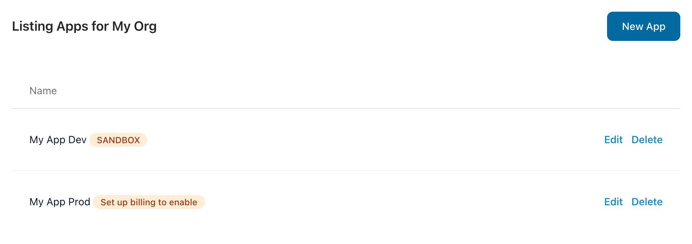

[Sign up](https://qubesync.com/users/register) and confirm your email. You'll land on **My Applications**,
with two apps ready: **My App Dev**, a sandbox app to build with, and **My App Prod** (make sure to rename) for when you launch.

<Frame caption="Every new organization starts with a sandbox app and a production app.">
  
</Frame>
