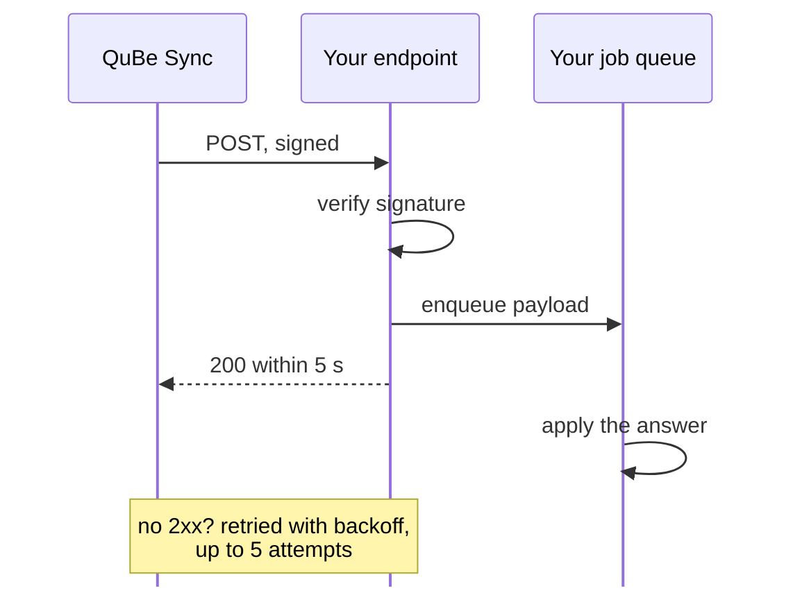

QuickBooks Desktop answers on its own schedule, so QuBe Sync pushes each answer to you rather than making
you poll. Pass a `webhook_url` with every request. It's a query parameter on every endpoint, whatever the
method. When QuickBooks answers, or the request fails, QuBe Sync POSTs the answered request there. A
[workflow run](#workflow-run-events) takes its `webhook_url` in the body that starts it, and reports on
the run rather than on each request.

## Webhook requirements

- It's an absolute `https://` or `http://` URL, such as `https://app.example.com/webhooks/qube`, of at
  most 2048 characters.
- QuBe Sync needs a publicly available URL (localhost doesn't work) to send to, so use a [tunnel](/ngrok) while you develop.
- Background the work of processing the webhook data, and respond quickly with a `200`




## The payload

This is a real webhook answer to creating a customer (`POST /customers`):

```json
{
  "id": "01a0e05d-8fdc-7531-9bcf-dbd53e26500c",
  "timestamp": 1790470625,
  "state": "response_received",
  "page": 1,
  "page_request_id": "01a0e05d-8fdc-7531-9bcf-dbd53e26500c",
  "iteration_state": "not_applicable",
  "app_id": "98f339a4-32e8-424a-987e-ccaf5bcaa620",
  "app_name": "My App Dev",
  "sandbox": true,
  "response_json": {
    "status": "success",
    "data": {
      "list_id": "80000024-1790470623",
      "edit_sequence": "1790470623",
      "name": "Northwind Builders",
      "full_name": "Northwind Builders",
      "email": "ap@northwind.example",
      "is_active": true,
      "balance": 0.0,
      "total_balance": 0.0,
      "sublevel": 0,
      "bill_address": { "addr1": "400 Congress Ave", "city": "Austin", "state": "TX", "postal_code": "78701" },
      "time_created": "2026-09-27T00:57:03",
      "time_modified": "2026-09-27T00:57:03"
    }
  },
  "response_xml": "<?xml version=\"1.0\"?><?qbxml version=\"16.0\"?><QBXML>...</QBXML>",
  "error": null
}
```

<ResponseField name="id" type="string">
  The request you queued, as returned by the `201`. For a multi-page answer, every page carries the first
  page's `id`.
</ResponseField>
<ResponseField name="state" type="string">
  Why you're being told: `response_received`, `error`, `retryable`, `timed_out` or `discarded`. See below.
</ResponseField>
<ResponseField name="response_json" type="object | null">
  QuickBooks' answer as JSON. Either `{"status": "success", "data": ...}` or
  `{"status": "error", "error": {"code", "type", "message"}}`. A query's `data` is always a list; a create
  or update's `data` is the record. A success also has `warning`, `{"code", "message"}`, when QuickBooks
  did what you asked but warned about something, such as a field it didn't save. See
  [Warnings](/error_handling#quickbooks-said-yes-with-a-warning).
</ResponseField>
<ResponseField name="error" type="object | null">
  Set when `state` is `error` or `retryable`: `error_type`, `error_code`, `message`, `user_message` (safe
  to show your customer), `hresult` and `debug_message`. See [Error handling](/error_handling).
</ResponseField>
<ResponseField name="page, page_request_id, iteration_state" type="integer, string, string">
  For [paginated](/pagination) answers. Each page has its own `page_request_id`; `iteration_state` is
  `continue` until the last page, which is `done`. Pages can arrive in any order, so count the pages
  instead of waiting for the `done` one ([how](/pagination#telling-pages-apart)). It's `not_applicable`
  for a single-page answer. A `retryable` and the final webhook for the same page share its
  `page_request_id`: tell them apart by `state`.
  <Tip>
      To ensure pages arrive in the correct order, you can use a [Workflow](/workflows) that sends a webhook
      per page and waits for a `200` response before sending the next webhook.
  </Tip>
</ResponseField>
<ResponseField name="timestamp" type="integer">
  Unix seconds when this delivery was signed. It's also the `t=` in the signature header.
</ResponseField>
<ResponseField name="app_id, app_name, sandbox" type="string, string, boolean">
  The app the request belongs to. Handy when one endpoint serves both your sandbox and production apps.
</ResponseField>
<ResponseField name="response_xml" type="string | null">
  The raw qbXML QuickBooks sent back, if you ever need it.
</ResponseField>

## What `state` tells you

| `state` | What happened | What to do |
| --- | --- | --- |
| `response_received` | QuickBooks answered. | Apply `response_json.data`. |
| `error` | It failed for good. Usually QuickBooks refused it (a duplicate name, a stale `edit_sequence`). | Branch on `response_json.error.code`; show your customer `error.user_message`. |
| `retryable` | The Web Connector couldn't get it into QuickBooks: QuickBooks wasn't running, a dialog was open, or the wrong company file was. Nothing was applied. | **Don't resend.** QuBe Sync keeps trying. Show your customer `error.user_message` so they can fix it. |
| `timed_out` | QuickBooks received it, but the session ended without an answer. | Queries are safe to queue again. For a create or update, check whether it was applied first. A workflow's requests send no webhook, and the run [settles](/workflows#lost-answers) a lost answer itself. |
| `discarded` | Your app [discarded](/error_handling#when-quickbooks-is-out-of-reach) it before the Web Connector took it. | Nothing: QuickBooks never saw it. |

A `retryable` webhook arrives when the error first appears and again only if it changes. The next webhook
after that is usually the answer. It carries the same `id` and `page_request_id` as the `retryable` one;
only `state` differs.

## Respond quickly, work later

Answer with any **2xx** status within **5 seconds**. The body is ignored. Put the work in a background job:

- Anything else counts as a failed delivery: a 3xx (redirects aren't followed), 4xx or 5xx, a timeout,
  or a refused connection. QuBe Sync retries with backoff, up to 5 attempts in all. After the last one the
  request's `webhook_state` becomes `failed`, your organization's owners get an email, and the dashboard
  offers **Resend webhook**. A workflow run's deliveries are retried the same way, but
  [end differently](#workflow-run-events).
- A delivery to an address webhooks [may not go to](#where-webhooks-can-go), such as a hostname that now
  resolves to a private address, isn't sent or retried: it fails at once with "Webhook not sent: ...",
  and the owners get the email.
- Deliveries can arrive out of order and, after a retry, more than once. Key your processing on
  `page_request_id` **plus `state`**. A `retryable` webhook isn't final: the same request or page can
  arrive again later with the same `id` and `page_request_id` and a different `state` (`response_received`,
  `error`, `timed_out` or `discarded`). That's the answer, not a repeat. A retried delivery of the *same*
  `state` is the duplicate to drop. Keying on `page_request_id` alone drops the answer.

Workflow runs post to the same kind of endpoint, with a different body: theirs has an `event` starting
`workflow_run.` and no `id` or `page_request_id` ([below](#workflow-run-events)). If one endpoint takes
both, send each to its own job:

```ruby
# app/controllers/qube_webhooks_controller.rb
class QubeWebhooksController < ActionController::API
  def create
    payload = QubeWebhook.verify!(request.raw_post, request.headers["X-QUBE-Signature"])
    if payload["event"].to_s.start_with?("workflow_run.")
      WorkflowRunEventJob.perform_later(payload)
    else
      QuickbooksAnswerJob.perform_later(payload)
    end
    head :ok
  rescue QubeWebhook::Invalid
    head :unauthorized
  end
end
```

```ruby
# app/jobs/quickbooks_answer_job.rb
class QuickbooksAnswerJob < ApplicationJob
  def perform(answer)
    request = QuickbooksRequest.find_by(qube_id: answer["id"]) or return
    # A retryable webhook and the answer share an id: tell them apart by state, never by id alone.
    request.update!(state: answer["state"])
    return unless answer["state"] == "response_received"

    data = answer.dig("response_json", "data")
    case request.purpose
    when "import_customers"
      Array(data).each do |attrs|
        request.account.customers.find_or_initialize_by(qb_list_id: attrs["list_id"])
          .update!(name: attrs["full_name"], email: attrs["email"])
      end
    when "add_customer"
      request.subject.update!(qb_list_id: data["list_id"])
    end
  end
end
```

## Verify the signature

Every delivery carries an `X-QUBE-Signature` header: a timestamp and one HMAC-SHA256 signature per active
webhook secret on your app.

```
X-QUBE-Signature: t=1790470625,v1=5257a869e7ecebeda32affa62cdca3fa51cad7e98f1da4da5da4f3a1f2a3d5e6
```

To check it:

1. Split the header on `,` and each part on the first `=`. Take `t` and every `v1` value.
2. Compute the hex-encoded HMAC-SHA256 of `"<t>.<raw request body>"` with your webhook secret.
3. Accept the delivery if it equals any `v1` value (compare in constant time) and `t` is recent.

Use the **raw bytes** you received. Verify before parsing, and never re-serialize the JSON first.

<CodeGroup>
```ruby Ruby
require "openssl"
require "json"

module QubeWebhook
  class Invalid < StandardError; end

  # max_age is in seconds
  def self.verify!(body, header, max_age: 300)
    parts = header.to_s.split(",").map { |part| part.split("=", 2) }
    timestamp = parts.find { |k, _| k == "t" }&.last.to_i
    signatures = parts.select { |k, _| k == "v1" }.map(&:last)
    raise Invalid, "stale webhook" if timestamp < Time.now.to_i - max_age

    expected = OpenSSL::HMAC.hexdigest("SHA256", ENV.fetch("QUBE_WEBHOOK_SECRET"), "#{timestamp}.#{body}")
    raise Invalid, "bad signature" unless signatures.any? { |sig| OpenSSL.secure_compare(sig, expected) }

    JSON.parse(body)
  end
end
```

```python Python
import hashlib, hmac, json, os, time

def verify_webhook(body: bytes, header: str, max_age: int = 300) -> dict:
    parts = [part.split("=", 1) for part in header.split(",")]
    timestamp = int(next(v for k, v in parts if k == "t"))
    signatures = [v for k, v in parts if k == "v1"]
    if timestamp < time.time() - max_age:
        raise ValueError("stale webhook")

    secret = os.environ["QUBE_WEBHOOK_SECRET"].encode()
    expected = hmac.new(secret, f"{timestamp}.".encode() + body, hashlib.sha256).hexdigest()
    if not any(hmac.compare_digest(sig, expected) for sig in signatures):
        raise ValueError("bad signature")

    return json.loads(body)
```

```javascript Node.js
const crypto = require("crypto");

// maxAge is in seconds; body is the raw request body (a string or Buffer)
function verifyWebhook(body, header, maxAge = 300) {
  const parts = header.split(",").map((part) => part.split("=", 2));
  const timestamp = Number(parts.find(([k]) => k === "t")?.[1]);
  const signatures = parts.filter(([k]) => k === "v1").map(([, v]) => v);
  if (timestamp < Date.now() / 1000 - maxAge) throw new Error("stale webhook");

  const expected = Buffer.from(
    crypto.createHmac("sha256", process.env.QUBE_WEBHOOK_SECRET).update(`${timestamp}.${body}`).digest("hex")
  );
  const ok = signatures.some((sig) => {
    const given = Buffer.from(sig);
    return given.length === expected.length && crypto.timingSafeEqual(given, expected);
  });
  if (!ok) throw new Error("bad signature");

  return JSON.parse(body);
}
```

```elixir Elixir
def verify_webhook(body, header, max_age \\ 300) do
  parts = header |> String.split(",") |> Enum.map(&String.split(&1, "=", parts: 2))
  timestamp = Enum.find_value(parts, fn [k, v] -> k == "t" && String.to_integer(v) end)
  signatures = for ["v1", sig] <- parts, do: sig

  if timestamp < System.system_time(:second) - max_age, do: raise("stale webhook")

  expected =
    :crypto.mac(:hmac, :sha256, System.fetch_env!("QUBE_WEBHOOK_SECRET"), "#{timestamp}.#{body}")
    |> Base.encode16(case: :lower)

  unless Enum.any?(signatures, &Plug.Crypto.secure_compare(&1, expected)),
    do: raise("bad signature")

  Jason.decode!(body)
end
```
</CodeGroup>

**Why check the timestamp?** It stops someone replaying a captured delivery. Every delivery, retries
included, is signed afresh, so a healthy receiver never sees an old one. Five minutes is a sensible limit.

## Rotate your webhook secret

An app can have several webhook secrets, and each delivery is signed with all of them. That header carries
one `v1=` per secret, so you can rotate without dropping a delivery:

1. Generate a new secret in the dashboard (**My Applications**, then your app).
2. Deploy it to your app, accepting a match against either secret.
3. Expire the old secret. An app always keeps at least one.

## Workflow run events

[Workflow runs](/workflows) report to the `webhook_url` you start them with, using the same signature.
Their events are `workflow_run.awaiting_input`, `workflow_run.notification`, `workflow_run.completed`,
`workflow_run.failed` and `workflow_run.cancelled`. `workflow_run.awaiting_input` carries a `prompt`, and `prompt.kind` says what it
is: `decision` for a question the chart asks, `conflict` when the run asks about a record someone changed
before an update landed. The requests a workflow sends don't send webhooks of their own. A run started
without a `webhook_url` sends none.

Every event has `event`, `timestamp`, `app_id`, `sandbox`, `connection_id`, `workflow`, `workflow_id`,
`run_id` and `links`. The three endings add `outcome`, `output`, `error` and `summary`, and a cancelled run
adds `cancel_reason`. A run's `error` is a sentence, not the error object a request's webhook carries. See
[Workflow webhooks](/workflows#webhooks) for examples.

### Data a workflow sends you

A workflow can hand your app data while it runs, from a [`notify` state](/workflows#sending-your-app-data)
("Send to the app" in the builder): every customer a page at a time, say. Each one is a
`workflow_run.notification` with the usual fields plus:

| Field | |
| --- | --- |
| `delivery_id` | The notification's id, **the same on every retry of it**. Deduplicate on it: delivery is at least once. |
| `seq` | 1, 2, 3… for the run, in the order its notifications were sent, workflows it calls included. |
| `name` | What to route on, such as `customers_page`: the state's `name`. |
| `state` | Where it was sent from, as a path from the run (`sync_page / send_customer` inside a workflow it calls). |
| `from` | `null`, or the workflow the run called that sent it: `{"workflow", "state"}`, with `item_index` and `item_count` inside a state that runs once per item. Never a run id: `run_id` is always the run you started. |
| `data` | What the state sends: any JSON, at most 4 MB. |

```json
{
  "event": "workflow_run.notification",
  "timestamp": 1758000000,
  "app_id": "018f0000-0000-7000-8000-000000000003",
  "sandbox": false,
  "connection_id": "018f0000-0000-7000-8000-000000000001",
  "workflow": "send_lists_to_app",
  "workflow_id": "018f0000-0000-7000-8000-000000000004",
  "run_id": "018f0000-0000-7000-8000-000000000000",
  "links": {"run": "https://qubesync.com/api/v2/connections/…/workflow-runs/…", "decisions": "…", "cancel": "…", "ui": "…"},
  "delivery_id": "018f0000-0000-7000-8000-000000000005",
  "seq": 1,
  "name": "customers_page",
  "state": "send_customers",
  "from": null,
  "data": {"page": 1, "more": true, "customers": [{"list_id": "80000001-1738310400", "full_name": "Acme Co"}]}
}
```

- **Order.** The run **waits for your `2xx`** before it goes on, so notifications arrive one at a time,
  in `seq` order, and every one before the run's ending webhook: `workflow_run.completed` means everything
  was sent. A slow endpoint slows the run; it never piles deliveries up.
- **Retries** last longer than a run's other webhooks: 10 attempts over about an hour (15 s, 30 s, 1, 2,
  4, 8, then 15 minutes apart), each with the same `delivery_id`, recorded in the run's log
  (`notification_queued`, then `notification_delivered` or `notification_failed`). If none succeeds,
  your organization's owners get an email and the state raises an error (`not_delivered`) that the
  workflow can handle -- otherwise the run fails, its `error` reading "could not deliver customers_page
  #3 to the app after 10 attempts: …". Data over 4 MB is never sent (`too_large`): send fewer records at
  a time, a smaller `page_size`.
- **A `webhook_url` is required** to start a workflow that has a `notify` state, or calls one that has:
  without one the start is refused with [`422 webhook_url_required`](/error_handling#when-qube-sync-refuses-a-request).
- `summary.notifications` on the ending counts what was `sent` and what `failed`.

- **Retries** work as above, up to 5 attempts, and every attempt is recorded in the run's event log as
  `webhook_sent`. When they all fail, your organization's owners get an email, as for a request's
  webhook. There's no **Resend** for a run, though: read it with `GET links.run` instead.
- **Repeats**: a run ends once, so key endings on `run_id`. Each delivery is built when it's sent, from the
  run as it is then, so a retried `workflow_run.awaiting_input` that arrives after the question was
  answered has no `prompt`.

```ruby
# app/jobs/workflow_run_event_job.rb
class WorkflowRunEventJob < ApplicationJob
  def perform(event)
    run = OrderSync.find_by(qube_run_id: event["run_id"]) or return # where you stored the run's id
    return if run.finished? # a repeat, or a question retried after the end

    case event["event"]
    when "workflow_run.notification"
      # Already handled if this delivery_id was seen: a retry repeats it.
      return if run.deliveries.exists?(delivery_id: event["delivery_id"])

      ImportPage.call(run, event["name"], event["data"]) # e.g. customers_page
      run.deliveries.create!(delivery_id: event["delivery_id"])
    when "workflow_run.awaiting_input"
      run.update!(status: "waiting", question: event["prompt"]) if event["prompt"]
    when "workflow_run.completed"
      run.update!(status: "done", outcome: event["outcome"], output: event["output"])
    when "workflow_run.failed", "workflow_run.cancelled"
      run.update!(status: "stopped", outcome: event["outcome"], error: event["error"] || event["cancel_reason"])
    end
  end
end
```

## In development

QuBe Sync has to reach your endpoint over the internet, so a `localhost` URL is refused. Use a tunnel
while you develop ([how](/ngrok)), or open the request's `links.ui` to see the answer in the dashboard.
