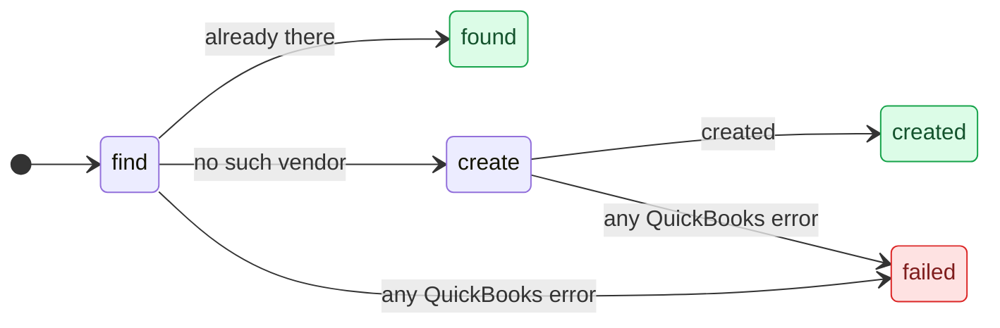
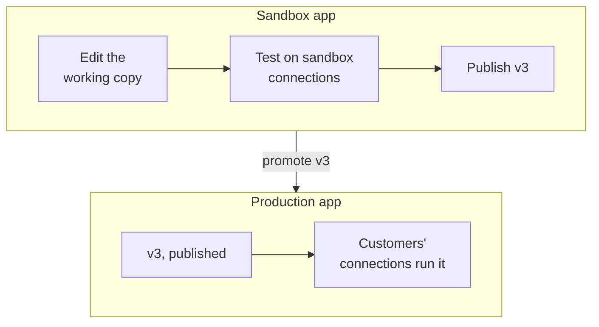

A workflow is one JSON document: a statechart QuBe Sync runs against a QuickBooks company file. You can
build one on the dashboard's canvas, write the JSON yourself, or have an AI assistant write it. The charts
are designed so an assistant writes them well and a person can review them.

## Anatomy of a chart

Here is the whole of the shipped `find_or_create_vendor` template:

```json find_or_create_vendor.json
{
  "version": 1,
  "key": "find_or_create_vendor",
  "name": "Find or create vendor",
  "description": "Looks a vendor up by full name and creates it only if it isn't there yet.",
  "input": {
    "vendor": { "type": "operation", "operation": "vendor.create", "required": true }
  },
  "outcomes": {
    "found": { "description": "A vendor with this name was already there; nothing was created." },
    "created": { "description": "No vendor had this name, so it was created from the vendor you sent." }
  },
  "initial": "find",
  "on": {
    "error": [{ "description": "any QuickBooks error", "target": "failed", "assign": { "error": "${response.error.message}" } }]
  },
  "states": {
    "find": {
      "type": "request",
      "description": "Look for a vendor with this exact full name.",
      "operation": "vendor.query",
      "params": { "full_name": ["${input.vendor.name}"] },
      "on": {
        "success": [
          { "description": "already there", "if": { "path": "response.data", "op": "present" },
            "target": "found", "assign": { "vendor": "${response.data.0}" } },
          { "description": "no such vendor", "target": "create" }
        ]
      }
    },
    "create": {
      "type": "request",
      "description": "Not there yet -- create it from the caller's own vendor.create body.",
      "operation": "vendor.create",
      "params": { "$from": "${input.vendor}" },
      "on": {
        "success": [{ "description": "created", "target": "created", "assign": { "vendor": "${response.data}" } }]
      }
    }
  },
  "output": { "outcome": "${meta.outcome}", "vendor": "${vars.vendor}" }
}
```



<AccordionGroup>
  <Accordion title="Inputs" icon="right-to-bracket">
    `input` declares what a run is started with. An input of `"type": "operation"` accepts exactly the body
    that operation's REST endpoint takes. Here, `vendor` is anything you could `POST /vendors`, and it is
    validated the same way before the run starts. Add `"list": true` for a list of them.
  </Accordion>
  <Accordion title="States" icon="circle-nodes">
    | Type | What it does |
    | --- | --- |
    | `request` | Sends one QuickBooks operation (`"operation": "customer.create"`) with `params`, or several with `requests`. Raises `success` or `error`. |
    | `wait` | Pauses and asks your app a question: a `prompt` with a `message`, optional `data`, and `options` (each may ask for `fields`). Raises the chosen option's id. |
    | `workflow` | Runs another workflow as one step. With `each`, runs it once per item of a list. |
    | `transform` | Sets variables, then moves on. |
    | `choice` | A pure branch point. |
    | `compound` | Groups states, with its own `initial`. Catches events its children don't handle. |
    | `final` | Ends a compound state. |
  </Accordion>
  <Accordion title="Transitions and conditions" icon="arrows-split-up-and-left">
    Each event maps to a list of transitions, tried in order: `{"if": ..., "target": ..., "assign": ..., "description": ...}`.
    The first whose `if` passes wins. Conditions are `{"path", "op", "value"}` with `op` one of `present`,
    `absent`, `eq`, `neq`, `gt`, `gte`, `lt`, `lte`, `contains`, `starts_with` or `in`, combined with
    `all`, `any` and `not`. An event no state handles bubbles up to the root. Put `error → failed` there once,
    and handle only the specific QuickBooks codes you care about (3100, 3200...) where they happen.
  </Accordion>
  <Accordion title="Templates" icon="brackets-curly">
    Any string can reference the run's context with `${...}`: `input.*`, `vars.*`, `states.<path>.response`,
    `meta.today`, and during a transition `response` and `decision`. `"$from"` uses a value as the base of a
    map, which is how `create` above passes the caller's whole vendor through. `"$map"` builds a list from a
    list.
  </Accordion>
  <Accordion title="Outcomes" icon="flag-checkered">
    `completed` and `failed` always exist. Declare more under `outcomes`, each with a `description` saying
    why a run can end that way. A declared outcome is a success unless it has `"kind": "failure"`. Your app
    branches on the run's `outcome`, so name every ending it should treat differently.
  </Accordion>
  <Accordion title="Descriptions" icon="comment">
    Every state, outcome and branching transition takes a `description`. It's drawn on the canvas and shown
    in the usage contract, and it's where the chart explains itself: "a vendor has that name" rather than
    "success".
  </Accordion>
</AccordionGroup>

The full rules are in the chart's JSON Schema, served at
[`/api/v2/workflows/schema.json`](https://qubesync.com/api/v2/workflows/schema.json), and in the authoring
guide below.

## Write one with an AI assistant

Charts are built to be written by an assistant and reviewed by a person. Describe the job in prose (what
should happen, and what should happen when QuickBooks says no) and let the assistant write the JSON. Its
reasoning ends up in the `description` fields, where the next person will read it.

<Steps>
  <Step title="Give it the rules">
    Connect your assistant to the [MCP server](/mcp-server). Its `get_workflow_authoring_guide` tool returns
    the chart rules, the JSON Schema and a worked example, and `list_workflow_templates` and
    `get_workflow_template` give it tested charts to start from. In the dashboard, a chart's
    **Prompt for an LLM** tab has the same guide, plus the exact parameters and error codes of every
    operation that chart uses.
  </Step>
  <Step title="Let it check its work">
    The assistant validates the chart until it's clean, with the MCP `validate_workflow_chart` tool, or:

    ```bash
    curl -u "$QUBE_API_KEY:" -X POST https://qubesync.com/api/v2/workflows/validate \
      -H "Content-Type: application/json" -d @chart-request.json   # {"definition": {...}}
    ```

    It always answers `200`, with `valid`, every `error` (each with the path to the problem), and `warnings`
    for things that are allowed but probably wrong, such as an unreachable state.
  </Step>
  <Step title="Save it">
    ```bash
    curl -u "$QUBE_API_KEY:" -X PUT https://qubesync.com/api/v2/workflows/find_or_create_vendor \
      -H "Content-Type: application/json" -d '{"definition": {...}}'
    ```

    `PUT` creates or replaces by key, so charts can live in your repository and be pushed from a deploy
    script. The [CLI](/cli) does the same: `qube workflows push ./chart.json`.
  </Step>
  <Step title="Hand the other side to your assistant too">
    `GET /api/v2/workflows/{key}/usage.md` describes how to call the workflow, generated from the chart
    itself: how to start it, every question it can ask (with example webhooks and answers), every outcome and
    what's in its output. Give it to whatever writes your app's side. In the dashboard it's
    **How do I use this?**.
  </Step>
</Steps>

## Test it

Run it against a [simulated connection](/simulator) from the dashboard's **Run** panel or the API, then
open the run's page: the canvas highlights the path it took, and the trace, requests, context and summary
show every step. Use the simulator's faults to walk the unhappy paths: a 3100 on the create, QuickBooks
closed halfway through, a 3200 on an update.

## Versions and publishing

A workflow has a **working copy**, which is what you edit, and numbered **published versions**, which are
immutable snapshots.

| Connection | Runs |
| --- | --- |
| Sandbox or simulated | The working copy, by default. Pass `"version": "published"` or a number to run a specific version. |
| Production | Always the published version. A workflow that has never been published can't run there. |

Publish with `POST /api/v2/workflows/{key}/publish` (with optional `notes`), with `"publish": true` on the
`PUT`, or with **Publish** in the dashboard, which shows what changed since the last version. **History**
lists every version with its notes and author. You can compare any version with the working copy and
restore it into the working copy, then publish it again.

A run that has already started finishes on the version it started with, even if you publish mid-run or
delete the workflow.

## From sandbox to production

Build and publish in your sandbox app. Then **promote** the published version to your production app:



**Promote** in the dashboard copies a published version into another app under the same key. It brings
along the workflows it calls, shows what will change in the target, and records where each version came
from. Promotion deliberately has no API: it's the step where a person, not a script or an assistant,
moves a chart to production.

Before promoting, QuBe Sync warns about **values that belong to one company file**: a `list_id` or
`txn_id` written into the chart, or a hard-coded reference. They work against your test company and fail
in your customers' files. Pass them in as inputs, or look them up by name in a query state. You have to
acknowledge the warning to promote.

To make production workflows change only through promotion, turn on **Workflows in production apps can only
change by promotion**, an organization setting on the dashboard's **Workflows** page. Editing, installing and deleting are then
refused for production apps (`promotion_required`), while publishing and history stay available.

<Tip>
  Deploying from CI instead? Read the version with your sandbox key
  (`GET /api/v2/workflows/{key}/versions/{n}`) and `PUT` it with your production key.
</Tip>
