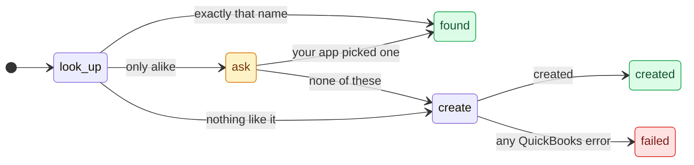
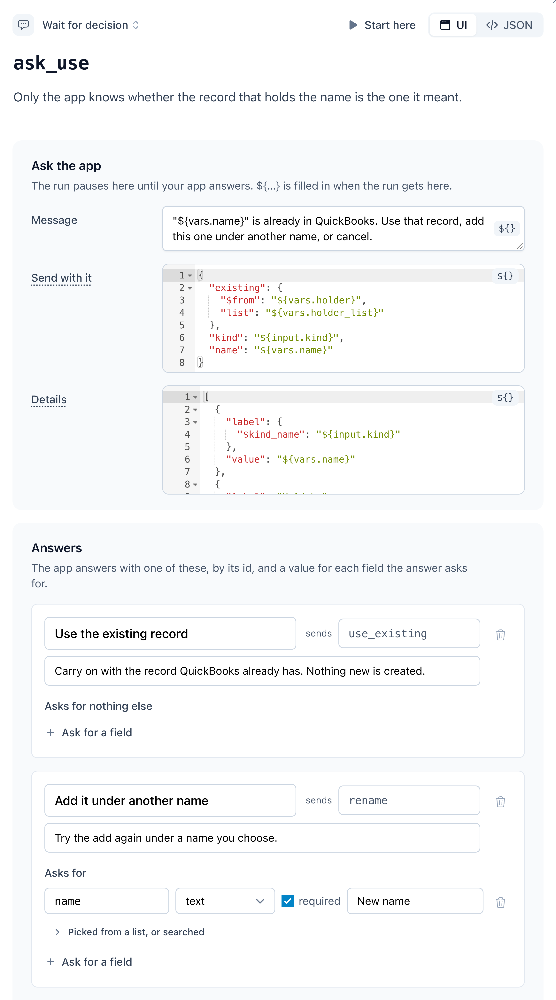
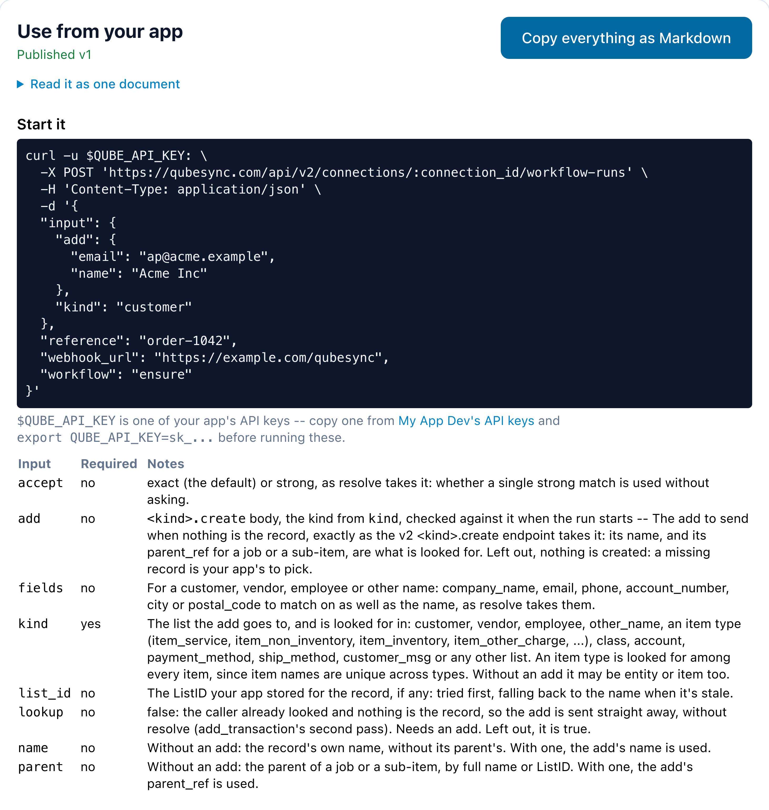
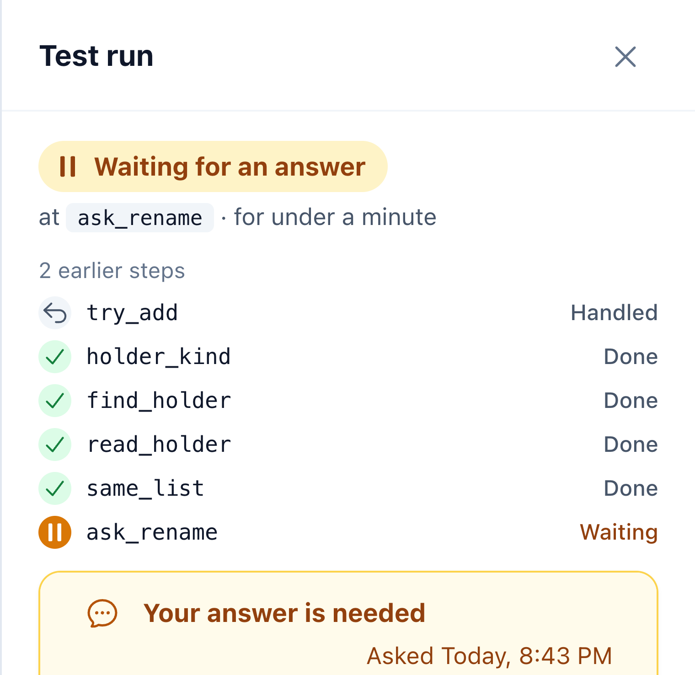
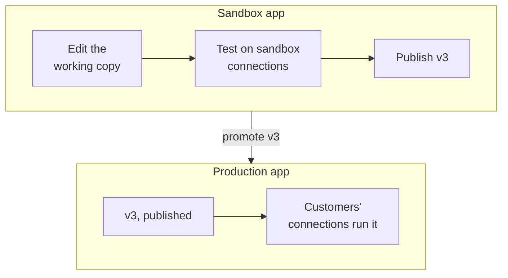
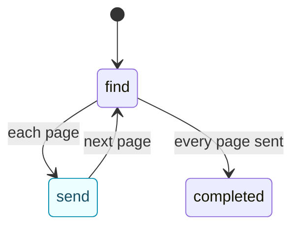
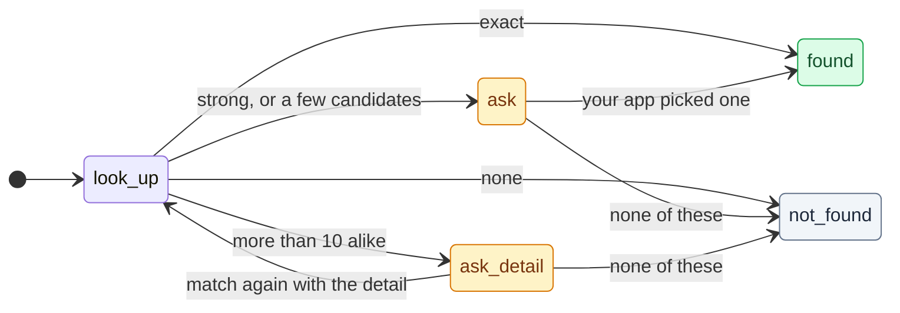

import { Request } from "/snippets/request.jsx";

A workflow is one JSON document: a statechart QuBe Sync runs against a QuickBooks company file. Build it on
the dashboard's canvas, write the JSON yourself, or have an AI assistant write it. Charts are designed so an
agent writes them well and a person can review them.

| To | Read |
| --- | --- |
| Learn what a chart is made of | [Anatomy of a chart](#anatomy-of-a-chart) |
| Build one | [In the dashboard](#build-it-in-the-dashboard) or [with an AI assistant](#write-one-with-an-ai-assistant) |
| Ship it | [Test it](#test-it), [Versions and publishing](#versions-and-publishing), [From sandbox to production](#from-sandbox-to-production) |
| Reuse what's shipped | [Composing workflows](#composing-workflows), [One chart for any record type](#one-chart-for-any-record-type) |
| Send your app data mid-run | [Sending your app data from a chart](#sending-your-app-data-from-a-chart) |
| Identify a record by a name your app writes differently | [Matching names in a chart](#matching-names-in-a-chart) |
| Handle what QuickBooks does | [Settling lost answers](#settling-lost-answers), [Conflicts in a chart](#conflicts-in-a-chart) |

## Anatomy of a chart

Let's break down a short chart, one part at a time. It finds the customer your app means by name, uses it when
the name matches exactly, asks your app when the name only looks like one, and adds the customer when there's
nothing like it. The shipped [`ensure`](/workflows#pick-a-template) does the same for any kind of record, and
also handles a name another list already has.



<Steps>
  <Step title="The run's inputs (from you, or another workflow)">
    Operations take exactly the same inputs as their corresponding REST endpoint. Here, it will need the body [`customer.create`](/api-reference/v2/customers/create-customer) takes.

    ```json input (abridged)
    "input": {
      "customer": {
        "type": "operation",
        "operation": "customer.create",
        "required": true,
        "description": "The customer to add…"
      }
    }
    ```
  </Step>
  <Step title="How it can end">
    `completed` and `failed` always exist. These two tell your app which way it worked.

    ```json outcomes (abridged)
    "outcomes": {
      "found": {
        "description": "A customer has this…"
      },
      "created": {
        "description": "Nothing was like it…"
      }
    }
    ```
  </Step>
  <Step title="What each state sends">
    `look_up` asks the connection's [name index](/matching) for the name. `ask` asks your app. `create` sends the
    caller's own body, with `$from`.

    <CodeGroup>
    ```json look_up
    "look_up": {
      "type": "match",
      "kind": "customer",
      "name": "${input.customer.name}",
      "on": { … }
    }
    ```

    ```json ask
    "ask": {
      "type": "wait",
      "prompt": {
        "message": "No customer has exactly…",
        "data": { "found": "${vars.found}" },
        "options": [
          { "id": "use", … },
          { "id": "add", … }
        ]
      },
      "on": { … }
    }
    ```

    ```json create
    "create": {
      "type": "request",
      "operation": "customer.create",
      "params": {
        "$from": "${input.customer}"
      },
      "on": { … }
    }
    ```
    </CodeGroup>
  </Step>
  <Step title="Where each answer leads">
    Tried in order: the first whose `if` passes wins. Each `description` is drawn on the canvas. A match always
    raises `success`, so `look_up` branches on how sure its answer is.

    ```json states.look_up.on
    "success": [
      {
        "description": "exactly that name",
        "if": {
          "path": "response.data.match",
          "op": "eq",
          "value": "exact"
        },
        "target": "found",
        "assign": {
          "list_id": "${response.data.record.list_id}"
        }
      },
      { "description": "nothing like it", … },
      {
        "description": "only alike: ask",
        "target": "ask",
        "assign": { "found": "${response.data}" }
      }
    ]
    ```
  </Step>
  <Step title="One error handler, at the root">
    States can detect and branch on errors, but sometimes a catch-all is better. An error that's unhandled in the state where it happens bubbles up. This transition on the workflow root catches any error unhandled by the states themselves.

    ```json on
    "on": {
      "error": [
        {
          "description": "any QuickBooks error",
          "target": "failed",
          "assign": {
            "error": "${response.error.message}"
          }
        }
      ]
    }
    ```
  </Step>
  <Step title="What the run returns">
    Rendered when the run ends, from two places:

    | From | Holds |
    | --- | --- |
    | `vars` | The global data context for the chart. States and transitions can `assign` values there. Here, `vars.list_id` is set by `look_up`'s "exactly that name" branch, by `ask`'s `use` answer or by `create`'s success. |
    | `meta` | Info the run collects automatically. `meta.outcome` is the outcome it ended on, `found` or `created` ([Templates](#templates) lists the rest). |

    ```json output
    "output": {
      "outcome": "${meta.outcome}",
      "list_id": "${vars.list_id}"
    }
    ```
  </Step>
</Steps>

<Accordion title="The whole chart" description="find_or_add_customer.json" icon="code">
  ```json find_or_add_customer.json
  {
    "version": 1,
    "key": "find_or_add_customer",
    "name": "Find or add a customer",
    "description": "Finds the customer your app means by name, asks your app when the name only looks like one, and adds the customer when there is nothing like it.",
    "input": {
      "customer": { "type": "operation", "operation": "customer.create", "required": true,
                    "description": "The customer to add if it isn't there, exactly as you would POST it to the v2 customer.create endpoint. Its name is what is looked for." }
    },
    "outcomes": {
      "found": { "description": "A customer has this name, or your app picked one. Nothing was added." },
      "created": { "description": "Nothing was like it, or your app said none of them is it, so the customer you sent was added." }
    },
    "initial": "look_up",
    "on": {
      "error": [{ "description": "any QuickBooks error", "target": "failed", "assign": { "error": "${response.error.message}" } }]
    },
    "states": {
      "look_up": {
        "type": "match",
        "description": "QuickBooks finds a name only as it's spelled, so the name index ranks the file's customers against it instead.",
        "kind": "customer",
        "name": "${input.customer.name}",
        "on": {
          "success": [
            { "description": "exactly that name", "if": { "path": "response.data.match", "op": "eq", "value": "exact" },
              "target": "found", "assign": { "list_id": "${response.data.record.list_id}" } },
            { "description": "nothing like it", "if": { "path": "response.data.match", "op": "eq", "value": "none" },
              "target": "create" },
            { "description": "only alike: ask", "target": "ask", "assign": { "found": "${response.data}" } }
          ]
        }
      },
      "ask": {
        "type": "wait",
        "description": "Acme Inc and Acme LLC can be two companies: only your app knows which one it meant, if either.",
        "prompt": {
          "message": "No customer has exactly that name. Pick the one you meant, or add it as a new customer.",
          "data": { "found": "${vars.found}" },
          "details": [{ "label": "Customer", "value": "${input.customer.name}" }],
          "options": [
            { "id": "use", "label": "Use this one",
              "fields": { "list_id": { "type": "string", "required": true, "label": "The customer",
                "choose": { "from": "${vars.found.candidates}", "value": "${item.list_id}",
                            "label": "${item.full_name}", "detail": "${item.reasons}" },
                "record": { "kind": "customer", "label": "Another customer…" } } } },
            { "id": "add", "label": "None of these: add it" }
          ]
        },
        "on": {
          "use": [{ "description": "your app picked one", "target": "found", "assign": { "list_id": "${decision.data.list_id}" } }],
          "add": [{ "description": "none of these", "target": "create" }]
        }
      },
      "create": {
        "type": "request",
        "description": "Nothing like it: add it from the caller's own customer.create body.",
        "operation": "customer.create",
        "params": { "$from": "${input.customer}" },
        "on": {
          "success": [{ "description": "created", "target": "created", "assign": { "list_id": "${response.data.list_id}" } }]
        }
      }
    },
    "output": { "outcome": "${meta.outcome}", "list_id": "${vars.list_id}" }
  }
  ```
</Accordion>

### Every key, for reference

<AccordionGroup>
  <Accordion title="Inputs" description="type, list, example, schema, only, enum, body_of" icon="right-to-bracket">
    `input` declares what a run is started with. A run whose input doesn't match is refused before anything
    is sent.

    | Key | What it does |
    | --- | --- |
    | `type` | `string`, `number`, `boolean`, `object`, `array` or `operation`. |
    | `list` | `true` for a list of them. |
    | `required`, `description` | Optional. |
    | `example` | What the usage contract's start body and the dashboard's Run drawer show, in the input's own JSON type. An operation input needs none: its example is built from the operation. Nor does a list of objects a `workflow` state runs through one at a time: its example is one element of what that workflow takes. |
    | `operation` | For `"type": "operation"`: the input accepts exactly the body that operation's REST endpoint takes, validated the same way. Here, `customer` is anything you could `POST /customers`. Leave `operation` out and the input takes an operation *and* its params, so one chart can serve any record type ([One chart for any record type](#one-chart-for-any-record-type)). |
    | `schema` | For an `object` or `array` input, or a `list` of anything but operations: what one value (one element, for a list) has to look like, as JSON Schema's `type`, `properties`, `required`, `additionalProperties`, `items`, `enum` and `description`, plus `body_of` on a property (below). `{"type": "object", "example": {"name": "Acme"}, "schema": {"properties": {"name": {"type": "string"}, "email": {"type": "string"}}, "required": ["name"], "additionalProperties": false}}` refuses a run whose input has no `name`, or a field besides `name` and `email`, naming the field (`input.customer.name: is required`). The example has to match it, the builder offers its fields as references, and a `${input.customer.<field>}` it doesn't list is a warning. Other JSON Schema keywords are refused rather than ignored. In the dashboard, **Make one from the example** writes one from the example's types. |
    | `enum` | For a `string` input: the values a run may give it. `add_transaction`'s `operation` lists the transaction adds, so `customer.create` is refused at the start. |
    | `body_of` | For an `object` input whose operation another input names: the run checks the body against that operation when it starts, as it does an operation input. `{"operation": "operation"}` when the other input holds an operation id (`add_transaction`'s `params`); `{"kind": "kind", "action": "create"}` when it holds a kind, for `<kind>.create` (`ensure`'s `add`; `update` and `query` are the other actions). The input it names is a `string` input. Inside a `schema`, it goes on an object property and names a property beside it (`add_transaction`'s `adds` entries). A field the operation doesn't take is refused before anything is sent (`input.params: unknown parameter: "customer_rf"`); required fields are checked when the request is sent, since the chart may fill some in. Your app's library writes a typed start per operation from it ([Typed starts in your code](/workflows#typed-starts-in-your-code)). |
    | `only` | Narrows an operation input to the parameters you name. `{"type": "operation", "operation": "customer.create", "only": ["name", "company_name", "email"]}` takes a customer's name, company and email and nothing else. A run started with more is refused, naming the field. |
  </Accordion>
  <Accordion title="States" description="the nine types, entry and exit" icon="circle-nodes">
    | Type | What it does |
    | --- | --- |
    | `request` | Sends one QuickBooks operation with `params`, or several with `requests`. Raises `success` or `error`. |
    | `wait` | Pauses and asks your app a question (**Wait states**, below). Raises the id of the option your app chose. |
    | `notify` | Sends your app data (`data`, under the `name` it routes on) and waits for its `2xx`. Raises `success` or `error` ([Sending your app data from a chart](#sending-your-app-data-from-a-chart)). |
    | `match` | Identifies a list record by name against the connection's name index. Always raises `success`, with the answer in `response.data` ([Match states](#match-states), [Matching names in a chart](#matching-names-in-a-chart)). |
    | `workflow` | Runs another workflow as one step, optionally once per item of a list ([Composing workflows](#composing-workflows)). |
    | `transform` | Sets variables, then moves on (`always`). |
    | `choice` | A pure branch point (`always`). |
    | `compound` | Groups states, with its own `initial`. Catches events its children don't handle. |
    | `final` | Only inside a compound. Entering it raises `done` on that compound. |

    Every state also takes `entry` and `exit`: assignments made when the run enters or leaves it.
    `upsert` counts its looks this way, and `add_transaction` its sends.
  </Accordion>
  <Accordion title="Wait states" description="prompt, details, choose, record" icon="comment">
    A `wait` state's `prompt` is the question. Your app shows every question the same way, from the
    `details` and `choices` the run builds when it asks ([Answering a question](/workflows#answering-a-question)),
    so write them for the person who answers.

    | Key | What it does |
    | --- | --- |
    | `message` | The question, a template. |
    | `data` | Anything the app needs beside it (the record found, the candidates), a template. |
    | `details` | What the question is about, as at most 20 `{"label", "value"}` rows, each a template: `[{"label": {"$kind_name": "${input.kind}"}, "value": "${vars.name}"}]` shows `Customer: Lone Star Supply Co`. A list renders as its parts joined with ` · `, and a row whose value renders to nothing is left out. |
    | `options` | The answers: each an `id` (the event it raises), a `label` and an optional `description` (both templates, so a button can say what follows, as `resolve`'s "None of these: add "Acme" as new" does), and the `fields` it asks for (`type`, `required`, `label`). Each becomes a choice. At most 26. |
    | `fields.<name>.choose` | One choice per element of `from` (a template that gives a list), the field already filled with what `value` renders to for it, so your app never handles the value: `{"from": "${vars.found.candidates}", "value": "${item.list_id}", "label": "${item.full_name}", "detail": "${item.reasons}"}`. The element is at `item`, bound only here. Its choices are `use:1`, `use:2`, ..., at most 25, and 26 in all. One field per option. |
    | `fields.<name>.record` | A search choice too, filled from the connection's name index: `{"kind": "${input.kind}", "label": "Use this one"}`, `label` being the button that sends the pick. `kind` is a list a match takes (`customer`, `entity`, `item`, an item type, `account`, ...). Every list but inventory sites can be searched, and workflows run only on realtime or simulated connections, which have the index. The field is a `string`: a search answers a ListID, which the chart should read before using. |
    | `fields.<name>.enum` | The values a `string` or `number` field takes, each with what a person reads: `[{"value": "item_service", "label": "Service"}]`. A drop-down; an answer outside it is refused. |
    | `fields.<name>` of type `rows` | The same columns asked of each row of a list, in one question ([A table of rows](/workflows#a-table-of-rows)). `rows` is `{"from": "${vars.asking}", "key", "label", "detail", "columns", "values"}`, templates over `item`, the element: `columns` the names the row asks, `values` what it already has. `columns` is a list of fields with a `name`, each with optional `enum`, `record` (`{"kind": "${item.kind}"}`) and `when` (`{"action": ["create"]}`: the values of the row's other columns it applies under). Answered as `{row key: {column: value}}`; at most 100 rows. |

    `{"$kind_name": "${input.kind}"}` is a kind, or an operation's (`invoice.create`), as a person reads it:
    `Customer`, `Service item`, `Invoice`. The validator checks every key, `item` outside a `choose`
    included. A template in `details` or a `choose` that doesn't render when the run asks fails the run, as a
    bad `message` does.
  </Accordion>
  <Accordion title="Request states" description="requests, settle, on_conflict" icon="paper-plane">
    | Key | What it does |
    | --- | --- |
    | `operation` | An operation id such as `customer.create`, or a template that renders to one, such as `"${input.find.operation}"`. |
    | `requests` | Several operations instead of one. The state raises `success` only when every answer succeeded; `response` is the first answer and `responses` all of them. |
    | `settle` | `false` skips [settling](#settling-lost-answers): a lost answer raises `no_response` at once, with `response.error.reason` saying why and, for an add, `response.error.external_guid`, the GUID it was sent with ([Doing the looking in the chart](#doing-the-looking-in-the-chart)). |
    | `on_conflict` | `ask` (the default), `overwrite` or `fail`: what happens when an update meets a record that changed after the run read it ([Conflicts in a chart](#conflicts-in-a-chart)). An update may leave `edit_sequence` out: the run reads the record first. |
    | `paginate`, `page_size` | Go through every result of a query (**Paging**, below). |
    | `qbxml_version` | Defaults to `16.0`. |

    **What it raises.** `success` or `error`, as QuickBooks answers.

    | When | The state raises |
    | --- | --- |
    | QuickBooks warned | `success` with `response.warning`, its `code` and `message`, such as `530` for a field it saved the record without ([Warnings](/error_handling#quickbooks-said-yes-with-a-warning)). |
    | QuickBooks never answered | Nothing until the run [settles it](#settling-lost-answers). Then `success` as if the answer had arrived, with `response.settled` saying how and `response.evidence` on what grounds, or `error` with `response.error.type` set to `unsettled` or `no_response`. |
  </Accordion>
  <Accordion title="Paging" description="page, success, error" icon="layer-group">
    With `"paginate": true`, a query goes through every result, `page_size` (1–200, default 100) at a time.

    | Event | When | What `response` holds |
    | --- | --- | --- |
    | `page` | For each page | `data`, that page's records; `page`, its number; `more`, whether more follow. Handle it by processing the page and coming back to the query, which delivers the next one. A `page` nothing handles is skipped. |
    | `success` | Once every page is in | `count` records over `pages` pages. The pages together can be counted or read one record at a time, but never copied into a variable, an output or params. |
    | `error` | The Web Connector session ended between pages | `no_response`: QuickBooks keeps an iteration only for the session that started it. Going back to the query starts again from page 1. |

    Customers, vendors, items and every transaction query page this way. A query QuickBooks doesn't iterate
    (accounts, classes and the other short lists, the deleted-records queries, the company queries, reports)
    answers whole and arrives as page 1 with `more` false, so the same chart works over it.
  </Accordion>
  <Accordion title="Notify states" description="name, data" icon="bell">
    | Key | What it does |
    | --- | --- |
    | `name` | What your app routes on. Lower case, like a state key. |
    | `data` | Any JSON, a template rendered as the state is entered, at most 4 MB. `response` is the response that entered the state: on a paginating query's `page`, that page, so `{"customers": "${response.data}"}` sends the page's records. Every page of a query is never sent at once: `${response.data}` on its `success` is refused. |

    | Event | When | What `response` holds |
    | --- | --- | --- |
    | `success` | Your app answered `2xx` | `delivery_id`, `seq` and `attempts`. |
    | `error` | Every attempt failed, or `data` is too large | `error.type`: `not_delivered` or `too_large`. |

    <Note>
      **It only ever goes to the run's `webhook_url`,** as a `workflow_run.notification`, never to a URL of
      the chart's own: `url`, `webhook_url`, `operation`, `params`, `prompt`, `workflow`, `input`, `each`
      and `always` are refused. A workflow with a notify state, or calling one with one, can't start without a
      `webhook_url` (`422 webhook_url_required`).
    </Note>
  </Accordion>
  <Accordion title="Match states" description="kind, name, parent, fields" icon="magnifying-glass">
    Identifies a list record by name against the connection's [name index](/matching): the same ranked match
    as `POST /connections/{connection_id}/matches`. Every key is a template, like a request's `params`, so
    `${input.kind}` and `${vars.name}` work.

    | Key | What it does |
    | --- | --- |
    | `kind` | Required. Which lists to look in: `customer`, `vendor`, `employee`, `other_name`, or `entity` for all four (they share one name space); `item` for every item type; or `account`, `class` and the other reference lists [the endpoint takes](/matching#match-a-name). |
    | `name` | Required. The record's own name, without its parent's. |
    | `parent` | Optional. The parent's full name or ListID, for a job or a sub-item. Only for the kinds that have parents. |
    | `fields` | Optional. What else your app knows: `company_name`, `email`, `phone`, `account_number`, `city` and `postal_code`, under the [endpoint's rules](/matching#distinguishing-fields). |
    | `exact_only` | `true` answers only `exact` or `none`. |
    | `min_score` | The candidate threshold, from 0.3 to 1.0. Not with `exact_only`. |
    | `refresh` | `true` by default: catch the index up with QuickBooks before matching, unless that was done less than a minute ago. `false` matches the index as it stands. |

    A key whose template renders to nothing is left out, and so is a blank `parent` or field, so one chart
    serves records with and without them. Literal values are checked by the endpoint's own rules when the
    chart is saved: a `kind` from the list, a `parent` only for the kinds that have one, `fields` only for the
    kinds whose lists hold them, and a `min_score` from 0.3 to 1.0 that isn't sent with `exact_only`. Keys of
    other state types (`operation`, `params`, `prompt`, `data`, `always`, `paginate`, `settle` and the rest)
    are refused.

    | Event | When | What `response` holds |
    | --- | --- | --- |
    | `success` | Always, whatever the answer: `none` too | `data`, the match's answer. |
    | `error` | What it renders to can't be asked, such as a `kind` that comes out as a list the endpoint doesn't take | `error.type` `invalid_match`, with a sentence saying what is wrong. Unhandled, it fails the run. |
    | `error` | On a connection without a name index, one of QuickBooks' own queries for the fallback fails | The failed query's error, as a request state raises it. |

    `response.data` is the [answer the endpoint gives](/matching#what-the-answer-means). `match` is `exact`,
    `strong`, `candidates` or `none`. `record` is set for `exact` and `strong`. `candidates` holds up to 10,
    with `candidates_total` and `candidates_total_complete`, and `index` has its `state` and `as_of`.

    A match step has no QuickBooks status codes to branch on. Branch on `response.data.match`.

    <Note>
      **It refreshes the index first.** Every connection a run can start on (realtime or simulated:
      [workflows run on realtime connections](/workflows#workflows-run-on-realtime-connections)) has a
      name index. The run waits, parked and
      holding nothing, until the refresh is in, then matches, so the answer reflects QuickBooks as of that
      moment. A refresh that finished less than a minute ago is used as it is, so the matches of one burst
      (a transaction's references, say) wait for one refresh, not one each. The first use builds the index. A run whose chart, or a workflow it calls, has a `match` state
      starts the build as the run starts, so it overlaps the steps before it, and the run waits while the
      index builds.

      **Without an index, it falls back and is never refused.** On a connection downgraded to standard
      while the run is going, or if the index's build gives up, the step sends QuickBooks' own filters instead, as ordinary requests of the run,
      settled like any other: the exact full name, and the "contains" name filter, for each list the `kind`
      covers. The answer has the same shape, with `index.state` `unavailable`: `exact`, or `candidates`
      without scores (`score` is `null`, the reason is `contains the name`), or `none`, and never `strong`.
      `exact_only` skips the "contains" query, and `min_score` and `fields` have nothing to apply to, so they
      are ignored. So the run finishes, without the index's ranking, punctuation, suffixes, word order,
      typos and other fields.
    </Note>

    <Note>
      **Use only `exact` without asking.** `Acme Inc` and `Acme LLC` are a strong match for each other, and
      they can be two companies. Send `strong` and `candidates` to a `wait` state that asks your app. When
      `candidates_total` is more than the 10 that came back, ask for a detail that tells them apart (a
      number, city, postal code or account number) and match again, rather than show a long list.
    </Note>

    **What the run records.** The event log keeps a match step's tier and counts, never the names, and when
    it waits for the index's build or refresh (`match_waiting`, then `match_answered`). The run's page says
    "building the name index" or "refreshing the name index" while it waits, then shows the tier and the
    candidates with their reasons. The run's `summary.matches` lists each match step with its state, tier,
    counts and the index's state, and is there only when the run matched.
  </Accordion>
  <Accordion title="Wait states" description="prompt and its options" icon="hand">
    | Key | What it does |
    | --- | --- |
    | `prompt.message` | The question. |
    | `prompt.data` | Optional data sent with it. |
    | `prompt.options` | The answers. Each has an `id`, a `label`, optionally a `description`, and optionally `fields` your app must fill in, each with a `type`: `string`, `number`, `boolean`, `object` or `array`. |

    The state's `on` must handle every option id, and no other. An option can't be called `success`,
    `error`, `done` or `always`.
  </Accordion>
  <Accordion title="Transitions and conditions" description="if, target, assign" icon="arrows-split-up-and-left">
    Each event maps to a list of transitions, tried in order. The first whose `if` passes wins.

    | Key | What it does |
    | --- | --- |
    | `if` | A condition: `{"path", "op", "value"}`, combined with `all`, `any` and `not`. `op` is one of `present`, `absent`, `eq`, `neq`, `gt`, `gte`, `lt`, `lte`, `contains`, `starts_with` or `in`. |
    | `target` | `completed`, `failed`, an outcome the chart declares, a sibling's key (searched outwards through the enclosing groups), or a dotted path such as `resolve_conflict.find_holder`. |
    | `assign` | Variables to set. |
    | `description` | Why the run takes this branch, drawn on the canvas. |

    <Tip>
      **Handle errors once, at the root.** An event no state handles bubbles up to the root. Put
      `error → failed` there once, and handle only the specific QuickBooks codes you care about (3100, say)
      where they happen. A lost answer and a stale `edit_sequence` (3200) don't need handling: the run settles
      the one and, by default, asks your app about the other.
    </Tip>

    **Names.** `success`, `error`, `done` and `always` are reserved event names. State keys, option ids and
    variable names are lower case: a letter, then letters, digits and underscores, up to 50 characters (a
    workflow's own key may run to 64).
  </Accordion>
  <Accordion title="Templates" description="${…} and the six $ keys" icon="brackets-curly">
    Any string can reference the run's context with `${...}`:

    | Reference | Available |
    | --- | --- |
    | `input.*`, `vars.*`, `states.<path>.response` | Always. |
    | `meta.today`, `meta.now`, `meta.workflow_key`, `meta.connection_id` | Always. |
    | `meta.run_id` | Always: the run your app started, even inside a workflow it calls. |
    | `meta.outcome` | While an output renders. |
    | `response`, `responses`, `decision` | During a transition. |
    | `each` | In a per-item `input`, a `$map` template or key, or a `$find` condition. |

    Eight `$` keys build values, and no others are allowed:

    | Key | What it does |
    | --- | --- |
    | `$from` | Uses a value as the base of a map and deep-merges the map's own keys onto it. That's how `create` above passes the caller's whole customer through. |
    | `$map` | `{"$map": "${vars.items}", "as": "item", "template": {...}}` builds a list from a list, rendering the template once per element (`each.item`, `each.index`, `each.count`). With `"key"` beside it, a template rendered per element to a string or a list of strings, it builds an object instead: each element's rendered template under its key, or under each of its keys. A later element replaces an earlier one under the same key, and an element whose key renders to nothing is left out. `add_transaction` keys its output's `references` by where each sits in the add, `"key": "${each.ref.paths}"`, so an item named on two lines is under both. |
    | `$add` | `{"$add": [a, b]}` is the sum of its operands, numbers or templates that render to numbers, with nothing counting as 0: `{"$add": ["${vars.attempts}", 1]}` counts, and `-1` counts down. An operand that isn't a number fails the run. |
    | `$default` | `{"$default": [a, b]}` is the first candidate that renders to something other than nothing or an empty string: `{"$default": ["${vars.record.full_name}", "${vars.record.name}"]}` is a list record's name whatever list it came from. |
    | `$merge` | `{"$merge": [a, b]}` deep-merges objects, each onto the ones before it, the way `$from` merges a map's own keys: objects merge key by key, and lists and plain values replace. An operand that renders to nothing is skipped. `{"$merge": ["${input.invoice}", "${vars.overrides}"]}` merges two objects the run holds, where `$from` would need the second one's keys written out. |
    | `$find` | `{"$find": "${response.data}", "as": "invoice", "where": <condition>}` is the first element for which the condition holds, with the element at `each.invoice`, or nothing: `{"$find": "${response.data}", "as": "invoice", "where": {"path": "each.invoice.external_guid", "op": "eq", "value": "${vars.guid}"}}` picks out the invoice carrying a GUID, which is how a chart that looks for a lost add itself recognises the one it sent. |
    | `$refs` | `{"$refs": "${input.params}", "operation": "invoice.create"}` lists the references an add's params make, one per distinct record, each with its `kind` (`customer`, `item`, `account`, ...), `full_name`, `name`, `parent`, `list_id` and `paths`. With `"found"` beside it (the `response` of a for-each over them), each also has its `outcome`, `how` and `record`; with `"made"` too (the `response` of a for-each over the ones `found` answered `not_found`), those take its outcome and record; `"missing": true` keeps the ones still `not_found`. With `"list_ids"` instead (one per reference, in that order), it is the params with each reference replaced by its ListID. `add_transaction` is built on it. |
    | `$read` | `{"$read": "${decision.data.txn_id}", "operation": "${input.operation}"}` is the query that reads the record that add makes, whole, by its id: `{"operation": ..., "params": ...}`, its type's query by `txn_id` with the flag that asks for its lines for a transaction (`include_line_items`, or a build assembly's `include_component_line_items`), or by `list_id` for a list record. Send it from a request state with `"operation": "${vars.read.operation}"` and `"params": {"$from": "${vars.read.params}"}`. `add_transaction` reads the transaction your app names at `ask_about_add` this way. |
  </Accordion>
  <Accordion title="Outcomes" description="kind, output" icon="flag-checkered">
    `completed` and `failed` always exist. Declare more under `outcomes`: your app branches on the run's
    `outcome`, so name every ending it should treat differently. No state may use an outcome's key.

    | Key | What it does |
    | --- | --- |
    | `description` | Why a run can end this way, when its name doesn't already say. |
    | `kind` | `"failure"` ends the run <Badge color="red">`failed`</Badge> with `outcome` set to the outcome's key. The run's `error` is then what the transition assigned to `error`, else the outcome's description. `ensure` declares `renames_exhausted` this way. Without it, the outcome is a success. |
    | `output` | Rendered instead of the chart's: `ensure`'s `cancelled` returns `{"record": null, "how": null}`, whatever the run found before your app cancelled. |

    A workflow that calls this one hears a success outcome as `success` and a failure as `error`, both with
    `response.outcome` naming it.
  </Accordion>
  <Accordion title="Descriptions" description="on states, outcomes and branches" icon="comment">
    Every state, outcome and branching transition takes a `description`. It's drawn on the canvas and shown
    in the usage contract, and it's where the chart explains itself: "a customer has that name" rather than
    "success".
  </Accordion>
</AccordionGroup>

<Info>
  **The full rules** are in the chart's JSON Schema, served at
  [`/api/v2/workflows/schema.json`](https://qubesync.com/api/v2/workflows/schema.json), and in the
  authoring guide your assistant reads ([Write one with an AI assistant](#write-one-with-an-ai-assistant)).
</Info>

## Build it in the dashboard

On the **Workflows** page, **New workflow** starts a blank chart, clones a
[shipped template](/workflows#pick-a-template), or takes JSON you already have (**Import a chart**). Each opens
the builder:

| Part | What's there |
| --- | --- |
| Header | What is live ("v2 is live. You have unpublished changes."), **Test run**, the publish button, and a **⋯** menu with **Workflow settings**, **JSON** and **Delete workflow…** |
| Tabs | The **Chart**, the workflow's **Runs**, its **Versions**, and **Use from your app**. |
| Canvas | The chart, with a palette of steps (**Request**, **Wait for decision**, **Send to the app**, **Match a name**, **Workflow**, **Transform**, **Branch**, **Group**) and endings. |
| **JSON** window | The whole chart to edit as text (**Definition**), **Import** to replace it with a template or a pasted chart, and a **Prompt for an LLM** for your assistant ([Write one with an AI assistant](#write-one-with-an-ai-assistant)). |

Click a step to open it:

| Step | What you set |
| --- | --- |
| **Request** | **Which request** it sends: one you pick there, or one **From a reference** such as `${input.find.operation}`. Then its parameters, filled in there or taken from the app's input. A query says what it returns and has **Page through results**. |
| A query that pages | **Send each page to the app**, under **On each page**: one click adds a **Send to the app** step sending the page (its number, whether more follow, and its records) and the way back to the query for the next. |
| An add or update | A **Settle a lost answer** switch. A query has it under **More options**, since asking a query again is always safe. An update also has **If someone changed it since it was read**: ask the app with the diff, apply your changes anyway, or fail with error 3200 for the chart to handle. |
| An error branch | Can test for **QuickBooks never answered**, and why (`timed_out`, `connector_error`, `rejected`, `withdrawn`, `page_expired` or `too_large`), or, for an add or update that settles a lost answer, **QuickBooks may have applied it**. |
| **Send to the app** | Its name and **What to send**. Its error branch offers **the app could not be reached** and **what it sends is too large**. |
| **Match a name** | The kind of record (pick one, or take it from a reference such as `${input.kind}`), the name, the parent, the fields to compare, exact only, a minimum score and whether to refresh the index first. |
| **Wait for decision** | The question and its answers. |

<Frame caption="A wait step: the message, what it sends with it, the details rows your app shows, and each answer with the option id it sends.">
  
</Frame>

<Check>
  **Every edit is checked as it's saved.** One that would make the chart invalid isn't saved, and the builder
  says what's wrong and where. Things that are allowed but probably wrong show as **N suggestions** in the
  corner of the canvas, which opens them in **Workflow settings** (**More options** → **Suggestions**).
</Check>

<Note>
  **A cloned template brings the workflows it calls; a pasted chart doesn't.** **Clone** on the **Workflows**
  page and **Use** in the **JSON** window both install the templates a template calls, as drafts. Pasting a
  chart (**Import a chart**, or the **JSON** window's **Definition**) brings in that one chart only: install or
  create the workflows it calls first.
</Note>

## Write one with an AI assistant

Charts are built to be written by an assistant and reviewed by a person. Describe the job in prose: what
should happen, and what should happen when QuickBooks says no. The assistant writes the JSON, and its
reasoning ends up in the `description` fields, where the next person will read it.

<Steps>
  <Step title="Give it the rules">
    Connect your assistant to the [MCP server](/mcp-server):

    | Tool | Gives it |
    | --- | --- |
    | `get_workflow_authoring_guide` | The chart rules, the JSON Schema and a worked example. |
    | `list_workflow_templates`, `get_workflow_template` | Tested charts to start from, with what each asks and how it ends. |

    In the dashboard, the builder's **JSON** window has a **Prompt for an LLM** tab with the same guide, plus
    the exact parameters and error codes of every operation the chart uses, and your app's other workflows
    with their inputs and outputs.
  </Step>
  <Step title="Let it check its work">
    The assistant validates the chart until it's clean, with the MCP `validate_workflow_chart` tool, or:

    <Request
      method="POST"
      path="/api/v2/workflows/validate"
      file="chart-request.json"
      body={`{
      "key": "find_or_add_customer",
      "definition": {...}
    }`}
    />

    {/* agent-block:start */}
    <Visibility for="agents">

    ```http
    POST /api/v2/workflows/validate

    {
      "key": "find_or_add_customer",
      "definition": {...}
    }
    ```

    ```bash
    curl -u "$QUBE_API_KEY:" \
      -X POST \
      "https://qubesync.com/api/v2/workflows/validate" \
      -H "Content-Type: application/json" \
      -d @chart-request.json
    ```

    </Visibility>
    {/* agent-block:end */}

    It always answers `200`, with `valid` and every `error`, each with the path to the problem. Once the
    chart is valid, `warnings` lists what's allowed but probably wrong. Send the workflow's `key` too, and it
    checks the workflows the chart calls:

    | It finds | Reported as |
    | --- | --- |
    | An unreachable state, an ending nothing reaches, or a transaction with no lines | A warning |
    | A called workflow that doesn't exist, or a chain that comes back to this one | An error |
    | A required input the `workflow` state doesn't pass, or an ending it doesn't branch on | A warning |
  </Step>
  <Step title="Save it">
    <Request
      method="PUT"
      path="/api/v2/workflows/find_or_add_customer"
      body={`{"definition": {...}}`}
    />

    {/* agent-block:start */}
    <Visibility for="agents">

    ```http
    PUT /api/v2/workflows/find_or_add_customer

    {"definition": {...}}
    ```

    ```bash
    curl -u "$QUBE_API_KEY:" \
      -X PUT \
      "https://qubesync.com/api/v2/workflows/find_or_add_customer" \
      -H "Content-Type: application/json" \
      -d '{"definition": {...}}'
    ```

    </Visibility>
    {/* agent-block:end */}

    `PUT` creates or replaces by key, so charts can live in your repository and be pushed from a deploy
    script. Add `"publish": true` to publish in the same call. The [CLI](/cli) does the same with
    `qube workflows push ./chart.json`, taking the key from the chart's own `key`.
  </Step>
  <Step title="Hand the other side to your assistant too">
    `GET /api/v2/workflows/{key}/usage.md` describes how to call the workflow, generated from the chart
    itself. Give it to whatever writes your app's side. A shipped template's is
    `GET /api/v2/workflow-templates/{key}/usage.md`, readable before you install it.

    It covers how to start the workflow, every question it can ask (with example webhooks and answers), every
    outcome and what's in its output. It describes the published version (the working copy, until there is
    one); add `?version=working`, or a version number, for another.

    In the builder it's the **Use from your app** tab:

    <Frame caption="Use from your app: the usage contract for ensure, ready to copy as Markdown.">
      
    </Frame>
  </Step>
</Steps>

## Test it

Run it against a [simulated connection](/simulator) from the builder's **Test run** panel or the API. The
panel docks beside the chart, so the chart shows the run's path as it goes. On a sandbox app it can run the
working copy, the published version or an older one.

| Part of the panel | What it shows |
| --- | --- |
| The latest run | Its status, its steps and, while it waits, its question to answer right there. |
| Below it | The start form and the recent runs. Each run's page has its [steps, chart, event log and data](/workflows#follow-your-runs). |

<Frame caption="Test run, beside the chart: the run's status, its steps (an error the chart handles is Handled), and its question.">
  
</Frame>

Walk the unhappy paths too:

| To see | Do this |
| --- | --- |
| A 3100 on the create, QuickBooks closed halfway through, or an answer lost on its way back | Arm one of the simulator's faults: **Next request** on the connection's page, or `next_lost_response` through the API (it waits for the run's first add, change or delete). |
| A conflict prompt | Give your chart an update state, change the record through the API, then run the update with the `edit_sequence` from before. |

<Note>
  **A 3200 fault doesn't make a conflict prompt.** A fault's answer carries no record, so the run reads the
  record back, finds nobody changed it, and sends the update again. And with your own `edit_sequence` there's
  no baseline, so `as_read` is `null` and every field that differs counts as a conflict.
</Note>

## Versions and publishing

A workflow has a **working copy**, which is what you edit, and numbered **published versions**, which are
immutable snapshots.

| Connection | Runs |
| --- | --- |
| Sandbox or simulated | The working copy, by default. Pass `"version": "published"`, `"working"` or a number to choose; an unknown number is `404`. |
| Production | Always the published version. A workflow that isn't published can't run there (`422 workflow_not_published`). |

| To | Through the API | In the builder |
| --- | --- | --- |
| Publish | `POST /api/v2/workflows/{key}/publish` (with optional `notes`), or `"publish": true` on the `PUT` | The header's **Publish v1** (**Review and publish** once a published workflow has changes) opens the **Versions** tab: what would be published against the last version, a note ("What changed?"), and the publish button. |
| Unpublish (take it off production) | `POST .../unpublish`, or `"publish": false` on the `PUT` | **Unpublish** |
| Read the history | `GET /api/v2/workflows/{key}/versions` and `.../versions/{n}` | **Versions** lists every version with its notes and author. **Diff against working copy** compares one with what you're editing. |
| Roll back | | **Restore into working copy** brings a version back to publish again. |

| Refused | While |
| --- | --- |
| Publishing (`422`) | A workflow it calls is still a draft (`unpublished_references`), or a `workflow` state leaves out an input the called workflow requires. |
| Unpublishing (`referenced_by`) | A published workflow calls it. |
| Deleting (`409 referenced_by`) | Any other workflow calls it. |

<Info>
  **A run finishes on the version it started with,** even if you publish mid-run or delete the workflow.
  Deleting keeps its runs, and their webhooks carry `workflow_id: null`.
</Info>

## From sandbox to production

Build and publish in your sandbox app. Then **promote** the published version to your production app:



In **Versions**, **Promote to another app…** copies the published version into another app under the same
key, and records where each version came from. It brings along the workflows it calls, showing each one as
created, updated or skipped in the target, with what will change.

**Publish there as well** is ticked by default. Untick it to land the chart as that app's working copy for a
final look.

<Warning>
  **Values that belong to one company file have to be confirmed.** Before promoting, QuBe Sync warns about a
  `list_id` or `txn_id` written into the chart, or a hard-coded reference. They work against your test
  company and fail in your customers' files: pass them in as inputs, or look them up by name in a query
  state. To promote, you confirm the highlighted values mean the same thing in the target's company file.
</Warning>

<Info>
  **Promotion deliberately has no API.** It's the step where a person, not a script or an assistant, moves a
  chart to production.
</Info>

**Make promotion the only way in.** An organization owner can turn on **Workflows in production apps can
only change by promotion**, under **How production apps change** on the dashboard's **Workflows** page:

| In production apps | Actions |
| --- | --- |
| Refused, through the API (`promotion_required`) and in the dashboard | Creating, importing, cloning, editing, installing and deleting workflows. |
| Still available, so you can roll back | Publishing, unpublishing and the version history. |

<Tip>
  Deploying from CI instead, with that setting off? Read the version with your sandbox key
  (`GET /api/v2/workflows/{key}/versions/{n}`) and `PUT` it with your production key.
</Tip>

## Composing workflows

A `workflow` state can run another workflow (under the same app) as one step.
Prefer combining workflows to just copying another chart's states. For example, `add_transaction` runs two
other workflows, each once per reference its add makes:

```json add_transaction.json (two of its states, abridged)
"find_references": {
  "type": "workflow",
  "workflow": "resolve",
  "each": "${vars.refs}",
  "as": "ref",
  "stop_on": ["cancelled"],
  "input": { "kind": "${each.ref.kind}", "name": "${each.ref.name}", "parent": "${each.ref.parent}",
             "list_id": "${each.ref.list_id}", "pick": "${each.ref.pick}",
             "fields": "${each.ref.fields}", "accept": "${each.ref.accept}" },
  "on": {
    "success": [
      { "description": "the app stopped at one of the questions", "if": { "path": "response.stopped", "op": "present" },
        "target": "cancelled", "assign": { "found": "${response}", … } },
      { "description": "every reference looked for", "target": "still_missing", "assign": { "found": "${response}", … } }
    ]
  }
},
"create_missing": {
  "type": "workflow",
  "workflow": "ensure",
  "each": "${vars.missing}",
  "as": "ref",
  "stop_on": ["cancelled"],
  "input": { "kind": "${each.ref.ensure.kind}", "add": "${each.ref.ensure.add}", "lookup": false },
  "on": {
    "success": [
      { "description": "the app stopped at a name clash", "if": { "path": "response.stopped", "op": "present" },
        "target": "cancelled", "assign": { "references": { "$refs": "${input.params}", "operation": "${input.operation}",
                                                         "found": "${vars.found}", "made": "${response}" } } },
      { "description": "every record exists", "target": "add", "assign": { "references": … } }
    ]
  }
}
```

| The called workflow | The state raises |
| --- | --- |
| Ends with a success outcome | `success`, with its output in `response.data` and the outcome in `response.outcome`. A called workflow's `cancelled` is a success like any other, which is why a state that calls one branches on it, or, running it once per item, stops on it with `stop_on` as these two do. |
| Fails | `error`, with `response.error.message` and `response.outcome` set to `failed` or the named failure. `add_transaction` doesn't handle `ensure`'s `renames_exhausted`, so its root `error → failed` ends the run with the called workflow's message. |

**Once per item.** With `each`, the state runs the workflow once per element of a list: one at a time, in
order, at most 200.

| Key | What it does |
| --- | --- |
| `each` | The list. One that renders to nothing, such as an `items` the run wasn't sent, is empty: the state raises `success` at once with `response.data` `[]`. |
| `as` | Where each element is: `each.<as>`, `item` by default. Its position is `each.index` and the length `each.count`. |
| `input` | Rendered per element. |
| `on_item_error` | `stop`, the default: the first failure raises `error` instead ("item 2 of 3: ..."). `continue`: the others go ahead. |
| `stop_on` | Endings of the called workflow, such as `["cancelled"]`, that end the loop: the first element whose run ends in one is the last, and the elements after it never start, so your app isn't asked about them. Each must be an outcome the called workflow declares (or `completed`), and not a failure, which `on_item_error` decides. |

The state raises one `success` with the outputs in `response.data`, how each ended in `response.outcomes`, and
failures in `response.errors`. When a `stop_on` ending ended the loop, `response.data` and `response.outcomes`
stop at that element, and `response.stopped` says which and how: `{"index": 0, "outcome": "cancelled"}`.
Branch on it to your own ending, as `add_transaction` does when your app cancels at one of its references:
`{"if": {"path": "response.stopped", "op": "present"}, "target": "cancelled"}`.

<Note>
  **A `workflow` state takes no `always`, `params`, `operation` or `prompt`.**
</Note>

Your app sees one run. A question the called workflow asks arrives on it, and so does everything the called
workflow does ([Good to know](/workflows#good-to-know)). Publishing waits for the workflows it calls to be
published first ([Versions and publishing](#versions-and-publishing)).

## One chart for any record type

`find_or_add_customer` names its operations, so it only ever finds and adds customers. A chart can take its
operations as input instead: declare an `operation` input without an `operation`, and it takes a pair, an
operation and its params. A request state sends the pair with a templated `operation` and `$from`, as
`stream_query` does:

```json
"input": {
  "query": { "type": "operation", "required": true }
},
"states": {
  "find": {
    "type": "request",
    "operation": "${input.query.operation}",
    "params": { "$from": "${input.query.params}" },
    "on": { ... }
  },
  ...
}
```

A run of it then passes the operation it wants, here a vendor query:

```json
{
  "query": { "operation": "vendor.query", "params": { "active_status": "All" } }
}
```

| Check | What happens |
| --- | --- |
| When the run starts | Each pair's `params` are checked against the operation it names, as a fixed `operation` input's are. An unknown operation is refused. |
| `only` | Not allowed on such an input: it needs a fixed operation to check against. |
| A templated `operation` | Can be built from any value, such as `"${input.kind}.create"`, but should come from `input` or `vars`: validation warns about one that doesn't. If it renders to something that isn't an operation, the run fails and says what it got. |

`ensure` builds its operation that way: it takes a `kind` and the `add` to send, and sends `"${input.kind}.create"`,
so `{"kind": "vendor", "add": {"name": "Lone Star Supply Co"}}` adds a vendor.

**Start from the shipped generic charts** rather than writing the states again:

| Template | Takes |
| --- | --- |
| `resolve` | A `kind` and a `name`, and optionally a `parent`, the `list_id` your app stored and `fields` to match on. |
| `ensure` | What `resolve` takes, plus the `add` to send when nothing is the record. |
| `upsert` | A `kind`, the `add` and the `update`. |
| `add_transaction` | Any transaction add's `operation` and `params`, plus `adds` for the records it may have to create. |
| `resolve_transaction` | A `query` pair, plus the `txn_id`, `ref_number` or `external_guid` the app holds. |
| `stream_query` | One `query` pair to page. |

A chart for many records of any kind is then a single `workflow` state. `push_records` is one: it runs `upsert`
once per record your app sends, each record the `kind`, `add` and `update` that `upsert` takes, records of
different lists mixed:

```json
"upsert": {
  "type": "workflow",
  "workflow": "upsert",
  "each": "${input.records}",
  "as": "record",
  "on_item_error": "continue",
  "input": {
    "kind": "${each.record.kind}",
    "add": "${each.record.add}",
    "update": "${each.record.update}",
    "list_id": "${each.record.list_id}"
  },
  "on": {
    "success": [{ "description": "every record tried", "target": "completed",
                  "assign": { "results": "${response.data}", "outcomes": "${response.outcomes}" } }]
  }
}
```

<Note>
  **None of these handles lost answers:** the run settles those before a state hears of them. `upsert` does
  handle one race. When its add meets 3100 because something created the name after the lookup, it runs
  `resolve` once more, counting its looks with `$add` in the state's `entry`, so that it looks at most twice.
</Note>

## Sending your app data from a chart

A `notify` state hands your app data while the run goes, not only at the end
([what your app receives](/workflows#sending-your-app-data)). The usual use is a whole list, a page at a
time. This is `stream_query`'s loop:



```json
"find": {
  "type": "request", "operation": "${input.query.operation}",
  "params": {"$from": "${input.query.params}"}, "paginate": true, "page_size": 200,
  "on": {
    "page": [{"target": "send", "description": "send this page"}],
    "success": [{"target": "completed", "assign": {"records": "${response.count}", "pages": "${response.pages}"}}]
  }
},
"send": {
  "type": "notify", "name": "page",
  "data": {"kind": "${vars.kind}", "pass": "${vars.pass}", "page": "${response.page}",
           "more": "${response.more}", "records": "${response.data}"},
  "on": {"success": [{"target": "find", "description": "next page"}]}
}
```

In `data`, `response` is the response that brought the run to the state (on a paginating query's `page`,
that page), so `${response.data}` is the page's records.

| When a notification | The state raises |
| --- | --- |
| Fails every delivery attempt | `error`, with `response.error.type` `not_delivered`. |
| Is over 4 MB | `error`, with `response.error.type` `too_large`. |

Handle it in the chart, by going to a `wait` that asks whether to retry, say. Unhandled, the run fails.

## Matching names in a chart

Your app knows a customer as `ACME, Inc.`. QuickBooks finds `Acme Inc` only by that exact spelling. A `match`
state asks the connection's [name index](/matching) instead, which ranks the file's names against yours, and
the chart branches on how sure the answer is.



This is `look_up`, the first state of a chart that finds a customer by name:

```json look_up
"look_up": {
  "type": "match",
  "description": "QuickBooks finds a name only as it's spelled, so the name index ranks the file's customers against it instead, after catching up with QuickBooks.",
  "kind": "customer",
  "name": "${input.name}",
  "fields": { "email": "${input.email}", "city": "${vars.city}", "postal_code": "${vars.postal_code}" },
  "on": {
    "success": [
      { "description": "one customer has exactly that name: safe to use without asking",
        "if": { "path": "response.data.match", "op": "eq", "value": "exact" },
        "target": "found", "assign": { "list_id": "${response.data.record.list_id}" } },
      { "description": "nothing like it",
        "if": { "path": "response.data.match", "op": "eq", "value": "none" }, "target": "not_found" },
      { "description": "too many alike to choose from: ask for what tells them apart",
        "if": { "path": "response.data.candidates_total", "op": "gt", "value": 10 }, "target": "ask_detail" },
      { "description": "a strong match or a few candidates: only your app can say which",
        "target": "ask", "assign": { "found": "${response.data}" } }
    ]
  }
}
```

The transitions are tried in order, so the `exact` and `none` tiers go first, then the crowded answer, and
what is left goes to a `wait` state that asks your app.

| `response.data.match` | What the chart does |
| --- | --- |
| `exact` | Uses `record` without asking. It is the only tier that is safe to use alone. |
| `none` | Ends `not_found`, or creates the record, if that is what the chart is for. |
| `candidates` with `candidates_total` over 10 | Asks your app for a detail that tells them apart, then matches again. See [when the list is crowded](/matching#when-the-list-is-crowded). |
| `strong`, or a few `candidates` | Asks your app which one is meant, if any, sending `record` and `candidates` with the question. |

`email` is left out when the run was started without one, and `city` and `postal_code` until your app has
sent them: a key that renders to nothing is dropped, so one chart serves records with and without them.

<Accordion title="The whole chart" description="find_customer.json" icon="code">
  ```json find_customer.json
  {
    "version": 1,
    "key": "find_customer",
    "name": "Find a customer by name",
    "description": "Finds the customer your app means by a name it may write differently from QuickBooks, asking your app whenever the answer isn't certain.",
    "input": {
      "name": { "type": "string", "required": true, "description": "The customer's name as your app has it.", "example": "ACME, Inc." },
      "email": { "type": "string", "required": false, "description": "Its email, when your app has one: a candidate with the same email ranks first.", "example": "ap@acme.example" }
    },
    "outcomes": {
      "found": { "description": "One customer is the one your app meant: exactly that name, or the one your app picked. `list_id` is its ListID." },
      "not_found": { "description": "Nothing in the file is that customer. Nothing was changed." }
    },
    "initial": "look_up",
    "states": {
      "look_up": {
        "type": "match",
        "description": "QuickBooks finds a name only as it's spelled, so the name index ranks the file's customers against it instead, after catching up with QuickBooks.",
        "kind": "customer",
        "name": "${input.name}",
        "fields": { "email": "${input.email}", "city": "${vars.city}", "postal_code": "${vars.postal_code}" },
        "on": {
          "success": [
            { "description": "one customer has exactly that name: safe to use without asking",
              "if": { "path": "response.data.match", "op": "eq", "value": "exact" },
              "target": "found", "assign": { "list_id": "${response.data.record.list_id}" } },
            { "description": "nothing like it",
              "if": { "path": "response.data.match", "op": "eq", "value": "none" }, "target": "not_found" },
            { "description": "too many alike to choose from: ask for what tells them apart",
              "if": { "path": "response.data.candidates_total", "op": "gt", "value": 10 }, "target": "ask_detail" },
            { "description": "a strong match or a few candidates: only your app can say which, since Acme Inc and Acme LLC can be two companies",
              "target": "ask", "assign": { "found": "${response.data}" } }
          ]
        }
      },
      "ask": {
        "type": "wait",
        "description": "Only your app knows whether one of these is the customer it meant.",
        "prompt": {
          "message": "No customer has exactly that name. Pick the one you meant, or say none of these is it.",
          "data": { "record": "${vars.found.record}", "candidates": "${vars.found.candidates}" },
          "options": [
            { "id": "use", "label": "Use this one",
              "fields": { "list_id": { "type": "string", "required": true, "label": "ListID of the one to use" } } },
            { "id": "none", "label": "None of these" }
          ]
        },
        "on": {
          "use": [{ "description": "your app picked one", "target": "found", "assign": { "list_id": "${decision.data.list_id}" } }],
          "none": [{ "description": "your app says it isn't there", "target": "not_found" }]
        }
      },
      "ask_detail": {
        "type": "wait",
        "description": "A long list of near-identical names (numbered stores, say) is no help to a person: a city or postal code picks one out.",
        "prompt": {
          "message": "More than 10 customers are like that name. Send its city or postal code to narrow it down.",
          "options": [
            { "id": "narrow", "label": "Narrow it down",
              "fields": { "city": { "type": "string", "label": "City" }, "postal_code": { "type": "string", "label": "Postal code" } } },
            { "id": "none", "label": "None of these" }
          ]
        },
        "on": {
          "narrow": [{ "description": "match again with the detail", "target": "look_up",
                       "assign": { "city": "${decision.data.city}", "postal_code": "${decision.data.postal_code}" } }],
          "none": [{ "description": "your app says it isn't there", "target": "not_found" }]
        }
      }
    },
    "output": { "list_id": "${vars.list_id}" }
  }
  ```
</Accordion>

[Matching](/matching#in-a-workflow) says what each tier means and how current the index is. The state's keys
and events are in [Match states](#match-states).

## Settling lost answers

When QuickBooks never answers a request a run sent, the run settles it before the state raises anything: it
finds out whether QuickBooks applied it ([Lost answers](/workflows#lost-answers)).

| What was sent | How the run settles it |
| --- | --- |
| A query | Sends it again. |
| A list add: a customer, vendor, item, class... | Looks for a record with the full name it sent, under its parent if it had one. None there, it sends the add again. |
| A transaction add: an invoice, bill, check... | Looks for it by its reference number, or else by its customer or vendor and its date, at most 50, headers only, and matches the `external_guid` the run put on it. The one that matches is then read whole by its TxnID, with its lines; that read is sent again if its answer is lost too, and if it still can't be had, the run keeps the header it found. None matches, it sends the add again, unless all 50 came back: then it may be past them, and the run can't tell (below). |
| An update | Reads the record back. If it already has the fields sent, the update was applied. If nobody has touched it, the update is sent again. If someone else changed it, it's a [conflict](#conflicts-in-a-chart). |
| A delete | Looks the record up by its id. If it's gone, the delete was applied; if not, it's sent again. |

<Info>
  **Every add a workflow sends carries an `external_guid`,** when the operation has one: yours if you set it,
  otherwise one the run generates. That's nearly every transaction, plus customers, vendors, employees, other
  names and items. QuickBooks stores it on the record, which is how the run tells its own invoice from another
  one for the same customer on the same day.
</Info>

### What the state raises

What the answer would have raised, usually `success`, with two more fields:

| Field | What it says |
| --- | --- |
| `response.settled` | How the run got the answer (below). A first-time answer has none. |
| `response.evidence` | On what grounds, in a sentence: what the check looked at, what came back and what that means, such as `of 2 candidates with reference number "1044", one carries the GUID sent (txn_id 2-1791267763), so the add was applied`. |

| `response.settled` | What happened |
| --- | --- |
| `found` | The add had been applied. `response.data` is the record the run found, whole: a transaction is read by its TxnID after the check finds it, so it comes with its lines and their `txn_line_id`s, as the add's own answer would have. When that read can't be answered, it's the header the check found, and `response.evidence` says why. |
| `already_deleted` | The delete had been applied. `response.data` is only the id and its delete type. |
| `already_current` | The record already had every field the update sends. |
| `resent` | It hadn't been applied, or it was a query, so the run sent it again. This is that answer. |
| `reapplied` | An update sent again with the current edit sequence, because what someone else changed doesn't overlap with it ([Conflicts in a chart](#conflicts-in-a-chart)). |
| `overwritten` | An update sent again over someone else's change, because your app or the chart said to. |
| `kept` | Your app chose to keep QuickBooks' version of a changed record. `response.data` is that record. |

Two endings are left for the chart to handle, both as `error` with `code` `null`:

| `response.error.type` | What happened |
| --- | --- |
| `unsettled` | The run can't tell. Usually it found records that might be the one it sent and nothing to tell them apart, as with a transaction type that has no `external_guid`, and `response.error.candidates` lists them, a transaction's as a header, without its lines. It's also `unsettled` when the check itself can't be trusted: the record an update was for no longer exists, a list add's parent is gone, the check came back full with none carrying the GUID sent (so there may be more), or QuickBooks answered the check with an error. Then `candidates` may be empty. `response.error.candidates_complete` is `true` only when the candidates are every record the check could have found (a transaction add's check by reference number, which answers whole, or one that came back with fewer than its cap of 50): then if none of them is it, it wasn't added. `response.error.message` says which. Unhandled, `unsettled` fails the run with that message. |
| `no_response` | QuickBooks didn't answer the checks and re-sends either. The run sends at most five more requests for one that was lost, re-sending it at most twice, then gives up. |

<AccordionGroup>
  <Accordion title="The two errors, exactly" icon="code">
    ```json unsettled
    { "status": "error",
      "error": { "code": null, "type": "unsettled",
                 "message": "QuickBooks never answered transfer.create, and 2 candidates match what was sent, and it carried no GUID to tell them apart",
                 "candidates": [ { "txn_id": "1B-1790470702", "txn_date": "2026-09-28", "amount": 250.0, "...": "..." },
                                 { "txn_id": "1C-1790470744", "txn_date": "2026-09-28", "amount": 250.0, "...": "..." } ],
                 "candidates_complete": true } }
    ```

    ```json no_response
    { "status": "error",
      "error": { "code": null, "type": "no_response", "reason": "timed_out",
                 "external_guid": "{3B6E1F0A-52C4-4D8B-9E21-7A0C5D93F4B2}",
                 "message": "QuickBooks never answered: the Web Connector session ended before it did; 2 re-sends and 3 checks did not settle it" } }
    ```

    An `unsettled` message is always `QuickBooks never answered <operation>, and <why>`. A `no_response`
    message starts `QuickBooks never answered: ` and says why: the session ended, the request was withdrawn
    before it was sent, the Web Connector reported a failure in place of the answer, or the request ended in
    some other state. `reason` says the same as a word to branch on, and an add's `external_guid` is the GUID
    it was sent with:

    | `reason` | What happened | Could QuickBooks have it? |
    | --- | --- | --- |
    | `timed_out` | Sent, and the Web Connector session ended before the answer came back: the customer's computer lost its connection, or QuickBooks or the Web Connector was closed, part way. | Yes |
    | `connector_error` | The Web Connector handed the request to QuickBooks, then reported a failure in place of the answer: QuickBooks was closed or stopped responding part way. | It can't be told |
    | `rejected` | QuickBooks couldn't read the request (`xml_error`). | No |
    | `withdrawn` | Your app withdrew it before the Web Connector took it. | No |
    | `page_expired` | A later page of a paginated query, whose session ended before it was fetched. | No, it's a query |
    | `too_large` | QuickBooks answered, but over the [size limit](/error_handling#when-the-answer-is-too-large) for one answer, so the answer wasn't kept. A query isn't sent again: it would answer the same. | Yes: QuickBooks ran it. An add or update is settled as for `timed_out` |
  </Accordion>
  <Accordion title="Where settling shows up" icon="magnifying-glass">
    | Where | What it shows |
    | --- | --- |
    | The request, in the dashboard | Its own ending (<Badge color="purple">`timed_out`</Badge>, say). |
    | The run's event log | A `settling` event for each check and re-send, and for the read of a transaction a check found (no attempt of its own: found on the first check is settled after 1 attempt), saying why it went out and what it looks at ("looking for reference number "1044" with invoice.query, which answers whole"), and a `settled` or `unsettled` one at the end with the verdict and its grounds, so the decision can be audited without opening a payload. |
    | The step's row on the run's page | The same. |
    | `summary.requests` | The checks and re-sends, each with a `role`: `settle`, `read` for the transaction a check found, read whole by its TxnID, `resend`, `reapply`, `overwrite`, or `prepare` for the read before an update. The original request's entry says how it was `settled` and its `evidence`. |
    | `summary.side_effects` | An add, delete or update found applied, with `settled` and `evidence` too. |
  </Accordion>
</AccordionGroup>

<Note>
  **Some requests aren't settled,** and raise `no_response` straight away: one your app withdrew, one
  QuickBooks couldn't parse (`xml_error`), a paginated query, an operation with nothing to look for
  afterwards (such as a void or a merge), and any request state with `"settle": false`.
</Note>

### Doing the looking in the chart

`"settle": false` hands a lost answer to the chart at once, as `no_response`, with `response.error.reason`
saying why and, for an add, `response.error.external_guid`, the GUID it was sent with. That makes the looking
part of the chart, where the diagram and the run's log show it.

No shipped template does it any more: `add_transaction` leaves its add to settling, and asks your app at
`ask_about_add` about an `unsettled` add or a `no_response` that reached QuickBooks, with `why` in the
question's data saying which, and `candidates_complete` whether the candidates are all there could be.

A chart that looks for itself:

| The add's answer is | The chart |
| --- | --- |
| A QuickBooks error | Treats it as "nothing was added". |
| A `no_response` whose `reason` is `withdrawn` or `rejected` | Treats it the same way: the request never reached the company file. |
| Any other `no_response` | Queries for the record -- by its `ref_number`, or among the customer's transactions on its date, without their lines -- and uses `$find` to pick out the one whose `external_guid` equals `response.error.external_guid`. Sends the add again only when the query's answer was whole (by number, or fewer than its cap came back), and asks your app otherwise. |

<Note>
  **QuickBooks returns the GUID exactly as it was sent, braces and upper case.** An `external_guid` you send
  yourself should be written that way too.
</Note>

<Accordion title="How the run's summary counts what the chart found" icon="list-check">
  An add such a chart found counts as the change it was, once, at the state that sent it. Its entry in
  `summary.requests` reads as one the run settled itself: `"status": "success"`, `"settled": "found"`, the
  record's `identifiers`, and `found_by`, the state whose answer carried it. It's in `summary.side_effects`,
  and the run's page lists it under **Changed in QuickBooks**:

  ```json summary of a chart that looked for its own lost invoice add (abridged)
  { "requests": [
      { "state": "add_invoice", "workflow": "my_invoices", "operation": "invoice.create",
        "status": "success", "settled": "found", "found_by": "look_for_invoice",
        "identifiers": { "txn_id": "1F-1791238970", "ref_number": "1044" } },
      { "state": "look_for_invoice", "workflow": "my_invoices", "operation": "invoice.query", "status": "success" },
      { "state": "fetch_invoice", "workflow": "my_invoices", "operation": "invoice.query", "status": "success" } ],
    "side_effects": [
      { "state": "add_invoice", "workflow": "my_invoices", "operation": "invoice.create", "settled": "found",
        "identifiers": { "txn_id": "1F-1791238970", "ref_number": "1044" } } ] }
  ```

  | Counts as finding it | Doesn't |
  | --- | --- |
  | Any query the run sends after the add, in your own charts too, whose answer carries the `external_guid` the add was sent with, or, for a list add sent without one, the full name it was sent with. | A reference number alone: QuickBooks lets two invoices share one. |

  A change the run sends again and gets an answer to is counted once, as that answer. One nothing in the run
  settles keeps `"status": "error"`, gets `"unconfirmed": true`, and is listed under `summary.unconfirmed`
  instead: your app picked another invoice, say, or the run failed or was cancelled first. It may or may not
  be in QuickBooks, so look before sending it again.
</Accordion>

## Conflicts in a chart

When an update meets a record someone changed after it was read, the run compares fields before anything is
overwritten ([Conflicts](/workflows#conflicts)). It compares each field the update sends with the record as it
is now (QuickBooks answers the 3200 with it; when an answer doesn't, the run reads it again) and, when the run
read the record itself, with the record as it was then.

| The comparison finds | What happens |
| --- | --- |
| The record already has what the update sends | The state raises `success` with `response.settled` set to `already_current`. |
| The other person changed only fields the update doesn't send | The run sends the update again with the current edit sequence, without asking (`reapplied`). It can only tell this when it read the record itself. |
| They changed a field the update sends | The state's `on_conflict` decides, as below. |

| `on_conflict` | What happens |
| --- | --- |
| `ask` (default) | The run asks your app with a `conflict` prompt ([answering it](/workflows#two-kinds-of-question)). |
| `overwrite` | The run sends the update again with the current edit sequence, without asking. For a chart that owns the record, such as a nightly sync. |
| `fail` | The state raises `error` with code 3200, type `stale_edit_sequence`, and the diff (`sent`, `current`, `as_read`, `conflicts`, `theirs`) under `response.error.conflict`, for the chart to handle. |

| Your app answers | The state raises |
| --- | --- |
| `overwrite` | Whatever QuickBooks answers, with `response.settled` set to `overwritten`. |
| `keep` | `success` with the record as QuickBooks has it and `response.settled` set to `kept`, so a chart that only needed the record to be there carries on. |

<Note>
  **Lines, linked transactions and data extensions aren't compared.** The run's own read doesn't include
  them, so they're left out of both sides.
</Note>

<Tip>
  **Leave `edit_sequence` out.** An update in a workflow doesn't need one: the run reads the record first and
  fills it in. That read is the `as_read` the diff is judged against, and it's what lets the run tell their
  changes from yours. Pass your own `edit_sequence` and there's no baseline, so every field that differs from
  QuickBooks counts as a conflict.
</Tip>

If the read finds nothing, the state raises `error` 3120 (`object_not_found`), such as "nothing to update: no
item_non_inventory has this id; the record was deleted, or it is another type of record". The read goes by the
update's own type, so an inventory item's `list_id` sent to `item_non_inventory.update` finds nothing too:
update a record with the operation for its type.
