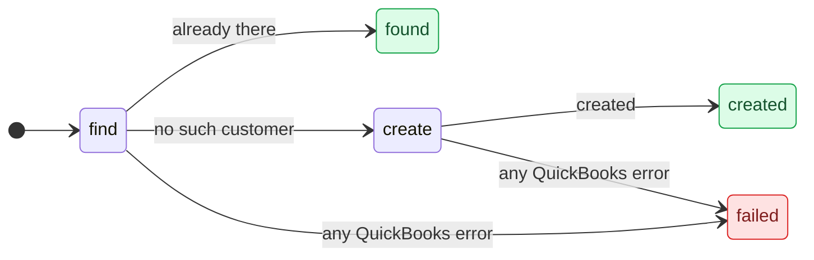
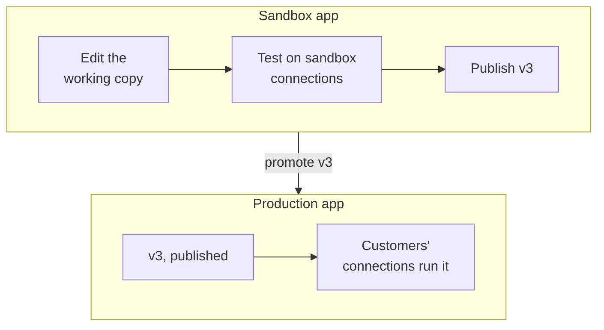

A workflow is one JSON document: a statechart QuBe Sync runs against a QuickBooks company file. You can
build one on the dashboard's canvas, write the JSON yourself, or have an AI assistant write it. The charts
are designed so an assistant writes them well and a person can review them.

## Anatomy of a chart

Here is the whole of the shipped `find_or_create_customer` template. Vendors, and any other list without a
template of its own, use the generic `find_or_create`, which takes the two operations as input
([below](#one-chart-for-any-record-type)).

```json find_or_create_customer.json
{
  "version": 1,
  "key": "find_or_create_customer",
  "name": "Find or create customer",
  "description": "Looks a customer up by full name and creates it only if it isn't there yet. The same shape as the generic find_or_create, written out for one type so its two states are easy to read. For vendors or any other list, use find_or_create with that type's query and create pair, such as vendor.query and vendor.create.",
  "input": {
    "customer": { "type": "operation", "operation": "customer.create", "required": true,
                  "description": "The customer to create if it isn't found, exactly as you would POST it to the v2 customer.create endpoint." }
  },
  "outcomes": {
    "found": { "description": "A customer with this name was already there; nothing was created." },
    "created": { "description": "No customer had this name, so it was created from the customer you sent." }
  },
  "initial": "find",
  "on": {
    "error": [{ "description": "any QuickBooks error", "target": "failed", "assign": { "error": "${response.error.message}" } }]
  },
  "states": {
    "find": {
      "type": "request",
      "description": "Look for a customer with this exact full name.",
      "operation": "customer.query",
      "params": { "full_name": ["${input.customer.name}"] },
      "on": {
        "success": [
          { "description": "already there", "if": { "path": "response.data", "op": "present" },
            "target": "found", "assign": { "customer": "${response.data.0}" } },
          { "description": "no such customer", "target": "create" }
        ]
      }
    },
    "create": {
      "type": "request",
      "description": "Not there yet -- create it from the caller's own customer.create body.",
      "operation": "customer.create",
      "params": { "$from": "${input.customer}" },
      "on": {
        "success": [{ "description": "created", "target": "created", "assign": { "customer": "${response.data}" } }]
      }
    }
  },
  "output": { "outcome": "${meta.outcome}", "customer": "${vars.customer}" }
}
```



<AccordionGroup>
  <Accordion title="Inputs" icon="right-to-bracket">
    `input` declares what a run is started with, and a run whose input doesn't match is refused before
    anything is sent. Each input has a `type` (`string`, `number`, `boolean`, `object`, `array` or
    `operation`) and optionally `required`, a `description` and an `example`. Add `"list": true` for a list
    of them. The example is what the usage contract's start body and the dashboard's Run drawer show, in the
    input's own JSON type. An operation input needs none: its example is built from the operation. Nor does a
    list of objects a `workflow` state runs through one at a time: its example is one element of what that
    workflow takes.

    An input of `"type": "operation"` accepts exactly the body that operation's REST endpoint takes. Here,
    `customer` is anything you could `POST /customers`, validated the same way. `only` narrows it to the
    parameters you name: `{"type": "operation", "operation": "customer.create", "only": ["name",
    "company_name", "email"]}` takes a customer's name, company and email and nothing else, and a run
    started with more is refused, naming the field. Leave `operation` out and the input takes an operation *and* its
    params, so one chart can serve any record type ([below](#one-chart-for-any-record-type)).
  </Accordion>
  <Accordion title="States" icon="circle-nodes">
    | Type | What it does |
    | --- | --- |
    | `request` | Sends one QuickBooks operation with `params`, or several with `requests`. Raises `success` or `error`. |
    | `wait` | Pauses and asks your app a question. Raises the id of the option your app chose. |
    | `notify` | Sends your app data (`data`, under the `name` it routes on) and waits for its `2xx`. Raises `success` or `error` ([Sending your app data](/workflows#sending-your-app-data)). |
    | `workflow` | Runs another workflow as one step, optionally once per item of a list ([Calling other workflows](#calling-other-workflows)). |
    | `transform` | Sets variables, then moves on (`always`). |
    | `choice` | A pure branch point (`always`). |
    | `compound` | Groups states, with its own `initial`. Catches events its children don't handle. |
    | `final` | Only inside a compound. Entering it raises `done` on that compound. |

    **Request states.** `operation` is an operation id such as `customer.create`, or a template that
    renders to one, such as `"${input.find.operation}"`. With `requests: [...]`, the state raises `success`
    only when every answer succeeded; `response` is the first answer and `responses` all of them. A
    `success` QuickBooks warned about carries `response.warning`, its `code` and `message`, such as `530`
    for a field it saved the record without ([Warnings](/error_handling#quickbooks-said-yes-with-a-warning)). If
    QuickBooks never answers, the run [settles it](/workflows#lost-answers) before the state raises
    anything: `success` as if the answer had arrived, with `response.settled` saying how and
    `response.evidence` on what grounds, or `error` with
    `response.error.type` set to `unsettled` or `no_response`. `"settle": false` skips that: a lost answer
    raises `no_response` at once, with `response.error.reason` saying why and, for an add,
    `response.error.external_guid`, the GUID it was sent with, so the chart can do the looking itself
    ([Lost answers](/workflows#lost-answers)). An update may
    leave `edit_sequence` out: the run reads the record first, and `on_conflict` (`ask`, the default,
    `overwrite` or `fail`) says what happens when it changed after that read
    ([Conflicts](/workflows#conflicts)). `qbxml_version` defaults to `16.0`.

    **Paging.** With `"paginate": true`, a query goes through every result, `page_size` (1–200, default 100)
    at a time. Customers, vendors, items and every transaction query page this way; a query QuickBooks
    doesn't iterate (accounts, classes and the other short lists, the deleted-records queries, the company
    queries, reports) answers whole and arrives as page 1 with `more` false, so the same chart works over
    it. It raises `page` for each page (`response.data` that page, `response.page` its number,
    `response.more` whether more follow), and `success` once every page is in (`response.count` records
    over `response.pages` pages). Handle `page` by processing the page and coming back to the query, which
    delivers the next one; a `page` nothing handles is skipped. The pages together can be counted or read
    one record at a time, but never copied into a variable, an output or params. QuickBooks keeps an
    iteration only for the Web Connector session that started it, so if that session ends between pages
    the next one raises `error` (`no_response`); going back to the query then starts again from page 1.

    **Notify states.** `name` is what your app routes on (lower case, like a state key) and `data` is any
    JSON, a template rendered as the state is entered, at most 4 MB. It goes to the run's `webhook_url` as a
    `workflow_run.notification`, never to a URL of the chart's own -- `url`, `webhook_url`, `operation`,
    `params`, `prompt`, `workflow`, `input`, `each` and `always` are refused -- and a workflow with one, or
    calling one with one, can't start without a `webhook_url` (`422 webhook_url_required`). The run waits
    for your `2xx`, then raises `success` (`response.delivery_id`, `response.seq`, `response.attempts`);
    when every attempt fails, or `data` is too large, `error` with `response.error.type` `not_delivered` or
    `too_large`. In `data`, `response` is the response that entered the state: on a paginating query's
    `page`, that page, so `{"customers": "${response.data}"}` sends the page's records. Every page of a
    query is never sent at once: `${response.data}` on its `success` is refused.

    **Wait states.** A `prompt` has a `message`, optional `data`, and `options`. Each option has an `id`, a
    `label`, optionally a `description`, and optionally `fields` your app must fill in (each with a `type`:
    `string`, `number`, `boolean`, `object` or `array`). The state's `on` must handle every option id, and
    no other. An option can't be called `success`, `error`, `done` or `always`.

    **Every state** also takes `entry` and `exit`: assignments made when the run enters or leaves it.
    `find_or_create` and `resolve` count their looks this way.
  </Accordion>
  <Accordion title="Transitions and conditions" icon="arrows-split-up-and-left">
    Each event maps to a list of transitions, tried in order: `{"if": ..., "target": ..., "assign": ..., "description": ...}`.
    The first whose `if` passes wins. Conditions are `{"path", "op", "value"}` with `op` one of `present`,
    `absent`, `eq`, `neq`, `gt`, `gte`, `lt`, `lte`, `contains`, `starts_with` or `in`, combined with
    `all`, `any` and `not`. A `target` is `completed`, `failed`, an outcome the chart declares, a sibling's
    key (searched outwards through the enclosing groups), or a dotted path such as
    `resolve_conflict.find_holder`.

    An event no state handles bubbles up to the root. Put `error → failed` there once, and handle only the
    specific QuickBooks codes you care about (3100, say) where they happen. A lost answer and a stale
    `edit_sequence` (3200) don't need handling: the run settles the one and, by default, asks your app about
    the other.

    `success`, `error`, `done` and `always` are reserved event names. State keys, option ids and variable
    names are lower case: a letter, then letters, digits and underscores, up to 50 characters (a workflow's
    own key may run to 64).
  </Accordion>
  <Accordion title="Templates" icon="brackets-curly">
    Any string can reference the run's context with `${...}`: `input.*`, `vars.*`, `states.<path>.response`,
    and `meta`: `meta.today`, `meta.now`, `meta.run_id` (the run your app started, even inside a workflow it
    calls), `meta.workflow_key`, `meta.connection_id`, and `meta.outcome` while an output renders. During a
    transition there's also `response`, `responses` and `decision`, and in a per-item `input`, a `$map`
    template or a `$find` condition, `each`.

    Six `$` keys build values, and no others are allowed:

    - `"$from"` uses a value as the base of a map and deep-merges the map's own keys onto it. That's how
      `create` above passes the caller's whole customer through.
    - `{"$map": "${vars.items}", "as": "item", "template": {...}}` builds a list from a list, rendering the
      template once per element (`each.item`, `each.index`, `each.count`).
    - `{"$add": [a, b]}` is the sum of its operands, numbers or templates that render to numbers, with
      nothing counting as 0: `{"$add": ["${vars.attempts}", 1]}` counts, and `-1` counts down. An operand
      that isn't a number fails the run.
    - `{"$default": [a, b]}` is the first candidate that renders to something other than nothing or an
      empty string: `{"$default": ["${vars.record.full_name}", "${vars.record.name}"]}` is a list record's
      name whatever list it came from.
    - `{"$merge": [a, b]}` deep-merges objects, each onto the ones before it, the way `$from` merges a map's
      own keys: objects merge key by key, and lists and plain values replace. An operand that renders to
      nothing is skipped. `{"$merge": ["${input.invoice}", "${vars.overrides}"]}` merges two objects the run
      holds, where `$from` would need the second one's keys written out.
    - `{"$find": "${response.data}", "as": "invoice", "where": <condition>}` is the first element for which
      the condition holds, with the element at `each.invoice`, or nothing:
      `{"$find": "${response.data}", "as": "invoice", "where": {"path": "each.invoice.external_guid", "op":
      "eq", "value": "${vars.guid}"}}` picks out the invoice carrying a GUID, which is how a chart that looks
      for a lost add itself recognises the one it sent.
  </Accordion>
  <Accordion title="Outcomes" icon="flag-checkered">
    `completed` and `failed` always exist. Declare more under `outcomes`, each with an optional
    `description` saying why a run can end that way when its name doesn't already. Your app branches on the
    run's `outcome`, so name every ending it should treat differently. No state may use an outcome's key.

    A declared outcome is a success unless it has `"kind": "failure"`, which ends the run `failed` with
    `outcome` set to its key. The run's `error` is then what the transition assigned to `error`, else the
    outcome's description. `create_customer_safely` declares `renames_exhausted` this way.

    An outcome may declare its own `output`, rendered instead of the chart's: `create_customer_safely`'s
    `cancelled` returns `{outcome, name_tried}`. A workflow that calls this one hears a success outcome as
    `success` and a failure as `error`, both with `response.outcome` naming it.
  </Accordion>
  <Accordion title="Descriptions" icon="comment">
    Every state, outcome and branching transition takes a `description`. It's drawn on the canvas and shown
    in the usage contract, and it's where the chart explains itself: "a customer has that name" rather than
    "success".
  </Accordion>
</AccordionGroup>

The full rules are in the chart's JSON Schema, served at
[`/api/v2/workflows/schema.json`](https://qubesync.com/api/v2/workflows/schema.json), and in the authoring
guide below.

## Calling other workflows

A `workflow` state runs another workflow of the same app as one step, with `input` rendered from this run.
Prefer it to copying another chart's states. `create_invoice` is built this way:

```json create_invoice.json (two of its states)
"create_customer": {
  "type": "workflow",
  "workflow": "create_customer_safely",
  "input": { "customer": "${input.customer}" },
  "on": {
    "success": [
      { "description": "the app said no", "if": { "path": "response.outcome", "op": "eq", "value": "cancelled" },
        "target": "cancelled" },
      { "description": "a customer was created or chosen",
        "if": { "path": "response.outcome", "op": "in", "value": ["created", "created_renamed", "used_existing"] },
        "target": "ensure_items", "assign": { "customer": "${response.data.customer}" } }
    ]
  }
},
"ensure_items": {
  "type": "workflow",
  "workflow": "find_or_create_item",
  "each": "${input.items}",
  "as": "item",
  "on_item_error": "stop",
  "input": { "item": "${each.item}" },
  "on": {
    "success": [{ "description": "every item sent is there", "target": "add_invoice", "assign": { "items": "${response.data}" } }]
  }
}
```

- The state raises `success` when the called workflow ends with a success outcome, with its output in
  `response.data` and the outcome in `response.outcome`. A called workflow's `cancelled` is a success
  like any other, which is why `create_customer` branches on it.
- It raises `error` when the called workflow fails, with `response.error.message` and `response.outcome`
  set to `failed` or the named failure. `create_invoice` doesn't handle `renames_exhausted`, so its root
  `error → failed` ends the order with the called workflow's message.
- With `each`, it runs the workflow once per element of the list, one at a time, in order, at most 200.
  `input` is rendered per element, with the element at `each.<as>` (`as` defaults to `item`), its position
  at `each.index` and the length at `each.count`. The state raises one `success` with the outputs in
  `response.data`, how each ended in `response.outcomes`, and failures in `response.errors`. Under
  `"on_item_error": "stop"`, the default, the first failure raises `error` instead ("item 2 of 3: ..."), and
  under `"continue"` the others go ahead. A list that renders to nothing, such as an `items` the run
  wasn't sent, is empty: the state raises `success` at once with `response.data` `[]`.
- A `workflow` state takes no `always`, `params`, `operation` or `prompt`.

Your app sees one run. A question the called workflow asks arrives on it, and so does everything the called
workflow does ([Good to know](/workflows#good-to-know)). Publishing waits for the workflows it calls to be
published first ([below](#versions-and-publishing)).

## One chart for any record type

`find_or_create_customer` names its operations, so it only ever finds and creates customers. A chart can take
its operations as input instead. Declare an `operation` input without an `operation`, and it takes a pair:
an operation and its params. A request state sends the pair with a templated `operation` and `$from`:

```json
"input": {
  "find": { "type": "operation", "required": true },
  "create": { "type": "operation", "required": true }
},
"states": {
  "find": {
    "type": "request",
    "operation": "${input.find.operation}",
    "params": { "$from": "${input.find.params}" },
    "on": { ... }
  },
  ...
}
```

A run of it then passes the operations it wants, here a vendor's:

```json
{
  "find": { "operation": "vendor.query", "params": { "full_name": ["Lone Star Supply Co"] } },
  "create": { "operation": "vendor.create", "params": { "name": "Lone Star Supply Co" } }
}
```

When the run starts, each pair's `params` are checked against the operation it names, as a fixed `operation`
input's are, and an unknown operation is refused. `only` needs a fixed operation to check against, so it
isn't allowed on such an input. A templated `operation` can be built from any value, such as
`"${input.kind}.query"`, but it should come from `input` or `vars`: validation warns about one that doesn't.
If it renders to something that isn't an operation, the run fails and says what it got.

That is exactly the shipped `find_or_create` (a `find` and a `create` pair) and `resolve` (a stored `id`, a
`by_name` query, and optionally `candidates`), and likewise `upsert` (those plus `create` and `update`
pairs), `resolve_transaction` (a `query` pair plus the `txn_id`, `ref_number` or `external_guid` the app
holds) and `stream_query` (one `query` pair to page). Start from those rather than writing the states
again. A chart for one record type is then a single `workflow` state passing two operations. Here is
`find_or_create_item`'s, once its `pick` has the add to send: the `item` it was sent, an
`{"operation": "item_other_charge.create", "params": {...}}` pair for any kind of item, or one it builds
from `non_inventory` or `service`:

```json
"find_or_create": {
  "type": "workflow",
  "workflow": "find_or_create",
  "input": {
    "find": { "operation": "item.query", "params": { "full_name": ["${vars.name}"] } },
    "create": "${vars.create}"
  },
  "on": {
    "success": [
      { "description": "created", "if": { "path": "response.outcome", "op": "eq", "value": "created" },
        "target": "created", "assign": { "item": "${response.data.record}" } },
      { "description": "already there", "target": "found", "assign": { "item": "${response.data.record}" } }
    ]
  }
}
```

Neither generic chart handles lost answers: the run settles those before a state hears of them.
`find_or_create` does handle one race. When its add meets 3100 because something created the name after
the query, it looks once more, counting its looks with `$add` so that it looks at most twice.

## Build it in the dashboard

On the **Workflows** page, **New workflow** starts a blank chart, clones a
[shipped template](/workflows#templates), or takes JSON you already have (**Import a chart**). Each opens the
builder. Its header says what is live ("v2 is live. You have unpublished changes.") and has **Test run**, the
publish button, and a **⋯** menu with **Workflow settings**, **JSON** and **Delete workflow…**. Its tabs are the
**Chart**, the workflow's **Runs**, its **Versions**, and **Use from your app**. The chart is a canvas with a
palette of steps (**Request**, **Wait for decision**, **Send to the app**, **Workflow**, **Transform**,
**Branch**, **Group**) and endings.

Click a step to open it. A request step first says **Which request** it sends: one you pick there, or one
**From a reference** such as `${input.find.operation}`. Then come its parameters, filled in there or taken
from the app's input. A query says what it returns, and has **Page through results**. An add or an update
has a **Settle a lost answer** switch; a query has it under **More options**, since asking a query again is
always safe. An update also has **If someone changed it since it was read**: ask the app with the
diff, apply your changes anyway, or fail with error 3200 for the chart to handle. An error branch can test
for **QuickBooks never answered**, and why (`timed_out`, `connector_error`, `rejected`, `withdrawn` or
`page_expired`), or, for an add or update that settles a lost answer, **QuickBooks may have applied it**.
A query that pages through its results offers **Send each page to the app** under **On each page**: one
click adds a **Send to the app** step sending the page -- its number, whether more follow, and its records --
and the way back to the query for the next. A **Send to the app** step holds its name and **What to send**,
and its error branch offers **the app could not be reached** and **what it sends is too large**.
A wait step holds the question and
its answers:

<Frame caption="A wait step: the message, what it sends with it, and each answer with the option id it sends.">
  
</Frame>

Every edit is checked as it's saved. One that would make the chart invalid isn't saved, and the builder says
what's wrong and where. Things that are allowed but probably wrong show as **N suggestions** in the corner of
the canvas, which opens them in **Workflow settings** (**More options** → **Suggestions**). The **JSON**
window shows the whole chart to
edit as text (**Definition**), replaces it with a template or a pasted chart (**Import**), and has a
**Prompt for an LLM** for your assistant ([below](#write-one-with-an-ai-assistant)).

**Clone** on the **Workflows** page and **Use** in the **JSON** window both install the templates a template
calls, as drafts. Pasting a chart (**Import a chart**, or the **JSON** window's **Definition**) brings in that one chart
only: install or create the workflows it calls first.

## Write one with an AI assistant

Charts are built to be written by an assistant and reviewed by a person. Describe the job in prose (what
should happen, and what should happen when QuickBooks says no) and let the assistant write the JSON. Its
reasoning ends up in the `description` fields, where the next person will read it.

<Steps>
  <Step title="Give it the rules">
    Connect your assistant to the [MCP server](/mcp-server). Its `get_workflow_authoring_guide` tool returns
    the chart rules, the JSON Schema and a worked example, and `list_workflow_templates` and
    `get_workflow_template` give it tested charts to start from. In the dashboard, the builder's **JSON**
    window has a **Prompt for an LLM** tab with the same guide, plus the exact parameters and error codes of
    every operation the chart uses and your app's other workflows with their inputs and outputs.
  </Step>
  <Step title="Let it check its work">
    The assistant validates the chart until it's clean, with the MCP `validate_workflow_chart` tool, or:

    ```bash
    curl -u "$QUBE_API_KEY:" -X POST https://qubesync.com/api/v2/workflows/validate \
      -H "Content-Type: application/json" -d @chart-request.json   # {"key": "...", "definition": {...}}
    ```

    It always answers `200`, with `valid` and every `error`, each with the path to the problem. Once the
    chart is valid, `warnings` lists what's allowed but probably wrong, such as an unreachable state, an
    ending nothing reaches, or a transaction with no lines. Send the workflow's `key` too, and it checks the
    workflows the chart calls: one that doesn't exist, or a chain that comes back to this one, is an error;
    a required input the `workflow` state doesn't pass, or an ending it doesn't branch on, is a warning.
  </Step>
  <Step title="Save it">
    ```bash
    curl -u "$QUBE_API_KEY:" -X PUT https://qubesync.com/api/v2/workflows/find_or_create_customer \
      -H "Content-Type: application/json" -d '{"definition": {...}}'
    ```

    `PUT` creates or replaces by key, so charts can live in your repository and be pushed from a deploy
    script. Add `"publish": true` to publish in the same call. The [CLI](/cli) does the same with
    `qube workflows push ./chart.json`, taking the key from the chart's own `key`.
  </Step>
  <Step title="Hand the other side to your assistant too">
    `GET /api/v2/workflows/{key}/usage.md` describes how to call the workflow, generated from the chart
    itself: how to start it, every question it can ask (with example webhooks and answers), every outcome and
    what's in its output. It describes the published version (the working copy, until there is one); add
    `?version=working`, or a version number, for another. Give it to whatever writes your app's side. In
    the builder it's the **Use from your app** tab:

    <Frame caption="Use from your app: the usage contract for create_customer_safely, ready to copy as Markdown.">
      
    </Frame>
  </Step>
</Steps>

## Test it

Run it against a [simulated connection](/simulator) from the builder's **Test run** panel or the API. The
panel docks beside the chart, so the chart shows the run's path as it goes. On a sandbox app it can run the
working copy, the published version or an older one. It shows the latest run's status, its steps and, while
it waits, its question to answer right there; then the start form and the recent runs. Each run's page has its
[steps, chart, event log and data](/workflows#follow-your-runs).

<Frame caption="Test run, beside the chart: the run's status, its steps (an error the chart handles is Handled), and its question.">
  
</Frame>

Use the simulator's faults to walk the unhappy paths: a 3100 on the create, QuickBooks closed halfway
through, an answer lost on its way back (**Next request** on the connection's page, or `next_lost_response`
through the API). A 3200 fault on a workflow's update doesn't make a conflict prompt: the run reads the record
back, finds nobody changed it, and sends the update again. To see a conflict prompt, give your chart an update
state, change the record through the API, then run the update with the `edit_sequence` from before. With your
own `edit_sequence` there's no baseline, so `as_read` is `null` and every field that differs counts as a
conflict.

## Versions and publishing

A workflow has a **working copy**, which is what you edit, and numbered **published versions**, which are
immutable snapshots.

| Connection | Runs |
| --- | --- |
| Sandbox or simulated | The working copy, by default. Pass `"version": "published"`, `"working"` or a number to choose; an unknown number is `404`. |
| Production | Always the published version. A workflow that isn't published can't run there (`422 workflow_not_published`). |

Publish with `POST /api/v2/workflows/{key}/publish` (with optional `notes`), with `"publish": true` on the
`PUT`, or in the builder: the header's **Publish v1** (or **Review and publish** once a published workflow has
changes) opens the **Versions** tab, which shows what would be published against the
last version, takes a note ("What changed?"), and has **Publish v{n}**. It lists every version with its notes
and author: **Diff against working copy** compares one with what you're editing, and **Restore into working
copy** brings it back to publish again. **Unpublish**, `POST .../unpublish` or `"publish": false` on the `PUT`
takes the workflow off production.

Publishing is refused (`422`) while a workflow it calls is still a draft (`unpublished_references`) or a
`workflow` state leaves out an input the called workflow requires. Unpublishing is refused while a published
workflow calls it (`referenced_by`), and deleting while any other workflow calls it (`409 referenced_by`).
`GET /api/v2/workflows/{key}/versions` and `.../versions/{n}` read the history.

A run that has already started finishes on the version it started with, even if you publish mid-run or
delete the workflow. Deleting keeps its runs, and their webhooks carry `workflow_id: null`.

## From sandbox to production

Build and publish in your sandbox app. Then **promote** the published version to your production app:



In **Versions**, **Promote to another app…** copies the published version into another app under the same
key. It brings along the workflows it calls, shows each one as created, updated or skipped in the target with
what will change, and records where each version came from. **Publish there as well** is ticked by default;
untick it to land the chart as that app's working copy for a final look. Promotion deliberately has no API:
it's the step where a person, not a script or an assistant, moves a chart to production.

Before promoting, QuBe Sync warns about **values that belong to one company file**: a `list_id` or
`txn_id` written into the chart, or a hard-coded reference. They work against your test company and fail
in your customers' files. Pass them in as inputs, or look them up by name in a query state. You have to
confirm the highlighted values mean the same thing in the target's company file to promote.

To make production workflows change only through promotion, an organization owner can turn on **Workflows in
production apps can only change by promotion**, under **How production apps change** on the dashboard's
**Workflows** page. In production apps, creating, importing, cloning, editing, installing and deleting
workflows are then refused, through the API (`promotion_required`) and in the dashboard. Publishing,
unpublishing and the version history stay available, so you can still roll back.

<Tip>
  Deploying from CI instead, with that setting off? Read the version with your sandbox key
  (`GET /api/v2/workflows/{key}/versions/{n}`) and `PUT` it with your production key.
</Tip>
