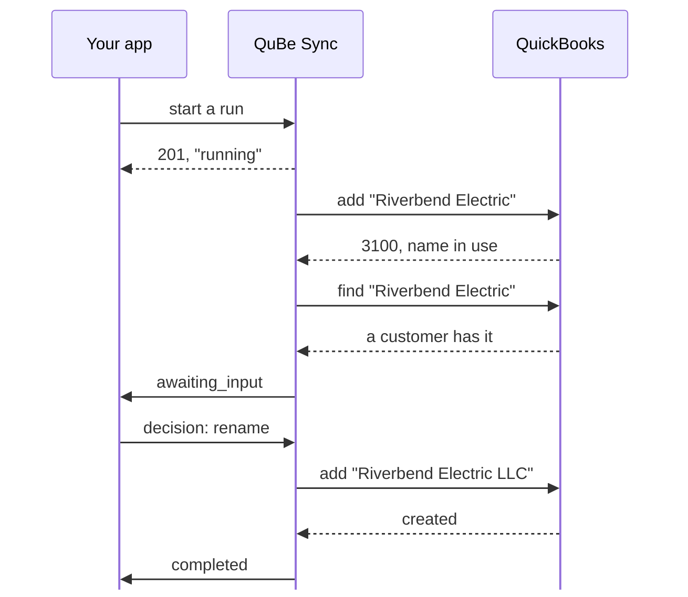
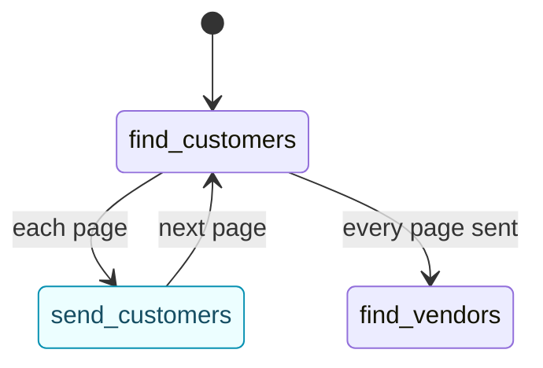

Real jobs rarely fit in one QuickBooks request. Invoicing an order from your store means making sure the
customer exists, handling the case where a vendor already has their name, making sure every item exists,
and only then adding the invoice. If the connection drops during any part of that process, you have to 
recover gracefully and reconcile what mutations were made or not. Naive solutions lead to duplicate transaction records and headaches.

**Workflows** let you encapsulate all those decisions in one piece of logic, with all the tools to let your LLM of choice safely help you. Workflows are also composable, so you can build complex systems from small, re-usable pieces (including the templates we provide).

<Frame caption="Find or create anything in QuickBooks: includes a retry if another person or app editing QuickBooks causes a race condition. Combine with an update workflow to implement `upsert`.">
  
</Frame>

## Templates

Start from a shipped template rather than a blank chart. Each one is complete and tested, and a template
that calls other workflows installs those too (the template list's `installs` names them).

`find_or_create`, `resolve`, `upsert`, `resolve_transaction` and `stream_query` work for any record type: you pass them the operations to send, such as
`{"operation": "customer.query", "params": {"full_name": ["Riverbend Electric"]}}`. `find_or_create_item`,
`resolve_entity` and `resolve_reference` are thin charts over them, ready-made for one kind of record, and
`push_records` and `pull_changes` run `upsert` and `stream_query` once for each record or kind you list.

| Template | What it does | Asks your app | Ends |
| --- | --- | --- | --- |
| `find_or_create` | Sends the `find` query you pass and, if it finds nothing, the `create` add. Any record type, vendors included. On a 3100 from the add, looks once more. | No | `found`, `created` |
| `resolve` | Finds a list record by its stored ListID (`id`), then by exact full name (`by_name`), and if nothing has the name offers what your `candidates` query finds. It only finds: `upsert` is the one that writes. | `ask`: `use` (with `list_id`), `none` (ends `not_found`) or `cancel` | `found`, `picked`, `not_found`, `cancelled` |
| `upsert` | Finds a list record as `resolve` does (`id`, `by_name`, optional `candidates`) and sends your `update` to it with its ListID filled in; the engine reads the edit sequence first and asks before overwriting a record someone changed since. Nothing has the name: sends your `create` add instead, looking once more if the name was taken in between. | `resolve / ask`: `use` (with `list_id`), `none` (then the add goes out) or `cancel`. And the [conflict prompt](#conflicts) when the record changed after it was read | `updated`, `created`, `cancelled`; fails as `name_taken` when the update renames it to a name in use |
| `push_records` | Runs `upsert` once per entry of `records` -- at most 200, each the `id`, `by_name`, `candidates`, `create` and `update` that `upsert` takes, records of different lists mixed -- one at a time, in order, in one run. A record QuickBooks refuses, or one that isn't a valid `upsert` input, is listed in `errors` and the next one goes. For a webhook per record, run `upsert` once per record instead. | Through `upsert`, for each record that asks | `completed` |
| `resolve_transaction` | Finds a transaction by the `txn_id` your app stored, then by its `ref_number`, then by the filters your `query` carries (a customer, a date range), picking out the one carrying the `external_guid` your app kept from the add. One transaction with the number and no GUID to check is it; anything less sure is offered to your app. Without line items: read it whole by `txn_id` when you need them. | `ask`: `use` (with `txn_id`), `none` (ends `not_found`) or `cancel` | `found`, `picked`, `not_found`, `cancelled` |
| `void_transaction` | Finds a transaction of `kind` (invoice, bill, check and the other voidable types) as `resolve_transaction` does, then voids it, or deletes it when `action` is `delete`. Nothing is voided until the transaction is identified. | Through `resolve_transaction` | `voided`, `deleted`, `not_found`, `cancelled` |
| `record_payment` | Finds an invoice as `resolve_transaction` does and records a `payment` (a `receive_payment.create` body: how it was paid) for the invoice's own customer, applied to that invoice; the amount defaults to what the invoice still owes. An invoice already paid in full is reported, not paid again. | Through `resolve_transaction` | `applied`, `already_paid`, `not_found`, `cancelled` |
| `create_customer_safely` | Creates a customer from `customer`, the body `POST /customers` takes. On a name clash, finds what has the name and asks. Allows five renames. | `ask_about_customer`: `use_existing`, `rename` (with `name`), `cancel`. `ask_about_other`: `rename`, `cancel` | `created`, `created_renamed`, `used_existing`, `cancelled`; fails as `renames_exhausted` |
| `find_or_create_customer` | Finds a customer by full name, or creates it from `customer`. `find_or_create`, written out for one type. | No | `found`, `created` |
| `find_or_create_item` | Finds an item by full name, whatever its type, or creates it from exactly one of `item` (any item add, as `{"operation": "item_other_charge.create", "params": {...}}`), `non_inventory` or `service`. Runs `find_or_create`. | No | `found`, `created` |
| `resolve_entity` | Finds a customer, vendor, employee or other name (`kind`) by its stored `list_id`, then by `name`, inactive ones included. Runs `resolve`. | When nothing has the name but near matches do (up to 20): `use`, `none` or `cancel` | `found`, `picked`, `not_found`, `cancelled` |
| `resolve_reference` | Turns a `name`, and optionally a stored `list_id`, into a reference to an account, class, terms, payment method, sales tax code or ship method (`kind`). Only finds, like `resolve`, which it runs: a missing class, payment method or ship method is `find_or_create`'s or `upsert`'s to make. | When nothing has the name: `use` one of the first 50 active ones, `none`, or `cancel`. With none active, it ends `not_found` without asking | `found`, `picked`, `not_found`, `cancelled` |
| `send_lists_to_app` | An initial import: every customer, vendor and item, active or not, sent to your app 200 at a time as `customers_page`, `vendors_page` and `items_page` [notifications](#sending-your-app-data), then the counts. Needs a `webhook_url`. | No | `completed` |
| `stream_query` | Pages through the `query` you pass, 200 at a time, and sends each page to your app as a `page` [notification](#sending-your-app-data) carrying `kind`, `page`, `more`, `pass` and `records`, then how many there were. Any query: every customer, the items changed since a date, one customer's invoices; one QuickBooks doesn't page, such as the accounts, arrives as a single page. If the Web Connector session ends between pages, it starts again from page 1 (`pass` 2, at most 3), so take a repeated page without harm. Needs a `webhook_url`. | No | `completed` |
| `pull_changes` | The incremental sync. For each kind word in `lists` (`customer`, `vendor`, `account`, `class`, the `item_*` kinds such as `item_service`, and every other list type a deleted-records query knows, all but `billing_rate`) and in `transactions` (`invoice`, `receive_payment`, `bill` and every other transaction type), runs `stream_query` over the records modified on or after `since`, inactive ones included, so they arrive as `page` [notifications](#sending-your-app-data) with that `kind`. Then it sends one `deleted` notification with the records of those kinds deleted since then: QuickBooks keeps 90 days of them. Transactions come without their lines unless `include_line_items` is true (four kinds don't take it: `build_assembly`, `charge`, `time_tracking` and `vehicle_mileage`). A list QuickBooks doesn't page arrives as one page. Needs a `webhook_url`. | No | `completed` |
| `company_profile` | Reads the company (name, legal name, address, fiscal year), its preferences (inventory, class tracking, multiple currencies, sales tax and the defaults QuickBooks posts with) and its host (product, version, country and the qbXML versions it speaks), all three in one Web Connector session. Run it when a connection is set up. | No | `completed` |
| `create_invoice` | Creates the `customer` with `create_customer_safely`, finds or creates each item add in `items` (optional, any item type), then adds the `invoice` exactly as sent, each line naming its item and carrying its own quantity, rate and the rest. A lost answer to the add is [settled by the run](#lost-answers): the invoice found by the GUID the add carried is read whole, and one not found is added again. | Through `create_customer_safely`. And `ask_about_invoice` when the run could not settle whether the invoice was added: `use_existing` (with `txn_id`), `create_again`, `cancel` | `completed`, `cancelled`; fails as `unanswered_twice` |

A question's `prompt.id` is the path of the state that asks it, such as
`resolve_conflict.ask_about_customer`. When one workflow calls another, the calling state comes first:
`create_invoice` relays `create_customer / resolve_conflict.ask_about_customer`, `resolve_entity` asks
`resolve / ask`, as do `upsert` and `resolve_reference`; `resolve_transaction` asks `ask`, and `void_transaction` and `record_payment` relay `find / ask`.
`push_records` relays `upsert / resolve / ask` for whichever record asks: `prompt.from.item_index` says which, counting from 0,
and `item_count` how many there are. `resolve_reference`'s `kind` is
`account`, `class`, `standard_terms`, `payment_method`, `sales_tax_code` or `ship_method`.

Every template can also end `failed`, when something goes wrong that it doesn't handle. `error` says why,
usually in QuickBooks' own words.

<Accordion title="What each template returns in output" icon="box-open">
  | Template | `output` |
  | --- | --- |
  | `find_or_create` | `{outcome, record, ref: {list_id, full_name}}` |
  | `resolve`, `resolve_entity` | `{outcome, record, ref: {list_id, full_name}, is_active}` |
  | `upsert` | `{outcome, matched, record, ref: {list_id, full_name}, is_active}`: `matched` is `found` or `picked` after an update, null after a create |
  | `push_records` | `{results, outcomes, errors}`, in the order of `records`: each one's `upsert` output (null for one that failed), how it ended (`updated`, `created`, `cancelled`, `failed`, `name_taken`, or null when it wasn't a valid `upsert` input) and an `{index, message}` entry for each that failed, with its `outcome` when it ran |
  | `resolve_transaction` | `{outcome, record, ref: {txn_id, ref_number, external_guid}}`: the header, without lines |
  | `void_transaction` | `{outcome, ref: {txn_id, ref_number, external_guid}}` |
  | `record_payment` | `{outcome, payment, invoice: {txn_id, ref_number, balance_before, applied}}` |
  | `resolve_reference` | `{outcome, ref}` |
  | `find_or_create_customer` | `{outcome, customer}` |
  | `find_or_create_item` | `{outcome, item}` |
  | `create_customer_safely` | `{outcome, customer: {list_id, full_name}}`. On `cancelled`, `{outcome, name_tried}`; on `renames_exhausted`, `null` |
  | `send_lists_to_app` | `{customers, vendors, items}`: how many of each were sent |
  | `stream_query` | `{kind, records, pages, passes}`: how many records were sent, over how many pages, and how many times the query was started from page 1 |
  | `pull_changes` | `{since, lists, transactions, deleted: {lists, transactions}}`: `lists` and `transactions` hold `stream_query`'s output for each kind, in the order given, and `deleted` how many deleted records of each were sent |
  | `company_profile` | `{company, preferences, host}`, each as its query answers it |
  | `create_invoice` | `{customer, items, invoice}`. It has no `outcome` key: read the run's `outcome`. |
</Accordion>

In the dashboard, open **Workflows**. Under **Start from a template**, click **Use template** on a card, pick
the app and click **Clone**: it creates the workflow as a draft, installs the templates it calls as drafts too
(any your app doesn't have yet), and opens it in the builder.

<Frame caption="Workflows → Start from a template. A card names the templates it also installs.">
  
</Frame>

## Run one

<Steps>
  <Step title="Install the template">
    ```bash
    curl -u "$QUBE_API_KEY:" -X POST \
      https://qubesync.com/api/v2/workflow-templates/create_customer_safely/install \
      -H "Content-Type: application/json" -d '{"publish": true}'
    ```

    That installs and publishes it, and any template it calls, in one go. A template cloned in the
    dashboard is a draft instead: publish it with **Publish v1** in the builder (the ones it calls first). A
    sandbox connection can run a draft; a production connection can't.

    If the app already has a workflow at that key, the call is refused with `409` (`key_taken`). Add
    `"replace": true` to install again over it: the workflow, and each one it calls that the app already
    has, gets the template's current chart the way `PUT /workflows/{key}` would give it one. Earlier versions
    are kept, the answer is `200`, and `replaced` lists the keys it changed. With `replace`, a setup script
    can run the same call every time. To keep the existing workflow instead, install a second copy under
    another key with `{"as": "new_key"}`.
  </Step>
  <Step title="Start a run">
    The input is the same body `POST /customers` takes, so a workflow is a drop-in for the request it
    replaces:

    ```bash
    curl -u "$QUBE_API_KEY:" -X POST \
      "https://qubesync.com/api/v2/connections/$CONN_ID/workflow-runs" \
      -H "Content-Type: application/json" \
      -d '{
        "workflow": "create_customer_safely",
        "input": {"customer": {"name": "Riverbend Electric", "email": "billing@riverbend.example"}},
        "webhook_url": "https://your-app.example/webhooks/qube"
      }'
    ```

    You get `201` with the run. Store its `id` next to the record it's for. `webhook_url` is optional, but
    a run started without one sends no webhooks -- and a workflow that [sends your app data](#sending-your-app-data)
    can't start without one (`422 webhook_url_required`).
  </Step>
  <Step title="Answer its question">
    Riverbend Electric already exists, so the run stops at `ask_about_customer` and sends
    `workflow_run.awaiting_input`:

    ```json workflow_run.awaiting_input (abridged)
    {
      "event": "workflow_run.awaiting_input",
      "timestamp": 1790470628,
      "app_id": "98f339a4-32e8-424a-987e-ccaf5bcaa620",
      "sandbox": true,
      "connection_id": "4fdde583-68b1-4c6b-94d1-82abf97afdf5",
      "workflow": "create_customer_safely",
      "workflow_id": "01a0e05a-3c52-7a8e-b1f4-6d2e9c0a7b31",
      "run_id": "fb1951a1-25b9-4fb2-98c7-c988988ecdf7",
      "prompt": {
        "id": "resolve_conflict.ask_about_customer",
        "kind": "decision",
        "message": "A customer named \"Riverbend Electric\" already exists.",
        "data": {
          "existing": { "type": "customer", "list_id": "8000001F-1790470623", "full_name": "Riverbend Electric",
                        "company_name": "Riverbend Electric LLC", "phone": "512-555-0142" }
        },
        "options": [
          { "id": "use_existing", "label": "Use the existing customer",
            "description": "Carry on with the customer QuickBooks already has. Nothing new is created." },
          { "id": "rename", "label": "Create it with a different name",
            "description": "Try again under a name you choose.",
            "fields": { "name": { "type": "string", "required": true, "label": "New name" } } },
          { "id": "cancel", "label": "Don't create a customer",
            "description": "Stop here. The run ends as cancelled, with nothing written to QuickBooks." }
        ]
      },
      "links": {
        "run": "https://qubesync.com/api/v2/connections/4fdde583-…/workflow-runs/fb1951a1-…",
        "decisions": "https://qubesync.com/api/v2/connections/4fdde583-…/workflow-runs/fb1951a1-…/decisions",
        "cancel": "https://qubesync.com/api/v2/connections/4fdde583-…/workflow-runs/fb1951a1-…/cancel",
        "ui": "https://qubesync.com/app/workflow_runs/fb1951a1-…"
      }
    }
    ```

    Show `prompt.message` and the options (each one's `label`, and its `description` when it has one) to
    your user, or decide in code. Then POST the choice, with any
    `fields` the option asks for, to `links.decisions`:

    ```bash
    curl -u "$QUBE_API_KEY:" -X POST "$DECISIONS_URL" \
      -H "Content-Type: application/json" \
      -d '{"option": "rename", "data": {"name": "Riverbend Electric LLC"}}'
    ```

    An option the question doesn't offer, or a missing field, is refused with `422`, and the run keeps
    waiting. A run can wait as long as it needs to. Your user can answer tomorrow.

    <Frame caption="The same question on the run's page (links.ui). Answering here is the same as POSTing to links.decisions.">
      
    </Frame>
  </Step>
  <Step title="Get the result">
    The run creates "Riverbend Electric LLC" and ends:

    ```json workflow_run.completed (abridged)
    {
      "event": "workflow_run.completed",
      "run_id": "fb1951a1-25b9-4fb2-98c7-c988988ecdf7",
      "workflow": "create_customer_safely",
      "outcome": "created_renamed",
      "output": {
        "customer": { "list_id": "80000025-1790470630", "full_name": "Riverbend Electric LLC" },
        "outcome": "created_renamed"
      },
      "error": null,
      "summary": {
        "ended_at": "2026-09-27T00:57:14.482113Z",
        "stopped_at": "try_create",
        "requests": [
          { "state": "try_create", "workflow": "create_customer_safely", "operation": "customer.create", "status": "error" },
          { "state": "resolve_conflict.find_holder", "workflow": "create_customer_safely", "operation": "entity.query", "status": "success" },
          { "state": "try_create", "workflow": "create_customer_safely", "operation": "customer.create", "status": "success",
            "identifiers": { "list_id": "80000025-1790470630", "full_name": "Riverbend Electric LLC" } }
        ],
        "side_effects": [
          { "state": "try_create", "workflow": "create_customer_safely", "operation": "customer.create",
            "identifiers": { "list_id": "80000025-1790470630", "full_name": "Riverbend Electric LLC" } }
        ],
        "decisions": [
          { "state": "resolve_conflict.ask_about_customer", "workflow": "create_customer_safely",
            "option": "rename", "at": "2026-09-27T00:57:10.418204Z" }
        ],
        "discarded": [],
        "calls": []
      }
    }
    ```

    Store `output.customer.list_id` against your record, and you're done. Every `summary` entry names the
    `workflow` whose state it was, which tells a called workflow's step from the run's own.
  </Step>
</Steps>



## Follow your runs

Every run has a page in the dashboard, at its `links.ui`. **Workflow runs** in the dashboard's menu lists
them all, newest first, by day. Its tabs pick a state (**Needs an answer**, **Running**, which includes a run
waiting on a workflow it called, as the API reports it, **Failed**, **Completed**, **Cancelled**), and runs
waiting for an answer are pinned above the list, oldest first, with their question and an **Answer** button.
Filter by workflow, connection, when it started and outcome (the exact key, such as `created`). Runs a
workflow starts for another are left out unless you tick **Include runs started by other runs**. Each
connection's page lists that connection's runs too, and the builder's **Runs** tab a workflow's own.

<Frame caption="Workflow runs: the ones waiting for an answer first, then every run with where it is or how it ended.">
  
</Frame>

A run's page leads with its status and one sentence: where it is, where it stopped, or how it ended. Under
that:

- **Your answer is needed**, while it waits: the question, the record it's about, and its answers, each
  saying where it leads. The answer you pick shows a box for each field it asks for, and **Send answer**
  sends it. Answering here is the same as your app answering. A conflict adds a table of each field as you
  sent it, as QuickBooks has it, and as the run read it.
- **Why it failed**, when it failed: QuickBooks' error, or the failure ending the chart declared. Under it,
  **Still in QuickBooks** lists what the run had already changed: a failed run undoes nothing. A completed
  run lists the same under **Changed in QuickBooks**. A change found only after QuickBooks' answer was
  [lost](#lost-answers) says "confirmed after a lost answer"; one nothing in the run could confirm is
  listed as **Not confirmed**, not counted either way.
- **Cancel run**, while it's going, with an optional reason, and **Open the workflow**.
- **Steps**: what the run did, a row per step, with each request and QuickBooks' answer, each workflow it
  called and each answer it was given. An error the chart handles shows as **Handled**, not as a failure.
- **Chart**: the snapshot taken when the run started, with the path it took in blue and, for a failed run,
  the step it stopped at in red. **Event log**: the whole log, to filter, copy or **Download**, with the
  run's values as of any event you pick. **Data**: its input, vars, per-state responses and output.

<Frame caption="A finished create_invoice run: what it changed in QuickBooks, and its steps.">
  
</Frame>

From your app, `GET /connections/{id}/workflow-runs?state=awaiting_input` lists the runs waiting on your
users. [The API at a glance](#the-api-at-a-glance) has the rest.

## Webhooks

A run reports to the `webhook_url` it was started with, signed like every other QuBe Sync webhook
([verify it](/webhooks#verify-the-signature)):

| Event | When |
| --- | --- |
| `workflow_run.awaiting_input` | The run needs a decision. It carries the question in `prompt`. |
| `workflow_run.notification` | A `notify` state [sends your app data](#sending-your-app-data). The run waits for your `2xx`. |
| `workflow_run.completed` | The run ended as designed: `completed`, or a success outcome the chart declares. |
| `workflow_run.failed` | Something needs attention: a QuickBooks error the chart doesn't handle, a named failure such as `renames_exhausted`, or a limit reached. |
| `workflow_run.cancelled` | Somebody stopped it: your app with `POST links.cancel`, or a person on the run's page. |

Every event has `event`, `timestamp`, `app_id`, `sandbox`, `connection_id`, `workflow` (the key),
`workflow_id` (`null` once the workflow is deleted), `run_id` and `links` (`run`, `decisions`, `cancel`,
`ui`). All three endings carry `outcome`, `output`, `error` and `summary`, and `workflow_run.cancelled` adds
`cancel_reason`. `GET links.run` returns the whole run, including its input, vars and trace; in that JSON the
same link is `links.self`.

A failed delivery is retried with backoff, up to 5 attempts (a notification: 10, over about an hour), and
each attempt is in the run's event log as `webhook_sent`. When a run's deliveries fail for good, your organization's owners get an email, as they do for
a request's webhook. There's still no **Resend** for a run, so if your endpoint was down, read the run with
`GET links.run`. Deliveries can repeat and arrive out of order. A run ends only once,
so key endings on `run_id`. Each delivery is built when it's sent, from the run as it is then: a retried
`workflow_run.awaiting_input` that arrives after the question was answered has no `prompt`.

The QuickBooks requests a run sends are ordinary queued requests, visible in the dashboard, but they
**don't** send webhooks of their own. The run's events are the whole story.

### Two kinds of question

`workflow_run.awaiting_input` carries the question in `prompt`, and `prompt.kind` says who is asking.
`decision` is a question the chart asks in a `wait` state, with options the chart declares. `conflict` is
one the run asks by itself, when an update meets a record someone else changed after it was read
([Conflicts](#conflicts)). Its options are always `overwrite` and `keep`. Both are answered at
`links.decisions`.

<CodeGroup>
```json kind: decision (abridged)
{
  "id": "resolve_conflict.ask_about_customer",
  "kind": "decision",
  "message": "A customer named \"Riverbend Electric\" already exists.",
  "data": {
    "existing": { "type": "customer", "list_id": "8000001F-1790470623", "full_name": "Riverbend Electric", "phone": "512-555-0142" }
  },
  "options": [
    { "id": "use_existing", "label": "Use the existing customer",
      "description": "Carry on with the customer QuickBooks already has. Nothing new is created." },
    { "id": "rename", "label": "Create it with a different name",
      "description": "Try again under a name you choose.",
      "fields": { "name": { "type": "string", "required": true, "label": "New name" } } },
    { "id": "cancel", "label": "Don't create a customer",
      "description": "Stop here. The run ends as cancelled, with nothing written to QuickBooks." }
  ]
}
```

```json kind: conflict (abridged)
{
  "id": "conflict:update_contact",
  "kind": "conflict",
  "state": "update_contact",
  "message": "customer \"Riverbend Electric\" changed in QuickBooks after it was read; 1 of the 2 fields you are updating differs.",
  "data": {
    "operation": "customer.update",
    "sent": { "phone": "512-555-0100", "email": "billing@riverbend.example" },
    "current": { "list_id": "8000001F-1790470623", "edit_sequence": "1790470711", "full_name": "Riverbend Electric",
                 "phone": "512-555-0199", "email": "ap@riverbend.example", "last_name": "Okafor-Reyes" },
    "as_read": { "list_id": "8000001F-1790470623", "edit_sequence": "1790470623", "full_name": "Riverbend Electric",
                 "phone": "512-555-0142", "email": "ap@riverbend.example", "last_name": "Okafor" },
    "conflicts": [
      { "field": "phone", "sent": "512-555-0100", "current": "512-555-0199", "as_read": "512-555-0142" }
    ],
    "theirs": [
      { "field": "last_name", "as_read": "Okafor", "current": "Okafor-Reyes" }
    ],
    "position": 0
  },
  "options": [
    { "id": "overwrite", "label": "Apply my changes anyway",
      "fields": { "params": { "type": "object", "required": false, "label": "Different fields to send instead" } } },
    { "id": "keep", "label": "Keep what QuickBooks has" }
  ]
}
```
</CodeGroup>

In the decision, `data.existing` is the record `find_holder` found, and its `type` says which list it's on.
In the conflict, the run was changing Riverbend Electric's phone and email. Since it read the record, someone
in QuickBooks changed the phone too, and the last name. The email isn't in `conflicts`, because nobody else
touched it. The last name is in `theirs`, because the update doesn't send it.

## Sending your app data

A run can hand your app data while it goes, not only at the end: a **`notify` state** ("Send to the app" in
the builder's palette) renders its `data` and sends it as a `workflow_run.notification` to the run's
`webhook_url`. Its `name` is what your app routes on. The usual use is a whole list, a page at a time --
this is `send_lists_to_app`'s first list:



```json
"find_customers": {
  "type": "request", "operation": "customer.query",
  "params": {"active_status": "All"}, "paginate": true, "page_size": 200,
  "on": {
    "page": [{"target": "send_customers", "description": "send this page"}],
    "success": [{"target": "find_vendors", "assign": {"customers": "${response.count}"}}]
  }
},
"send_customers": {
  "type": "notify", "name": "customers_page",
  "data": {"page": "${response.page}", "more": "${response.more}", "customers": "${response.data}"},
  "on": {"success": [{"target": "find_customers", "description": "next page"}]}
}
```

In `data`, `response` is the response that brought the run to the state -- on a paginating query's `page`,
that page -- so `${response.data}` is the page's records. Your app receives `customers_page` with `seq` 1,
2, 3…, then the vendors, then the items, then `workflow_run.completed` with the counts.

- **The run waits for your `2xx`** before it goes on: notifications come one at a time, in order, and all of
  them before the run ends. QuickBooks isn't held up: the pages keep being fetched while your app takes them.
- **Delivery is at least once.** A failed delivery is retried for about an hour with the same `delivery_id`;
  deduplicate on it. If none succeeds, the state raises `error` with `response.error.type` `not_delivered`,
  which the chart can handle (go to a `wait` that asks whether to retry, say); otherwise the run fails.
- **At most 4 MB** each, once filled in. Bigger is never sent: `error` `too_large`. Send fewer records at a
  time with a smaller `page_size`.
- **Only to the run's `webhook_url`.** A chart can't name a URL of its own, and a workflow with a `notify`
  state -- or one that calls such a workflow -- refuses to start without a `webhook_url`.
- A run caps at 500 transitions, and a page costs two (to the notify state and back), so one run sends at
  most about 250 pages: 50,000 records at 200 a page.

[Webhooks](/webhooks#data-a-workflow-sends-you) has the payload, and
[Pagination](/pagination#initial-import) says when to use a workflow for an import and when the plain
paginated API.

## How a run ends

| `state` | `outcome` | `output` | `error` |
| --- | --- | --- | --- |
| `completed` | `completed`, or a success outcome the chart declares: `created`, `used_existing`, `cancelled`... | The chart's `output`, or the outcome's own | `null` |
| `failed` | `failed`, or a named failure the chart declares, such as `renames_exhausted` | `null`, unless the named failure declares an `output` | What went wrong, in words |
| `cancelled` | `null` | `null` | `null`; your reason is in `cancel_reason` |

- **`completed`** means the job went as designed. `outcome` says which way, so branch on it. A chart's own
  `cancelled` ending, when your app answered `cancel`, is a completed run: nothing is wrong.
- **`failed`** means something needs attention: a QuickBooks error the chart doesn't handle, a mistake in
  the chart, or a limit reached. A chart can declare named failures, so your app can tell them apart by
  `outcome`. `create_customer_safely` ends `renames_exhausted` with the error `Five renames were tried and
  every name was taken; the last was "<name>".`
- **`cancelled`**: someone stopped the run with `POST links.cancel` or **Cancel run**. An optional
  `{"reason": "..."}` is kept as `cancel_reason`, trimmed and cut to 500 characters. The workflows the run
  calls stop with it. Requests not yet handed to the Web Connector are withdrawn (`summary.discarded`); one
  already sent may still complete (`"status": "in_flight"` in `summary.requests`). Cancelling never undoes
  what was applied: `summary.side_effects` lists it, so you can check or reverse it, and
  `summary.unconfirmed` lists any change QuickBooks never answered that the run hadn't settled yet.
  Cancelling a run that has ended is `409 already_finished`.

When one workflow calls another, the caller hears a success outcome as `success` and a failure as `error`,
with `response.outcome` naming it either way ([Calling other workflows](/workflow-authoring#calling-other-workflows)).

A request whose answer was lost doesn't change how a run ends. The run [settles it](#lost-answers) and the
state carries on as if the answer had arrived, with `response.settled` telling the chart how (`found`,
`resent`...). A lost answer fails the run only when it can't be settled and the chart doesn't handle that.

## Lost answers

Now and then QuickBooks gets a request and its answer never comes back. QuickBooks doesn't report an error
when that happens: its computer lost its connection, or QuickBooks or the Web Connector was closed, while
the request was being processed, and the Web Connector session ends without the answer. On its own, such a
request ends `timed_out`, and QuickBooks may or may not have applied it
([Error handling](/error_handling#other-endings)). A workflow doesn't leave that to you. Before the chart
hears anything, the run **settles** the request: it finds out whether QuickBooks applied it and carries on
as if the answer had arrived.

| What was sent | How the run settles it |
| --- | --- |
| A query | Sends it again. |
| A list add: a customer, vendor, item, class... | Looks for a record with the full name it sent, under its parent if it had one. None there, it sends the add again. |
| A transaction add: an invoice, bill, check... | Looks for it by its reference number, or else by its customer or vendor and its date, at most 50, and matches the `external_guid` the run put on it. None matches, it sends the add again, unless all 50 came back: then it may be past them, and the run can't tell (below). |
| An update | Reads the record back. If it already has the fields sent, the update was applied. If nobody has touched it, the update is sent again. If someone else changed it, it's a [conflict](#conflicts). |
| A delete | Looks the record up by its id. If it's gone, the delete was applied; if not, it's sent again. |

Every add a workflow sends that has an `external_guid` field carries one: yours if you set it, otherwise one
the run generates. That's nearly every transaction, plus customers, vendors, employees, other names and
items. QuickBooks stores it on the record, which is how the run tells its own invoice from another one for
the same customer on the same day.

The state then raises what the answer would have raised, usually `success`, and `response.settled` says how
the run got it. `response.evidence` says on what grounds, in a sentence: what the check looked at, what came
back and what that means, such as `of 2 candidates with reference number "1044", one carries the GUID sent
(txn_id 2-1791267763), so the add was applied`. A first-time answer has neither.

| `response.settled` | What happened |
| --- | --- |
| `found` | The add had been applied. `response.data` is the record the run found. |
| `already_deleted` | The delete had been applied. `response.data` is only the id and its delete type. |
| `already_current` | The record already had every field the update sends. |
| `resent` | It hadn't been applied, or it was a query, so the run sent it again. This is that answer. |
| `reapplied` | An update sent again with the current edit sequence, because what someone else changed doesn't overlap with it ([Conflicts](#conflicts)). |
| `overwritten` | An update sent again over someone else's change, because your app or the chart said to. |
| `kept` | Your app chose to keep QuickBooks' version of a changed record. `response.data` is that record. |

Two endings are left for the chart to handle, both as `error` with `code` `null`:

- **`response.error.type` is `unsettled`**: the run can't tell. Usually it found records that might be the
  one it sent and nothing to tell them apart, as with a transaction type that has no `external_guid`, and
  `response.error.candidates` lists them. It's also `unsettled` when the check itself can't be trusted: the
  record an update was for no longer exists, a list add's parent is gone, the check came back full with none
  carrying the GUID sent (so there may be more), or QuickBooks answered the check with an error. Then
  `candidates` may be empty.
  `response.error.message` says which. Unhandled, `unsettled` fails the run with that message.
- **`response.error.type` is `no_response`**: QuickBooks didn't answer the checks and re-sends either. The
  run sends at most five more requests for one that was lost, re-sending it at most twice, then gives up.

<Accordion title="The two errors, exactly" icon="code">
  ```json unsettled
  { "status": "error",
    "error": { "code": null, "type": "unsettled",
               "message": "QuickBooks never answered transfer.create, and 2 candidates match what was sent, and it carried no GUID to tell them apart",
               "candidates": [ { "txn_id": "1B-1790470702", "txn_date": "2026-09-28", "amount": 250.0, "...": "..." },
                               { "txn_id": "1C-1790470744", "txn_date": "2026-09-28", "amount": 250.0, "...": "..." } ] } }
  ```

  ```json no_response
  { "status": "error",
    "error": { "code": null, "type": "no_response", "reason": "timed_out",
               "external_guid": "{3B6E1F0A-52C4-4D8B-9E21-7A0C5D93F4B2}",
               "message": "QuickBooks never answered: the Web Connector session ended before it did; 2 re-sends and 3 checks did not settle it" } }
  ```

  An `unsettled` message is always `QuickBooks never answered <operation>, and <why>`. A `no_response`
  message starts `QuickBooks never answered: ` and says why: the session ended, the request was withdrawn
  before it was sent, the Web Connector reported a failure in place of the answer, or the request ended in
  some other state.
  `reason` says the same as a word to branch on, and an add's `external_guid` is the GUID it was sent with:

  | `reason` | What happened | Could QuickBooks have it? |
  | --- | --- | --- |
  | `timed_out` | Sent, and the Web Connector session ended before the answer came back: the customer's computer lost its connection, or QuickBooks or the Web Connector was closed, part way. | Yes |
  | `connector_error` | The Web Connector handed the request to QuickBooks, then reported a failure in place of the answer: QuickBooks was closed or stopped responding part way. | It can't be told |
  | `rejected` | QuickBooks couldn't read the request (`xml_error`). | No |
  | `withdrawn` | Your app withdrew it before the Web Connector took it. | No |
  | `page_expired` | A later page of a paginated query, whose session ended before it was fetched. | No, it's a query |
</Accordion>

Some requests aren't settled, and raise `no_response` straight away: one your app withdrew, one QuickBooks
couldn't parse (`xml_error`), a paginated query, and an operation with nothing to look for afterwards, such
as a void or a merge. A request state with `"settle": false` isn't settled either.

The request itself keeps its own ending (`timed_out`, say) in the dashboard. The run's event log has a
`settling` event for each check and re-send, saying why it went out and what it looks at ("looking for
reference number "1044" with invoice.query, which answers whole"), and a `settled` or `unsettled` one at the
end with the verdict and its grounds, so the decision can be audited without opening a payload. The step's row
on the run's page says the same. `summary.requests` lists the checks and re-sends, each with a `role`:
`settle`, `resend`, `reapply`, `overwrite`, or `prepare` for the read before an update. The original
request's entry says how it was `settled` and its `evidence`, and an add, delete or update found applied is in
`summary.side_effects` with both too. Your app has nothing
to do. To watch it happen, arm a lost answer before a run sends an add: on the connection's page, set
**Next request** to "applied, then the Web Connector dies before answering", run
`qube simulator faults <connection> --next lost`, or set the simulator's
[`next_lost_response`](/simulator#make-it-fail) fault through the API.

### Doing the looking in the chart

`"settle": false` hands a lost answer to the chart at once, as `no_response`, with `response.error.reason`
saying why and, for an add, `response.error.external_guid`, the GUID it was sent with. That's how to make the
looking part of the chart, where the diagram and the run's log show it. No shipped template does it any more:
`create_invoice` leaves its invoice add to settling and handles only `unsettled`, with a question. A chart that
looks for itself:

- Treats a QuickBooks error answer as "nothing was added", and a `no_response` whose `reason` is `withdrawn`
  or `rejected` the same way: the request never reached the company file.
- On any other `no_response`, queries for the record -- by its `ref_number`, or among the customer's
  transactions on its date, without their lines -- and uses `$find` to pick out the one whose
  `external_guid` equals `response.error.external_guid`. QuickBooks returns the GUID exactly as it was
  sent, braces and upper case, so an `external_guid` you send yourself should be written that way too.
- Sends the add again only when the query's answer was whole (by number, or fewer than its cap came back),
  and asks your app otherwise.

The run's `summary` counts an add such a chart found as the change it was, once, at the state that sent it.
Its entry in `summary.requests` reads as one the run settled itself: `"status": "success"`,
`"settled": "found"`, the record's `identifiers`, and `found_by`, the state whose answer carried it. It's in
`summary.side_effects`, and the run's page lists it under **Changed in QuickBooks**:

```json summary of a chart that looked for its own lost invoice add (abridged)
{ "requests": [
    { "state": "add_invoice", "workflow": "my_invoices", "operation": "invoice.create",
      "status": "success", "settled": "found", "found_by": "look_for_invoice",
      "identifiers": { "txn_id": "1F-1791238970", "ref_number": "1044" } },
    { "state": "look_for_invoice", "workflow": "my_invoices", "operation": "invoice.query", "status": "success" },
    { "state": "fetch_invoice", "workflow": "my_invoices", "operation": "invoice.query", "status": "success" } ],
  "side_effects": [
    { "state": "add_invoice", "workflow": "my_invoices", "operation": "invoice.create", "settled": "found",
      "identifiers": { "txn_id": "1F-1791238970", "ref_number": "1044" } } ] }
```

Any query the run sends after the add counts, in your own charts too, as long as its answer carries the
`external_guid` the add was sent with, or, for a list add sent without one, the full name it was sent with.
A reference number alone doesn't count: QuickBooks lets two invoices share one. A change the run sends again
and gets an answer to is counted once, as that answer. One nothing in the run settles keeps
`"status": "error"`, gets `"unconfirmed": true`, and is listed under `summary.unconfirmed` instead: your app
picked another invoice, say, or the run failed or was cancelled first. It may or may not be in QuickBooks,
so look before sending it again.

## Conflicts

QuickBooks refuses an update when the record changed after it was read: error 3200, a stale `edit_sequence`.
Retrying with the fresh edit sequence would quietly overwrite whatever the other person changed. A workflow
looks first. The run reads the record again and compares each field the update sends with the record as it
is now and, when the run read it itself, as it was then:

- The record already has what the update sends: nothing to do. The state raises `success` with
  `response.settled` set to `already_current`.
- The other person changed only fields the update doesn't send: the run sends the update again with the
  current edit sequence, without asking (`reapplied`). It can only tell this when it read the record itself.
- They changed a field the update sends: the run pauses and asks your app, unless the state's
  `on_conflict` (below) says otherwise.

The run goes `awaiting_input` and sends `workflow_run.awaiting_input`, just as a `wait` state does, with a
prompt of `kind` `conflict`. There's an example under [Webhooks](#two-kinds-of-question). None of the
shipped templates sends an update, so you'll meet this in a chart of your own.

| Prompt field | What it holds |
| --- | --- |
| `id` | `conflict:<state>`, or `<calling state> / conflict:<state>` when a workflow this one calls asked (`prompt.from` then names it). |
| `state` | The request state that sent the update, in the workflow that asked. |
| `data.operation` | The update, such as `customer.update`. |
| `data.sent` | The fields it sends, without its id and edit sequence. |
| `data.current` | The record as QuickBooks has it now, with its edit sequence. |
| `data.as_read` | The record as the run read it, or `null` when the chart passed its own `edit_sequence`. |
| `data.conflicts` | One row per field being updated that someone else changed too: `field`, `sent`, `current`, `as_read`. |
| `data.theirs` | What they changed that the update doesn't send: `field`, `as_read`, `current`. Empty when `as_read` is `null`. |
| `data.position` | Which of the state's requests it was, counting from 0. Always 0 unless the state sends several. |

Answer at `links.decisions`, like any question:

```bash
# Send my fields anyway, with the current edit sequence
curl -u "$QUBE_API_KEY:" -X POST "$DECISIONS_URL" -H "Content-Type: application/json" \
  -d '{"option": "overwrite"}'

# Send these fields instead: a merge worked out from the diff
curl -u "$QUBE_API_KEY:" -X POST "$DECISIONS_URL" -H "Content-Type: application/json" \
  -d '{"option": "overwrite", "data": {"params": {"phone": "512-555-0199", "email": "billing@riverbend.example"}}}'

# Leave QuickBooks as it is
curl -u "$QUBE_API_KEY:" -X POST "$DECISIONS_URL" -H "Content-Type: application/json" \
  -d '{"option": "keep"}'
```

After `overwrite`, the state raises whatever QuickBooks answers, with `response.settled` set to
`overwritten`. The fields in `params` replace the ones the update sent; the run adds the record's id and
current edit sequence. `params` must be an object of fields the update takes, like `data.sent`. One it
doesn't take is refused with `422` (`invalid_data`, naming the field), and the run keeps waiting. If the
record changes yet again first, the run asks again, and after three writes the 3200 stands as the state's
error. After `keep`, the state raises `success` with the record as QuickBooks has it and
`response.settled` set to `kept`, so a chart that only needed the record to be there carries on. To refuse
both, cancel the run.

A conflict answer isn't a step of the chart, so it isn't in `summary.decisions`. It's in the run's event log,
as a `decision_received` event whose payload has `"kind": "conflict"`.

A request state's `on_conflict` decides what happens when the fields overlap:

| `on_conflict` | What happens |
| --- | --- |
| `ask` (default) | The run asks your app, as above. |
| `overwrite` | The run sends the update again with the current edit sequence, without asking. For a chart that owns the record, such as a nightly sync. |
| `fail` | The state raises `error` with code 3200, type `stale_edit_sequence`, and the diff (`sent`, `current`, `as_read`, `conflicts`, `theirs`) under `response.error.conflict`, for the chart to handle. |

**Leave `edit_sequence` out.** An update in a workflow doesn't need one: the run reads the record first and
fills it in. That read is the `as_read` the diff is judged against, and it's what lets the run tell their
changes from yours. Pass your own `edit_sequence` and there's no baseline, so every field that differs from
QuickBooks counts as a conflict. If the read finds the record gone, the state raises `error` 3120
(`object_not_found`), "nothing to update: the record no longer exists".

## The API at a glance

All under `https://qubesync.com/api/v2/connections/{connection_id}`, with your app's API key. The
[API reference](/api-reference/v2/workflows/start-a-workflow-run) has every field.

| Call | What it does |
| --- | --- |
| `POST /workflow-runs` | Starts a run: `workflow` (the key), `input`, optional `webhook_url`. On a sandbox or simulated connection, `version` picks the chart ([versions](/workflow-authoring#versions-and-publishing)). `201` with the run. Input the workflow doesn't accept is `422`, with the path of each problem, before anything is queued. |
| `GET /workflow-runs/{run_id}` | The whole run: `state`, `current_state`, `outcome`, `input`, `vars`, `prompt`, `output`, `error`, `summary`, `cancel_reason`, `trace` and `links`. |
| `GET /workflow-runs` | The 100 most recent runs your app started on the connection, newest first. `?state=` and `?outcome=` (the exact key) filter them. |
| `POST /workflow-runs/{run_id}/decisions` | Answers the question: `option`, plus `data` with the option's fields. `422` for an option it doesn't offer, a missing field, or a conflict's `params` with a field the update doesn't take (`invalid_data`). `400 not_awaiting_input` when the run isn't waiting, which is safe to ignore on a repeat delivery. |
| `POST /workflow-runs/{run_id}/cancel` | Stops the run, with an optional `reason`. `409 already_finished` once it has ended. |
| `GET /workflow-runs/{run_id}/events` | The event log, oldest first, the workflows it calls included. Page with `?after=` (the previous page's `next_after`, or the last `seq` you have) and `?limit=` (up to 500, default 100). |
| `DELETE /workflow-runs/{run_id}` | Deletes a finished run before retention does. `409 run_not_finished` while it's running or waiting. |

A workflow your run calls has no run id of its own as far as your app is concerned: everything it does is
part of the run you started.

## Good to know

- **Starting a run twice runs it twice.** There's no idempotency key. Key runs by your own record (one run
  per order, say) and check before starting another.
- **Workflows can call workflows.** A `workflow` state runs another workflow as one step, optionally once
  per item in a list (`each`). Your app still deals with one run. The called workflow's requests, decisions
  and calls are in that run's `summary` and event log, and its questions arrive on that run: `prompt.id` is
  prefixed with the calling state (`create_customer / resolve_conflict.ask_about_customer`), and
  `prompt.from` names the `workflow` and `state` that asked, plus `item_index` and `item_count` when it runs
  once per item. Answer at the run's own `links.decisions`.
- **Production runs the published version.** On a production connection, a run always uses the workflow's
  published version. Sandbox and simulated connections run your latest edits by default, so you can test
  before publishing. The workflows a run calls follow suit: their working copies for a working-copy run,
  their published versions for a published one. See [Build your own](/workflow-authoring#versions-and-publishing).

| Limit | Value |
| --- | --- |
| Transitions per run | 500 |
| `always` transitions in a row | 50 |
| Items in one `each` | 200, run one at a time, in order |
| One notification's `data` | 4 MB |
| Delivering a notification | 10 attempts over about an hour |
| Workflows calling workflows | 8 deep |
| Settling one lost answer | 5 more requests, at most 2 of them re-sends |
| Writes after a conflict | 3 |
| Cancel reason | 500 characters |
| Finished runs kept | 60 days (per-state details are trimmed after 7). Runs waiting on an answer are never removed. |
| Runs listed per request | the 100 most recent |
| Events per page | 500 (default 100) |

## Next

<CardGroup cols={2}>
  <Card title="Build your own workflow" icon="pen-ruler" href="/workflow-authoring">
    Chart anatomy, the builder, writing charts with an AI assistant, versions, and promoting to production.
  </Card>
  <Card title="API reference: Workflows" icon="book" href="/api-reference/v2/workflows/start-a-workflow-run">
    Every workflow, template and run endpoint.
  </Card>
</CardGroup>
