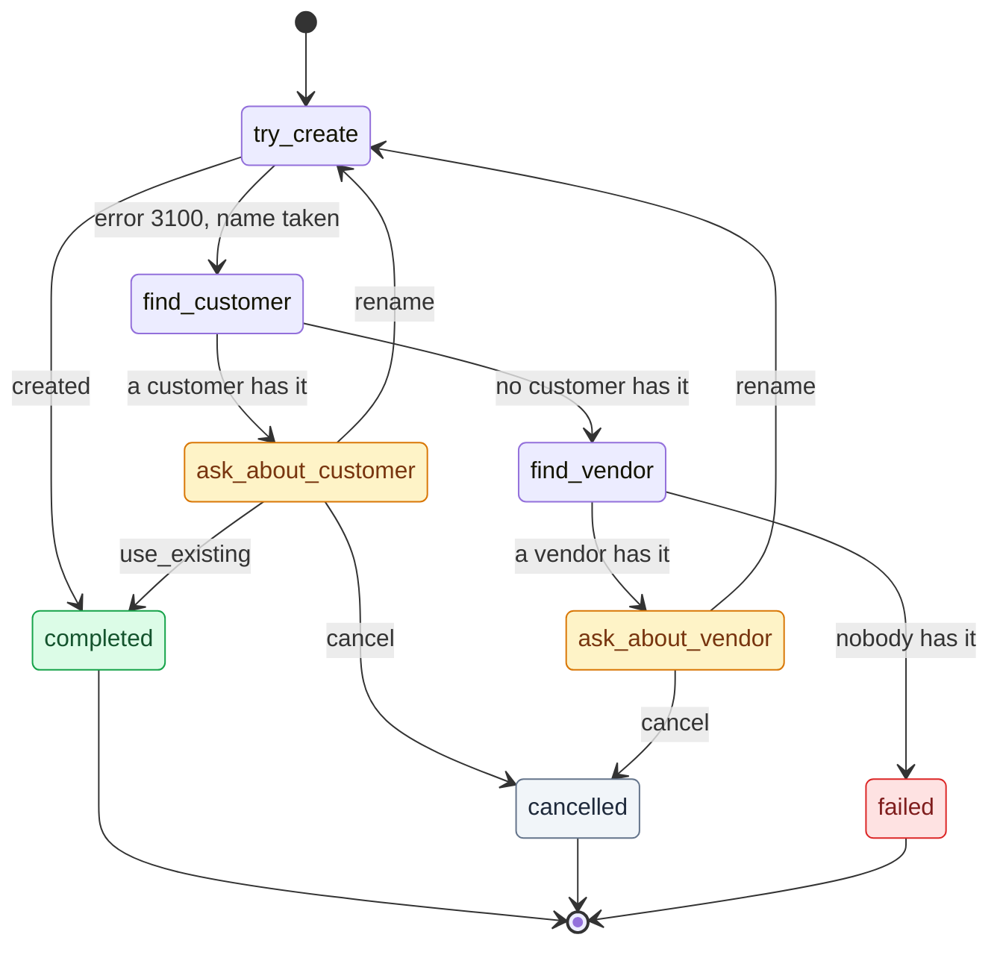
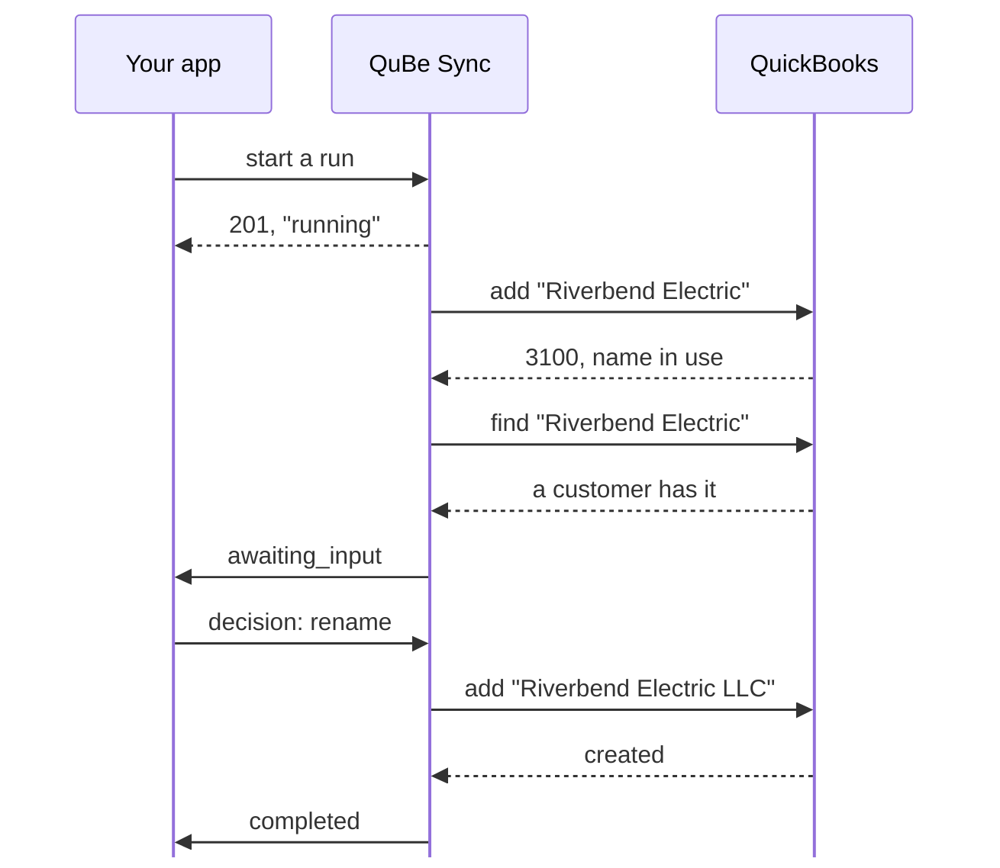

Real jobs rarely fit in one QuickBooks request. Invoicing an order from your store means making sure the
customer exists, handling the case where a vendor already has their name, making sure every item exists,
and only then adding the invoice. Over the Web Connector, each of those steps is a round trip that can
take minutes. Without workflows, your app has to save its place after every step, pick it up again from
each webhook, and decide what comes next.

A **workflow** is that job written down once, as a JSON statechart. QuBe Sync runs it server-side: it sends
each request, branches on QuickBooks' answer, pauses to ask your app when the chart says a person should
decide, and sends you one webhook when the job is done.

|  | One request at a time | A workflow |
| --- | --- | --- |
| A job of five dependent steps | Five requests, five webhooks, your code in between | One run, one final webhook |
| Branching on QuickBooks' answer | Your code, spread across webhook handlers | In the chart |
| "Is this the same company?" | Your code tracks what's pending and asks | A `wait` state: QuBe Sync asks, your app answers |
| Where progress is saved | Your database | QuBe Sync, visible on the run's page |
| Changing the flow | Deploy your app | Publish a new version of the chart |

## What a workflow looks like

This is `create_customer_safely`, one of the shipped templates. It creates a customer, and if QuickBooks
says the name is taken, it finds out who has it and asks your app what to do:



`try_create`, `find_customer` and `find_vendor` are **request** states: each sends one QuickBooks request
and branches on the answer. `ask_about_customer` and `ask_about_vendor` (amber) are **wait** states: the run
pauses and your app gets a question with options. `completed`, `cancelled` and `failed` are how a run can end.
A rename goes back to `try_create`, so a second clash is handled exactly like the first.

In the dashboard, every workflow is drawn as a canvas like this one, and every run lights up the path it took.

## Templates

Start from a shipped template rather than a blank chart. Each one is complete and tested, and templates
that call other workflows install those too.

| Template | What it does | Asks your app? |
| --- | --- | --- |
| `create_customer_safely` | Creates a customer. On a name clash, finds out whether a customer or a vendor has the name. | Yes: use the existing customer, rename, or cancel |
| `find_or_create_customer` | Looks a customer up by full name and creates it only if it's missing. | No |
| `find_or_create_vendor` | The same, for vendors. Ends `found` or `created`. | No |
| `find_or_create_item` | Looks an item up by full name, whatever its type, and creates it as a non-inventory or service item if it's missing. | No |
| `resolve_reference` | Turns a name into a reference to an account, class, terms, payment method, sales tax code or ship method. | When it can't create one from a name alone |
| `create_customer_and_invoice` | Runs `create_customer_safely`, then invoices whichever customer that produced. | Through `create_customer_safely` |
| `sync_order` | Creates the customer safely, finds or creates the item on every line, then adds the invoice. | Through `create_customer_safely` |

## Run one

<Steps>
  <Step title="Install the template">
    ```bash
    curl -u "$QUBE_API_KEY:" -X POST \
      https://qubesync.com/api/v2/workflow_templates/create_customer_safely/install \
      -H "Content-Type: application/json" -d '{"publish": true}'
    ```

    Or open **Workflows** in the dashboard and choose **Start from a template**.
  </Step>
  <Step title="Start a run">
    The input is the same body `POST /customers` takes, so a workflow is a drop-in for the request it
    replaces:

    ```bash
    curl -u "$QUBE_API_KEY:" -X POST \
      "https://qubesync.com/api/v2/connections/$CONN_ID/workflow_runs" \
      -H "Content-Type: application/json" \
      -d '{
        "workflow": "create_customer_safely",
        "input": {"customer": {"name": "Riverbend Electric", "email": "billing@riverbend.example"}},
        "webhook_url": "https://your-app.example/webhooks/qube"
      }'
    ```

    You get `201` with the run. Store its `id` next to the record it's for.
  </Step>
  <Step title="Answer its question">
    Riverbend Electric already exists, so the run stops at `ask_about_customer` and sends
    `workflow_run.awaiting_input`:

    ```json workflow_run.awaiting_input (abridged)
    {
      "event": "workflow_run.awaiting_input",
      "run_id": "fb1951a1-25b9-4fb2-98c7-c988988ecdf7",
      "workflow": "create_customer_safely",
      "connection_id": "4fdde583-68b1-4c6b-94d1-82abf97afdf5",
      "prompt": {
        "id": "resolve_conflict.ask_about_customer",
        "message": "A customer named \"Riverbend Electric\" already exists.",
        "data": {
          "existing": { "list_id": "8000001F-1790470623", "full_name": "Riverbend Electric", "company_name": "Riverbend Electric LLC", "phone": "512-555-0142" }
        },
        "options": [
          { "id": "use_existing", "label": "Use the existing customer" },
          { "id": "rename", "label": "Create it with a different name",
            "fields": { "name": { "type": "string", "required": true, "label": "New name" } } },
          { "id": "cancel", "label": "Cancel" }
        ]
      },
      "links": {
        "decisions": "https://qubesync.com/api/v2/connections/4fdde583-…/workflow_runs/fb1951a1-…/decisions",
        "cancel": "https://qubesync.com/api/v2/connections/4fdde583-…/workflow_runs/fb1951a1-…/cancel",
        "run": "https://qubesync.com/api/v2/connections/4fdde583-…/workflow_runs/fb1951a1-…",
        "ui": "https://qubesync.com/app/workflow_runs/fb1951a1-…"
      }
    }
    ```

    Show `prompt.message` and the options to your user, or decide in code. Then POST the choice, with any
    `fields` the option asks for, to `links.decisions`:

    ```bash
    curl -u "$QUBE_API_KEY:" -X POST "$DECISIONS_URL" \
      -H "Content-Type: application/json" \
      -d '{"option": "rename", "data": {"name": "Riverbend Electric LLC"}}'
    ```

    A run can wait as long as it needs to. Your user can answer tomorrow.
  </Step>
  <Step title="Get the result">
    The run creates "Riverbend Electric LLC" and ends:

    ```json workflow_run.completed (abridged)
    {
      "event": "workflow_run.completed",
      "run_id": "fb1951a1-25b9-4fb2-98c7-c988988ecdf7",
      "workflow": "create_customer_safely",
      "outcome": "completed",
      "output": {
        "customer": { "list_id": "80000025-1790470630", "full_name": "Riverbend Electric LLC" },
        "outcome": "created_renamed"
      },
      "error": null,
      "summary": {
        "requests": [
          { "state": "try_create", "operation": "customer.create", "status": "error" },
          { "state": "resolve_conflict.find_customer", "operation": "customer.query", "status": "success" },
          { "state": "try_create", "operation": "customer.create", "status": "success",
            "identifiers": { "list_id": "80000025-1790470630", "full_name": "Riverbend Electric LLC" } }
        ],
        "side_effects": [
          { "state": "try_create", "operation": "customer.create",
            "identifiers": { "list_id": "80000025-1790470630", "full_name": "Riverbend Electric LLC" } }
        ],
        "decisions": [
          { "state": "resolve_conflict.ask_about_customer", "option": "rename", "at": "2026-09-27T00:57:10Z" }
        ],
        "discarded": [],
        "calls": []
      }
    }
    ```

    Store `output.customer.list_id` against your record, and you're done.
  </Step>
</Steps>



## Webhooks

A run reports to the `webhook_url` it was started with, signed like every other QuBe Sync webhook
([verify it](/webhooks#verify-the-signature)):

| Event | When | Carries |
| --- | --- | --- |
| `workflow_run.awaiting_input` | The run needs a decision. | `prompt` |
| `workflow_run.completed` | The run ended as designed. | `outcome`, `output`, `summary` |
| `workflow_run.failed` | Something needs attention, such as a QuickBooks error the chart doesn't handle. | `outcome`, `error`, `summary` |
| `workflow_run.cancelled` | Your app cancelled it. | `cancel_reason`, `summary` |

Every event has `run_id`, `workflow`, `connection_id`, `app_id`, `sandbox`, `timestamp` and `links`
(`run`, `decisions`, `cancel`, `ui`). `GET links.run` returns the whole run, including its input and trace.

The QuickBooks requests a run sends are ordinary queued requests, visible in the dashboard, but they
**don't** send webhooks of their own. The run's events are the whole story.

## How a run ends

- **`completed`** means the job went as designed. `outcome` says which way: `completed`, or one the chart
  declares, such as `cancelled` when your app chose "Cancel", or `found` and `created` for a find-or-create.
  Branch on `outcome`.
- **`failed`** means something needs attention: a QuickBooks error the chart doesn't handle, a mistake in
  the chart, or a limit reached. `error` says what. A chart can also declare named failures, such as
  `customer_over_limit`, so your app can tell them apart by `outcome`.
- **`cancelled`**: your app stopped the run with `POST links.cancel` (an optional `{"reason": "..."}` is kept
  on the run). Cancelling never undoes what was already sent to QuickBooks. `summary.side_effects` lists
  exactly what was applied, so you can check or reverse it.

To find runs waiting on your users, list them:
`GET /connections/{id}/workflow_runs?state=awaiting_input`.

## Good to know

- **Starting a run twice runs it twice.** There's no idempotency key. Key runs by your own record (one run
  per order, say) and check before starting another.
- **Workflows can call workflows.** A `workflow` state runs another workflow as one step, optionally once
  per item in a list (`each`). Its questions arrive on the run you started, with `prompt.from` saying which
  part asked. You only ever deal with one run id.
- **Production runs the published version.** On a production connection, a run always uses the workflow's
  published version. Sandbox and simulated connections run your latest edits by default, so you can test
  before publishing. See [Build your own](/workflow-authoring#versions-and-publishing).

| Limit | Value |
| --- | --- |
| Transitions per run | 500 |
| Items in one `each` | 200, run one at a time, in order |
| Workflows calling workflows | 8 deep |
| Finished runs kept | 60 days (per-state details are trimmed after 7) |
| Runs listed per request | the 100 most recent |

## Next

<CardGroup cols={2}>
  <Card title="Build your own workflow" icon="pen-ruler" href="/workflow-authoring">
    Chart anatomy, writing charts with an AI assistant, versions, and promoting to production.
  </Card>
  <Card title="API reference: Workflows" icon="book" href="/api-reference/v2/workflows/start-a-workflow-run">
    Every workflow, template and run endpoint.
  </Card>
</CardGroup>
