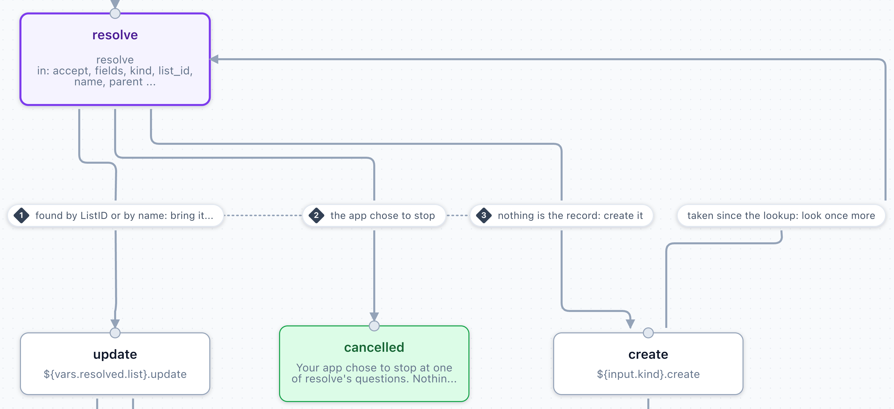
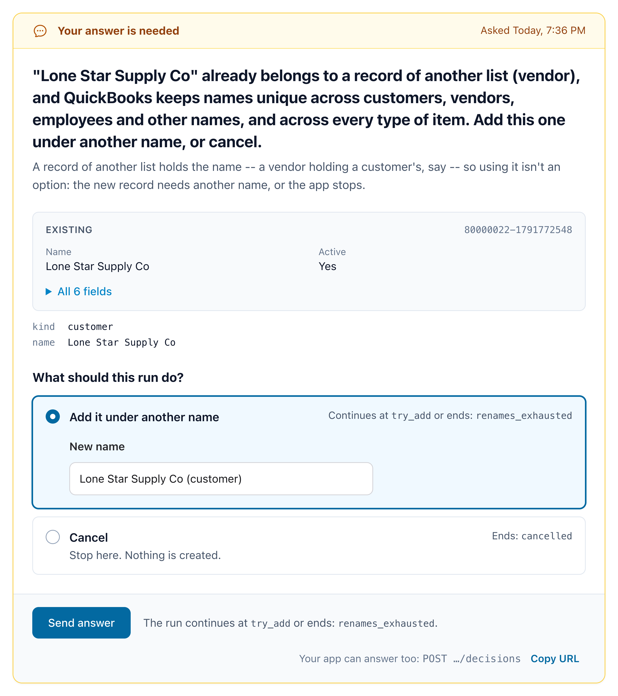
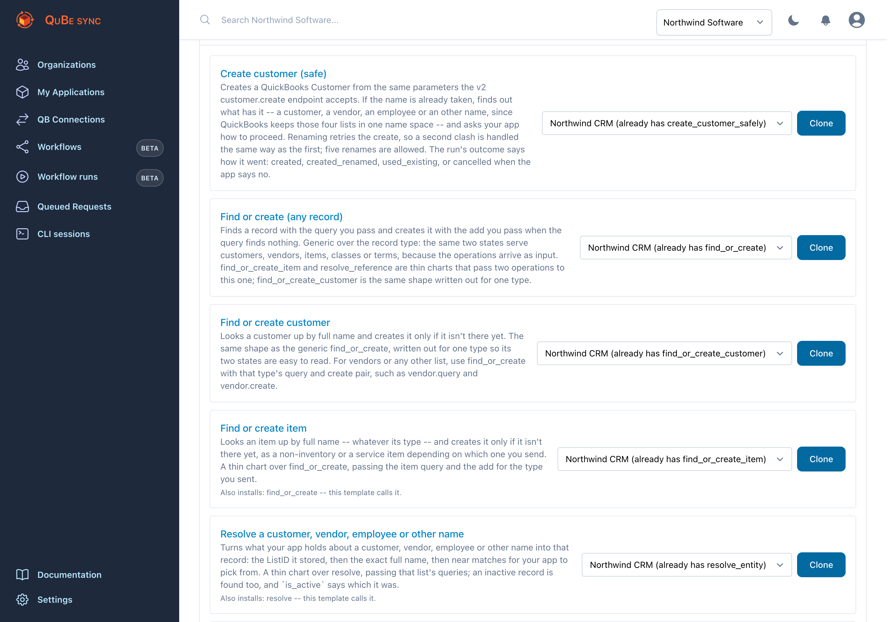
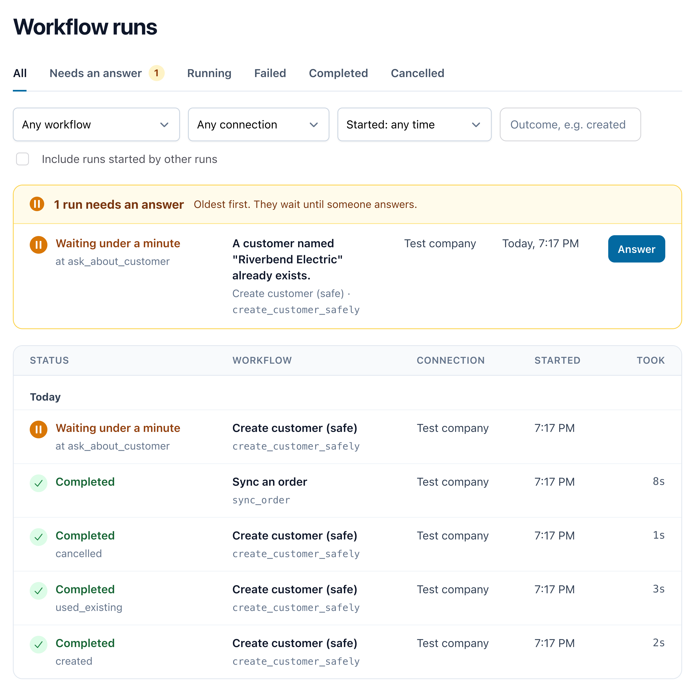
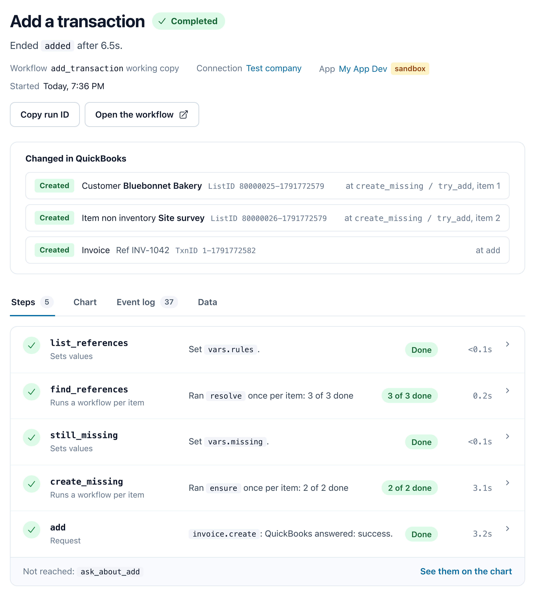

import { Request } from "/snippets/request.jsx";

Real jobs rarely fit in one QuickBooks request. Invoicing an order from your store means making sure the
customer exists, handling the case where a vendor already has their name, making sure every item exists,
and only then adding the invoice. If the connection drops during any part of that process, you have to 
recover gracefully and reconcile what mutations were made or not. Naive solutions lead to duplicate transaction records and headaches.

**Workflows** let you encapsulate all those decisions in one piece of logic, with all the tools to let your LLM of choice safely help you. Workflows are also composable, so you can build complex systems from small, re-usable pieces (including the templates we provide).

<CardGroup cols={3}>
  <Card title="Handles the edge cases" icon="code-branch" href="#pick-a-template">
    Names already taken, records someone else changed, races with other apps editing QuickBooks.
  </Card>
  <Card title="Asks when it can't decide" icon="comment" href="#two-kinds-of-question">
    Escalate decisions to your app or user when only a human can decide.
  </Card>
  <Card title="Survives lost answers" icon="arrows-rotate" href="#lost-answers">
    When QuickBooks' answer never arrives, the run finds out what was applied.
  </Card>
</CardGroup>

<Frame caption="Find or create anything in QuickBooks: includes a retry if another person or app editing QuickBooks causes a race condition. Combine with an update workflow to implement `upsert`.">
  
</Frame>

## Run your first workflow

This runs `create_customer_safely` for a customer that already exists (in a [simulated connection](/simulator)), so you see a question and its
answer.

<Steps>
  <Step title="Install the template">
    <Request
      method="POST"
      path="/api/v2/workflow-templates/create_customer_safely/install"
      body={{ publish: true }}
    />

    {/* agent-block:start */}
    <Visibility for="agents">

    ```http
    POST /api/v2/workflow-templates/create_customer_safely/install

    {"publish": true}
    ```

    ```bash
    curl -u "$QUBE_API_KEY:" \
      -X POST \
      "https://qubesync.com/api/v2/workflow-templates/create_customer_safely/install" \
      -H "Content-Type: application/json" \
      -d '{"publish": true}'
    ```

    </Visibility>
    {/* agent-block:end */}

    That installs and publishes it, and any template it calls, in one go.

    <Accordion title="Already installed, or cloned in the dashboard?" icon="circle-question">
      A template cloned in the dashboard is a draft: publish it with **Publish v1** in the builder. A sandbox connection can run a draft; a production connection can't.

      If the app already has a workflow at that key, the install is refused with `409` (`key_taken`). Add
      `"replace": true` to replace the workflow and all its dependencies. To install a second copy instead, just use
      another key with `{"as": "new_key"}`.
    </Accordion>

    <Accordion title="When a template changes" icon="code-compare">
      Installing copies the template's chart into your app, so when we fix or extend a template, your workflow keeps
      the chart it has until you install it again. `GET /api/v2/workflows` says when there's something to take: each
      workflow's `template` names the template it came from, and `template.status` is `update_available` once that
      template has changed. Install it again with `"replace": true`, plus `"publish": true` to make it live (and
      `"as"` with your workflow's key, if you installed it under another one). From the CLI, that's
      `qube workflows install KEY --replace --publish`.

      `update_available_customized` means you've edited the workflow since you installed it, so replacing it
      discards your edits: compare it with `GET /api/v2/workflow-templates/{key}` first. Each workflow a template
      installs alongside it reports its own `template`.

      In the dashboard, the Workflows page marks such a workflow **Template updated**, and its page offers
      **Update to the current template**.
    </Accordion>
  </Step>
  <Step title="Start a run">
    The input is the same body `POST /customers` takes, so a workflow can be a drop-in for the request it
    replaces:

    <Request
      method="POST"
      path="/api/v2/connections/{connection_id}/workflow-runs"
      body={{
        workflow: "create_customer_safely",
        input: {
          customer: { name: "Riverbend Electric", email: "billing@riverbend.example" },
        },
        webhook_url: "https://your-app.example/webhooks/qube",
      }}
    />

    {/* agent-block:start */}
    <Visibility for="agents">

    ```http
    POST /api/v2/connections/{connection_id}/workflow-runs

    {
      "workflow": "create_customer_safely",
      "input": {
        "customer": {
          "name": "Riverbend Electric",
          "email": "billing@riverbend.example"
        }
      },
      "webhook_url": "https://your-app.example/webhooks/qube"
    }
    ```

    ```bash
    curl -u "$QUBE_API_KEY:" \
      -X POST \
      "https://qubesync.com/api/v2/connections/$CONN_ID/workflow-runs" \
      -H "Content-Type: application/json" \
      -d '{
        "workflow": "create_customer_safely",
        "input": {
          "customer": {
            "name": "Riverbend Electric",
            "email": "billing@riverbend.example"
          }
        },
        "webhook_url": "https://your-app.example/webhooks/qube"
      }'
    ```

    </Visibility>
    {/* agent-block:end */}

    This returns `201` with the run object as JSON. Store its `id` for reference. `webhook_url` is optional, but
    a run started without one sends no webhooks, and a workflow that [sends your app data](#sending-your-app-data)
    can't start without one (`422 webhook_url_required`).
  </Step>
  <Step title="Answer its question">
    Riverbend Electric already exists in the simulator, so the run stops at `ask_about_customer` and sends
    `workflow_run.awaiting_input`. Its `prompt` says "A customer named "Riverbend Electric" already
    exists." and offers three options:

    | `option` | `label` | Asks for |
    | --- | --- | --- |
    | `use_existing` | Use the existing customer | |
    | `rename` | Create it with a different name | `name` |
    | `cancel` | Don't create a customer | |

    Show them to your user, or decide in code. Then POST the choice, with any `fields` the option asks for,
    to `links.decisions`:

    <Request
      method="POST"
      path="/api/v2/connections/{connection_id}/workflow-runs/{run_id}/decisions"
      body={{
        option: "rename",
        data: { name: "Riverbend Electric LLC" },
      }}
    />

    {/* agent-block:start */}
    <Visibility for="agents">

    ```http
    POST /api/v2/connections/{connection_id}/workflow-runs/{run_id}/decisions

    {
      "option": "rename",
      "data": {"name": "Riverbend Electric LLC"}
    }
    ```

    ```bash
    curl -u "$QUBE_API_KEY:" \
      -X POST \
      "https://qubesync.com/api/v2/connections/$CONN_ID/workflow-runs/$RUN_ID/decisions" \
      -H "Content-Type: application/json" \
      -d '{
        "option": "rename",
        "data": {"name": "Riverbend Electric LLC"}
      }'
    ```

    </Visibility>
    {/* agent-block:end */}

    A run can wait as long as it needs to. Your user can answer tomorrow.

    <Accordion title="The whole awaiting_input webhook" icon="code">
      ```json workflow_run.awaiting_input {10-27}
      {
        "event": "workflow_run.awaiting_input",
        "timestamp": 1790470628,
        "app_id": "98f339a4-32e8-424a-987e-ccaf5bcaa620",
        "sandbox": true,
        "connection_id": "4fdde583-68b1-4c6b-94d1-82abf97afdf5",
        "workflow": "create_customer_safely",
        "workflow_id": "01a0e05a-3c52-7a8e-b1f4-6d2e9c0a7b31",
        "run_id": "fb1951a1-25b9-4fb2-98c7-c988988ecdf7",
        "prompt": {
          "id": "resolve_conflict.ask_about_customer",
          "token": "Vq3kT9xRb2LmW8sZ",
          "kind": "decision",
          "message": "A customer named \"Riverbend Electric\" already exists.",
          "data": {
            "existing": { "type": "customer", "list_id": "8000001F-1790470623", "full_name": "Riverbend Electric",
                          "company_name": "Riverbend Electric LLC", "phone": "512-555-0142" }
          },
          "options": [
            { "id": "use_existing", "label": "Use the existing customer",
              "description": "Carry on with the customer QuickBooks already has. Nothing new is created." },
            { "id": "rename", "label": "Create it with a different name",
              "description": "Try again under a name you choose.",
              "fields": { "name": { "type": "string", "required": true, "label": "New name" } } },
            { "id": "cancel", "label": "Don't create a customer",
              "description": "Stop here. The run ends as cancelled, with nothing written to QuickBooks." }
          ]
        },
        "links": {
          "run": "https://qubesync.com/api/v2/connections/4fdde583-…/workflow-runs/fb1951a1-…",
          "decisions": "https://qubesync.com/api/v2/connections/4fdde583-…/workflow-runs/fb1951a1-…/decisions",
          "cancel": "https://qubesync.com/api/v2/connections/4fdde583-…/workflow-runs/fb1951a1-…/cancel",
          "ui": "https://qubesync.com/app/workflow_runs/fb1951a1-…"
        }
      }
      ```

      `data.existing` is the record that has the conflicting name, and its `type` says which list it's on (e.g. vendors, customers, etc). Each option
      has a `label`, and a `description` when it needs one.
    </Accordion>

    You can use the app to test workflow runs: open the `links.ui` field to answer the question in the app, or just find the running workflow on the **Workflow Runs** page.
    
    <Frame caption="The same question on the run's page (links.ui). Answering here is the same as POSTing to links.decisions.">
      
    </Frame>
  </Step>
  <Step title="Get the result">
    The run creates "Riverbend Electric LLC" and sends `workflow_run.completed`. Its `outcome` is
    `created_renamed`: store `output.customer.list_id` against your record, and you're done.

    <Accordion title="The whole completed webhook" icon="code">
      ```json workflow_run.completed (abridged)
      {
        "event": "workflow_run.completed",
        "run_id": "fb1951a1-25b9-4fb2-98c7-c988988ecdf7",
        "workflow": "create_customer_safely",
        "outcome": "created_renamed",
        "output": {
          "customer": { "list_id": "80000025-1790470630", "full_name": "Riverbend Electric LLC" },
          "outcome": "created_renamed"
        },
        "error": null,
        "summary": {
          "ended_at": "2026-09-27T00:57:14.482113Z",
          "stopped_at": "try_create",
          "requests": [
            { "state": "try_create", "workflow": "create_customer_safely", "operation": "customer.create", "status": "error" },
            { "state": "resolve_conflict.find_holder", "workflow": "create_customer_safely", "operation": "entity.query", "status": "success" },
            { "state": "try_create", "workflow": "create_customer_safely", "operation": "customer.create", "status": "success",
              "identifiers": { "list_id": "80000025-1790470630", "full_name": "Riverbend Electric LLC" } }
          ],
          "side_effects": [
            { "state": "try_create", "workflow": "create_customer_safely", "operation": "customer.create",
              "identifiers": { "list_id": "80000025-1790470630", "full_name": "Riverbend Electric LLC" } }
          ],
          "decisions": [
            { "state": "resolve_conflict.ask_about_customer", "workflow": "create_customer_safely",
              "option": "rename", "at": "2026-09-27T00:57:10.418204Z" }
          ],
          "discarded": [],
          "calls": []
        }
      }
      ```

      `summary` lists every request the run sent, what it changed in QuickBooks (`side_effects`) and every
      decision it was given. Each entry names the `workflow` whose state it was, which tells a called
      workflow's step from the run's own.
    </Accordion>
  </Step>
</Steps>

## Pick a template

Start from a shipped template rather than a blank chart. Each one is complete and tested, and a template
that calls other workflows installs those too. The generic ones (`find_or_create`, `resolve`, `upsert`,
`resolve_transaction` and `stream_query`) work for any record type: you pass them the operations to send,
such as `{"operation": "customer.query", "params": {"full_name": ["Riverbend Electric"]}}`.

**Find or create a record.** None of these asks your app, except `create_customer_safely`.

| Template | What it does |
| --- | --- |
| `find_or_create` | Sends your find query and, if it finds nothing, your create. Any record type. |
| `find_or_create_customer` | The same, for a customer, by full name. |
| `find_or_create_item` | Finds an item of any type by full name, or creates it. |
| `create_customer_safely` | Creates a customer. On a name clash, asks your app what to do. |

**Find a record, without writing.** Each asks your app to pick one when it isn't sure.

| Template | What it does |
| --- | --- |
| `resolve` | Finds a list record by its stored ListID, then its full name. Any list. |
| `resolve_entity` | The same, for a customer, vendor, employee or other name. |
| `resolve_reference` | Turns a name into an account, class, terms, payment method, sales tax code or ship method. |
| `resolve_transaction` | Finds a transaction by its TxnID, then its reference number, then your filters and the GUID your app kept. |

**Write.** Each can stop to ask your app before it writes.

| Template | What it does |
| --- | --- |
| `upsert` | Updates a list record if it finds one, and creates it if not. |
| `push_records` | Runs `upsert` for up to 200 records, in order, in one run. |
| `create_invoice` | Makes sure the customer and items exist, then adds the invoice. |
| `record_payment` | Finds an invoice and records a payment against it. |
| `void_transaction` | Finds a transaction, then voids or deletes it. |

**Send QuickBooks data to your app.** Each sends [notifications](#sending-your-app-data), so each needs a
`webhook_url`.

| Template | What it does |
| --- | --- |
| `send_lists_to_app` | An initial import: every customer, vendor and item, 200 at a time. |
| `stream_query` | Pages through any query you pass and sends each page. |
| `pull_changes` | An incremental sync: what changed since a date, then what was deleted. |

**Read the company's setup.**

| Template | What it does |
| --- | --- |
| `company_profile` | The company, its preferences and its host, in one Web Connector session. Run it when a connection is set up. |

<AccordionGroup>
  <Accordion title="What each template takes, asks and ends with" icon="table">
    | Template | What it does | Asks your app | Ends |
    | --- | --- | --- | --- |
    | `find_or_create` | Sends the `find` query you pass and, if it finds nothing, the `create` add. Any record type, vendors included. On a 3100 from the add, looks once more. | No | `found`, `created` |
    | `resolve` | Finds a list record by its stored ListID (`id`), then by exact full name (`by_name`), and if nothing has the name offers what your `candidates` query finds. It only finds: `upsert` is the one that writes. | `ask`: `use` (with `list_id`), `none` (ends `not_found`) or `cancel` | `found`, `picked`, `not_found`, `cancelled` |
    | `upsert` | Finds a list record as `resolve` does (`id`, `by_name`, optional `candidates`) and sends your `update` to it with its ListID filled in; the engine reads the edit sequence first and asks before overwriting a record someone changed since. Nothing has the name: sends your `create` add instead, looking once more if the name was taken in between. | `resolve / ask`: `use` (with `list_id`), `none` (then the add goes out) or `cancel`. And the [conflict prompt](#conflicts) when the record changed after it was read | `updated`, `created`, `cancelled`; fails as `name_taken` when the update renames it to a name in use |
    | `push_records` | Runs `upsert` once per entry of `records` -- at most 200, each the `id`, `by_name`, `candidates`, `create` and `update` that `upsert` takes, records of different lists mixed -- one at a time, in order, in one run. A record QuickBooks refuses, or one that isn't a valid `upsert` input, is listed in `errors` and the next one goes. For a webhook per record, run `upsert` once per record instead. | Through `upsert`, for each record that asks | `completed` |
    | `resolve_transaction` | Finds a transaction by the `txn_id` your app stored, then by its `ref_number`, then by the filters your `query` carries (a customer, a date range), picking out the one carrying the `external_guid` your app kept from the add. One transaction with the number and no GUID to check is it; anything less sure is offered to your app. Without line items: read it whole by `txn_id` when you need them. | `ask`: `use` (with `txn_id`), `none` (ends `not_found`) or `cancel` | `found`, `picked`, `not_found`, `cancelled` |
    | `void_transaction` | Finds a transaction of `kind` as `resolve_transaction` does, then voids it, or deletes it when `action` is `delete`. QuickBooks voids sixteen types (invoice, bill, check, journal_entry and the others `kind` lists) and deletes those and nine more (sales_order, estimate, purchase_order, receive_payment, time_tracking and four others), so a delete takes kinds a void does not; asking to void one of those nine fails at once, before anything is sent, and says to pass `action` `delete`. An invoice that payments paid can be voided: the payments stay, with what they had applied to it now their `unused_payment`. Nothing is voided or deleted until the transaction is identified. | Through `resolve_transaction` | `voided`, `deleted`, `not_found`, `cancelled` |
    | `record_payment` | Finds an invoice as `resolve_transaction` does and records a `payment` (a `receive_payment.create` body: how it was paid) for the invoice's own customer, applied to that invoice; the amount defaults to what the invoice still owes. An invoice already paid in full is reported, not paid again. | Through `resolve_transaction` | `applied`, `already_paid`, `not_found`, `cancelled` |
    | `create_customer_safely` | Creates a customer from `customer`, the body `POST /customers` takes. On a name clash, finds what has the name and asks. Allows five renames. | `ask_about_customer`: `use_existing`, `rename` (with `name`), `cancel`. `ask_about_other`: `rename`, `cancel` | `created`, `created_renamed`, `used_existing`, `cancelled`; fails as `renames_exhausted` |
    | `find_or_create_customer` | Finds a customer by full name, or creates it from `customer`. `find_or_create`, written out for one type. | No | `found`, `created` |
    | `find_or_create_item` | Finds an item by full name, whatever its type, or creates it from exactly one of `item` (any item add, as `{"operation": "item_other_charge.create", "params": {...}}`), `non_inventory` or `service`. Runs `find_or_create`. | No | `found`, `created` |
    | `resolve_entity` | Finds a customer, vendor, employee or other name (`kind`) by its stored `list_id`, then by `name`, inactive ones included. Runs `resolve`. | When nothing has the name but near matches do (up to 20): `use`, `none` or `cancel` | `found`, `picked`, `not_found`, `cancelled` |
    | `resolve_reference` | Turns a `name`, and optionally a stored `list_id`, into a reference to an account, class, terms, payment method, sales tax code or ship method (`kind`). Only finds, like `resolve`, which it runs: a missing class, payment method or ship method is `find_or_create`'s or `upsert`'s to make. | When nothing has the name: `use` one of the first 50 active ones, `none`, or `cancel`. With none active, it ends `not_found` without asking | `found`, `picked`, `not_found`, `cancelled` |
    | `send_lists_to_app` | An initial import: every customer, vendor and item, active or not, sent to your app 200 at a time as `customers_page`, `vendors_page` and `items_page` [notifications](#sending-your-app-data), then the counts. Needs a `webhook_url`. | No | `completed` |
    | `stream_query` | Pages through the `query` you pass, 200 at a time, and sends each page to your app as a `page` [notification](#sending-your-app-data) carrying `kind`, `page`, `more`, `pass` and `records`, then how many there were. Any query: every customer, the items changed since a date, one customer's invoices; one QuickBooks doesn't page, such as the accounts, arrives as a single page. If the Web Connector session ends between pages, it starts again from page 1 (`pass` 2, at most 3), so take a repeated page without harm. Needs a `webhook_url`. | No | `completed` |
    | `pull_changes` | The incremental sync. For each kind word in `lists` (`customer`, `vendor`, `account`, `class`, the `item_*` kinds such as `item_service`, and every other list type a deleted-records query knows, all but `billing_rate`) and in `transactions` (`invoice`, `receive_payment`, `bill` and every other transaction type), runs `stream_query` over the records modified on or after `since`, inactive ones included, so they arrive as `page` [notifications](#sending-your-app-data) with that `kind`. Then it sends one `deleted` notification with the records of those kinds deleted since then, and of no others: a payment deleted since then isn't in it unless `transactions` names `receive_payment`. QuickBooks keeps 90 days of them. Transactions come without their lines unless `include_line_items` is true (four kinds don't take it: `build_assembly`, `charge`, `time_tracking` and `vehicle_mileage`). A list QuickBooks doesn't page arrives as one page. Needs a `webhook_url`. | No | `completed` |
    | `company_profile` | Reads the company (name, legal name, address, fiscal year), its preferences (inventory, class tracking, multiple currencies, sales tax and the defaults QuickBooks posts with) and its host (product, version, country and the qbXML versions it speaks), all three in one Web Connector session. Run it when a connection is set up. | No | `completed` |
    | `create_invoice` | Creates the `customer` with `create_customer_safely`, finds or creates each item add in `items` (optional, any item type), then adds the `invoice` exactly as sent, each line naming its item and carrying its own quantity, rate and the rest. A lost answer to the add is [settled by the run](#lost-answers): the invoice found by the GUID the add carried is read whole, and one not found is added again. | Through `create_customer_safely`. And `ask_about_invoice` when the run could not settle whether the invoice was added: `use_existing` (with `txn_id`), `create_again`, `cancel` | `completed`, `cancelled`; fails as `unanswered_twice` |

    A question's `prompt.id` is the path of the state that asks it, such as
    `resolve_conflict.ask_about_customer`. When one workflow calls another, the calling state comes first:
    `create_invoice` relays `create_customer / resolve_conflict.ask_about_customer`, `resolve_entity` asks
    `resolve / ask`, as do `upsert` and `resolve_reference`; `resolve_transaction` asks `ask`, and `void_transaction` and `record_payment` relay `find / ask`.
    `push_records` relays `upsert / resolve / ask` for whichever record asks: `prompt.from.item_index` says which, counting from 0,
    and `item_count` how many there are. `resolve_reference`'s `kind` is
    `account`, `class`, `standard_terms`, `payment_method`, `sales_tax_code` or `ship_method`.

    Every template can also end <Badge color="red">`failed`</Badge>, when something goes wrong that it doesn't handle. `error` says why,
    usually in QuickBooks' own words.
  </Accordion>
  <Accordion title="What each template returns in output" icon="box-open">
    | Template | `output` |
    | --- | --- |
    | `find_or_create` | `{outcome, record, ref: {list_id, full_name}}` |
    | `resolve`, `resolve_entity` | `{outcome, record, ref: {list_id, full_name}, is_active}` |
    | `upsert` | `{outcome, matched, record, ref: {list_id, full_name}, is_active}`: `matched` is `found` or `picked` after an update, null after a create |
    | `push_records` | `{results, outcomes, errors}`, in the order of `records`: each one's `upsert` output (null for one that failed), how it ended (`updated`, `created`, `cancelled`, `failed`, `name_taken`, or null when it wasn't a valid `upsert` input) and an `{index, message}` entry for each that failed, with its `outcome` when it ran |
    | `resolve_transaction` | `{outcome, record, ref: {txn_id, ref_number, external_guid}}`: the header, without lines |
    | `void_transaction` | `{outcome, ref: {txn_id, ref_number, external_guid}}` |
    | `record_payment` | `{outcome, payment, invoice: {txn_id, ref_number, balance_before, applied}}` |
    | `resolve_reference` | `{outcome, ref}` |
    | `find_or_create_customer` | `{outcome, customer}` |
    | `find_or_create_item` | `{outcome, item}` |
    | `create_customer_safely` | `{outcome, customer: {list_id, full_name}}`. On `cancelled`, `{outcome, name_tried}`; on `renames_exhausted`, `null` |
    | `send_lists_to_app` | `{customers, vendors, items}`: how many of each were sent |
    | `stream_query` | `{kind, records, pages, passes}`: how many records were sent, over how many pages, and how many times the query was started from page 1 |
    | `pull_changes` | `{since, lists, transactions, deleted: {lists, transactions}}`: `lists` and `transactions` hold `stream_query`'s output for each kind, in the order given, and `deleted` how many deleted records of each were sent |
    | `company_profile` | `{company, preferences, host}`, each as its query answers it |
    | `create_invoice` | `{customer, items, invoice}`. It has no `outcome` key: read the run's `outcome`. |
  </Accordion>
</AccordionGroup>

In the dashboard, open **Workflows** and clone any template into your sandbox app.

<Frame caption="Workflows → Start from a template. A card names the templates it also installs.">
  
</Frame>

## What your app receives

A run reports to the `webhook_url` it was started with, and sends nothing if it was started without one.
The QuickBooks requests it sends are ordinary queued requests, visible in the dashboard, but they **don't**
send webhooks of their own: the run's events are the whole story. They're signed like every other QuBe
Sync webhook ([verify them](/webhooks#securing-your-endpoints)), and your endpoint answers the same way:
any `2xx` within 5 seconds.

<CardGroup cols={3}>
  <Card title="You start it" icon="play">
    `POST /workflow-runs` answers `201`, with the run `running`.
  </Card>
  <Card title="While it runs" icon="arrows-rotate">
    `awaiting_input` when it needs a decision, `notification` when it sends your app data.
  </Card>
  <Card title="Once, at the end" icon="flag-checkered">
    `completed`, `failed` or `cancelled`.
  </Card>
</CardGroup>

| Event | When | Your app |
| --- | --- | --- |
| `workflow_run.awaiting_input` | The run needs a decision. It carries the question in `prompt`. | Shows it, then POSTs the choice to `links.decisions` ([below](#two-kinds-of-question)). |
| `workflow_run.notification` | A `notify` state [sends your app data](#sending-your-app-data). The run waits for your `2xx`. | Stores `data`, deduplicating on `delivery_id`. |
| `workflow_run.completed` | The run ended as designed: `completed`, or a success outcome the chart declares. | Branches on `outcome` and stores `output`. |
| `workflow_run.failed` | Something needs attention: a QuickBooks error the chart doesn't handle, a named failure such as `renames_exhausted`, or a limit reached. | Shows `error`. What the run changed stays in QuickBooks. |
| `workflow_run.cancelled` | Somebody stopped it: your app with `POST links.cancel`, or a person on the run's page. | Reads `cancel_reason`. Nothing is undone. |

<Visibility for="agents">
Every event has `event`, `timestamp`, `app_id`, `sandbox`, `connection_id`, `workflow` (the key),
`workflow_id` (`null` once the workflow is deleted), `run_id` and `links` (`run`, `decisions`, `cancel`,
`ui`). All three endings carry `outcome`, `output`, `error` and `summary`, and `workflow_run.cancelled` adds
`cancel_reason`. A run's `error` is a sentence, not the error object a request's webhook carries.
`GET links.run` returns the whole run, including its input, vars and trace.
</Visibility>

Deliveries can fail, repeat, or arrive early:

| Delivery | What happens | What to do |
| --- | --- | --- |
| **Retries** | A failed delivery is retried with backoff, up to 5 attempts, each logged in the run's event log as `webhook_sent`. If they all fail, your organization's owners get an email. Notifications are retried for longer ([below](#sending-your-app-data)). | There's no **Resend** for a run: read it with `GET links.run` instead. |
| **Repeats** | Deliveries can repeat and arrive out of order. A run ends only once. Each delivery is built when it's sent, from the run as it is then: a retried `workflow_run.awaiting_input` that arrives after the question was answered has no `prompt`. | Key endings on `run_id`. |
| **Before the `201`** | A run that ends as it starts, such as a chart that fails before it sends anything, comes back from `POST /workflow-runs` already `failed` or `completed`, and its webhook can reach you before that response does. | Store the run's id from the response, and retry an event whose `run_id` you haven't stored yet instead of dropping it. |

<Accordion title="Handle them in a job" description="WorkflowRunEventJob, in Ruby" icon="code">
  If one endpoint takes both request and run webhooks, [route on `event`](/webhooks#handle-it-in-a-job)
  and handle the run's in a job of its own:

  ```ruby
  # app/jobs/workflow_run_event_job.rb
  class WorkflowRunEventJob < ApplicationJob
    class UnknownRun < StandardError; end
    # An ending can arrive before the 201 that gave you the run's id.
    retry_on UnknownRun, wait: 5.seconds, attempts: 5

    def perform(event)
      run = OrderSync.find_by(qube_run_id: event["run_id"]) or raise UnknownRun # where you stored the run's id
      return if run.finished? # a repeat, or a question retried after the end

      case event["event"]
      when "workflow_run.notification"
        # Already handled if this delivery_id was seen: a retry repeats it.
        return if run.deliveries.exists?(delivery_id: event["delivery_id"])

        ImportPage.call(run, event["name"], event["data"]) # e.g. customers_page
        run.deliveries.create!(delivery_id: event["delivery_id"])
      when "workflow_run.awaiting_input"
        run.update!(status: "waiting", question: event["prompt"]) if event["prompt"]
      when "workflow_run.completed"
        run.update!(status: "done", outcome: event["outcome"], output: event["output"])
      when "workflow_run.failed", "workflow_run.cancelled"
        run.update!(status: "stopped", outcome: event["outcome"], error: event["error"] || event["cancel_reason"])
      end
    end
  end
  ```
</Accordion>

### Two kinds of question

`workflow_run.awaiting_input` carries the question in `prompt`, and `prompt.kind` says who is asking. Both
kinds are answered at `links.decisions`.

<CardGroup cols={2}>
  <Card title="decision: the chart asks" icon="signs-post">
    At a `wait` state, with the options the chart declares, such as `use_existing`, `rename` and `cancel`.
  </Card>
  <Card title="conflict: the run asks" icon="code-compare">
    When an update meets a record someone changed after it was read ([Conflicts](#conflicts)). Its options
    are always `overwrite` and `keep`.
  </Card>
</CardGroup>

<AccordionGroup>
  <Accordion title="Both prompts, in full" icon="code">
    <CodeGroup>
    ```json kind: decision (abridged)
    {
      "id": "resolve_conflict.ask_about_customer",
      "kind": "decision",
      "message": "A customer named \"Riverbend Electric\" already exists.",
      "data": {
        "existing": { "type": "customer", "list_id": "8000001F-1790470623", "full_name": "Riverbend Electric", "phone": "512-555-0142" }
      },
      "options": [
        { "id": "use_existing", "label": "Use the existing customer",
          "description": "Carry on with the customer QuickBooks already has. Nothing new is created." },
        { "id": "rename", "label": "Create it with a different name",
          "description": "Try again under a name you choose.",
          "fields": { "name": { "type": "string", "required": true, "label": "New name" } } },
        { "id": "cancel", "label": "Don't create a customer",
          "description": "Stop here. The run ends as cancelled, with nothing written to QuickBooks." }
      ]
    }
    ```

    ```json kind: conflict (abridged)
    {
      "id": "conflict:update_contact",
      "kind": "conflict",
      "state": "update_contact",
      "message": "customer \"Riverbend Electric\" changed in QuickBooks after it was read; 1 of the 2 fields you are updating differs.",
      "data": {
        "operation": "customer.update",
        "sent": { "phone": "512-555-0100", "email": "billing@riverbend.example" },
        "current": { "list_id": "8000001F-1790470623", "edit_sequence": "1790470711", "full_name": "Riverbend Electric",
                     "phone": "512-555-0199", "email": "ap@riverbend.example", "last_name": "Okafor-Reyes" },
        "as_read": { "list_id": "8000001F-1790470623", "edit_sequence": "1790470623", "full_name": "Riverbend Electric",
                     "phone": "512-555-0142", "email": "ap@riverbend.example", "last_name": "Okafor" },
        "conflicts": [
          { "field": "phone", "sent": "512-555-0100", "current": "512-555-0199", "as_read": "512-555-0142" }
        ],
        "theirs": [
          { "field": "last_name", "as_read": "Okafor", "current": "Okafor-Reyes" }
        ],
        "position": 0
      },
      "options": [
        { "id": "overwrite", "label": "Apply my changes anyway",
          "fields": { "params": { "type": "object", "required": false, "label": "Different fields to send instead" } } },
        { "id": "keep", "label": "Keep what QuickBooks has" }
      ]
    }
    ```
    </CodeGroup>

    In the decision, `data.existing` is the record `find_holder` found, and its `type` says which list it's on.
    In the conflict, the run was changing Riverbend Electric's phone and email. Since it read the record, someone
    in QuickBooks changed the phone too, and the last name. The email isn't in `conflicts`, because nobody else
    touched it. The last name is in `theirs`, because the update doesn't send it.
  </Accordion>
  <Accordion title="Answering a conflict" icon="code-compare">
    | Prompt field | What it holds |
    | --- | --- |
    | `id` | `conflict:<state>`, or `<calling state> / conflict:<state>` when a workflow this one calls asked (`prompt.from` then names it). |
    | `state` | The request state that sent the update, in the workflow that asked. |
    | `data.operation` | The update, such as `customer.update`. |
    | `data.sent` | The fields it sends, without its id and edit sequence. |
    | `data.current` | The record as QuickBooks has it now, with its edit sequence, but without its lines, linked transactions and data extensions, which the run's read of it doesn't include either. |
    | `data.as_read` | The record as the run read it, or `null` when the chart passed its own `edit_sequence`. |
    | `data.conflicts` | One row per field being updated that someone else changed too: `field`, `sent`, `current`, `as_read`. |
    | `data.theirs` | What they changed that the update doesn't send: `field`, `as_read`, `current`. Empty when `as_read` is `null`. |
    | `data.position` | Which of the state's requests it was, counting from 0. Always 0 unless the state sends several. |

    <Request
      label="Send my fields anyway, with the current edit sequence"
      method="POST"
      path="/api/v2/connections/{connection_id}/workflow-runs/{run_id}/decisions"
      body={{ option: "overwrite" }}
    />

    {/* agent-block:start */}
    <Visibility for="agents">

    Send my fields anyway, with the current edit sequence:

    ```http
    POST /api/v2/connections/{connection_id}/workflow-runs/{run_id}/decisions

    {"option": "overwrite"}
    ```

    ```bash
    curl -u "$QUBE_API_KEY:" \
      -X POST \
      "https://qubesync.com/api/v2/connections/$CONN_ID/workflow-runs/$RUN_ID/decisions" \
      -H "Content-Type: application/json" \
      -d '{"option": "overwrite"}'
    ```

    </Visibility>
    {/* agent-block:end */}

    <Request
      label="Send these fields instead: a merge worked out from the diff"
      method="POST"
      path="/api/v2/connections/{connection_id}/workflow-runs/{run_id}/decisions"
      body={{
        option: "overwrite",
        data: { params: { phone: "512-555-0199", email: "billing@riverbend.example" } },
      }}
    />

    {/* agent-block:start */}
    <Visibility for="agents">

    Send these fields instead: a merge worked out from the diff:

    ```http
    POST /api/v2/connections/{connection_id}/workflow-runs/{run_id}/decisions

    {
      "option": "overwrite",
      "data": {
        "params": {"phone": "512-555-0199", "email": "billing@riverbend.example"}
      }
    }
    ```

    ```bash
    curl -u "$QUBE_API_KEY:" \
      -X POST \
      "https://qubesync.com/api/v2/connections/$CONN_ID/workflow-runs/$RUN_ID/decisions" \
      -H "Content-Type: application/json" \
      -d '{
        "option": "overwrite",
        "data": {
          "params": {"phone": "512-555-0199", "email": "billing@riverbend.example"}
        }
      }'
    ```

    </Visibility>
    {/* agent-block:end */}

    <Request
      label="Leave QuickBooks as it is"
      method="POST"
      path="/api/v2/connections/{connection_id}/workflow-runs/{run_id}/decisions"
      body={{ option: "keep" }}
    />

    {/* agent-block:start */}
    <Visibility for="agents">

    Leave QuickBooks as it is:

    ```http
    POST /api/v2/connections/{connection_id}/workflow-runs/{run_id}/decisions

    {"option": "keep"}
    ```

    ```bash
    curl -u "$QUBE_API_KEY:" \
      -X POST \
      "https://qubesync.com/api/v2/connections/$CONN_ID/workflow-runs/$RUN_ID/decisions" \
      -H "Content-Type: application/json" \
      -d '{"option": "keep"}'
    ```

    </Visibility>
    {/* agent-block:end */}

    With `overwrite`, the fields in `params` replace the ones the update sent, and the run adds the record's
    id and current edit sequence. `params` must be an object of fields the update takes, like `data.sent`.
    One it doesn't take is refused with `422` (`invalid_data`, naming the field), and the run keeps waiting.
    If the record changes yet again first, the run asks again, and after three writes the 3200 stands as the
    state's error. With `keep`, the run carries on with the record as QuickBooks has it. To refuse both,
    cancel the run.

    A conflict answer isn't a step of the chart, so it isn't in `summary.decisions`. It's in the run's event
    log, as a `decision_received` event whose payload has `"kind": "conflict"`.
  </Accordion>
</AccordionGroup>

### Sending your app data

A run can hand your app data while it goes, not only at the end: a **`notify` state** ("Send to the app" in
the builder) sends a `workflow_run.notification` to the run's `webhook_url`, under a `name` your app
routes on. The usual use is a whole list, a page at a time: `send_lists_to_app` sends `customers_page`
with `seq` 1, 2, 3…, then the vendors, then the items, then `workflow_run.completed` with the counts.

**The run waits for your `2xx`** before it goes on: notifications come one at a time, in `seq` order, and
all of them before the run's ending, so `workflow_run.completed` means everything was sent. QuickBooks
isn't held up: the pages keep being fetched while your app takes them. **The run's ending counts them**:
`summary.notifications` has how many were `sent` and how many `failed`.

| If | What happens |
| --- | --- |
| A delivery fails | **Delivery is at least once.** A failed delivery is retried up to 10 times over about an hour, with the same `delivery_id`. If none succeeds, your organization's owners get an email and the state raises `error` with `response.error.type` `not_delivered`, which the chart can handle (go to a `wait` that asks whether to retry, say); otherwise the run fails. |
| A notification is over 4 MB, once filled in | It's never sent: `error` `too_large`. Send fewer records at a time with a smaller `page_size`. |
| The run has no `webhook_url` | Notifications go only to the run's `webhook_url`: a chart can't name a URL of its own. A workflow with a `notify` state, or one that calls such a workflow, refuses to start without one (`422 webhook_url_required`). |

<Note>
  **One run sends at most about 250 pages: 50,000 records at 200 a page.** A run caps at 500 transitions,
  and a page costs two (to the notify state and back).
</Note>

<Accordion title="The notification payload" description="delivery_id, seq, name, state, from, data" icon="code">
  A notification has the fields [every event has](#what-your-app-receives), plus:

  | Field | |
  | --- | --- |
  | `delivery_id` | The same on every retry of this notification. Deduplicate on it. |
  | `seq` | 1, 2, 3… across the run, the workflows it calls included. |
  | `name` | The notify state's `name`, such as `customers_page`. Route on it. |
  | `state` | The path of the state that sent it, such as `sync_page / send_customer` when a workflow the run calls sent it. |
  | `from` | `null` when the run's own workflow sent it. Otherwise the called workflow and its state, `{"workflow", "state"}`, plus `item_index` and `item_count` in a state that runs once per item. |
  | `data` | The state's `data`, filled in. |

  ```json
  {
    "event": "workflow_run.notification",
    "timestamp": 1758000000,
    "app_id": "018f0000-0000-7000-8000-000000000003",
    "sandbox": false,
    "connection_id": "018f0000-0000-7000-8000-000000000001",
    "workflow": "send_lists_to_app",
    "workflow_id": "018f0000-0000-7000-8000-000000000004",
    "run_id": "018f0000-0000-7000-8000-000000000000",
    "links": {"run": "https://qubesync.com/api/v2/connections/…/workflow-runs/…", "decisions": "…", "cancel": "…", "ui": "…"},
    "delivery_id": "018f0000-0000-7000-8000-000000000005",
    "seq": 1,
    "name": "customers_page",
    "state": "send_customers",
    "from": null,
    "data": {"page": 1, "more": true, "customers": [{"list_id": "80000001-1738310400", "full_name": "Acme Co"}]}
  }
  ```
</Accordion>

To write a notify state of your own, see [Build your own workflow](/workflow-authoring#sending-your-app-data-from-a-chart).
[Pagination](/pagination#initial-import) says when to use a workflow for an import and when the plain
paginated API.

### How a run ends

| Run `state` | What it means |
| --- | --- |
| <Badge color="green">`completed`</Badge> | The job went as designed. Branch on `outcome`: `completed`, or one the chart declares, such as `created`. |
| <Badge color="red">`failed`</Badge> | Something needs attention. `outcome` is `failed` or a named failure such as `renames_exhausted`, and `error` says why. |
| <Badge color="gray">`cancelled`</Badge> | Someone stopped it, with an optional `cancel_reason`. Nothing is undone. |

A chart's own `cancelled` ending, when your app answered `cancel`, is a *completed* run: nothing is wrong.

<Accordion title="Every ending's fields, and cancelling in detail" icon="table">
  | `state` | `outcome` | `output` | `error` |
  | --- | --- | --- | --- |
  | <Badge color="green">`completed`</Badge> | `completed`, or a success outcome the chart declares: `created`, `used_existing`, `cancelled`... | The chart's `output`, or the outcome's own | `null` |
  | <Badge color="red">`failed`</Badge> | `failed`, or a named failure the chart declares, such as `renames_exhausted` | `null`, unless the named failure declares an `output` | What went wrong, in words |
  | <Badge color="gray">`cancelled`</Badge> | `null` | `null` | `null`; your reason is in `cancel_reason` |

  A chart can declare named failures, so your app can tell them apart by `outcome`.
  `create_customer_safely` ends `renames_exhausted` with the error `Five renames were tried and every name
  was taken; the last was "<name>".`

  Someone cancels a run with `POST links.cancel` or **Cancel run**. An optional `{"reason": "..."}` is kept
  as `cancel_reason`, trimmed and cut to 500 characters. The workflows the run calls stop with it. Requests
  not yet handed to the Web Connector are withdrawn (`summary.discarded`); one already sent may still
  complete (`"status": "in_flight"` in `summary.requests`). Cancelling never undoes what was applied:
  `summary.side_effects` lists it, so you can check or reverse it, and `summary.unconfirmed` lists any change
  QuickBooks never answered that the run hadn't settled yet. Cancelling a run that has ended is
  `409 already_finished`.
</Accordion>

## What the run handles for you

Two things can go wrong between a run and QuickBooks that a single request would leave to your app. A
workflow handles both.

### Lost answers

Now and then QuickBooks gets a request and its answer never comes back: its computer lost its connection,
or QuickBooks or the Web Connector was closed, while the request was being processed. On its own, such a
request ends <Badge color="purple">`timed_out`</Badge>, and QuickBooks may or may not have applied it
([Error handling](/error_handling#when-the-answer-is-lost)). A workflow doesn't leave that to you; the run **settles** the request: it constructs a fingerprint from the original request details and queries QuickBooks to find out if it was applied.

<Check>
  Your app has nothing to do. A change the run found this way is in `summary.side_effects` like any other,
  and the run's page lists it as "confirmed after a lost answer".
</Check>

When the run can't tell, the chart decides what happens next; a chart that doesn't handle it fails the run
with a message saying why. A change nothing in the run confirmed is listed under `summary.unconfirmed` and
on the run's page as **Not confirmed**: it may or may not be in QuickBooks, so look before sending it again.

To watch it happen, use a simulated connection to arm a lost answer fault before a run sends a creation request: on the connection's page, set **Next
request** to "applied, then the Web Connector dies before answering", run
`qube simulator faults <connection> --next lost`, or set the simulator's
[`next_lost_response`](/simulator#make-it-fail) fault through the API. How the run settles each kind of
request, and how a chart can do the looking itself, is in
[Settling lost answers](/workflow-authoring#settling-lost-answers).

### Conflicts

QuickBooks refuses an update when the record changed after it was read: error 3200, a stale `edit_sequence`.
Retrying with the fresh edit sequence would quietly overwrite whatever the other person changed. A workflow
looks first: QuickBooks answers the 3200 with the record as it stands (the run reads it again when an answer
doesn't), and the run compares each field the update sends with it.

| What it finds | What the run does |
| --- | --- |
| The record already has what the update sends | Nothing to do. |
| The other person changed only fields the update doesn't send | Sends the update again with the current edit sequence, without asking. |
| They changed a field the update sends | Pauses and asks your app with a `conflict` [prompt](#two-kinds-of-question). |

`upsert` and `push_records` send updates, and so may charts of your own. A chart can overwrite or fail
instead of asking: see [Conflicts in a chart](/workflow-authoring#conflicts-in-a-chart).

## Follow your runs

Every run has a page in the dashboard, at its `links.ui`. **Workflow runs** in the dashboard's menu lists
them all, newest first: tabs pick a state, filters narrow by workflow, connection, start time and outcome,
and runs waiting for an answer are pinned at the top with an **Answer** button. Runs a workflow starts for
another are left out unless you tick **Include runs started by other runs**. Each connection's page lists
that connection's runs too, and the builder's **Runs** tab a workflow's own.

<Frame caption="Workflow runs: the ones waiting for an answer first, then every run with where it is or how it ended.">
  
</Frame>

A run's page leads with its status and one sentence: where it is, where it stopped, or how it ended. Under
that:

| Section | What it shows |
| --- | --- |
| **Your answer is needed** | While it waits: the question, the record it's about, and its answers, each saying where it leads. Answering here is the same as your app answering. A conflict adds each field as you sent it, as QuickBooks has it, and as the run read it. |
| **Why it failed** | QuickBooks' error, or the failure ending the chart declared. |
| **Changed in QuickBooks** | What the run changed. A failed run undoes nothing, so its page lists them under **Still in QuickBooks**. |
| **Cancel run** | While it's going, with an optional reason. |
| **Steps** | A row per step, with each request and QuickBooks' answer, each workflow it called and each answer it was given. An error the chart handles shows as **Handled**. |
| **Chart**, **Event log**, **Data** | The path the run took, in blue, and where a failed run stopped, in red; the whole log to filter, copy or **Download**; and its input, vars, per-state responses and output. |

<Frame caption="A finished create_invoice run: what it changed in QuickBooks, and its steps.">
  
</Frame>

From your app, `GET /connections/{id}/workflow-runs?state=awaiting_input` lists the runs waiting on your
users.

## The API at a glance

All under `https://qubesync.com/api/v2/connections/{connection_id}`, with your app's API key. The
[API reference](/api-reference/v2/workflows/start-a-workflow-run) has every field.

| Call | What it does |
| --- | --- |
| `POST /workflow-runs` | Starts a run: `workflow` (the key), `input`, optional `webhook_url`. On a sandbox or simulated connection, `version` picks the chart ([versions](/workflow-authoring#versions-and-publishing)). `201` with the run. Input the workflow doesn't accept is `422`, with the path of each problem, before anything is queued. |
| `GET /workflow-runs/{run_id}` | The whole run: `state`, `current_state`, `outcome`, `input`, `vars`, `prompt`, `output`, `error`, `summary`, `cancel_reason`, `trace` and `links`. |
| `GET /workflow-runs` | The 100 most recent runs your app started on the connection, newest first. `?state=` and `?outcome=` (the exact key) filter them. |
| `POST /workflow-runs/{run_id}/decisions` | Answers the question: `option`, plus `data` with the option's fields, and `prompt_token` (the prompt's `token`) so a retry can't answer the next question. `422` for an option it doesn't offer, a missing field, a conflict's `params` with a field the update doesn't take (`invalid_data`), or a `prompt_token` that isn't a string. `409 prompt_changed` when the run has asked again since the question your `prompt_token` names. `400 not_awaiting_input` when the run isn't waiting. Both are safe to ignore on a repeat. |
| `POST /workflow-runs/{run_id}/cancel` | Stops the run, with an optional `reason`. `409 already_finished` once it has ended. |
| `GET /workflow-runs/{run_id}/events` | The event log, oldest first, the workflows it calls included. Page with `?after=` (the previous page's `next_after`, or the last `seq` you have) and `?limit=` (up to 500, default 100). |
| `DELETE /workflow-runs/{run_id}` | Deletes a finished run before retention does. `409 run_not_finished` while it's running or waiting. |

A workflow your run calls has no run id of its own as far as your app is concerned: everything it does is
part of the run you started.

## Good to know

<AccordionGroup>
  <Accordion title="Starting a run twice runs it twice" description="unless both calls carry the same Idempotency-Key" icon="key">
    Send a new `Idempotency-Key` with each run you start, and the same key when you send the call again
    because its `201` never arrived: you get the run already started, as it is now, not a second one. See [Retrying a call safely](/making-requests#retrying-a-call-safely).
  </Accordion>
  <Accordion title="Send prompt_token with every answer" icon="ticket">
    Each question a run asks has a `prompt.token`, new every time it's asked, even when it's the same
    question again: a `wait` in a loop, or a workflow called once per item. Send it back as `prompt_token`,
    and an answer you send again because the first got no response can't be taken as the answer to the
    run's next question: once the run has asked again, it's refused with `409 prompt_changed` and nothing
    changes. On a retry, a `409` or a `400 not_awaiting_input` means your first answer landed, unless
    someone answered on the run's page. Without `prompt_token`, an answer is taken for whatever the run is
    asking when it arrives.
  </Accordion>
  <Accordion title="Workflows can call workflows" icon="diagram-project">
    A `workflow` state runs another workflow as one step, optionally once per item in a list (`each`). Your
    app still deals with one run. The called workflow's requests, decisions and calls are in that run's
    `summary` and event log, and its questions arrive on that run: `prompt.id` is prefixed with the calling
    state (`create_customer / resolve_conflict.ask_about_customer`), and `prompt.from` names the `workflow`
    and `state` that asked, plus `item_index` and `item_count` when it runs once per item. Answer at the
    run's own `links.decisions`.
  </Accordion>
  <Accordion title="An installed template is a copy" icon="clone">
    A change we make to a template reaches your workflow only when you install it again with
    `"replace": true`. `template.status` on `GET /workflows` tells you when there's one to take.
  </Accordion>
  <Accordion title="Production runs the published version" icon="rocket">
    On a production connection, a run always uses the workflow's published version. Sandbox and simulated
    connections run your latest edits by default, so you can test before publishing. The workflows a run
    calls follow suit: their working copies for a working-copy run, their published versions for a
    published one. See [Build your own](/workflow-authoring#versions-and-publishing).
  </Accordion>
  <Accordion title="Limits" icon="gauge">
    | Limit | Value |
    | --- | --- |
    | Transitions per run | 500 |
    | `always` transitions in a row | 50 |
    | Items in one `each` | 200, run one at a time, in order |
    | One notification's `data` | 4 MB |
    | Delivering a notification | 10 attempts over about an hour |
    | Workflows calling workflows | 8 deep |
    | Settling one lost answer | 5 more requests, at most 2 of them re-sends |
    | Writes after a conflict | 3 |
    | Cancel reason | 500 characters |
    | Finished runs kept | 60 days (per-state details are trimmed after 7). Runs waiting on an answer are never removed. |
    | Runs listed per request | the 100 most recent |
    | Events per page | 500 (default 100) |
  </Accordion>
</AccordionGroup>

## Next

<CardGroup cols={2}>
  <Card title="Build your own workflow" icon="pen-ruler" href="/workflow-authoring">
    Chart anatomy, the builder, writing charts with an AI assistant, lost answers and conflicts in a chart,
    versions, and promoting to production.
  </Card>
  <Card title="API reference: Workflows" icon="book" href="/api-reference/v2/workflows/start-a-workflow-run">
    Every workflow, template and run endpoint.
  </Card>
</CardGroup>
