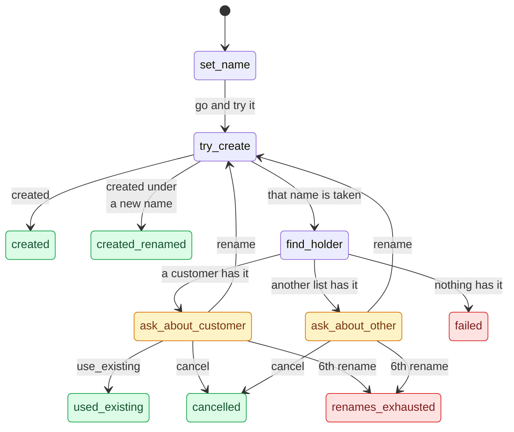
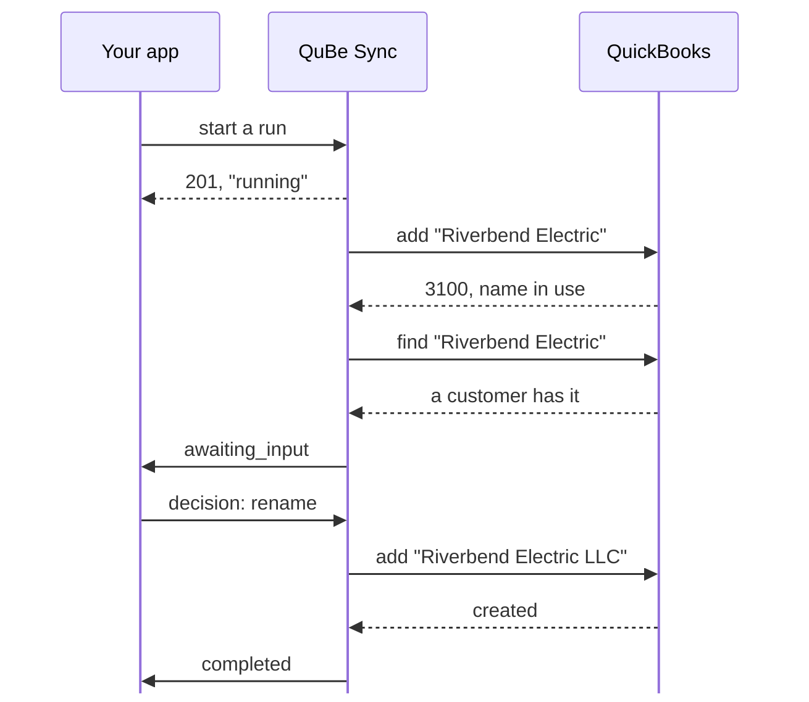
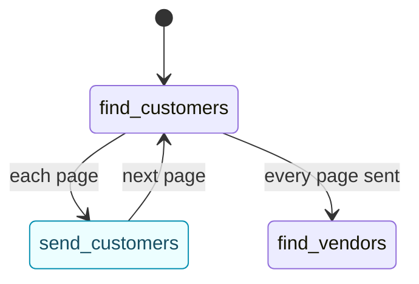

Real jobs rarely fit in one QuickBooks request. Invoicing an order from your store means making sure the
customer exists, handling the case where a vendor already has their name, making sure every item exists,
and only then adding the invoice. If the connection drops during any part of that process, you have to 
recover gracefully and reconcile what mutations were made or not. Without workflows, your app has to save its place after every step, pick it up again from
each webhook, and decide what comes next.

A **workflow** is that job written down once, as a JSON statechart (so your LLM of choice can use our [mcp](/mcp-server) to author your own). QuBe Sync runs it server-side: it sends
each request, branches on QuickBooks' answer, pauses to ask your app when the chart says a person should
decide, and sends you one webhook when the job is done.

|  | One request at a time | A workflow |
| --- | --- | --- |
| A job of five dependent steps | Five requests, five webhooks, your code in between | One run: a webhook for each question it asks, and one when it ends |
| Branching on QuickBooks' answer | Your code, spread across webhook handlers | In the chart |
| "Is this the same company?" | Your code tracks what's pending and asks | A `wait` state: QuBe Sync asks, your app answers |
| QuickBooks' answer never comes back | Your code queries to find out whether it was applied | The run [finds out](#lost-answers) and carries on |
| Someone changed the record you're updating | Your code re-reads it and retries | The run [asks your app](#conflicts), showing what changed |
| Where progress is saved | Your database | QuBe Sync, visible on the run's page |
| Changing the flow | Deploy your app | Publish a new version of the chart |

## What a workflow looks like

This is `create_customer_safely`, one of the shipped templates. It creates a customer, and if QuickBooks
says the name is taken, it finds out what has it and asks your app what to do:



`set_name` is a **transform**: it notes the name to try and starts a rename count, then moves on.
`try_create` and `find_holder` are **request** states: each sends one QuickBooks request and branches on
the answer. `find_holder` sends a single `entity.query`, which searches the four lists that share one name
space in QuickBooks (customers, vendors, employees and other names) and says in `type` which list each record
came from; "another list" is a vendor, an employee or an entry on the Other Names list. Any other QuickBooks
error, at either request, ends the run `failed`: the chart handles that once, at its root, so it isn't drawn
here.

`ask_about_customer` and `ask_about_other` (amber) are **wait** states: the run pauses until your app picks
one of the state's options. `ask_about_customer` offers `use_existing`, `rename` (with the new name) and
`cancel`. `ask_about_other` offers only `rename` and `cancel`, because a customer can't share a name with a
vendor. Options are choices your app makes, so they are verbs. `find_holder` and the two questions sit in a
group, `resolve_conflict`, so their full names, and the question ids your app sees, start with it:
`resolve_conflict.ask_about_customer`.

The green and red boxes are the chart's endings, named for what happened, and the run's `outcome` says which
one it reached. Four are successes: `created`, `created_renamed`, `used_existing` and `cancelled`. One is a
named failure, `renames_exhausted`. `failed` means something needs attention, such as a QuickBooks error the
chart doesn't handle. A rename goes back to `try_create`, so a second clash is handled exactly like the
first, and the create that follows ends `created_renamed`. The chart allows five renames. A sixth `rename`
answer isn't tried: the run ends `failed` with the outcome `renames_exhausted`.

In the dashboard, every workflow is drawn as a canvas like this one, each branch labelled with the
`description` the chart gives it:

<Frame caption="create_customer_safely in the builder, with its resolve_conflict group and the root's error branch drawn in.">
  
</Frame>

## Templates

Start from a shipped template rather than a blank chart. Each one is complete and tested, and a template
that calls other workflows installs those too (the template list's `installs` names them).

`find_or_create` and `resolve` work for any record type: you pass them the operations to send, such as
`{"operation": "customer.query", "params": {"full_name": ["Riverbend Electric"]}}`. `find_or_create_item`,
`resolve_entity` and `resolve_reference` are thin charts over them, ready-made for one kind of record.

| Template | What it does | Asks your app | Ends |
| --- | --- | --- | --- |
| `find_or_create` | Sends the `find` query you pass and, if it finds nothing, the `create` add. Any record type, vendors included. On a 3100 from the add, looks once more. | No | `found`, `created` |
| `resolve` | Finds a list record by its stored ListID (`id`), then by exact full name (`by_name`). If nothing has the name, sends your `create` add, or else offers what your `candidates` query finds. | `ask`: `use` (with `list_id`) or `cancel` | `found`, `picked`, `created`, `not_found`, `cancelled` |
| `create_customer_safely` | Creates a customer from `customer`, the body `POST /customers` takes. On a name clash, finds what has the name and asks. Allows five renames. | `ask_about_customer`: `use_existing`, `rename` (with `name`), `cancel`. `ask_about_other`: `rename`, `cancel` | `created`, `created_renamed`, `used_existing`, `cancelled`; fails as `renames_exhausted` |
| `find_or_create_customer` | Finds a customer by full name, or creates it from `customer`. `find_or_create`, written out for one type. | No | `found`, `created` |
| `find_or_create_item` | Finds an item by full name, whatever its type, or creates it from exactly one of `item` (any item add, as `{"operation": "item_other_charge.create", "params": {...}}`), `non_inventory` or `service`. Runs `find_or_create`. | No | `found`, `created` |
| `resolve_entity` | Finds a customer, vendor, employee or other name (`kind`) by its stored `list_id`, then by `name`, inactive ones included. Runs `resolve`. | When nothing has the name but near matches do (up to 20): `use` or `cancel` | `found`, `picked`, `not_found`, `cancelled` |
| `resolve_reference` | Turns a `name`, and optionally a stored `list_id`, into a reference to an account, class, terms, payment method, sales tax code or ship method (`kind`). Creates a missing class, payment method or ship method. Runs `resolve`. | When no account, terms or sales tax code has the name: `use` one of the first 50 active ones, or `cancel`. With none active, it ends `not_found` without asking | `found` (a pick included), `created`, `not_found`, `cancelled` |
| `send_lists_to_app` | An initial import: every customer, vendor and item, active or not, sent to your app 200 at a time as `customers_page`, `vendors_page` and `items_page` [notifications](#sending-your-app-data), then the counts. Needs a `webhook_url`. | No | `completed` |
| `sync_order` | Creates the `customer` with `create_customer_safely`, finds or creates each item add in `items` (optional, any item type), then adds the `invoice` exactly as sent, each line naming its item and carrying its own quantity, rate and the rest. If QuickBooks never answers the invoice add, looks for the invoice by the GUID the add carried before adding it again ([Lost answers](#doing-the-looking-in-the-chart)). | Through `create_customer_safely`. And `ask_about_invoice` when QuickBooks never answered the invoice add and looking couldn't settle whether it was added: `use_existing` (with `txn_id`), `create_again`, `cancel` | `completed`, `cancelled` |

A question's `prompt.id` is the path of the state that asks it, such as
`resolve_conflict.ask_about_customer`. When one workflow calls another, the calling state comes first:
`sync_order` relays `create_customer / resolve_conflict.ask_about_customer`, `resolve_entity` asks
`resolve / ask`, and `resolve_reference` asks `pick_when_missing / ask`. `resolve_reference`'s `kind` is
`account`, `class`, `standard_terms`, `payment_method`, `sales_tax_code` or `ship_method`.

Every template can also end `failed`, when something goes wrong that it doesn't handle. `error` says why,
usually in QuickBooks' own words.

<Accordion title="What each template returns in output" icon="box-open">
  | Template | `output` |
  | --- | --- |
  | `find_or_create` | `{outcome, record, ref: {list_id, full_name}}` |
  | `resolve`, `resolve_entity` | `{outcome, record, ref: {list_id, full_name}, is_active}` |
  | `resolve_reference` | `{outcome, ref}` |
  | `find_or_create_customer` | `{outcome, customer}` |
  | `find_or_create_item` | `{outcome, item}` |
  | `create_customer_safely` | `{outcome, customer: {list_id, full_name}}`. On `cancelled`, `{outcome, name_tried}`; on `renames_exhausted`, `null` |
  | `send_lists_to_app` | `{customers, vendors, items}`: how many of each were sent |
  | `sync_order` | `{customer, items, invoice}`. It has no `outcome` key: read the run's `outcome`. |
</Accordion>

In the dashboard, open **Workflows** and choose **From a template**. Pick the app on a template's card and
click **Clone**: it creates the workflow as a draft, installs the templates it calls as drafts too (any your
app doesn't have yet), and opens it in the builder.

<Frame caption="Workflows → From a template. Each card names the templates it also installs.">
  
</Frame>

## Run one

<Steps>
  <Step title="Install the template">
    ```bash
    curl -u "$QUBE_API_KEY:" -X POST \
      https://qubesync.com/api/v2/workflow_templates/create_customer_safely/install \
      -H "Content-Type: application/json" -d '{"publish": true}'
    ```

    That installs and publishes it, and any template it calls, in one go. A template cloned in the
    dashboard is a draft instead: publish it from the builder's **History** (the ones it calls first). A
    sandbox connection can run a draft; a production connection can't.
  </Step>
  <Step title="Start a run">
    The input is the same body `POST /customers` takes, so a workflow is a drop-in for the request it
    replaces:

    ```bash
    curl -u "$QUBE_API_KEY:" -X POST \
      "https://qubesync.com/api/v2/connections/$CONN_ID/workflow_runs" \
      -H "Content-Type: application/json" \
      -d '{
        "workflow": "create_customer_safely",
        "input": {"customer": {"name": "Riverbend Electric", "email": "billing@riverbend.example"}},
        "webhook_url": "https://your-app.example/webhooks/qube"
      }'
    ```

    You get `201` with the run. Store its `id` next to the record it's for. `webhook_url` is optional, but
    a run started without one sends no webhooks -- and a workflow that [sends your app data](#sending-your-app-data)
    can't start without one (`422 webhook_url_required`).
  </Step>
  <Step title="Answer its question">
    Riverbend Electric already exists, so the run stops at `ask_about_customer` and sends
    `workflow_run.awaiting_input`:

    ```json workflow_run.awaiting_input (abridged)
    {
      "event": "workflow_run.awaiting_input",
      "timestamp": 1790470628,
      "app_id": "98f339a4-32e8-424a-987e-ccaf5bcaa620",
      "sandbox": true,
      "connection_id": "4fdde583-68b1-4c6b-94d1-82abf97afdf5",
      "workflow": "create_customer_safely",
      "workflow_id": "01a0e05a-3c52-7a8e-b1f4-6d2e9c0a7b31",
      "run_id": "fb1951a1-25b9-4fb2-98c7-c988988ecdf7",
      "prompt": {
        "id": "resolve_conflict.ask_about_customer",
        "kind": "decision",
        "message": "A customer named \"Riverbend Electric\" already exists.",
        "data": {
          "existing": { "type": "customer", "list_id": "8000001F-1790470623", "full_name": "Riverbend Electric",
                        "company_name": "Riverbend Electric LLC", "phone": "512-555-0142" }
        },
        "options": [
          { "id": "use_existing", "label": "Use the existing customer" },
          { "id": "rename", "label": "Create it with a different name",
            "fields": { "name": { "type": "string", "required": true, "label": "New name" } } },
          { "id": "cancel", "label": "Cancel" }
        ]
      },
      "links": {
        "run": "https://qubesync.com/api/v2/connections/4fdde583-…/workflow_runs/fb1951a1-…",
        "decisions": "https://qubesync.com/api/v2/connections/4fdde583-…/workflow_runs/fb1951a1-…/decisions",
        "cancel": "https://qubesync.com/api/v2/connections/4fdde583-…/workflow_runs/fb1951a1-…/cancel",
        "ui": "https://qubesync.com/app/workflow_runs/fb1951a1-…"
      }
    }
    ```

    Show `prompt.message` and the options to your user, or decide in code. Then POST the choice, with any
    `fields` the option asks for, to `links.decisions`:

    ```bash
    curl -u "$QUBE_API_KEY:" -X POST "$DECISIONS_URL" \
      -H "Content-Type: application/json" \
      -d '{"option": "rename", "data": {"name": "Riverbend Electric LLC"}}'
    ```

    An option the question doesn't offer, or a missing field, is refused with `422`, and the run keeps
    waiting. A run can wait as long as it needs to. Your user can answer tomorrow.

    <Frame caption="The same question on the run's page (links.ui). Answering here is the same as POSTing to links.decisions.">
      
    </Frame>
  </Step>
  <Step title="Get the result">
    The run creates "Riverbend Electric LLC" and ends:

    ```json workflow_run.completed (abridged)
    {
      "event": "workflow_run.completed",
      "run_id": "fb1951a1-25b9-4fb2-98c7-c988988ecdf7",
      "workflow": "create_customer_safely",
      "outcome": "created_renamed",
      "output": {
        "customer": { "list_id": "80000025-1790470630", "full_name": "Riverbend Electric LLC" },
        "outcome": "created_renamed"
      },
      "error": null,
      "summary": {
        "ended_at": "2026-09-27T00:57:14.482113Z",
        "stopped_at": "try_create",
        "requests": [
          { "state": "try_create", "workflow": "create_customer_safely", "operation": "customer.create", "status": "error" },
          { "state": "resolve_conflict.find_holder", "workflow": "create_customer_safely", "operation": "entity.query", "status": "success" },
          { "state": "try_create", "workflow": "create_customer_safely", "operation": "customer.create", "status": "success",
            "identifiers": { "list_id": "80000025-1790470630", "full_name": "Riverbend Electric LLC" } }
        ],
        "side_effects": [
          { "state": "try_create", "workflow": "create_customer_safely", "operation": "customer.create",
            "identifiers": { "list_id": "80000025-1790470630", "full_name": "Riverbend Electric LLC" } }
        ],
        "decisions": [
          { "state": "resolve_conflict.ask_about_customer", "workflow": "create_customer_safely",
            "option": "rename", "at": "2026-09-27T00:57:10.418204Z" }
        ],
        "discarded": [],
        "calls": []
      }
    }
    ```

    Store `output.customer.list_id` against your record, and you're done. Every `summary` entry names the
    `workflow` whose state it was, which tells a called workflow's step from the run's own.
  </Step>
</Steps>



## Follow your runs

Every run has a page in the dashboard, at its `links.ui`. **Workflow runs** in the dashboard's menu lists
them all, newest first. Filter by workflow, connection, state (`running` includes a run waiting on a
workflow it called, as the API reports it), outcome (the exact key, such as `created`) and the day it
started. Runs a workflow starts for another are left out unless you tick **Include child runs**.
Each connection's page lists that connection's runs too.

<Frame caption="Workflow runs: every run in your organization, with where each one is waiting and how it ended.">
  
</Frame>

A run's page shows:

- **Waiting for a decision**, while it waits: the question, with a button for each option and a box for
  each field it asks for. Answering here is the same as your app answering. A conflict adds a table of each
  field as you sent it, as QuickBooks has it, and as the run read it.
- **Cancel run**, while it's going, with an optional reason. **Open the workflow** opens the chart in the
  builder.
- **Summary**, once it has ended: what it changed in QuickBooks, every request it sent, every decision, what
  was withdrawn before it was sent, and the workflows it called.
- **The chart this run is executing**: a snapshot taken when the run started, with the states it went
  through shaded and the transitions it took drawn in the same blue. Click a step to see only what
  happened there.
- **Requests**, per state, each linked to its queued request, and **Context**: the run's input, vars,
  per-state responses and output.
- A dock with **Context**, the run's context as of any event you pick, and **Events**, its whole log, which
  you can filter, copy and **Download**.

<Frame caption="A finished sync_order run: what it changed in QuickBooks, every request, and the workflows it called.">
  
</Frame>

From your app, `GET /connections/{id}/workflow_runs?state=awaiting_input` lists the runs waiting on your
users. [The API at a glance](#the-api-at-a-glance) has the rest.

## Webhooks

A run reports to the `webhook_url` it was started with, signed like every other QuBe Sync webhook
([verify it](/webhooks#verify-the-signature)):

| Event | When |
| --- | --- |
| `workflow_run.awaiting_input` | The run needs a decision. It carries the question in `prompt`. |
| `workflow_run.notification` | A `notify` state [sends your app data](#sending-your-app-data). The run waits for your `2xx`. |
| `workflow_run.completed` | The run ended as designed: `completed`, or a success outcome the chart declares. |
| `workflow_run.failed` | Something needs attention: a QuickBooks error the chart doesn't handle, a named failure such as `renames_exhausted`, or a limit reached. |
| `workflow_run.cancelled` | Somebody stopped it: your app with `POST links.cancel`, or a person on the run's page. |

Every event has `event`, `timestamp`, `app_id`, `sandbox`, `connection_id`, `workflow` (the key),
`workflow_id` (`null` once the workflow is deleted), `run_id` and `links` (`run`, `decisions`, `cancel`,
`ui`). All three endings carry `outcome`, `output`, `error` and `summary`, and `workflow_run.cancelled` adds
`cancel_reason`. `GET links.run` returns the whole run, including its input, vars and trace; in that JSON the
same link is `links.self`.

A failed delivery is retried with backoff, up to 5 attempts (a notification: 10, over about an hour), and
each attempt is in the run's event log as `webhook_sent`. When a run's deliveries fail for good, your organization's owners get an email, as they do for
a request's webhook. There's still no **Resend** for a run, so if your endpoint was down, read the run with
`GET links.run`. Deliveries can repeat and arrive out of order. A run ends only once,
so key endings on `run_id`. Each delivery is built when it's sent, from the run as it is then: a retried
`workflow_run.awaiting_input` that arrives after the question was answered has no `prompt`.

The QuickBooks requests a run sends are ordinary queued requests, visible in the dashboard, but they
**don't** send webhooks of their own. The run's events are the whole story.

### Two kinds of question

`workflow_run.awaiting_input` carries the question in `prompt`, and `prompt.kind` says who is asking.
`decision` is a question the chart asks in a `wait` state, with options the chart declares. `conflict` is
one the run asks by itself, when an update meets a record someone else changed after it was read
([Conflicts](#conflicts)). Its options are always `overwrite` and `keep`. Both are answered at
`links.decisions`.

<CodeGroup>
```json kind: decision (abridged)
{
  "id": "resolve_conflict.ask_about_customer",
  "kind": "decision",
  "message": "A customer named \"Riverbend Electric\" already exists.",
  "data": {
    "existing": { "type": "customer", "list_id": "8000001F-1790470623", "full_name": "Riverbend Electric", "phone": "512-555-0142" }
  },
  "options": [
    { "id": "use_existing", "label": "Use the existing customer" },
    { "id": "rename", "label": "Create it with a different name",
      "fields": { "name": { "type": "string", "required": true, "label": "New name" } } },
    { "id": "cancel", "label": "Cancel" }
  ]
}
```

```json kind: conflict (abridged)
{
  "id": "conflict:update_contact",
  "kind": "conflict",
  "state": "update_contact",
  "message": "customer \"Riverbend Electric\" changed in QuickBooks after it was read; 1 of the 2 fields you are updating differs.",
  "data": {
    "operation": "customer.update",
    "sent": { "phone": "512-555-0100", "email": "billing@riverbend.example" },
    "current": { "list_id": "8000001F-1790470623", "edit_sequence": "1790470711", "full_name": "Riverbend Electric",
                 "phone": "512-555-0199", "email": "ap@riverbend.example", "last_name": "Okafor-Reyes" },
    "as_read": { "list_id": "8000001F-1790470623", "edit_sequence": "1790470623", "full_name": "Riverbend Electric",
                 "phone": "512-555-0142", "email": "ap@riverbend.example", "last_name": "Okafor" },
    "conflicts": [
      { "field": "phone", "sent": "512-555-0100", "current": "512-555-0199", "as_read": "512-555-0142" }
    ],
    "theirs": [
      { "field": "last_name", "as_read": "Okafor", "current": "Okafor-Reyes" }
    ],
    "position": 0
  },
  "options": [
    { "id": "overwrite", "label": "Apply my changes anyway",
      "fields": { "params": { "type": "object", "required": false, "label": "Different fields to send instead" } } },
    { "id": "keep", "label": "Keep what QuickBooks has" }
  ]
}
```
</CodeGroup>

In the decision, `data.existing` is the record `find_holder` found, and its `type` says which list it's on.
In the conflict, the run was changing Riverbend Electric's phone and email. Since it read the record, someone
in QuickBooks changed the phone too, and the last name. The email isn't in `conflicts`, because nobody else
touched it. The last name is in `theirs`, because the update doesn't send it.

## Sending your app data

A run can hand your app data while it goes, not only at the end: a **`notify` state** ("Send to the app" in
the builder's palette) renders its `data` and sends it as a `workflow_run.notification` to the run's
`webhook_url`. Its `name` is what your app routes on. The usual use is a whole list, a page at a time --
this is `send_lists_to_app`'s first list:



```json
"find_customers": {
  "type": "request", "operation": "customer.query",
  "params": {"active_status": "All"}, "paginate": true, "page_size": 200,
  "on": {
    "page": [{"target": "send_customers", "description": "send this page"}],
    "success": [{"target": "find_vendors", "assign": {"customers": "${response.count}"}}]
  }
},
"send_customers": {
  "type": "notify", "name": "customers_page",
  "data": {"page": "${response.page}", "more": "${response.more}", "customers": "${response.data}"},
  "on": {"success": [{"target": "find_customers", "description": "next page"}]}
}
```

In `data`, `response` is the response that brought the run to the state -- on a paginating query's `page`,
that page -- so `${response.data}` is the page's records. Your app receives `customers_page` with `seq` 1,
2, 3…, then the vendors, then the items, then `workflow_run.completed` with the counts.

- **The run waits for your `2xx`** before it goes on: notifications come one at a time, in order, and all of
  them before the run ends. QuickBooks isn't held up: the pages keep being fetched while your app takes them.
- **Delivery is at least once.** A failed delivery is retried for about an hour with the same `delivery_id`;
  deduplicate on it. If none succeeds, the state raises `error` with `response.error.type` `not_delivered`,
  which the chart can handle (go to a `wait` that asks whether to retry, say); otherwise the run fails.
- **At most 4 MB** each, once filled in. Bigger is never sent: `error` `too_large`. Send fewer records at a
  time with a smaller `page_size`.
- **Only to the run's `webhook_url`.** A chart can't name a URL of its own, and a workflow with a `notify`
  state -- or one that calls such a workflow -- refuses to start without a `webhook_url`.
- A run caps at 500 transitions, and a page costs two (to the notify state and back), so one run sends at
  most about 250 pages: 50,000 records at 200 a page.

[Webhooks](/webhooks#data-a-workflow-sends-you) has the payload, and
[Pagination](/pagination#initial-import) says when to use a workflow for an import and when the plain
paginated API.

## How a run ends

| `state` | `outcome` | `output` | `error` |
| --- | --- | --- | --- |
| `completed` | `completed`, or a success outcome the chart declares: `created`, `used_existing`, `cancelled`... | The chart's `output`, or the outcome's own | `null` |
| `failed` | `failed`, or a named failure the chart declares, such as `renames_exhausted` | `null`, unless the named failure declares an `output` | What went wrong, in words |
| `cancelled` | `null` | `null` | `null`; your reason is in `cancel_reason` |

- **`completed`** means the job went as designed. `outcome` says which way, so branch on it. A chart's own
  `cancelled` ending, when your app chose "Cancel", is a completed run: nothing is wrong.
- **`failed`** means something needs attention: a QuickBooks error the chart doesn't handle, a mistake in
  the chart, or a limit reached. A chart can declare named failures, so your app can tell them apart by
  `outcome`. `create_customer_safely` ends `renames_exhausted` with the error `Five renames were tried and
  every name was taken; the last was "<name>".`
- **`cancelled`**: someone stopped the run with `POST links.cancel` or **Cancel run**. An optional
  `{"reason": "..."}` is kept as `cancel_reason`, trimmed and cut to 500 characters. The workflows the run
  calls stop with it. Requests not yet handed to the Web Connector are withdrawn (`summary.discarded`); one
  already sent may still complete (`"status": "in_flight"` in `summary.requests`). Cancelling never undoes
  what was applied: `summary.side_effects` lists it, so you can check or reverse it. Cancelling a run that
  has ended is `409 already_finished`.

When one workflow calls another, the caller hears a success outcome as `success` and a failure as `error`,
with `response.outcome` naming it either way ([Calling other workflows](/workflow-authoring#calling-other-workflows)).

A request whose answer was lost doesn't change how a run ends. The run [settles it](#lost-answers) and the
state carries on as if the answer had arrived, with `response.settled` telling the chart how (`found`,
`resent`...). A lost answer fails the run only when it can't be settled and the chart doesn't handle that.

## Lost answers

Now and then QuickBooks gets a request and its answer never comes back: the Web Connector session times out,
or the connector reports an error instead of the answer. On its own, such a request ends `timed_out` (or
`error`), and QuickBooks may or may not have applied it ([Error handling](/error_handling#other-endings)).
A workflow doesn't leave that to you. Before the chart hears anything, the run **settles** the request: it
finds out whether QuickBooks applied it and carries on as if the answer had arrived.

| What was sent | How the run settles it |
| --- | --- |
| A query | Sends it again. |
| A list add: a customer, vendor, item, class... | Looks for a record with the full name it sent, under its parent if it had one. None there, it sends the add again. |
| A transaction add: an invoice, bill, check... | Looks for it by its reference number, or else by its customer or vendor and its date, at most 50, and matches the `external_guid` the run put on it. None matches, it sends the add again, unless all 50 came back: then it may be past them, and the run can't tell (below). |
| An update | Reads the record back. If it already has the fields sent, the update was applied. If nobody has touched it, the update is sent again. If someone else changed it, it's a [conflict](#conflicts). |
| A delete | Looks the record up by its id. If it's gone, the delete was applied; if not, it's sent again. |

Every add a workflow sends that has an `external_guid` field carries one: yours if you set it, otherwise one
the run generates. That's nearly every transaction, plus customers, vendors, employees, other names and
items. QuickBooks stores it on the record, which is how the run tells its own invoice from another one for
the same customer on the same day.

The state then raises what the answer would have raised, usually `success`, and `response.settled` says how
the run got it. A first-time answer has no `settled`.

| `response.settled` | What happened |
| --- | --- |
| `found` | The add had been applied. `response.data` is the record the run found. |
| `already_deleted` | The delete had been applied. `response.data` is only the id and its delete type. |
| `already_current` | The record already had every field the update sends. |
| `resent` | It hadn't been applied, or it was a query, so the run sent it again. This is that answer. |
| `reapplied` | An update sent again with the current edit sequence, because what someone else changed doesn't overlap with it ([Conflicts](#conflicts)). |
| `overwritten` | An update sent again over someone else's change, because your app or the chart said to. |
| `kept` | Your app chose to keep QuickBooks' version of a changed record. `response.data` is that record. |

Two endings are left for the chart to handle, both as `error` with `code` `null`:

- **`response.error.type` is `unsettled`**: the run can't tell. Usually it found records that might be the
  one it sent and nothing to tell them apart, as with a transaction type that has no `external_guid`, and
  `response.error.candidates` lists them. It's also `unsettled` when the check itself can't be trusted: the
  record an update was for no longer exists, a list add's parent is gone, the check came back full with none
  carrying the GUID sent (so there may be more), or QuickBooks answered the check with an error. Then
  `candidates` may be empty.
  `response.error.message` says which. Unhandled, `unsettled` fails the run with that message.
- **`response.error.type` is `no_response`**: QuickBooks didn't answer the checks and re-sends either. The
  run sends at most five more requests for one that was lost, re-sending it at most twice, then gives up.

<Accordion title="The two errors, exactly" icon="code">
  ```json unsettled
  { "status": "error",
    "error": { "code": null, "type": "unsettled",
               "message": "QuickBooks never answered transfer.create, and 2 candidates match what was sent, and it carried no GUID to tell them apart",
               "candidates": [ { "txn_id": "1B-1790470702", "txn_date": "2026-09-28", "amount": 250.0, "...": "..." },
                               { "txn_id": "1C-1790470744", "txn_date": "2026-09-28", "amount": 250.0, "...": "..." } ] } }
  ```

  ```json no_response
  { "status": "error",
    "error": { "code": null, "type": "no_response", "reason": "timed_out",
               "external_guid": "{3B6E1F0A-52C4-4D8B-9E21-7A0C5D93F4B2}",
               "message": "QuickBooks never answered: the Web Connector session ended before it did; 2 re-sends and 3 checks did not settle it" } }
  ```

  An `unsettled` message is always `QuickBooks never answered <operation>, and <why>`. A `no_response`
  message starts `QuickBooks never answered: ` and says why: the session ended, the request was withdrawn
  before it was sent, the Web Connector reported an error, or the request ended in some other state.
  `reason` says the same as a word to branch on, and an add's `external_guid` is the GUID it was sent with:

  | `reason` | What happened | Could QuickBooks have it? |
  | --- | --- | --- |
  | `timed_out` | Sent, and the Web Connector session ended before the answer came back. | Yes |
  | `connector_error` | The Web Connector reported an error instead of QuickBooks' answer. | It can't be told |
  | `rejected` | QuickBooks couldn't read the request (`xml_error`). | No |
  | `withdrawn` | Your app withdrew it before the Web Connector took it. | No |
  | `page_expired` | A later page of a paginated query, whose session ended before it was fetched. | No, it's a query |
</Accordion>

Some requests aren't settled, and raise `no_response` straight away: one your app withdrew, one QuickBooks
couldn't parse (`xml_error`), a paginated query, and an operation with nothing to look for afterwards, such
as a void or a merge. A request state with `"settle": false` isn't settled either.

The request itself keeps its own ending (`timed_out`, say) in the dashboard. The run's event log has a
`settling` event for each check and re-send and a `settled` or `unsettled` one at the end. `summary.requests`
lists the checks and re-sends, each with a `role`: `settle`, `resend`, `reapply`, `overwrite`, or `prepare`
for the read before an update. The original request's entry says how it was `settled`. Your app has nothing
to do. To watch it happen, arm a lost answer before a run sends an add: on the connection's page, set
**Next request** to "applied, then the Web Connector dies before answering", run
`qube simulator faults <connection> --next lost`, or set the simulator's
[`next_lost_response`](/simulator#make-it-fail) fault through the API.

### Doing the looking in the chart

`"settle": false` hands a lost answer to the chart at once, as `no_response`. That's how to make the looking
part of the chart, where the diagram and the run's log show it. `sync_order` does it for its invoice:

- A QuickBooks error answer to the add means QuickBooks added nothing, so the run fails with QuickBooks'
  message and nothing is looked up. So does a `no_response` whose `reason` is `withdrawn` or `rejected`:
  the request never reached the company file.
- Any other `no_response` means the invoice may be there. The chart keeps `response.error.external_guid`
  and looks: by the invoice's `ref_number` when it has one, otherwise among the customer's invoices (on its
  `txn_date`, when it has one), at most 200, without their lines.
- `$find` picks out the invoice whose `external_guid` is that GUID. QuickBooks returns it exactly as it was
  sent, braces and upper case, so an `external_guid` you send yourself should be written that way too.
  Found, the invoice is read again with its lines, and the run completes with it.
- None carries it and the answer was whole (by number, or fewer than 200 came back): the add was not
  applied, so it's sent again, once. Otherwise (200 came back without it, the add went unanswered twice,
  or the lookup itself got no answer), the run asks your app with `ask_about_invoice`, showing what it
  found.

## Conflicts

QuickBooks refuses an update when the record changed after it was read: error 3200, a stale `edit_sequence`.
Retrying with the fresh edit sequence would quietly overwrite whatever the other person changed. A workflow
looks first. The run reads the record again and compares each field the update sends with the record as it
is now and, when the run read it itself, as it was then:

- The record already has what the update sends: nothing to do. The state raises `success` with
  `response.settled` set to `already_current`.
- The other person changed only fields the update doesn't send: the run sends the update again with the
  current edit sequence, without asking (`reapplied`). It can only tell this when it read the record itself.
- They changed a field the update sends: the run pauses and asks your app, unless the state's
  `on_conflict` (below) says otherwise.

The run goes `awaiting_input` and sends `workflow_run.awaiting_input`, just as a `wait` state does, with a
prompt of `kind` `conflict`. There's an example under [Webhooks](#two-kinds-of-question). None of the
shipped templates sends an update, so you'll meet this in a chart of your own.

| Prompt field | What it holds |
| --- | --- |
| `id` | `conflict:<state>`, or `<calling state> / conflict:<state>` when a workflow this one calls asked (`prompt.from` then names it). |
| `state` | The request state that sent the update, in the workflow that asked. |
| `data.operation` | The update, such as `customer.update`. |
| `data.sent` | The fields it sends, without its id and edit sequence. |
| `data.current` | The record as QuickBooks has it now, with its edit sequence. |
| `data.as_read` | The record as the run read it, or `null` when the chart passed its own `edit_sequence`. |
| `data.conflicts` | One row per field being updated that someone else changed too: `field`, `sent`, `current`, `as_read`. |
| `data.theirs` | What they changed that the update doesn't send: `field`, `as_read`, `current`. Empty when `as_read` is `null`. |
| `data.position` | Which of the state's requests it was, counting from 0. Always 0 unless the state sends several. |

Answer at `links.decisions`, like any question:

```bash
# Send my fields anyway, with the current edit sequence
curl -u "$QUBE_API_KEY:" -X POST "$DECISIONS_URL" -H "Content-Type: application/json" \
  -d '{"option": "overwrite"}'

# Send these fields instead: a merge worked out from the diff
curl -u "$QUBE_API_KEY:" -X POST "$DECISIONS_URL" -H "Content-Type: application/json" \
  -d '{"option": "overwrite", "data": {"params": {"phone": "512-555-0199", "email": "billing@riverbend.example"}}}'

# Leave QuickBooks as it is
curl -u "$QUBE_API_KEY:" -X POST "$DECISIONS_URL" -H "Content-Type: application/json" \
  -d '{"option": "keep"}'
```

After `overwrite`, the state raises whatever QuickBooks answers, with `response.settled` set to
`overwritten`. The fields in `params` replace the ones the update sent; the run adds the record's id and
current edit sequence. `params` must be an object of fields the update takes, like `data.sent`. One it
doesn't take is refused with `422` (`invalid_data`, naming the field), and the run keeps waiting. If the
record changes yet again first, the run asks again, and after three writes the 3200 stands as the state's
error. After `keep`, the state raises `success` with the record as QuickBooks has it and
`response.settled` set to `kept`, so a chart that only needed the record to be there carries on. To refuse
both, cancel the run.

A conflict answer isn't a step of the chart, so it isn't in `summary.decisions`. It's in the run's event log,
as a `decision_received` event whose payload has `"kind": "conflict"`.

A request state's `on_conflict` decides what happens when the fields overlap:

| `on_conflict` | What happens |
| --- | --- |
| `ask` (default) | The run asks your app, as above. |
| `overwrite` | The run sends the update again with the current edit sequence, without asking. For a chart that owns the record, such as a nightly sync. |
| `fail` | The state raises `error` with code 3200, type `stale_edit_sequence`, and the diff (`sent`, `current`, `as_read`, `conflicts`, `theirs`) under `response.error.conflict`, for the chart to handle. |

**Leave `edit_sequence` out.** An update in a workflow doesn't need one: the run reads the record first and
fills it in. That read is the `as_read` the diff is judged against, and it's what lets the run tell their
changes from yours. Pass your own `edit_sequence` and there's no baseline, so every field that differs from
QuickBooks counts as a conflict. If the read finds the record gone, the state raises `error` 3120
(`object_not_found`), "nothing to update: the record no longer exists".

## The API at a glance

All under `https://qubesync.com/api/v2/connections/{connection_id}`, with your app's API key. The
[API reference](/api-reference/v2/workflows/start-a-workflow-run) has every field.

| Call | What it does |
| --- | --- |
| `POST /workflow_runs` | Starts a run: `workflow` (the key), `input`, optional `webhook_url`. On a sandbox or simulated connection, `version` picks the chart ([versions](/workflow-authoring#versions-and-publishing)). `201` with the run. Input the workflow doesn't accept is `422`, with the path of each problem, before anything is queued. |
| `GET /workflow_runs/{run_id}` | The whole run: `state`, `current_state`, `outcome`, `input`, `vars`, `prompt`, `output`, `error`, `summary`, `cancel_reason`, `trace` and `links`. |
| `GET /workflow_runs` | The 100 most recent runs your app started on the connection, newest first. `?state=` and `?outcome=` (the exact key) filter them. |
| `POST /workflow_runs/{run_id}/decisions` | Answers the question: `option`, plus `data` with the option's fields. `422` for an option it doesn't offer, a missing field, or a conflict's `params` with a field the update doesn't take (`invalid_data`). `400 not_awaiting_input` when the run isn't waiting, which is safe to ignore on a repeat delivery. |
| `POST /workflow_runs/{run_id}/cancel` | Stops the run, with an optional `reason`. `409 already_finished` once it has ended. |
| `GET /workflow_runs/{run_id}/events` | The event log, oldest first, the workflows it calls included. Page with `?after=` (the previous page's `next_after`, or the last `seq` you have) and `?limit=` (up to 500, default 100). |
| `DELETE /workflow_runs/{run_id}` | Deletes a finished run before retention does. `409 run_not_finished` while it's running or waiting. |

A workflow your run calls has no run id of its own as far as your app is concerned: everything it does is
part of the run you started.

## Good to know

- **Starting a run twice runs it twice.** There's no idempotency key. Key runs by your own record (one run
  per order, say) and check before starting another.
- **Workflows can call workflows.** A `workflow` state runs another workflow as one step, optionally once
  per item in a list (`each`). Your app still deals with one run. The called workflow's requests, decisions
  and calls are in that run's `summary` and event log, and its questions arrive on that run: `prompt.id` is
  prefixed with the calling state (`create_customer / resolve_conflict.ask_about_customer`), and
  `prompt.from` names the `workflow` and `state` that asked, plus `item_index` and `item_count` when it runs
  once per item. Answer at the run's own `links.decisions`.
- **Production runs the published version.** On a production connection, a run always uses the workflow's
  published version. Sandbox and simulated connections run your latest edits by default, so you can test
  before publishing. The workflows a run calls follow suit: their working copies for a working-copy run,
  their published versions for a published one. See [Build your own](/workflow-authoring#versions-and-publishing).

| Limit | Value |
| --- | --- |
| Transitions per run | 500 |
| `always` transitions in a row | 50 |
| Items in one `each` | 200, run one at a time, in order |
| One notification's `data` | 4 MB |
| Delivering a notification | 10 attempts over about an hour |
| Workflows calling workflows | 8 deep |
| Settling one lost answer | 5 more requests, at most 2 of them re-sends |
| Writes after a conflict | 3 |
| Cancel reason | 500 characters |
| Finished runs kept | 60 days (per-state details are trimmed after 7). Runs waiting on an answer are never removed. |
| Runs listed per request | the 100 most recent |
| Events per page | 500 (default 100) |

## Next

<CardGroup cols={2}>
  <Card title="Build your own workflow" icon="pen-ruler" href="/workflow-authoring">
    Chart anatomy, the builder, writing charts with an AI assistant, versions, and promoting to production.
  </Card>
  <Card title="API reference: Workflows" icon="book" href="/api-reference/v2/workflows/start-a-workflow-run">
    Every workflow, template and run endpoint.
  </Card>
</CardGroup>
